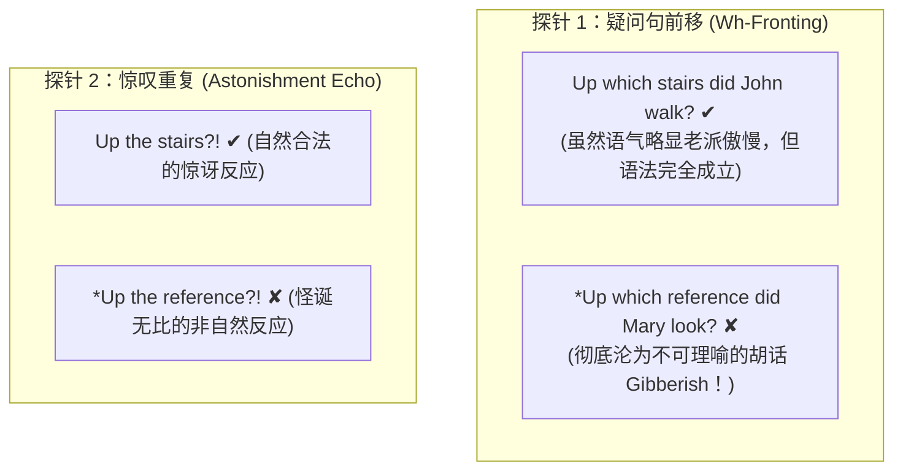
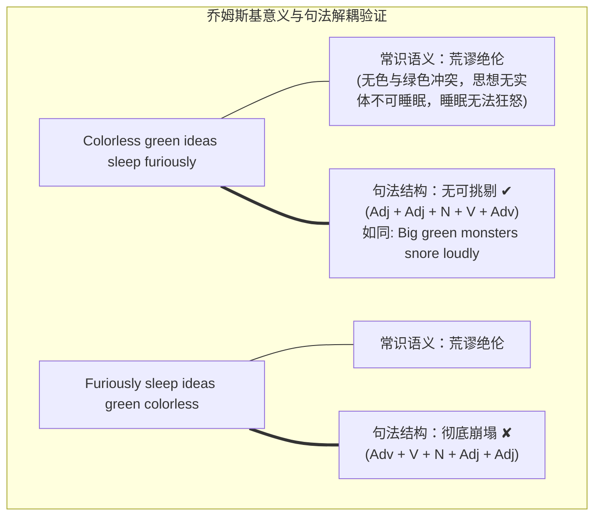
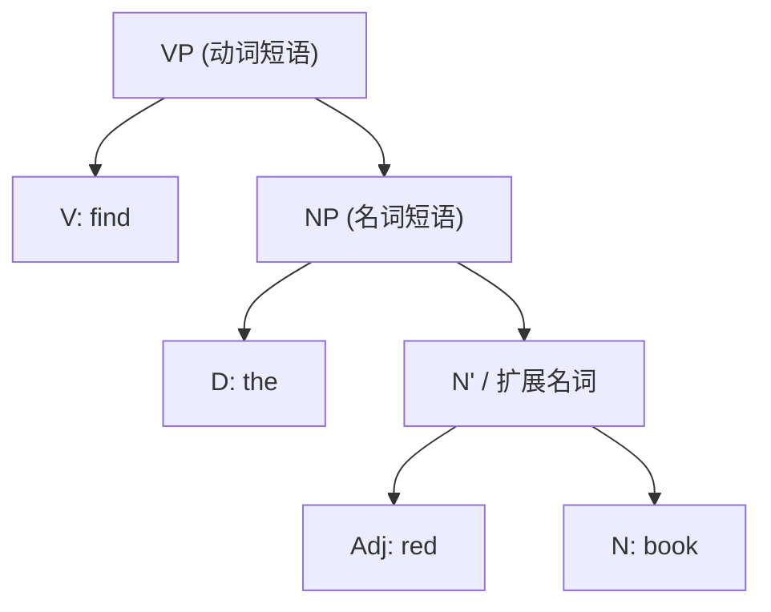
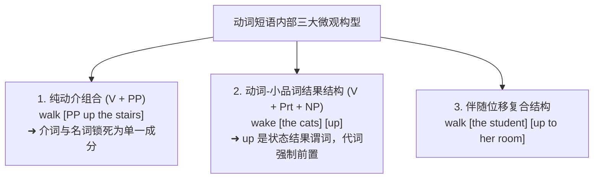

# Lec 11 句法学 I：句子成分与短语结构

**开场白**

大家还记得形态学吗？当我们探讨形态学时，我们曾讨论过像 **unlockable** 这样的单词是具有双重歧义的：

- 它可以表示“**可以被开锁的**”（It is possible to unlock it）；
- 它也可以表示“**无法上锁的**”（It is not possible to lock it）。

也就是说，它既可以描述一把锁令人满意的优良属性，也可以描述一把坏掉的锁的恼人属性。

我个人在说这两种意思时，甚至会有不同的语音习惯：如果我说“门是好的，它是 *unlockable*”，意思是它能被打开；但如果门坏了，我会倾向于在否定前缀 *un-* 上加重语气，给它一个额外的副重音节拍。

我们当时对此给出的解释是：

1. 后缀 **-able** 与动词结合，产出形容词（如 *singable*“可唱的”，*understandable*“可理解的”）；
2. 英语中存在**两个截然不同的前缀 *un-***：
   - **前缀 $un_1$​**：与动词结合生成新动词，表示“逆转、消除动作的效果”（Reversitive），如 *untie*（解开）、*undo*（撤销）；
     - 你绝不能说 *unwash socks* 来表示“把袜子再弄脏”
   - **前缀 $un_2$​**：与形容词结合生成新形容词，表示“非、不”（Not），如 *unkind*（不友善）、*unfamiliar*（不熟悉）、*unfortunate*（不幸的）。

现在，我们将这套成对组装的逻辑从词汇内部推演到全句——这就是**句法学（Syntax）**。句法学研究的是**单词（以及比词更小的语素）如何组装成句子**。

## 引例

思考我们在第一节课见过的经典对比：

```
【看似相同的词性序列，截然不同的内部组织】
Sentence A: John  walked  up  the  stairs.   (约翰走上了楼梯)
            [N]    [V]    [P] [D]   [N]
Sentence B: Mary  looked  up  the  reference. (玛丽查阅了参考资料)
            [N]    [V]    [P] [D]   [N]
```

如果只看表面，两句话都是完全一样的五个词：名词 - 动词 - 介词 - 限定词 - 名词。  但是，说它们“由五个词组成”虽然属实，却是一个极度贫乏、不完整的描述！

在句子 A 中，存在一个由成对合并产生的独立子串——**up the stairs（上楼梯）**，在句法学中，我们称之为**句法成分（Constituent）**。但在句子 B 中，根本不存在一个叫做 `up the reference` 的成分！

我们可以通过严格的句法探针来验证这一结构鸿沟：



这是大家在这门课上第一次见识到：**句法学家必须对一句话“虽然古怪但完全合语法”与另一句话“彻头彻尾的胡话（Gibberish）”之间的毫厘之差保持极度敏锐的热情！** 许多伟大的句法理论正是奠基在这些微小而决定性的差异之上的。

我们要建立的句法理论，必须把人类可能遇到的句子划分为三大阵营：

1. 你在生活中听过无数次的句子（如 "We're going to class."）；
2. 你在人类历史上大概率从未听任何人说过、但听到的瞬间就能确凿认定完全符合语法的句子。 如 "My anteater is hula dancing."【我的食蚁兽正在跳草裙舞】
3. 类别 3：被句法学打上黑星号的非法句子（如 *"We're class going to."）。

## 句法合法性独立于语义

诺姆·乔姆斯基（Noam Chomsky）在 1957 年的奠基之作《句法结构》中给出了英语语言学史上最著名的极小对立体：

$$\text{Sentence 1: “Colorless green ideas sleep furiously. 无色的绿色想法正在狂暴地沉睡”} \quad (\text{合语法 ✔，无意义})$$ 
$$\text{Sentence 2: *\“Furiously sleep ideas green colorless.”} \quad (\text{非语法 ✘，无意义})$$



两句话在常识逻辑上都是纯粹的无稽之谈。但面对第一句，任何一个英语母语者都会认定它在结构上是一句标准的英语；而第二句则是一堆散落一地的零件碎片。

两句话在常识逻辑上都是纯粹的无稽之谈。但面对第一句，任何一个英语母语者都会认定它在结构上是一句标准的英语；而第二句则是一堆散落一地的零件碎片。

反过来，**许多句子意义清晰明了，但在句法上却绝对非法**：

- *I put the sweater on.* ✔
- *I put on the sweater.* ✔
- *I put it on.* ✔
- *\*I put on it.* ✘（语义昭然若揭，但现代英语代词与小品词的句法规则坚决判它死刑！）
- 这决定性地表明：**句法学可以并且必须作为一门独立于语义学的形式系统来单独研究。**

那么，`*We're class going to` 的问题是因为它“以介词结尾”吗？在拉丁语以及几乎所有罗曼语族语言（法语、意大利语、西班牙语）中，你在物理生理上就根本无法把介词留在句尾。然而，在公元 15、16 世纪，英国有一群文人学者突然觉得：如果英语能长得更像高贵的拉丁语，那英语该显得多么高雅啊！于是他们凭空生造了这条禁令。

事实是：**全世界绝大多数语言都做不到介词悬空（Preposition Stranding），英语能够把介词留在句末，是一项极其罕见、极其精妙的句法特权！我们理应把悬空介词印在国旗上引以为傲！**

- **规定性语法**：学校老师教给你的“应当如何说话”的社会规范（有些规范有助于消除歧义，但很多纯属拉丁化学究的臆想）；
- **描述性语法**：我们在这门课唯一关心的科学目标——**探究人类大脑底层的心智语法实际上是如何运作的**。

更微妙的是母语者的真实语感差异：

- *Who are you talking to?*（最自然） vs *To whom are you talking?*（虽然做作但合语法）；
- 但对比：*What are you talking about?*（完美自然） vs *\*About what are you talking?*（在现代英语中听起来极其别扭甚至不成立！）；
- *What did you leave despite?* vs *Despite what did you leave?*（两句都让人极其难受，母语者会竭尽全力避免这两种说法）。

## 句法成分四大测试法

现在我们正式动手构建句法树。目标句子：  
$$\text{“I will find the red book.”}$$

我们如何严格证明 `the red book` 是一个独立的结构单元（成分），而 `find the red` 绝不是成分？

1. 话题化 / 句首前移（Topicalization / Fronting）
      - The red book, I will find. ✔ （对比: The blue book, I will leave where it is.）
      - *Find the red, I will book. ✘ （彻底崩溃！）
2. 并列连接测试（Coordination with 'and'）
      - I will find [the red book] and [the blue pencils]. ✔
      - *I will [find the red] and [leave the blue] book. ✘
3. 独立答语 / 惊叹测试 （Fragment Answer / Astonishment Echo）
      - "What will you find?" — "The red book." ✔
      - "I will find the red book!" — "The red book?!" ✔
      - "What will you find?" — *"Find the red." ✘
      - "I will find the red book!" — *"Find the red?!" ✘
4. 分裂句测试 （Clefting）
     - What I will find is [the red book]. ✔
      - *What I will book is [find the red]. ✘

## 句法成分划分——merge

在生成语法中，我们使用最基础的二元操作——**合并（Merge）**，自底向上两两成对结合而成的宏大层级结构




请仔细观察这棵树的拓扑几何特性：

- 树上存在一个清晰的红色圈出的节点，它恰好统领且仅统领 **the red book** 三个词；
- 但在整棵树上，**无论你如何圈选，都绝对找不到任何一个节点，其下方刚好只涵盖 `find the red`！**

这就是为什么所有句法操作（前移、并列、省略）能够且只能作用于 `the red book`，而对 `find the red` 无能为力！句法操作只认“树上的节点Node”。

>  为什么这个短语要叫名词短语（*Noun Phrase，NP*）”？

因为在这个槽位上，你可以换上：

- *red books*
- *those red books about linguistics*
- *books*

所有这些能够替换该位置的短语，**核心都必然包含一个名词（Noun）**！名词是赋予整个短语基本句法特性的灵魂**中心语（*Head*）**。

同理：

- 短语 `find the red book` 同样通过了全部成分测试（*“I said I would find the red book, and find the red book I will!”* ✔）；
- 该短语的核心词是动词 *find*，因此它被投射并命名为**动词短语（*verb phrase, VP*）**。

## 介词短语、小品词与动词短语的微观洞悉

最后，让我们把句子扩展为：  
$$\text{“I will find the book in the garage.”}$$

`in the garage`（在车库里）通过了全部成分测试（*“In the garage, I will find the book”* ✔），它由介词 *in* 与名词短语 *the garage* 合并而成，被命名为**介词短语（PP）**。

【对比三组看似相同的动词 + up 结构】

1. I walked up the stairs. (我走上了楼梯)
2. I will wake up the cats. / I will wake the cats up. (我将唤醒猫咪)
3. I will walk the student up to her room. (我将护送学生上楼去她的房间)

大家发现了这三者之间令人瞠目结舌的句法行为裂隙：

**在 Case 1 中（真正的介词短语 PP）**：

- *up the stairs* 是一个整体成分（*Up which stairs did you walk?* ✔）；
- 代词替换必须跟在介词后：*I walked up them* ✔，绝不能说 *\*I walked them up* ✘！

**在 Case 2 中（动词短语 VP）**：

- *up the cats* 绝不是介词短语（不能说 *\*Up which cats did you wake?* ✘，也不能惊叹 *\*Up the cats?!* ✘）；
- **小品词（Particles）**位置可以浮动：*wake up the cats* 或 *wake the cats up*；
- **代词宾语必须强制插在中间**：*wake them up* ✔，绝对不能说 *\*wake up them* ✘！
- **这里的 *up* 表现得更像一个表结果的次要谓词（Secondary Predicate）**，如同 *paint the cats red*（把猫漆成红色）中的 *red* 一样，表示动作造成了“猫醒了（Cats are up）”的状态改变！

**在 Case 3 中**

- *walk the student up*：你不能说 *\*walk up the student*（除非学生躺在地上你踩着她走过去！）；
- *up* 此时在修饰随后的方向介词短语 *to her room*。 
- 再举例， She jumped down from the wall. （可以介词紧接介词）



这充分向我们证明：仅仅依靠词线性排列的表象是极度危险的，我们必须深入动词短语内部，为不同的逻辑关系建立完全不同的句法树拓扑结构！
