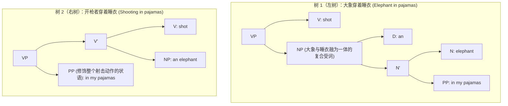
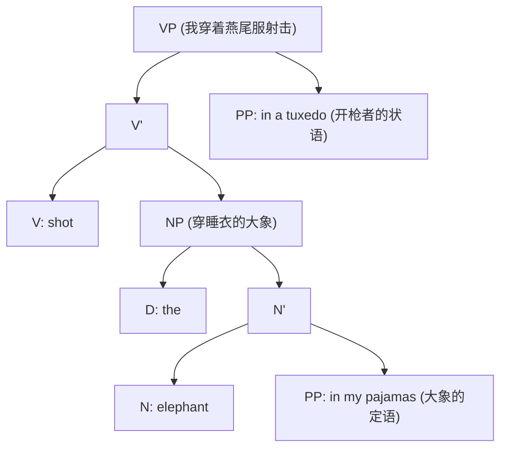
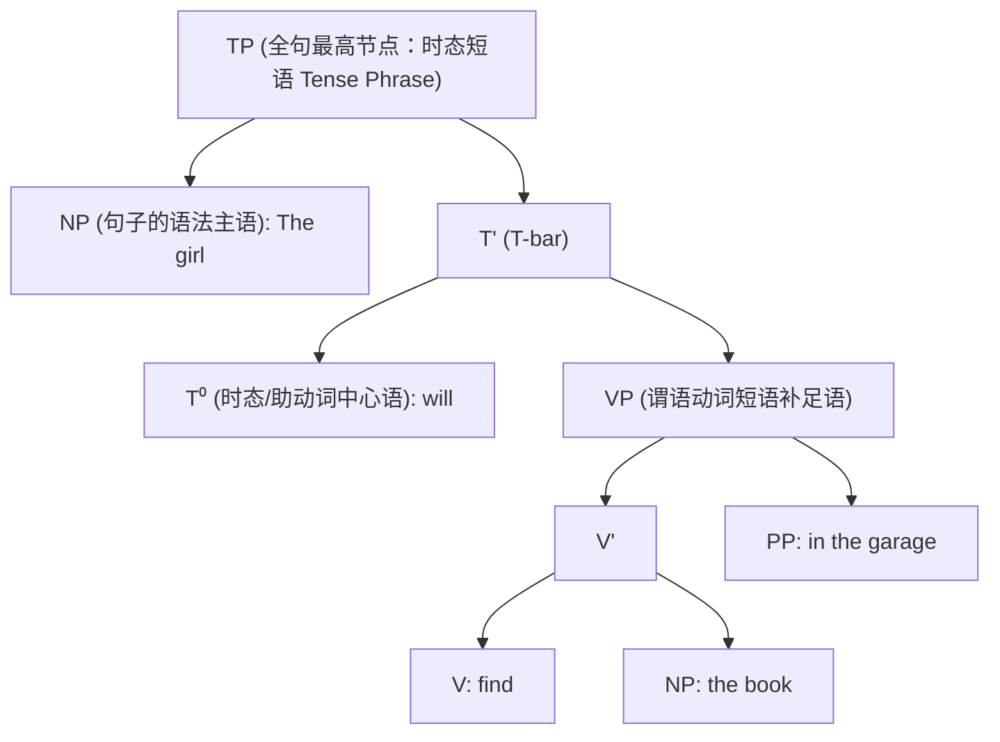

# Lec 12 句法学II：X-杠理论、结构歧义与时态短语

**开场白**

正如我们在形态学中剖析 **unlockable** 时所认识到的：说它包含三个语素（*un-*, *lock*, *-able*）固然没错，但这绝非完整的描述。关键在于这三个语素是**两两成对组装（Pairwise Merge）**的：

- 你可以把 *un-* 和 *lock* 拼在一起构成动词 *unlock*，再拼上 *-able* 得到形容词；
- 也可以把 *lock* 和 *-able* 拼成形容词 *lockable*，再在外面拼上 *un-* 得到形容词；
- 不同的组装顺序，直接导致了完全不同的语义解读。

在形态学中，节点该贴什么标签，完全取决于词缀自带的指令说明（比如 *-able* 声明“我把动词变成形容词”）。  而在句法学中，两个词合并之后生成的新节点，**它的标签必然继承自参与合并的两者之一！**

当前，理论句法学家们在顶级学术界正就“大脑为什么以及如何为合并产物贴标签（Labeling Algorithm）”展开极其激烈的争论；但在这门入门课上，我们只需遵循最自然的直觉：**让核心词决定短语的范畴属性**。

## X-bar 层次结构约定

为了让人类大脑能更清晰地识别句法树，句法学确立了一套通用的标示约定：

1. 最大投射 (Maximal Projection, XP) : 继承自某个中心语的最高层级节点，标为 XP (如 NP, VP, PP)；
2. 中介投射 (Intermediate Projection, X') : 介于最高短语与词汇中心语之间的所有节点，标为 X-bar (X')；
3. 词汇中心语 (Zero-level Head, X⁰ / X) : 最底层的单一词汇，标为零级 X⁰ 或单纯的 X。

> 为什么叫“X-bar”？

在 1960、1970 年代，电脑排版技术还处于“石器时代”。当时的语言学家们在机械打字机上打完一个大写字母 $V$ 后，会把字车退格回去，在大写字母上方艰难地打上一根横杠（$\bar{V}$），因此它被正式命名为 V-bar。后来，打字排版引入了撇号（$V'$）。但请大家务必牢记：在理论语言学界，这个符号永远、绝对被读作“V-bar”，绝不能读作“V-prime”！

- **最高节点**：带 $P$（如 $VP, NP, PP$）；
- **最低节点**：裸字母或带零标（$V^0, N^0, P^0$）；
- **夹在中间的所有过渡节点**：一律标为 **Bar（$V', N'$）**。

*对于既没有下属分支、自身又直接参与顶层合并的词（如孤立的代词或限定词 the），它在结构上同时身兼中心语与短语双重身份。*

介词短语（PP）既可以修饰动词短语（VP，表示动作发生的地形背景），也可以修饰名词短语（NP，表示名词的内在属性）：

- 修饰动词：*find the book [in the garage]*（在车库里找书）
- 修饰名词：*find [books [about syntax]]*（找关于句法学的书）

这立刻引发了一个震撼的数学推论：
$$\text{NP 可以包含 PP，而 PP 可以包含 NP，NP 又可以继续包含 PP……}$$

你可以写出一本极其离谱的地理学著作：

- *A book about islands.*（一本关于岛屿的书）
- *A book about islands on lakes.*（一本关于湖泊上的岛屿的书）
- *A book about islands on lakes on islands.*（一本关于岛屿上的湖泊中的岛屿的书）
- *A book about islands on lakes on islands on lakes...*

如果你一直这样说下去，最终你一定会因为现实中找不到更深层嵌套的微缩地理构造而词穷——但在菲律宾的塔阿尔湖，确实存在真实的“岛中之湖、湖中之岛、岛中之湖”！

而这再次印证了我们在上节课确立的真理：现实中没有人会说出一句无限长的名词短语，这是地理学和人类寿命的物理限制，而不是人类心智句法能力的限制！

## 二义性的树形分析

现在，让我们回到两义性的核心实验场。美国传奇喜剧演员格劳乔·马克斯（Groucho Marx）在 1930 年经典电影《动物饼干》（*Animal Crackers*）中有一段名垂影史的传世台词：

**“One morning I shot an elephant in my pajamas. How he got in my pajamas, I'll never know.”**  
*(某天早晨，我穿着睡衣打中了一头大象。至于它是怎么钻进我的睡衣里的，我永远也想不通。)*

为什么这句台词能引爆观众长达近百年的哄堂大笑？  因为这句话在大脑的句法解析引擎中，**完全等价地对应着两棵不同的句法树**！



- **树 1（左树）**：介词短语 `[in my pajamas]` 挂在名词 `elephant` 的下方，直接修饰大象。句法语义计算裁决：**是大象正套在我的睡衣里！**
- **树 2（右树）**：介词短语 `[in my pajamas]` 挂在动词短语 `V'` 的外侧，修饰整个射击动作。句法语义计算裁决：**是我在开枪时正穿着睡衣！**

正常人在日常语境中，基于常识经验会本能地倾向于树 2（常识解读）；而格劳乔·马克斯在第二句包袱中突然抖出：“它是怎么钻进我睡衣里的”，**强行逼迫听众在瞬间推翻常识树，急转弯切换到荒诞的树 1！** 幽默的认知声学本质，正是这种句法树模型的猝不及防的重构。


我们怎么向怀疑论者科学证明：这两棵句法树并非语言学家的主观臆造，而是真实物理存在于人类心智中？

答案就是我们在上节课学到的核武器——**句法成分测试法（Constituency Tests）**！我们将句子分别施加话题化前移：

```
变体 A：The elephant, I shot in my pajamas.
变体 B：The elephant in my pajamas, I shot.
```


### 双重介词短语

为了进一步测试这套树形几何，教授给出了一个更复杂的语料：

$$\text{“I shot the elephant in my pajamas in a tuxedo.”}$$
*(我打中了在睡衣里的一头身穿燕尾服的大象 / 我穿着燕尾服打中了穿睡衣的大象……到底是谁穿什么？！)*

**唯一合法语感解：大象穿着睡衣，而我穿着燕尾服！** 绝对无法读反！



为什么绝对不可能反过来（我穿睡衣、大象穿燕尾服）？  
因为根据生成语法的根本拓扑公理——**句法树树枝严禁交叉（No Crossing Branches）**！


## 进军全句顶层

在过去两节课里，十几位同学一直在焦急地追问：“教授，您为什么永远只画下半截动词短语？主语跑哪去了？助动词 *will* 到底挂在哪？完整的句子究竟长什么样？！今天，完整的全句宇宙终于正式揭晓！


*“The girl will find the book in the garage.”*

我们引入一个全新的、高居全句核心的语法范畴——**时态（Tense, 缩写为 T）**！



> 为什么将 *will* 命名为 T？

1. 它绝对不是普通动词：你绝不能说 `*The girl will the book.`；
2. 它参与了一系列普通副词（如 *quickly*）绝对无法参与的特权语法操作：
   - **主谓倒装疑问句**：*Will the girl find the book?* ✔（助动词 *will* 能瞬间跳跃至句首变疑问句；而副词绝不行：`*Quickly the girl found the book?` 不是疑问句！）；
   - **简短答句承载者**：“Who will find the book?” — “**The girl will.**” ✔（而面对“谁找到了书？”，你绝不能答成 `*The girl quickly.` ✘！）


> 教授，您凭什么理所当然地认定：助动词 *will* 是先和谓语动词短语 VP 合并，最后再和主语 *the girl* 合并？
>
> 如果按照二元合并的数学可能，为什么不能是 **主语 *the girl* 先和助动词 *will* 合并成一个短语，然后再把这个复合成分整体砸向后方的动词短语** 呢？！”
>
> ```
> 【黑板上的异端候选树 (The Heretical Tree)】
>         TP (?)
>        /      \
>     T' (?)     VP (find the book...)
>    /      \
> NP (The girl)  T (will)
> ```
>

下节课给这个板异端树，彻底的致命一击！
