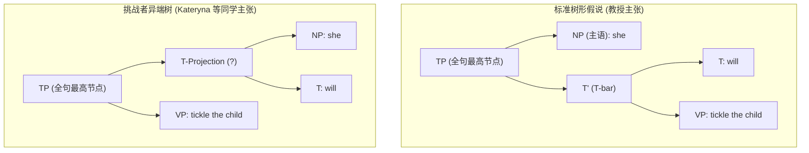
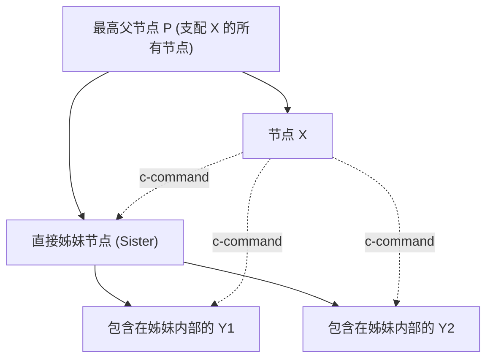
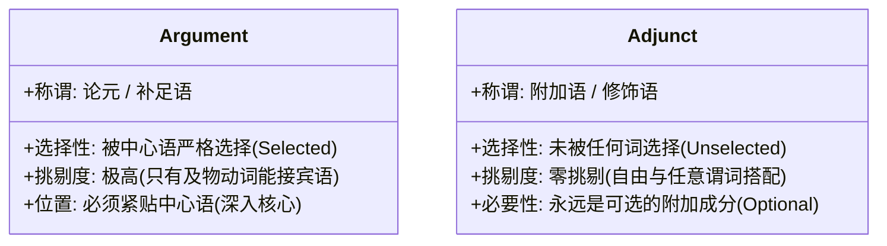
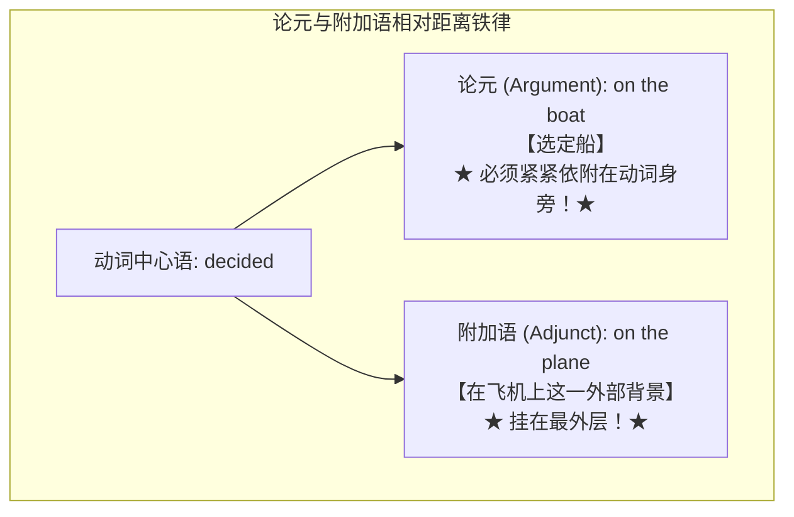

# Lec 13 句法学 III：成分统领与选择局部性

**开场白**




然而，上节课我刚把这棵树画出来，台下几位同学立刻发起了猛烈的理论围攻！特别是 Kateryna 同学，冷酷无情地当场质问我：

> *“教授，你凭什么先让 will 和后面的动词短语合并？明明在时间线性语序上，主语 she 和 will 紧紧贴在一起！我们为什么不能先合并 [she + will]，然后再把这个单元整体砸向后面的动词短语？！”*

我当时试图用我们在句法学第一天半里学到的一丁点粗浅的成分测试工具来证明我是对的，但我彻底失败了——因为我还没有向大家传授足够高阶的形式化武器。

今天，我将兑现上节课悬念的承诺：**动用当代句法学最核心的几何公理，在黑板上彻底击毙右边的异端树！**

顺便说一句，因为 Kateryna 的严厉质问，我不得不把原本计划在几周之后才讲的顶级机密提前挪到了今天。如果大家待会儿觉得烧脑，请全都怪她！


## 约束理论 Principle C

请观察以下两句完全合语法的日常英语：

- *She would recognize Mary.* （她会认出玛丽）
- *Anyone who knows her would recognize Mary.*（认识她的任何人都认得出玛丽）

这两句话都包含代词（*she / her*）和专有名词 *Mary*。但在母语者心智中，存在一道不可逾越的鸿沟：

- 在句子 1 中：代词 *she* 绝对不能等于 *Mary*（$\text{she} \neq \text{Mary}$ ❌）！ 这句话必须涉及两个不同的女性；
- 在句子 2 中：代词 *her* 完全可以指代 *Mary*（$\text{her} = \text{Mary}$ ✔）！

上节课有同学提出了一个极符合直觉的常识假设：

> *“句子 A 之所以不能共指，是因为代词出现在了名字之前！代词只能指代前面已经提到过的人，不能指代后文才出现的人。”*

但句子 B 的存在瞬间将这一线性假说轰得粉碎！在句子 B 中，代词 *her* 同样在物理时间上远远排在 *Mary* 之前，但母语者却毫不犹豫地允许它们共指！

这铁证了：能否共指，根本不是前后线性时间问题，而是句法树拓扑几何层级的问题！


为了解释这一现象，我们确立如下结构原则：

**原则（针对代词与专有名词）：**  **若一个代词短语（NP）与某个节点 $\alpha$ 合并，则该代词短语绝对不能与任何被 $\alpha$ 所支配（Dominated）的专有名词发生共指！**

让我们用这套原则分别检验两棵树：

检验句子 A：*She would recognize Mary*

在标准树中：

- 主语代词 `she` 是与整个 `T'` 节点合并的；
- `T'` 支配了下属的整个谓语，包括处于宾语位置的专有名词 `Mary`；
- 根据原则，`she` 绝不能与被它所合并的节点（$T'$）内部的任何名字共指！
- 判决：**$\text{she} \neq \text{Mary}$ 成立！完美预测真实语感！**


检验句子 B：*Anyone who knows her would recognize Mary*

在主语 *Anyone who knows her* 内部：

- 代词 `her` 只是一个深埋在定语从句（*Relative Clause*）内部的微小宾语；
- 它最初是与从句动词 *knows* 合并的；
- *knows* 根本不支配外面的 *Mary*！
- 正如我们常说的：**“你无需为你祖先的罪行负责！”** 代词深埋在主语从句内部，没有直接与包含 *Mary* 的大树枝合并，因此共指完全合法！


现在，反观 Kateryna 提出的异端候选树：

- 如果按照异端树：`she` 先和 `would` 合并；
- 那么 `she` 仅仅是和一个小小的时态助动词 $T$ 发生合并，它根本没有与包含 *Mary* 的动词短语发生直接合并！
- 那么上述原则就彻底失效，异端树将错误地预测：**句子 A 应该允许 *she* 和 *Mary* 共指！**
- 这与全人类英语母语者的直觉完全相反！

要让句法规则做出正确的裁决，**主语代词 `she` 的直接姐妹，必须且只能是那个涵盖了整个谓语动词短语的 $T'$ 节点！** 案卷封存，标准树完胜！


## 句法学的几何灵魂： 成分统领


运用的结构关系，在生成句法学中拥有一个如雷贯耳的名字——**成分统领（c-command, Constituent Command）**



### 3.1 成分统领的形式定义

> **节点 $X$ 成分统领（c-commands）节点 $Y$，当且仅当：**
>
> 1. **$X$ 不支配 $Y$，且 $Y$ 不支配 $X$；**
> 2. **支配 $X$ 的每一个分支节点，同样支配 $Y$！**
>
> *(极简白话版本)*：  
> **你成分统领你的亲姊妹，以及你亲姊妹肚子里支配的所有后代子孙！**

当代句法学极其庞大的现象体系（约束理论、一致关系、极性词许可、否定辖域、移位引力）全都是由 **c-command** 驱动的。大家在今天无意中提前解锁了这项顶级技能！


为了统一交流语言，句法学家普遍采用**女性亲属称谓**来描写树的节点拓扑：

- **姊妹（Sisters）**：通过同一次合并操作组合在一起的两个同级节点（如限定词 *the* 与名词 *child*）；
- **母亲（Mother）**：由两节点合并而直接产生的新节点；
- **女儿（Daughters）**：参与合并生成母节点的直接下级；
- **直接支配（Immediate Domination）**：母节点对子节点的直接关系；
- **支配（Domination）**：直接支配关系的传递闭包（祖先对所有后代子孙的自上而下投射）。

```
【句法成分的形式化终极定义】
一个词串 α 是一个句法成分 (Constituent)，
当且仅当：存在一个单一节点，恰好支配 α 中的所有单词，且不支配 α 之外的任何单词！
```

---

## 5. 词汇选择限制（Selectional Restrictions）

我们凭什么决定哪两个词可以合并？

请看蚂蚁与食蚁兽的悲喜寓言：

```
Sentence 1: The ants thrived.       (蚂蚁兴旺繁衍 - 不及物动词)
Sentence 2: The anteater arrived.   (食蚁兽到来了 - 不及物动词)
Sentence 3: The anteater devoured the ants. (食蚁兽吞食了蚂蚁 - 及物动词)
Sentence 4: Mary slapped the anteater.      (玛丽掌掴了食蚁兽 - 及物动词)
```

古代希腊罗马语文学家早就指出：动词在词汇属性上分为两大阵营：

- **及物动词（Transitive）**：强烈渴求宾语（*devour, slap*；你不能说 *\*The anteater devoured.* 句子未完成！）；
- **不及物动词（Intransitive）**：严禁携带直接宾语（*thrive, arrive*；你不能说 *\*The ants thrived the farm.*）；
- 还有一些两可动词（如 *eat*，既可以 *ate the ants*，也可以单独说 *ate*）。

除了及物与不及物，某些动词还对介词短语有强制依赖，如动词 **put**（放置）：

- *The anteater put the ants onto a plate.* ✔（这是一只有教养的讲究食蚁兽！）
- *\*The anteater put the ants.* ✘（缺少地点 PP，非法！）
- *\*The anteater put onto a plate.* ✘（缺少直接宾语 NP，非法！）

因此，我们在心智词典（Lexicon）中存储动词时，必须为每个动词标明它的**选择特征（Selectional Features / Subcategorization）**：

- *devour*：选择 `[_ NP]`；
- *put*：选择 `[_ NP PP]`。

---

### 5.1 虚构动词 *glorf* 与选择的局部性定理（Locality of Selection）

动词对介词的选择不仅局限于“需要一个 PP”，甚至可以精确挑剔介词的词汇身份：

- 动词 **depend**：只能与介词 **on** 搭配（*depend on*）；绝不能说 *depend from, depend at, depend near*！

*（教授吐槽印欧语系）*  
“印欧语系（包括英语）拥有的介词数量多到了变态的地步！如果你学另一门印欧语，你必须痛苦地死记：在大型岛屿上要用这个介词，在小型岛屿上却必须换成另一个介词……如果你不想受这个罪，就去学非印欧语，那里的逻辑大多清爽干脆：‘这是我们的全能处所介词，请谨慎使用！’”

那么，选择限制能够穿透到多深？  
假设我发明了一个动词 **glorf**：

- *glorf* 声明：“我需要一个介词短语，我不管介词是 *under*、*through* 还是 *beside*，但我**唯一的天条是：这个介词短语前面必须由程度副词 *right* 来修饰**！（你可以说 *She glorfed them right under the tree*，但绝不能说 *She glorfed them under the tree*）。”

**在全人类所有语言中，存在类似 *glorf* 这样的动词吗？**  
**绝对没有！零存在！**

乔姆斯基在 1965 年提出了著名的**选择局部性定理（Locality of Selection）**：

> **中心语（Head）在施加选择限制时，只能选择其直接姊妹节点的“中心语（Head）”！**  
> 动词可以选择 PP 的中心语介词（如 *depend* 选择 *on*），但**绝对无法把手伸进补足语内部，去干涉里面的修饰语或附加语！**

---

### 5.2 补足语从句中心语（C & CP）的发现

利用这套“严苛挑剔性”探针，我们可以揭示从句的秘密：

- *I think [that I have won the lottery].* ✔
- *I wonder [whether I have won the lottery].* ✔
- *\*I think [whether I have won the lottery].* ✘
- *\*I wonder [that I have won the lottery].* ✘

动词 *think* 只能接 *that*，动词 *wonder* 只能接 *whether*！  
这与 *depend on* 的逻辑如出一辙：**that 和 whether 不是无关紧要的连词，它们是从句的灵魂中心语——补足语引出词（Complementizer, 缩写为 C）！**  
整个宾语从句正是以 C 为核心投射出的**补足语从句短语（CP, Complementizer Phrase）**！

---

## 6. 论元（Argument）vs 附加语（Adjunct）：羽毛万能定律

现在，我们要剖析一个极其关键的二分法：

思考介词短语 **with a feather**（用一根羽毛）：

- 你可以说：*tickle the child with a feather*（用羽毛呵痒小孩）；
- 也可以说：*devour the child with a feather*（用羽毛吞食小孩……虽然诡异，但绝对合语法！）；
- 甚至可以：*write a novel with a feather*（用羽毛写小说）、*dance with a feather*（带着羽毛跳舞）、*thrive with a feather*（靠一根羽毛繁盛生长）。

**你可以在这个世界上用一根羽毛做任何事！** 没有任何动词会对 *with a feather* 提出挑剔的排斥。



- **论元（Arguments）**：中心语的必要参与者（如及物动词的宾语），存在挑剔的选择限制；
- **附加语（Adjuncts）**：自由游走的修饰者（如工具、时间、地点状语）。

> [!WARNING]
> **重要认知陷阱**：附加语通常是可选的（Optional），但**绝不能反过来说“只要是可选的成分就一定是附加语”**！像 *dance a hornpipe*（跳水手舞）中的宾语虽然可以省略，但它依然是动词的论元！

---

## 7. 终极大招：双介词短语裁决实验与民主表决

论元与附加语在树形拓扑上的真正本质差异究竟是什么？  
我们来看这句充满欺骗性的句子：

$$\text{“I decided on the boat on the plane.”}$$

在单介词短语句子 *I decided on the boat* 中存在双重歧义：

- 解读 A（附加语）：我在船上做出了决定（*on the boat* 是地点附加语）；
- 解读 B（论元）：我挑中、选定了这艘船（*decide on* 搭配构成论元）。

那么，当两个介词短语堆叠在一起时：
$$\text{“I decided on the boat on the plane.”}$$
它究竟表示什么？

Norvin 教授在黑板上写出两个潜在候选读法：

- **读法 1**：**我在飞机上，最终拍板选定了买那艘船！**（*I chose the boat while I was on the plane.*）
- **读法 2**：**我在轮船上，最终拍板选定了买那架飞机！**（*I chose the plane while I was on the boat.*）

教授向全班发起现场民主举手表决：
“认为读法 1 成立的请举手？（全场几乎所有同学举手）  
认为读法 2 是自然直觉的请举手？（全场一片死寂，无人举手）”

通过全班民主表决，真相水落石出：**自然直觉 100% 毫无争议地锁定了读法 1！**  
除非你用一种极其夸张做作的插入语声调（“*I decided... on the boat... on the plane!*”并在两边画上逗号），否则母语者绝对不会得出读法 2！



### 
