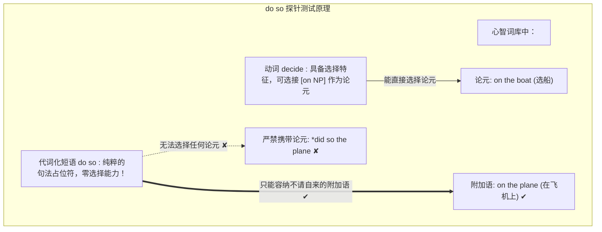
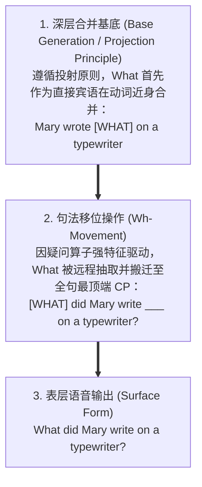
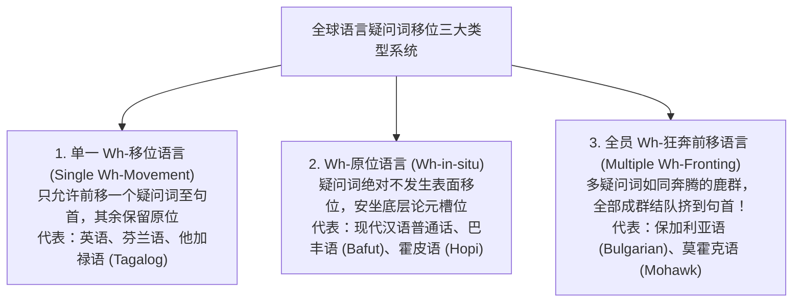

# Lec 14 句法学 IV ：投射原则、移位假说

**开场白**


**Norvin Richards 教授**：  
欢迎大家休假归来！希望大家度过了一个愉快的春假，并在业余时间花大量精力思考句法学。*（

今天我们继续句法学的旅程。上节课我们讨论了中心语（Head）对其姊妹节点（Sister）的**选择限制（Selection）**：

- 像动词 *tickle*、*devour* 这样的及物动词选择一个名词短语（NP）作为直接宾语；
- 动词 *depend* 专门选择以介词 *on* 为中心语的介词短语（PP）；
- 动词 *put*（放置）则同时选择一个受格 NP 和一个表示方位的地点 PP（*put the book on the table*，你绝不能说 `*put the book during the party`，因为时态介词不是方位）。

### 1.1 课堂激辩：祈使句里真的藏着一个无声的“You”吗？

**学生提问**：句法树上的每一个终端节点，都必须严格对应句子里发音出来的单词吗？我们在小学学英语时，老师总说祈使句命令句的深层主语其实是隐藏的“You”（*(You) do your homework!*）。我们能在句法树里画一个括号里的 *(You)* 吗？

**Norvin Richards 教授**：*（赞叹）* 这是一个极其深刻且困难的绝妙问题！答案是斩钉截铁的：**是的！在句法树中，绝对存在在表层物理上不发音的‘无声词’！**

我们如何向最挑剔的怀疑论者科学证明祈使句里确实存在一个幽灵般的主语 *you*？  
**反身代词（Reflexives）的严格形态一致性，就是无可辩驳的照妖镜！**

```
【反身代词的一致性约束】
Case 1: Sally defended herself.  (主语是第三人称阴性 ➜ 只能用 herself)
Case 2: I defended myself.       (主语是第一人称 ➜ 只能用 myself)
Case 3: You defended yourself.   (主语是第二人称 ➜ 只能用 yourself)
*I defended herself. ✘          (人称不一致，绝对非法！)
```

反身代词的形式严格由全句的语法主语所决定。现在，请看这句日常祈使句：
$$\text{“Defend yourself!”} \quad (\text{保护好你自己！} ✔)$$

- 你可以说 *Defend yourself!*；
- 但你**绝对无法说**：`*Defend himself!` 或者 `*Defend myself!`！

为什么在祈使句中，反身代词只能且唯独能选用第二人称单复数的 *yourself / yourselves*？  
**因为在人类大脑的深层句法树主语位置上，物理真实地盘踞着一个代词 *you*！** 只是在表层语音输出阶段，大脑的一道发音规则将这个 *you* 实施了静音（Silence）。小学的直觉在这里得到了最高阶生成语法的严格背书！

---

## 2. 论元 vs. 附加语判定的第二大测试：VP 代词化（*do so*）

在春假前，我们讨论了论元（Argument）与附加语（Adjunct）的区分。  
很多人常常陷入误区，以为“只要是可选的（Optional）就一定是附加语”。但这是极度错误的——像 *eat* 这样的动词，其直接宾语虽然可以不发音（*I ate*），但它依然是动词的论元！

今天，我向大家引介判定论元与附加语的第二项金牌测试法——**动词短语代词化（VP-Pronominalization: *do so*）**！

```
【分析基底两义句】
“I decided on the boat, and Mary decided on the plane.”
含义 1：我选定了买船，玛丽选定了买飞机 (decide on 作为及物动词论元)；
含义 2：我在轮船上做出了决定，玛丽在飞机上做出了决定 (on... 作为地点附加语)。
```

现在，我们用代词短语 **did so** 来替换谓语动词，观察句意发生了什么剧变：

$$\text{“I decided on the boat, and Mary did so on the plane.”}$$

**全场注意：两义性瞬间坍塌！** 这句话**唯独且只能表示含义 2**（我在船上做出了决定，玛丽在飞机上做出了决定）！  
它绝对不可能表示“玛丽挑中了飞机”！



### 2.1 铁血规则

1. **`do so` 是一个没有内部词汇选择能力的纯代词**；
2. 凡是在 `do so` 后面被孤零零遗留下来的介词短语，**必然且只能是附加语（Adjunct）**！它绝对无法充当论元！
3. 这也解释了为什么直接宾语永远无法被留在 `do so` 后面：
   - *\*“I chose the boat, and Mary did so the plane.”* ✘  
     *（教授敲黑板打趣）* “Bad sentence. Bad sentence. No biscuit!（坏句子，没有小饼干吃！）”

---

## 3. 投射原则（The Projection Principle）的提出

结合上述事实，我们确立了生成语法的核心公理——**投射原则（The Projection Principle）**：

> **投射原则（Projection Principle）：**  
> **如果一个中心语在词库中选择了一个论元，那么在树形合并时，必须优先满足该中心语的选择需求（先将论元合并为直接补足语），随后才能合并任何外围的可选附加语！**

*（通俗比喻）*：**“先吃完你的西兰花蔬菜，然后才能吃餐后甜点！先修完大一的硬核必修课，然后才能选修有意思的语言学课！”**

因此：

- *He read the book quickly.* ✔（及物动词 *read* 优先与论元宾语 *the book* 合并，外围包裹状语 *quickly*）；
- *\*He read quickly the book.* ✘（附加语插在动词与论元中间，直接违背投射原则！）；
- *Mary wrote the novel on a typewriter.* ✔
- *\*Mary wrote on a typewriter the novel.* ✘

---

### 3.1 理论插曲：Currying 与 Schönfinkelization

在讨论多论元动词（如 *give the children books*）如何用二元合并表示时，有计算机与数学背景的同学指出：这就像 Lambda 演算中的柯里化（Currying）！

*（Norvin 教授笑谈学术八卦）*  
“在 MIT 语言学与哲学系，我有几位母语是德语的顶尖语义学家同事。在形式逻辑中，把多参数函数转化为一系列单参数函数的算法，英国人以逻辑学家哈斯凯尔·柯里（Haskell Curry）的名字将其称为 **Currying（柯里化）**；但德国学者们会极度愤怒地纠正你：‘这叫 **Schönfinkelization（申芬克尔化）**！因为德国逻辑学家摩西·申芬克尔（Moses Schönfinkel）早在 1924 年就发现了它，比柯里早得多！’不管叫什么，中心语对论元的逐层饱和推导，在逻辑上完全相通。”

---

## 4. 投射原则的世纪大危机：Wh-疑问句的惊天挑衅

然而，正当我们沉浸在投射原则的优雅与严丝合缝之中时，一个极其日常的英语疑问句，瞬间将整个理论炸得粉碎：

$$\text{“What did Mary write on a typewriter?”} \quad (\text{玛丽用打字机写了什么？})$$

请仔细审视这个句子的结构：

- 我们刚刚铁口直断：动词 *write* 当表示及物动词时，它的受格论元**绝对、必须紧贴在动词身边**；
- 那么在这句话里，被写的那个对象到底是什么？！

**学生回答**：是“What”！

**Norvin Richards 教授**：*（大笑模仿雅培与科斯特洛的著名相声《谁在一垒》）*  
“被写的是什么？”  
“就是‘什么’啊！”  
“对啊，到底是什么？”  
“我都说了是‘什么’（What）！”

但问题在于：**这个作为动词宾语的 *What*，根本不在 *write* 的身边！它高高地耸立在遥远的句首，动词 *write* 后面紧跟着的反而是工具状语 *on a typewriter*！**

面对这起严重的理论危机，我们面临两种选择：

1. **方案 A（绝望放弃）**：宣布投射原则彻底破产，承认语言的组合毫无规律可循；
2. **方案 B（移位假说，Movement Hypothesis）**：**投射原则永远成立！句子在深层诞生时，宾语就是老老实实呆在动词身边；只是在后续推导中，它发生了一场惊天动地的大位移！**



### 4.1 移位假说的三大铁证

你怎么知道 *What* 曾经真的呆在动词身边？

1. **回声疑问句（Echo Questions）的真相**：  
   如果你在嘈杂的地铁上没听清对方说话，或者对对方的话感到极度震惊（*“Mary wrote Fermat's Last Theorem on a typewriter!”*），你会脱口而出：  
   $$\text{“Mary wrote WHAT on a typewriter?!”}$$  
   在情绪震惊状态下，**那个原本移位的 *what* 竟然 100% 毫无保留地回到了动词身旁的原始基底位置！**
2. **严格禁止双重宾语占位**：  
   如果在 *write* 后面再塞进一个宾语：  
   $$\text{*\“What did Mary write the novel on a typewriter?”} \quad (❌ 绝对非语法！)$$  
   因为动词身后的那个槽位虽然没有发音，但在心智中早已被 *What* 留下的**隐形语迹（Trace / Silent Copy）**牢牢占据！
3. **着陆点锁定在 CP（Complementizer Phrase）**：  
   在嵌入句从句中：
   - *I know [that he ate the ants].*
   - *I know [whether he ate the ants].*
   - *I know [what he ate].*
   - *\*I know [what that he ate].* ✘ / *\*I know [what whether he ate].* ✘  
     *what* 移位后的最终着陆点，恰恰霸占了从句补足语中心语（C）所在的领域！

---

## 5. 全球语言 Wh-疑问句大图景类型学（Wh-Typology）

在理论语言学中，疑问词通常以 **wh-words** 统称（即便这是个极具盎格鲁中心主义的术语，因为英语疑问词如 *who, what, where, when, why* 恰好以 wh- 开头，连 *how* 也拼凑着这两个字母）。

纵观全人类所有自然语言，疑问句的处理呈现出了三足鼎立的壮阔图景：



### 5.1 跨语言深度对照（以“谁把什么给了谁？”为例）

1. **现代汉语（Wh-in-situ 原位语言）**：  
   $$\text{“张三 买了 什么？”} \quad (\text{绝对不说：*什么 张三 买了？})$$  
   在汉语中，疑问词完全不需要发生长距离位移，它像普通宾语名词一样安坐在原处。
2. **现代英语（Single Wh-Movement 单一移位）**：  
   $$\text{“What did you give to whom?”} \quad (\text{只前移 What，to whom 留在原位})$$  
   如果强行将所有疑问词都移到句首：`*What to whom did you give?` 彻底崩溃！
3. **保加利亚语（Multiple Wh-Fronting 全员狂奔）**：  
   在巴尔干半岛的斯拉夫语保加利亚语中，多重疑问句要求所有疑问词全员搬迁至句首：  
   $$\text{“Koj kogo kakvo dade?”} \quad (\text{字面直译：谁 谁 什么 给了？})$$

---

## 6. 终极大戏：多项式函数、保加利亚儿童与普遍语法（UG）

在课程的最后五分钟，Norvin 教授在黑板上写下了一道数学数列游戏：

```
已知函数 f(x) 满足：
f(1) = 1
f(2) = 2
f(3) = 3
f(4) = 4
问：f(5) = ?
```

全班同学异口同声脱口而出：“**5！**”

Norvin 教授狡黠地笑出声来：  
“哈！你们全都不幸掉进了我的陷阱！我心里构思的真正函数其实是这个：
$$f(x) = (x-1)(x-2)(x-3)(x-4) \times 6 + x$$
代入 $x=5$，真正的答案是 **29！** 事实上，前四项即便全为零，由于高阶多项式的自由度，**f(5) 可以是全宇宙的任何实数！**”

标准化考试里的找规律题在数学本质上是极不公正的——因为有限的离散经验观测，在数学逻辑上永远对应着**无穷多种完全兼容的生成规则**！

### 6.1 保加利亚儿童的“语言习得逻辑困境”

现在，请大家闭上眼睛想象：你是一个正在母语摇篮里牙牙学语的**保加利亚婴儿**。

在成长过程中，你的父母在家里向你发出的疑问句样本是极其有限的：

- 父母或许问过包含两个疑问词的句子（*“谁把什么拿走了？”*）；
- 偶尔问过包含三个疑问词的句子；
- 但几乎绝不可能有哪对父母在日常生活中疯狂向婴儿抛出包含四个甚至五个疑问词的复杂复合长句！

如果人类心智真的纯粹靠经验归纳与数据拟合，那么不同家庭的保加利亚儿童将发展出截然不同的语法规则：

- 听过两个疑问词前移的孩子，会归纳出“**移动至多两个疑问词**”的语法；
- 听过三个的孩子，会归纳出“**移动至多三个疑问词**”的语法；
- 当把这些孩子放进高压舱语言实验室测试五个疑问词时，他们理应展现出各自散落的断裂分化！

**然而，现实的科学实验证明：全保加利亚所有的儿童，语法表现 100% 惊人一致——他们全部毫无例外地掌握了“移动所有 Wh-短语（Move ALL）”的规则！**

没有任何人类儿童会愚蠢地产生“只移动质数个疑问词”或“最多只移动两个疑问词”的假说。

这决定性地向我们宣告了认知科学最伟大的里程碑：  
**人类婴儿的大脑绝非一块任由经验涂抹的白板！我们的大脑在基因遗传中内置了一套神圣的结构约束引擎——普遍语法（Universal Grammar, UG）！**

关于人类心智如何凭借贫乏的输入刺激征服无穷无尽的语言世界，我们下节课继续深潜！
