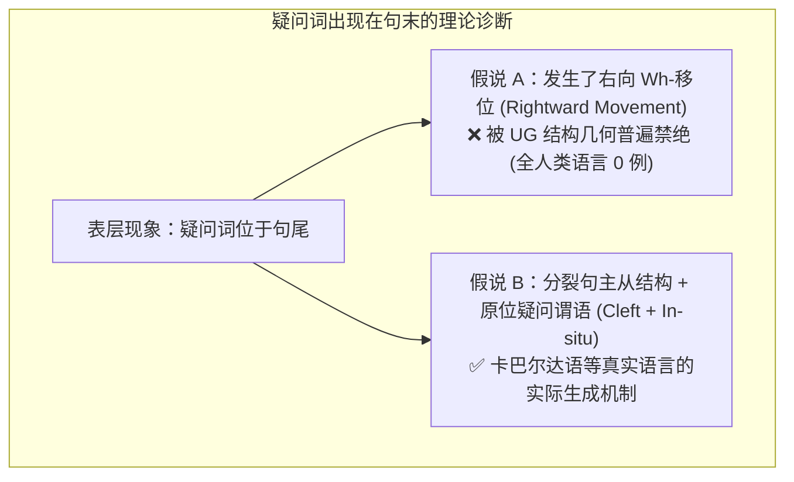
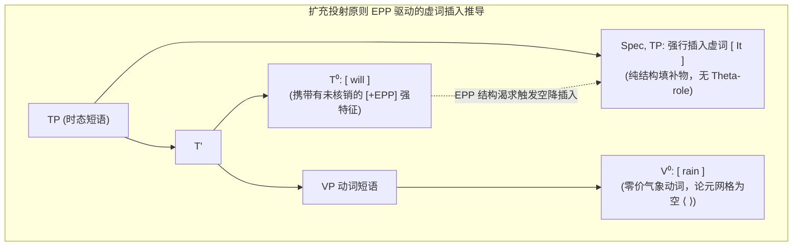
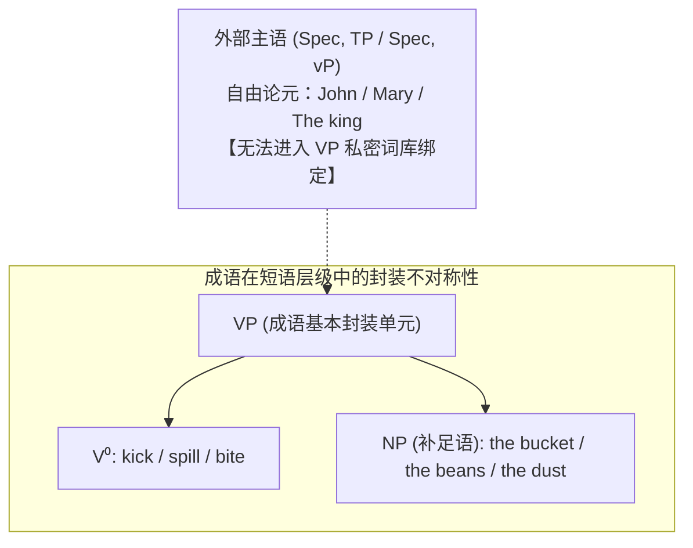

# Lec 15 句法学（五）：普遍语法未见类型、扩充投射原则与成语边界

> MIT 24.900 · 语言学导论 · 主讲 Norvin W. Richards

## TL;DR

- **普遍语法通过未见类型划界**：自然语言绝对不存在“右向 Wh-移位”与“数数限制移位”，卡巴尔达语尾端疑问词本质为分裂句原位谓语，证明心智语法受严格拓扑约束。
- **布罗卡区特异性激活**：神经语言学证实人类大脑仅响应层级结构依赖规则；当输入“在线性第 N 位加词”的人造规则时，语言中枢完全沉寂，只能靠通用认知区死记。
- **扩充投射原则（EPP）的强力驱动**：时态中心语 $T^0$ 强迫 $[Spec, TP]$ 必须显性填补，导致无参与者论元的天气动词必须凭空空降虚词主语（*It rains*）。
- **成语动宾不对称性确证结构分层**：词库中成语仅以动宾短语（$VP$）打包封装，主语作为外部论元无法进入成语内核，实证了 X-杠理论的论元层级划分。

## 1. 课程定位与问题意识

在句法学的前几讲中，我们建立了短语结构规则、X-杠理论、投射原则以及移位系统（Wh-移位与中心语移位）。然而，一个优秀的科学理论不仅要能解释“自然界中存在什么”，更必须精准预测“自然界中绝不可能存在什么”。

在计算机编程中，我们可以用三行代码轻松写出一个“把句子第 3 个单词移到最末尾”的解析器；但在全人类已知的 7,000 多种自然语言中，没有任何一种语言允许这样的操作。这种全人类语言体系中**彻底缺席的逻辑可能性（Unattested Types）**，正是揭示人类遗传赋予的心智语言器官（普遍语法 Universal Grammar）物理边界的关键探针。

本讲通过两大世纪“未见类型”、扩充投射原则（EPP）在虚词主语中的机械性强制要求，以及成语在动宾与主谓之间的极端不对称性，彻底锁定人类心智句法计算的核心公理。

## 2. 核心概念

| 概念 | 严密定义（用自己的话） | 容易混淆的邻居 | 典型实例 / 判据 |
|---|---|---|---|
| **未见类型（Unattested Types）** | 逻辑上自洽、计算上极简，但在全人类所有已知自然语言中彻底绝迹的假想语法模式。 | 罕见类型（罕见类型如 OSV 语序确实在极少数亚马逊语言中存在；未见类型是 UG 硬约束所绝对禁止的）。 | 右向 Wh-移位到句尾；将否定词精确插在全句第 3 个单词之后。 |
| **扩充投射原则（Extended Projection Principle, EPP）** | 普遍语法的一项刚性结构公理，规定时态短语的说明语位置（Spec, TP）在表层句法中必须被显性名词短语填充，绝不能裸露为空。 | 投射原则（投射原则要求论元结构在各层级保持；EPP 则要求主语槽位在结构上必须物理占位，哪怕该动词无主语论元）。 | 英语天气句强行插入虚词：*It rains*（对比非语法的 *\*Rains*）。 |
| **虚词主语（Expletive / Pleonastic Subject）** | 不承载任何语义角色（Theta-role）、没有现实世界指称，纯粹为了满足 EPP 结构槽位需求而由句法系统强行插入的无意义代词。 | 指称代词（*It is delicious* 中的 *it* 指代具体食物；*It rains* 中的 *it* 毫无所指，纯属结构填充物）。 | 英语天气虚词 *it*、存在句虚词 *there*（*There is a book*）。 |
| **结构依赖原则（Structure Dependency）** | 人类语言心智中所有句法规则的运作均只感知树形拓扑层级（如统领、管辖、短语边界），绝对屏蔽线性物理序列（如词数、字母数）。 | 线性顺序列（自然语言规则绝不依赖“倒数第几个词”、“偶数位词”等线性计数器）。 | 疑问倒装永远基于主分句辅助中心语，绝非“把句中第 2 个词移到句首”。 |
| **成语的词库封装（Idiomatic VP Encapsulation）** | 成语作为一个固定语义的超大词元（Complex Lexical Item），在句法计算中作为动词与其补足语的最小短语构件（$VP$）整体合并生成。 | 自由语篇搭配（成语内部无法被任意外部量词或论元插入；动宾成语极多，而主谓成语几乎绝迹）。 | *kick the bucket*（去世）；无法构造固定主谓而宾语自由替换的成语。 |

## 3. 证据链与形式推导

### 3.1 世纪未见类型之一：为什么绝对没有“右向 Wh-移位语言”？

在第 14 讲中，我们看到英语将疑问词左移至句首（*What will Mary write?*），保加利亚语将所有疑问词全员左移（*Koj kogo vižda?*）。在形式逻辑上，我们完全可以定义一种“右向移位语言”：句子内部的疑问词全部拔地而起，整体移位到句子的最末端。

全人类 7,000 多种语言中，有哪怕一种语言采用纯粹的右向 Wh-移位吗？答案是：**绝对为零！**

::: pitfall 高加索卡巴尔达语（Kabardian）的“句尾疑问词”假象
部分类型学家曾提出反例：在高加索地区的卡巴尔达语中，疑问词确实出现在句末！例如其表达“谁吃了肉？”时，疑问词位于句尾。

然而，深入的生成句法诊断彻底推翻了这一假说：
- 卡巴尔达语表面句末疑问句的真实深层结构是一个**分裂句（Clefting）**：
  $$\text{[吃了肉的那个人]} \quad \text{是} \quad \mathbf{[谁]}？ \quad (\text{The one who ate the meat is who?})$$
- 疑问词“谁”之所以出现在句尾，是因为它本身就是处于句末谓语位置的**原位疑问词（Wh-in-situ）**！它从未发生过从句中向句尾的右向移位！
:::

形式句法得出普适结论：全人类语言的算子/焦点移位（Operator/Focus Movement）在拓扑学上具有绝对的**左向不对称性（Leftward Asymmetry）**。普遍语法的投射引擎只允许短语向更高阶的分句前沿边缘（Spec, CP）攀爬，绝对禁止向句尾下沉或右向悬挂。

### 3.2 世纪未见类型之二：为什么自然语言心智绝不“数数”？

考察以下假想的人类语言规则：
- **假想规则 1**：“在一个包含多个疑问词的句子里，前移疑问词，但最多只能移动 2 个，第 3 个必须原位。”
- **假想规则 2**：“将否定副词 *not* 严格插入在句子的第 4 个单词之后。”
- **假想规则 3**：“要形成一般疑问句，将整句话中由偶数个字母构成的单词全部倒装。”

上述任何一条规则在计算机算法中都只需一行简单的循环或取模运算（`if idx == 3`, `if len(word) % 2 == 0`），实现成本极其低廉。然而，人类语言的演化历史表明，**全人类没有任何一种自然语言发展出依赖线性计数的句法规则！**

::: theorem 普遍语法非计数公理（Non-Counting Axiom of UG）
人类心智中的生成语法系统是一个纯粹的**拓扑与结构依赖系统（Structure-Dependent Engine）**。它仅能识别层级包含、成分统领（c-command）、中心语投射以及短语孤岛边界；它在神经机制上对线性物理距离（如词汇个数、字符长度、线性音段序号）完全盲目。
:::

神经语言学实验（Musso, Moro et al., 2002）为此提供了坚如磐石的脑成像实证支持：
- **符合 UG 的复杂外语规则组**：当让受试者学习符合层级递归（如中心语移位、层级嵌套）的人造语言规则时，功能性磁共振成像（fMRI）显示大脑主管母语语法的**布罗卡区（Broca's Area, BA 44/45）**产生强烈的特异性血氧信号激活；
- **基于线性计数的外语规则组**：当教给受试者“在句子第 3 个单词后放置否定词”这种人造规则时，布罗卡区**完全保持静默**！受试者的大脑只能调用额叶的前额叶皮层等处理通用算术、拼图游戏的通用认知工作区勉强应对，且错误率极高。

这无可辩驳地证明：普遍语法的结构依赖性不是哲学家桌上的抽象思辨，而是铭刻在智人脑神经神经网络底层的生物物理硬件特质！

## 4. 机制与形式推导

### 4.1 扩充投射原则（EPP）与无意义虚主语的空降

在第 12 讲中，我们建立了时态短语的标准 X-杠拓扑：$TP \rightarrow Spec, TP + T'$。现在考察无参与者事件（Zero-place Predicates）的句法推导。

::: example 天气动词与虚词插入（Weather Expletives）
思考气象动词 `rain`（下雨）、`snow`（下雪）：
- 在语义学与论元结构上，物理世界的“下雨”是一个自发的大气现象，没有任何有意识的行为施事者（Agent），也没有承受下雨动作的客体受事者（Theme）。动词 `rain` 的论元网格（Theta-grid）为完全空白：$\text{rain}: \langle\ \rangle$。
- 在现代汉语（*“下雨了”*）或现代西班牙语（*“Llueve”*）中，由于它们是代词脱落语言（Pro-drop Languages），允许时态中心语携带隐性空范畴（Null Subject）。
- 但是在非代词脱落的现代英语中，如果直接按照论元结构发音，会产生严重违规：
  $$\text{*\“Will rain.”} \quad (\text{严重语法崩溃 ❌})$$
- 英语母语者必须、且只能机械性地塞入一个完全不指涉任何实体的幽灵代词 **it**：
  $$\text{“It will rain.”} \quad (\text{完全合法 ✅})$$
:::

根据乔姆斯基的**扩充投射原则（EPP）**，时态中心语 $T^0$ 拥有一项结构特征需求（`[+EPP]` 特征）：它强制命令其说明语位置 $[Spec, TP]$ 必须在表层结构中得到显性填充。

这种机制解释了存在句中虚词 `there` 的出现：在 *There is a cat in the room* 中，真正的语义论元是 *a cat*，但因为谓语动词后的位置无法直接满足 $TP$ 的 EPP 需求，句法系统不得不从词库调取无指称的占位符 `there` 强行空降至 $[Spec, TP]$。

### 4.2 成语的句法边界：为什么动宾成语压倒一切？

在人类语言的心理词库中，成语（Idioms）是一类极富理论价值的“活化石”。观察英语与跨语言中普遍存在的成语构造：
- **动宾成语（极其丰富、随处可见）**：
  - *kick the bucket*（蹬水桶 $\rightarrow$ 逝世、翘辫子）
  - *spill the beans*（撒落豆子 $\rightarrow$ 泄露机密）
  - *bite the dust*（咬泥土 $\rightarrow$ 战死、败亡）
  - *yawn in Technicolor*（彩色打哈欠 $\rightarrow$ 狂吐、呕吐）
- **排他性主谓成语（全人类语言中彻底绝迹）**：
  - 找不到任何一个成语，固定规定“只要主语是约翰，动词是买，无论后面买什么宾语，整体都固定表示‘破产’”。

这一句法不对称性为 X-杠理论的论元分层提供了终极证据：
1. **补足语（Complement）是动词的内部论元**：动词 $V^0$ 与其宾语补足语在句法生成的最底层通过初次合并（First Merge）直接结合，构成了不可分割的最小短语构件 $VP$。在心理词典中，成语可以被作为复合词元直接映射并存储为 $[_{VP}\ V\ NP]$。
2. **主语是动词的外部论元（External Argument）**：主语是在 $VP$ 已经构建完毕之后，才在高阶位置（如 $vP$ 或 $TP$ 的说明语位置）通过二次合并介入的外部实体。
3. **句法阻隔效应**：由于动词与宾语构成了紧密封闭的结构单元，外部主语在物理几何上根本无法隔空跨入动词内部去缔结专属的成语惯用契约。

## 5. 我的理解与批判性反思

::: insight 未见之物揭示心智的内在几何
如果一个外星科学家仅通过听录音来研究人类语言，他很可能会认为人类语言是一串线性的字母流，进而推断人类大脑使用的是类似马尔可夫链或循环神经网络的逐词统计模型。

然而，“未见类型”与“EPP 虚主语”无情地击碎了这种浅层经验主义假说：
1. **缺席的尊严**：自然语言拒绝“右向 Wh-移位”，拒绝“数到 3 插入否定词”，不是因为人类大脑算力不足，而是因为人类语言本能从生理构造上就只对树形层级（拓扑几何）开放，对线性计数绝对免疫。未见类型的存在，恰恰是划定心智固有形状最清晰的边界线。
2. **EPP 的纯粹形式主义**：当英语母语者说出 *It is raining* 时，没有任何人能指出那个 *it* 到底指代自然界的哪片云或哪滴水。这个虚词是人类句法系统为了维护其内在几何平衡（时态短语必须具备说明语槽位）而付出的计算代价。语言系统对形式完备性的执着，竟然超越了对纯粹语义传达的追求！
3. **知识的生物学底色**：Musso 的神经脑成像实验告诉我们，母语习得绝非简单的全能通用联结学习。当规则契合普遍语法时，大脑点亮专门进化的语言中心；当规则违背普遍语法时，大脑只能将其当作人造数独游戏般痛苦求解。掌握英语的句法本质，就是学会顺应这套刻印在我们物种神经元中的几何直觉。
:::
