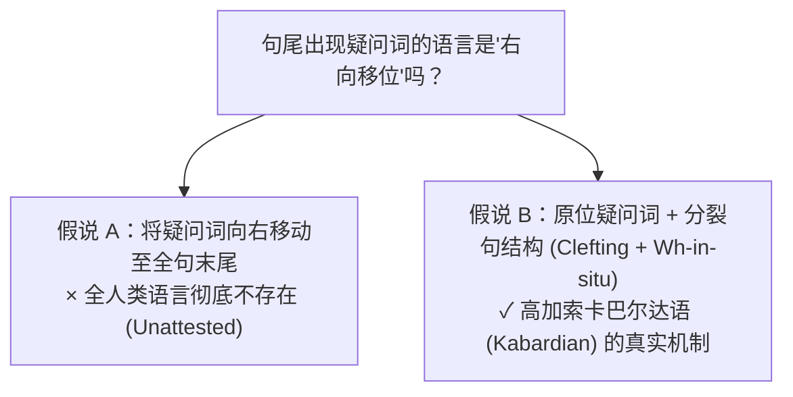
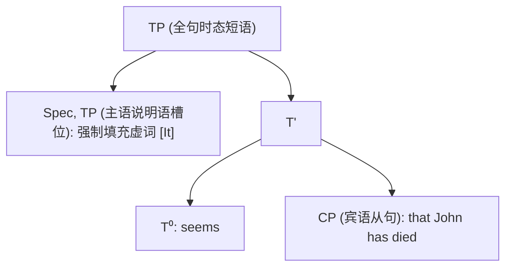
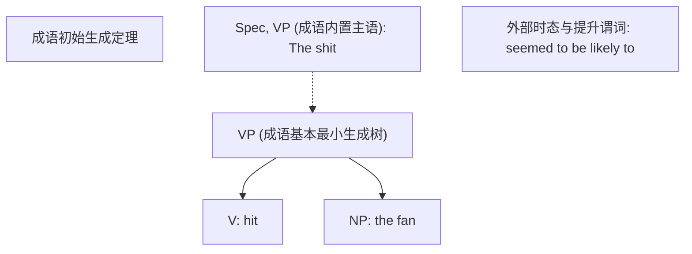
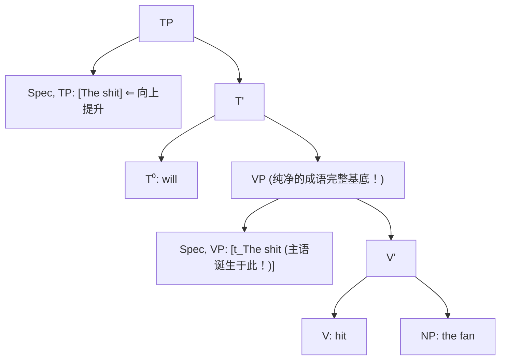

# Lec 15 句法学（五）：普遍语法未见类型、扩充投射原则与成语边界

> MIT 24.900 · 语言学导论 · 主讲 Norvin W. Richards

## TL;DR

- **普遍语法通过未见类型划界**：自然语言绝对不存在“右向 Wh-移位”与“数数限制移位”，卡巴尔达语尾端疑问词本质为分裂句原位谓语，证明心智语法受严格拓扑约束。
- **布罗卡区特异性激活**：神经语言学证实人类大脑仅响应层级结构依赖规则；当输入“在线性第 N 位加词”的人造规则时，语言中枢完全沉寂，只能靠通用认知区死记。
- **扩充投射原则（EPP）的强力驱动**：时态中心语 $T^0$ 强迫 $[Spec, TP]$ 必须显性填补，导致无参与者论元的天气动词必须凭空空降虚词主语（*It rains*）。
- **成语动宾不对称性确证结构分层**：词库中成语仅以动宾短语（$VP$）打包封装，主语作为外部论元无法进入成语内核，实证了 X-杠理论的论元层级划分。

## 1. 语言学核心追问：那些“从未存在过的语言”教给了我们什么？

**Norvin Richards 教授**：  
大家下午好！抱歉稍等一下，我去把门关上……*（关门未果，门又弹开）*……好吧，我被一扇门彻底打败了，这太令人悲伤了。*（全场笑）*

今天我们进入句法学的第五讲。如果大家在心里嘀咕“我们到底什么时候才能讲完句法学啊？”，我可以向大家保证：我们确实快要结束句法学了，大概还有一到两次课。所以请大家暂时别看教学大纲，我很快会更新进度表。

我在学期初曾向大家承诺过：在理论语言学中，有一种极其强大的研究范式——**负面证据与未见类型（Unattested Types）**。  
我们在世界各地的田野调查中会发现千奇百怪的语言现象；但更为震撼的是：**有大量在逻辑上极其自洽、在计算机编程中极其易于实现、人类非常容易想象的语法规则，在全人类几千门真实语言中却彻头彻尾从未出现过一次！**

为什么？因为**作为人类的一员，我们的大脑天生具备一套特殊的生物学结构，使得我们只能以某些特定方式构建语言系统，而坚决拒绝其他逻辑可能！**  
语言学的核心终极使命，正是通过有限的数据，去破解人类大脑这座内在生成引擎的底层运行法则。

---

## 2. 世纪未见类型之一：为什么绝对没有“右向 Wh-移位语言”？

上节课我们讲到疑问词移位（Wh-Movement）：

- 像英语、芬兰语、他加禄语（Tagalog），通常将疑问词左移至句首（*What will Mary write?*）；
- 像汉语普通话、非洲巴丰语（Bafut）、美洲霍皮语（Hopi），疑问词则留在原位（Wh-in-situ：“张三买了什么？”）；
- 像保加利亚语，则是所有疑问词成群结队全员前移。

在逻辑上，我们完全可以轻而易举地发明一种“反向对称语言”：

> **假想语言：右向 Wh-移位语言（Rightward Wh-Movement Language）**  
> 规则：将句子里的疑问词，通通拔起移动到**全句的最末尾**！  
> 例如将“谁吃了饼干？”说成：`*Has eaten the cookies who?`

**全人类有哪怕一门自然语言这么干吗？零！彻底不存在！**

当我在飞机上给旁边的乘客讲起这个事实时，常有人凭常识猜测：“在疑问句中，疑问词是最核心的焦点嘛！因为重要，所以人类习惯把它放在最前面！”

### 2.1 高加索卡巴尔达语（Kabardian）的表象与真相

真的只有左边才能表焦点吗？事实上有语言**把疑问词放在句末**，比如高加索地区的**卡巴尔达语（Kabardian）**！  
在卡巴尔达语中，“谁吃了肉？”这句话的字面发音就是以疑问词“谁”收尾的。

但是，这是否意味着卡巴尔达语是“右向 Wh-移位语言”？**绝对不是！**  
如果你深入卡巴尔达语的底层句法架构，你会发现它采用了**分裂句（Clefting）**结构：

- 在卡巴尔达语中，你不能直接说“谁吃了肉？”，你必须说：
  $$\text{“[吃了肉的那个人] 是 [谁]？”} \quad (\text{The one who ate the meat is who?})$$
- 这里的疑问词“谁”之所以落在句尾，根本不是因为它发生了向右移位，而是因为卡巴尔达语的表语谓词原本就位于句末，**疑问词仅仅是安坐在它的底层原位（Wh-in-situ）上！**



因此，全人类语言共享一个不可动摇的普遍语法铁律：**绝对不存在真正的向右 Wh-移位（No True Rightward Wh-Movement）！** 所有显性移位在拓扑几何上都呈现出惊人的**左向不对称性（Leftward Asymmetry）**！

---

## 3. 世纪未见类型之二：为什么人类语言绝不“数数”？

再看另一个逻辑上极其简单的假想规则。  
在多重疑问句中：

- 汉语移动 0 个（全部原位）；
- 英语移动 1 个（*What did you give to whom?*，其余原位）；
- 保加利亚语和莫霍克语（Mohawk）移动全部（*What to whom did he give?*）。

**全人类自然语言的全部取值范围，只有 0、1 和“全部（All）”！**

大家都是 MIT 的学生，数学素养远在我之上。除了 0、1 和全部，自然界还有无穷无尽的数字！我们完全可以想象这样一门语言：

> **假想规则：“移动疑问词，但最多只能移动 2 个！（Move up to a maximum of 2 wh-phrases）”**  
>
> - 有 1 个疑问词时：移动 1 个；
> - 有 2 个疑问词时：移动 2 个；
> - 出现 3 个疑问词时：只移动前 2 个，第 3 个留原位（*Who what gave to whom?*）。

在编程中实现这个逻辑只需一行代码 `if count <= 2: move()`。  
但**在全人类所有语言中，这种“数数到特定常数（如恰好移 2 个、移质数个、移圆周率前十位）”的语法规则，彻底零存在！**


---

## 4. 语言习得的逻辑困境与学者克里斯托弗（Christopher）的实证

现在，让我们回到上节课结束时的那个多项式数学游戏：

```
已知函数 f(x) 满足：
f(1) = 1
f(2) = 2
f(3) = 3
f(4) = 4
问：f(5) = ?
全班脱口而出：“5！”
但真实函数其实是：f(x) = (x-1)(x-2)(x-3)(x-4) * 6 + x
此时 f(5) = 29！
```

有限的经验数据输入，在纯数学逻辑上**永远对应着无穷多种彼此兼容的生成规则**！这就是科学哲学中著名的**归纳难题（Problem of Induction）**。

### 4.1 保加利亚婴儿的思想实验

设想你是一个在保加利亚家庭成长的婴儿。在你的童年时期，你从父母口中听到的多重疑问句样本在数量上是极其有限的：

- 父母或许问过带有两个疑问词的句子（*“谁把什么拿走了？”*）；
- 偶尔问过带有三个疑问词的句子；
- 但几乎绝不可能有哪对父母在日常生活中疯狂向婴儿连续抛出包含五个疑问词的复合句！

*（教授学术趣闻）*  
“我当年的博士论文就是专门研究多重疑问句的。这种句子在人类日常语料中极其罕见！比如在长达几十万字的美洲原住民瓦姆帕诺亚格语（Wampanoag）《圣经》译本中（那是 1635 年在波士顿出版的美洲大陆第一部圣经，我为了抢救该语言逐字研读了多年），我翻遍了整部圣经，**整部圣经里没有任何一句多重疑问句！** 我多么渴望耶稣基督能在某天转过身对门徒们大声问一句：‘到底是谁把什么买来了？’，但他从来没这么问过！”

如果人类儿童的大脑真是一块纯粹的数据拟合白板，那么不同家庭的孩子面对有限样本，必然会分化出五花八门的语法系统：有的孩子猜“最多移两个”，有的猜“最多移三个”……  
**然而科学实验表明：全保加利亚所有的儿童，无论成长环境如何，成年后其语法直觉 100% 毫无分歧地统统收敛于‘移动全部（Move ALL）’！**

### 4.2 语言白痴天才克里斯托弗（Christopher the Savant）

在英国认知神经科学界，有一位著名的学者研究对象——**克里斯托弗（Christopher）**。  
克里斯托弗在日常智商测验中表现极低，缺乏基本生活自理能力，甚至需要看护人员贴身照顾；但他却是一个绝世罕见的**语言学超级神童（Polyglot Savant）**！他仅凭阅读语法书，就能在几天之内自学掌握几十门完全不同的自然语言，能极其流利地读写二三十门外语！

语言学家曾对克里斯托弗进行了一组残酷的实验：

- 科学家编造了两门完全虚构的假想语言教给他；
- **语言 A**：规则完全符合人类普遍语法（UG），只是词汇是人造的；
- **语言 B**：人为植入了违反普遍语法的规则（比如“在遇到否定句时，将否定词固定放在句子从左数起第 3 个单词的位置”，或者“最多移动 2 个疑问词”）；
- **实验结果令人震撼**：克里斯托弗在极短时间内神速掌握了语言 A；**但在面对语言 B 时，这位语言天才的大脑陷入了彻底的瘫痪与崩溃，无论怎么教都完全学不会！**

这无可辩驳地证明：**人类语言习得绝非通用智能的机械试错，我们的大脑硬件内刻录着普遍语法的坚硬边界！**

---

## 5. 扩充投射原则（EPP）与虚词主语（Expletive It）

现在，让我们回到句子骨架的时态短语（TP）上。

此前我们反复强调过投射原则（Projection Principle）：及物动词选择宾语，不及物动词不选择宾语。  
但是在句子的主语位置上，存在一个完全不对称的奇异现象：

- 人类语言从来不探讨“及物主语动词”或“不及物主语动词”；
- **在英语和法语中，无论谓语动词是什么，主语槽位绝对、必须强制被填满！**

观察以下两句话：

```
Sentence 1: It squeezed John.          (它勒紧了约翰)
Sentence 2: It seems that John has died. (似乎约翰已经死了)
```

这两句话开头的代词 **it**，在句法和认知地位上存在天壤之别：

- **在 Sentence 1 中**：如果你突然听到这句话，你一定会本能地追问：“**到底是什么勒紧了约翰？！**”（是一台机器？一条大蟒蛇？还是一只怪物？）；这里的 *it* 是一个**有实际指称意义的真代词（Referential Pronoun）**；
- **在 Sentence 2 中**：如果你听到“似乎约翰已经死了”，你**绝对不会愚蠢地追问：“到底‘什么’似乎约翰死了？你说的这个‘它’到底是谁？！”**  
  因为这里的 *it* 纯属无稽之谈，它没有任何概念语义，它是一个纯粹的**虚词主语（Expletive / Dummy Pronoun）**！



### 5.1 乔姆斯基的 EPP 补丁

为什么英语非要强行塞进一个毫无意义的虚词 `it`？  
乔姆斯基在 1982 年提出了著名的：

> **扩充投射原则（Extended Projection Principle, EPP）：**  
> **时态短语的说明语位置 $[Spec, TP]$（即全句的表层主语位置）必须被显性短语所填充，绝对禁止裸露为空！**

*（Norvin 教授笑称）*  
“乔姆斯基把它命名为‘扩充投射原则’，这在理论上完全是一个公然的生搬硬套（An obvious hack）！它跟原本的投射原则没有任何内在逻辑联系。乔姆斯基之所以这么叫它，不过是给它画上一个醒目的大红靶心，好让全世界的句法学家们去拼命研究：‘人类大脑为什么非要有这么一个必须填满主语的怪癖？！’”

而在西班牙语或意大利语等虚主语语言（Null Subject / Pro-drop Languages）中，它们无需 EPP，可以直接裸露动词说 *Parece que Juan ha muerto*（似乎胡安死了）。这展现了参数化的跨语言变异。

---

## 6. 名词短语移位（NP-Movement）：被动句与提升句

EPP 的存在，直接催生了生成语法中最核心的第二大移位——**NP-移位（NP-Movement / A-Movement）**！

### 6.1 被动语态（Passive）中的位移

思考及物动词 *squeeze*（勒紧）和 *put*（放置）：

- 主动句：*The snake squeezed John.*
- 被动句：*John was squeezed.*

在主动句中，*John* 是动词 *squeeze* 的直接宾语（补足语）。而在被动句中：

1. 施事主语 *the snake* 被剥夺抹除；
2. 底层动词短语形成了 `[was squeezed John]`；
3. 此时，全句最高节点 TP 亮起了鲜红的警报灯——**EPP 咆哮道：“我的 $[Spec, TP]$ 主语位置空了！这绝对非法！”**
4. 于是，原位宾语 *John* 被一股强大的力量向上一把抽起，搬迁至 $[Spec, TP]$ 位置，成为表层语法主语！

$$\text{底基：}[_{TP} \ \underline{\quad\quad} \ [_{T'} \ \text{was} \ [_{VP} \ \text{squeezed } \mathbf{John}]]] \quad \xrightarrow{\text{EPP 驱动移位}} \quad [_{TP} \ \mathbf{John}_i \ [_{T'} \ \text{was} \ [_{VP} \ \text{squeezed } t_i]]]$$

---

### 6.2 提升动词（Raising Verbs）中的跨句移位

不仅被动句如此，像 *seem* 这样的提升动词同样展现了这一奇迹：

- 方案 A（插入虚词满足 EPP）：*It seems that John is sick.*
- 方案 B（提取下层主语满足 EPP）：**John seems to be sick.**

在方案 B 中，*John* 最初明明是下层不定式从句的主语（*John be sick*）；但由于上层主句的时态中心语面临 EPP 的填补饥渴，*John* 被长途跋涉**跨从句提升（Raising）**到了上层主语位置！

---

## 7. 终极大招：成语（Idioms）对 NP-移位的无可辩驳的铁证

我们怎么向全天下证明：在 *John seems to be sick* 里，*John* 真的曾经在下层呆过？

**答案是：英语成语（Idioms）的深层句法黏结性！**

成语是词库中语义高度凝固、不可替换的超大词汇块：

- *kick the bucket*（翘辫子/去世；你绝不能说 *punt the bucket* 或 *kick the pail*）；
- *buy the farm*（阵亡/去世）；
- *spill the beans*（泄露秘密）；
- *yawn in Technicolor*（彩色打哈欠 $\rightarrow$ 大吐特吐/呕吐；加州大学洛杉矶分校 UCLA 与澳洲俚语！MIT 的俚语全都是关于熬夜做作业的）。

### 7.1 成语的结构不对称定律

请大家思考一个震撼的语料事实：

- 世界上有成千上万个 **[动词 + 宾语]** 构成的成语（其主语可以由任何人充当，如 *John / Mary / Anyone kicked the bucket*）；
- 或者全句性成语（*The cat got your tongue*【猫叼走了你的舌头/支支吾吾】, *The cat is out of the bag*【真相大白】, ***The shit hit the fan***【场面失控大祸临头】）；
- **但是，在全人类语言中，绝对零存在任何仅仅由 [主语 + 动词] 构成、而宾语可以任意填入的成语！**（没有任何成语规定“只要主语是犰狳，动词是咬，宾语随便填谁，整体都代表‘头疼’”）。

**成语在最初生成时，必须且只能是一个完整的连续句法成分（Constituent）！**



### 7.2 撕裂成语的 NP-移位

现在，请看当成语遭遇提升动词时的不可思议现象：

$$\text{“The shit seemed to hit the fan.”}$$
$$\text{“The shit seemed to be likely to hit the fan at any minute.”}$$

在这两句话中，**整句 100% 毫无争议地保留了成语的完整引申义（场面即将彻底失控）！**  
但是，成语的主语 *the shit* 与谓语 *hit the fan* 之间，**被生生插入了长达两三层的无关谓词（*seemed to be likely to*）！**

如果在表层树上，*the shit* 和 *hit the fan* 根本不是一个连续成分，它们凭什么能触发整体成语的特异语义？！

答案唯有 **NP-移位（NP-Movement）**：
$$\text{深层基底：}[ \ \text{seemed to be likely [ } \mathbf{the \ shit} \ \text{to hit the fan} \ ] \ ]$$
在句法生成的最初一瞬间，**[the shit hit the fan] 作为一个天衣无缝的完整成分在最底层合并，成功激活了成语语义！**  
随后，为了满足顶层时态短语极其贪婪的 EPP 饥渴，主语 *the shit* 一步步跨越层级，被向上抽取提升到了最前端！

---

## 8. 课堂重大泄密：动词短语内主语假说（VP-Internal Subject Hypothesis）

在课程的最后几分钟，台下一位目光敏锐的同学站起来，指着黑板上的经典树形图，发出了灵魂一问：

**学生质疑**：
“教授，如果按照您之前教我们的树形图：
$$\text{“The shit will hit the fan.”}$$
在这个最普通的一般将来时句子里，助动词 *will* 住在 $T^0$；如果主语 *the shit* 一开始就直接合并在 $[Spec, TP]$，那么 *the shit* 和 *hit the fan* 之间就隔着一个不属于成语的 *will*！它们在底层就根本没能抱团成一个纯粹的成分啊！”

Norvin 教授在讲台前倒退两步，抱头大呼：  
“天啊！我本来竭尽全力想向你们隐瞒这个秘密的，因为这门课只是本科低年级导论课！但我早该知道，**在 MIT 的课堂上，你绝对妄想瞒过任何一个学生！**

你刚才独立发现的，正是 1980 年代末轰动整个世界语言学界的里程碑发现——**动词短语内主语假说（VP-Internal Subject Hypothesis）！**”



### 8.1 终极真理揭晓

主语虽然最终表层居住在 $[Spec, TP]$，**但它最初从来都不是在那里诞生的！**  

1. **第一阶段（语义生成）**：主语与宾语全都在动词短语内部（$[Spec, VP]$ 与 $VP$ 补足语）与动词共同诞生！在此阶段，成语得以封装为纯粹无瑕的最小成分！
2. **第二阶段（EPP 驱动移位）**：为了满足时态中心语 $T^0$ 的 EPP 强特征，主语必须无条件执行**长距离向上跃迁**，最终搬迁至全句表层的 $[Spec, TP]$！

下课铃声响起。Norvin 教授笑着擦去黑板上的板书：  
“今天你们学到了远超教学大纲预
