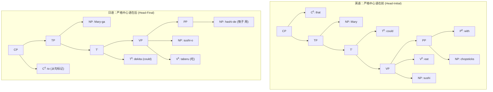
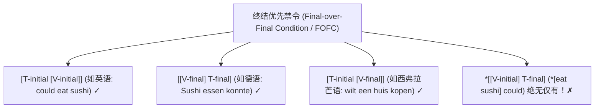
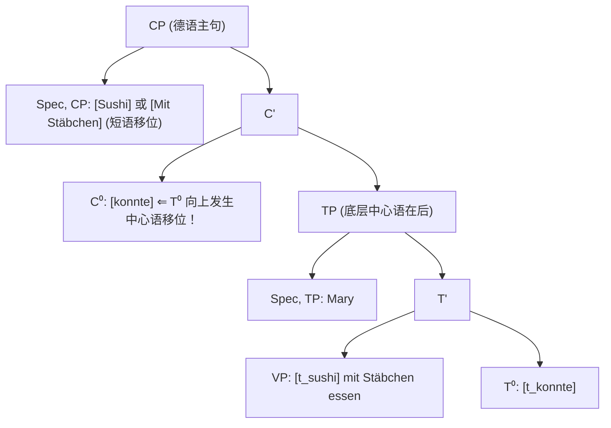
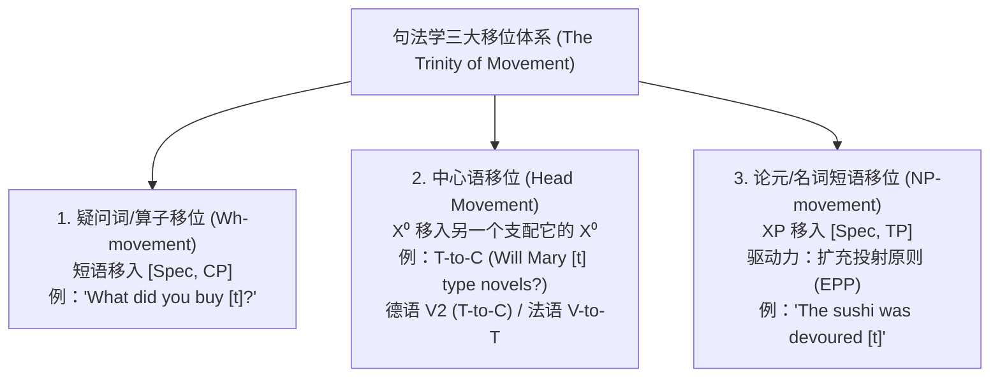
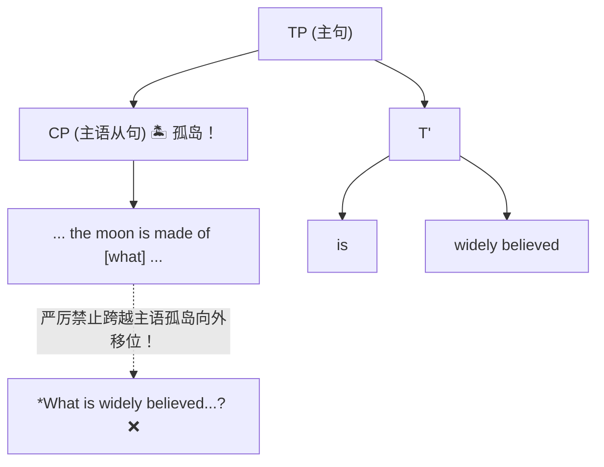

# Lec 16 句法学 VI ：Head Directionality、FOFC、Movement & Islands

## 1. 课前行政安排与中心语方向参数（Head-Directionality Parameter）

**Norvin Richards 教授**：  
大家下午好！很高兴今天看到这么多人。今天有几件事务性的事情要宣布。首先，我们发布了一个新的作业，是关于句法学的——第三次作业。如果你已经看过了，你会发现其中有很多关于画树形图的练习。大家务必仔细阅读上面的说明。

我们今天将继续探讨句法学。在前面的讨论中，我们画出了大量的句法树，并且基本都以英语为主。在英语中，我们发现了一个压倒一切的普遍规律：**中心语在前（Head-Initial）**。也就是说，中心语永远位于它的补足语（sister/complement）之前：

- 动词先于宾语：`[eat] sushi`（吃 寿司）；
- 介词先于名词短语：`[with] chopsticks`（用 筷子）；
- 补足语引导词（C）先于时态短语（TP）：`[that] Mary could eat sushi`（玛丽可以用筷子吃寿司）。

但是，如果我们把中心语的位置镜像对调，语言会变成什么样？在世界语言中，有许多语言系统性地执行**中心语在后（Head-Final）**。比如日语、韩语或土耳其语：

- 宾语先于动词（SOV）：*sushi-o taberu*（寿司 吃）；
- 名词先于介词（使用后置词 Postposition）：*hashi-de*（筷子 用）；
- 句子先于时态助动词：动词短语在前，时态在后；
- 从句补足语引导词挂在整句的最末端：*to* 出现在整个从句之后！

所以，在日语这样的语言中，中心语永远跟在补足语后面。英语是中心语在前，日语是中心语在后。这就是著名的**中心语方向参数（Head-Directionality Parameter）**。

---

## 2. 混合中心语方向与终结优先禁令（Final-over-Final Condition, FOFC）

### 2.1 混合中心语方向语言（Mixed-Headed Languages）

世界上的语言并非非黑即白地全盘选择“在前”或“在后”。很多语言具有**混合中心语方向（Mixed Headedness）**。

比如德语（German）的内嵌从句：

- 引导词是前置的：`dass`（that）放在句首；
- 介词是前置的：`mit`（with）放在名词短语之前；
- 但是动词短语和时态是中心语在后的：宾语在动词前，动词短语在助动词前！
  $$\text{“...dass Mary mit Stäbchen Sushi essen konnte.”} \quad (\text{“...即玛丽用筷子寿司吃能够”})$$

又比如西弗拉芒语（West Flemish，比利时的一种日耳曼语方言）：

- 引导词在前：`dat`（that）；
- 但时态助动词在前：`wilt`（wants）；
- 动词却在宾语之后：中心语在后！
  $$\text{“...dat Jan wilt een huis kopen.”} \quad (\text{“...即扬想要一座房子买”})$$

### 2.2 FOFC 普适禁令（Final-over-Final Condition）

既然语言可以在不同层级上混合“在前”与“在后”，那么在一个从句的动词投射链条（$TP \rightarrow VP \rightarrow NP$）中，理论上存在四种数学组合逻辑：

| 逻辑组合       | 结构示例                             | 时态 T 的方向                | 动词 V 的方向                | 现实语言分布                          |
| -------------- | ------------------------------------ | ---------------------------- | ---------------------------- | ------------------------------------- |
| **1. 前 + 前** | `[that Mary [could [eat sushi]]]`    | 中心语在前（T 在 VP 前）     | 中心语在前（V 在 NP 前）     | **极度普遍**（英语、罗曼语族等）✅     |
| **2. 后 + 后** | `[dass Mary [[Sushi essen] konnte]]` | 中心语在后（T 在 VP 后）     | 中心语在后（V 在 NP 后）     | **极度普遍**（德语、日语、土耳其语）✅ |
| **3. 前 + 后** | `[dat Jan [wilt [een huis kopen]]]`  | 中心语在前（T 在 VP 前）     | 中心语在后（V 在 NP 后）     | **存在**（西弗拉芒语等）✅             |
| **4. 后 + 前** | `*[that Mary [[eat sushi] could]]`   | **中心语在后（T 在 VP 后）** | **中心语在前（V 在 NP 前）** | **全球彻底绝迹！❌❌❌**                 |

这就是由 Theresa Biberauer、Anders Holmberg 与 Ian Roberts 等语言学家提出的 **FOFC 条件（Final-over-Final Condition）**：

> **终结优先条件（FOFC）**：  
> 在同一个扩展投射路径（Extended Projection，如动词短语到时态短语）中，一个**中心语在后（Head-Final）**的高阶短语，绝对不能直接支配一个**中心语在前（Head-Initial）**的低阶短语！

你可以“在外层选前向，内层选后向”（西弗拉芒语）；但人类语言的大脑结构彻底禁止“在外层选后向，内层选前向”！在芬兰语和巴斯克语等语序极其自由的语言中，任何排列都可以，唯独这种组合被绝对排除。

**学生提问**：对于动词位于句首（Verb-Initial）的语言呢？  
**Norvin Richards 教授**：这是一个极好的问题。在全人类所有动词句首语言中，疑问词移位（wh-movement）全部都是显性发生的（至少可选）。世界上存在显性移位的语言，存在疑问词原位的语言，也存在二者兼备的语言；但**绝对没有**既是动词句首、又强制要求疑问词原位（obligatory wh-in-situ）的语言！我在自己写的一本书里曾试图从理论上推导这个事实。不过我不太想在课堂上教我自己的理论，因为我可能是错的——我知道这很难相信，但我确实可能是错的！我在这门课上只讲那些绝对被公认为真实的事实。

---

## 3. 德语动词第二位现象（V2）与假想语言之谜

### 3.1 德语主句中的 V2 现象

在德语从句中，时态和动词都在句末。但如果你对一个懂德语的人说德语主句也是这样，他们会对你皱眉头。因为德语主句表现出著名的**动词第二位现象（Verb-Second, V2）**：

- *Mary **konnte** mit Stäbchen Sushi essen.*（玛丽可以用筷子吃寿司。）
- *Mit Stäbchen **konnte** Mary Sushi essen.*（用筷子，玛丽可以吃寿司。）
- *Sushi **konnte** Mary mit Stäbchen essen.*（寿司，玛丽可以用筷子吃。）

你必须把**恰好一个短语**（不管是主语、介词短语还是宾语）放在第一位，然后承载时态的有限助动词（如果有）或动词本身必须紧随其后排在**第二位**！你绝对不能说：
$$\text{*\“Mit Stäbchen Sushi konnte Mary essen.”} \quad (\text{两个短语占领第一位，绝对非法 ❌})$$

如果没有助动词，动词就会变化词形占据第二位（如 *isst*）。不仅是主句，只要是从属从句中没有出现显性引导词 `dass`（that），就会触发**内嵌 V2（Embedded V2）**：

- *Er sagte, Mary wollte mit Stäbchen Sushi essen.*（他说玛丽想用筷子吃寿司。）

### 3.2 V2 的句法树推导：中心语移位与短语移位

V2 是如何生成的？其机制非常清晰：

1. 德语底层的 CP 是中心语在前的（$C^0$ 在 $TP$ 之前）。
2. 如果 $C^0$ 中没有显性引导词（没有 `dass`），就会触发两件事：
   - **中心语移位（Head Movement）**：时态中心语 $T^0$（助动词或动词）向上移动到 $C^0$ 位置！
   - **短语移位（XP Movement）**：随机选取一个短语移入 $[Spec, CP]$ 位置！

### 3.3 跨语言 V2 与“不存在的假想语言”

V2 并非德语独有，它是跨语言常见的“出厂设置”之一：

- **克什米尔语（Kashmiri）**：印欧语系印度-雅利安语支，严格遵循 V2（有助动词时助动词居第二位，无助动词时动词居第二位）。Richards 教授开玩笑说：“克什米尔语基本上就是德语的一种极其古怪的方言。”
- **瓦塔语（Vata）**：西非科特迪瓦的克鲁语支语言，与德语毫无亲缘关系，也是严格的 V2 语言。
- **卡里蒂亚纳语（Karitiana）**（巴西图皮语系）、**印古什语（Ingush）**（高加索纳赫-达吉斯坦语系）、**丁卡语（Dinka）**（南苏丹尼罗-撒哈拉语系）全都是 V2 语言！

那么，既然德语是在左侧设立一个中心语在前的 $C^0$，并将一个短语移入左侧的 $[Spec, CP]$：

- 我们能否构建一个**镜像德语**？即 $C^0$ 是中心语在后的（放在句末），短语移入句末的 $[Spec, CP]$，动词永远排在**倒数第二位（Verb-Penultimate）**？
  **答案是：零！全人类至今从未发现任何一种“动词倒数第二位”的语言！**
- 同样，我们可以轻易用自然语言描述一种“**直接宾语第二位语言**”或“**主语第二位语言**”，但在人类句法中它们根本不存在！
- 句法树和移位理论之所以深刻，正是因为它能自然生成德语的 V2，同时在数学上封死了这些看似可以想象、实则在人类大脑中根本不存在的语言！

> **Norvin Richards 教授**：  
> 这就是我们谈论**普遍语法（Universal Grammar, UG）**时的真正含义！在科普读物中，你经常会读到有人声称“普遍语法已被推翻”、“普遍语法已死”等等。**那全是胡扯（All hooey）！你应该直接把那些文章扔进垃圾桶。** 普遍语法指的正是人类心智预装了构建语言的底层限制：某些结构是人类大脑绝对无法生成的盲区。

---

## 4. 句法学三大移位体系（The Trinity of Movement）

在回顾与总结中，Richards 教授系统归纳了支配人类语言的三大移位类型（他在板书上使用了句法学家的专属缩写 `mvmt`）：

### 4.1 跨语言差异与田野调查趣闻

不同语言对这三种移位的激活机制截然不同：

- **疑问词原位（Wh-in-situ）**：汉语、日语以及埃塞俄比亚的**恰哈语（Chaha）**（闪米特语族）。  

  > **田野趣闻**：Richards 教授在讲授研究生田野方法课时研究恰哈语。第一堂课他说了一句“这个男人煮了肉”，母语合作者断然拒绝：“不，我不能说这句话。”教授问为什么，对方回答：“**男人不进厨房做饭（Men do not cook）！**”  
  > 合作者还教过他们一个形容“极快”的恰哈语表达——“**在一口唾沫蒸发所需的时间之内**”。

- **缺乏 EPP 驱动的 NP-移位**：英语必须说 *The cookies were devoured*，强制将被动宾语提升为主语；但意大利语可以直接说 *Sono stati mangiati i biscotti*（字面为：已经被吃光了 那些饼干），意大利语没有 EPP 强制要求 $[Spec, TP]$ 必须被占领。

- **动词抬升至 T（V-to-T）**：

  - 英语：*Mary often speaks French.*（动词留在副词之后）。
  - 法语：*Marie parle souvent français.*（动词 *parle* 必须强制抬升到 $T^0$，跃迁至副词 *souvent* 之前！英语绝不能说 *\*Mary speaks often French*）。

---

## 5. 移位的禁区：孤岛限制（Islands）与最短移位条件

移位并非毫无约束。句法树中存在许多“移位禁区”，语言学中形象地称之为**孤岛（Islands）**（由 John R. Ross 于 1967 年提出）。正如 Richards 教授所比喻的：**“疑问词不会游泳；岛上没有桥也没有船，如果你被困在孤岛内部，你就注定出不去了！”**

### 5.1 并列结构限制（Coordinate Structure Constraint）

- *I ordered a hamburger and French fries.*（我点了一个汉堡和炸薯条。）
- 试图将其中一个移出：
  $$\text{*\“What did you order a hamburger and [t]?”} \quad (\text{致命违规 ❌})$$
  $$\text{*\“What did you order [t] and a hamburger?”} \quad (\text{同样致命违规 ❌})$$

#### 课堂辩论与“摩西错觉”（The Moses Illusion）

一位学生提出异议，觉得第一句听起来没那么糟。  
**Norvin Richards 教授**：你的意思是如果有人这么问你，你会直接回答“炸薯条”？  
**学生**：对，仔细想想确实语法不对，但听起来好像不奇怪。  
**Joseph**：在 *order* 后面加个冒号停顿一下会不会自然一点？比如 *“What did you order: a hamburger and...?”*  
**Kateryna**：当你说 *“You ordered...”* 时，这是否相当于没有做 wh-移位只是省略了 *what*？  
**Raequel**：如果对方问的是 *“What did you order a hamburger with?”*（你点汉堡配了什么？），那就完全合法了。  
**Norvin Richards 教授**：Raequel 说的很关键！这反映了人类对话中的**宽容原则**。当你听到这句话时，你在大脑里自动脑补并替对方修正成了合法的介词短语。这很像认知心理学里的**摩西错觉（Moses Illusion）**：如果你在大街上问别人“摩西带了多少只每种动物下方舟？”，大部分人会毫不犹豫回答“两只”。但其实在圣经里，造方舟的是诺亚，根本不是摩西！人类大脑倾向于假设对方说了合情合理的话，并在理解时替对方完成修复。

### 5.2 that-语迹效应（that-trace Effect）与方言变异

- 宾语提取（有无 that 均完美）：  
  *Who do you think (that) we should vote for [t]?* ✅
- 主语提取（that 紧邻语迹时触发严重违规）：  
  - 省略 that：*Who do you think [t] should win the election?* ✅  
  - 保留 that：$$\text{*\“Who do you think that [t] should win the election?”} \quad (\text{绝大多数英语母语者判定严重违规 ❌})$$

> **文化趣闻**：Richards 教授指出，当他在课堂上讲到这页幻灯片时，偶尔会有一两个来自美国中西部（Midwest）的学生一脸惊恐地看着他。教授问：“你来自中西部对吧？”对方说是。在平坦开阔、农业发达的中西部部分方言里，这种句子竟然是可以接受的！

### 5.3 主语从句孤岛（Subject Island）

- 补足语从句中提取（完全合法）：  
  *People believe [that the moon is made of green cheese].*  
  $\rightarrow$ *What do people believe [that the moon is made of [t]]?* ✅
- 主语从句中提取（直接变成文字垃圾）：  
  *[That the moon is made of green cheese] is widely believed.*  
  $\rightarrow$ $$\text{*\“What is [that the moon is made of [t]] widely believed?”} \quad (\text{彻头彻尾的“文字沙拉”Word Salad ❌！})$$

---

## 6. 最短移位条件（Shortest Move）与优越律（Superiority）

为什么这些结构会阻止移位？现代句法学试图将其统一在**最短移位条件（Shortest Move）**之下：在两个候选移位之间，认知系统永远优先选择**路径更短（Shorter Path）**的那一个！

### 6.1 中心语移位限制（Head Movement Constraint, HMC）

由麦吉尔大学（McGill）语言学家 Lisa Travis 提出：

- 从 $T^0$ 移到 $C^0$：*Will Mary [t] type novels?* ✅（路径仅包含 $T'$ 和 $TP$）。
- 试图跳过 $T^0$，直接将动词 $V^0$ 移到 $C^0$：  
  $$\text{*\“Type Mary will [t] novels?”} \quad (\text{严重违规 ❌！})$$  
  从 $V^0$ 到 $C^0$ 的路径包含了 $VP$、$T'$ 和 $TP$，是前者的真超集（Superset）。因此更长、跨越更高中心语的移位被彻底拒绝！

### 6.2 优越律（Superiority Effect）与双疑问词问句

在包含两个疑问词的疑问句中：

- *Who bought what?*（谁买了什么？——移升较高的高阶主语 $who$）✅  
- *?What did who buy?*（移升较低的宾语 $what$，跨越主语 $who$）❓（明显劣质或不自然）
- *What did you give to whom?* ✅ vs *?Who did you give what to?* ❓

#### 详尽性要求（Exhaustivity）与课堂互动

**学生提问**：这种优越感是否与说话人认为句子中哪部分更重要有关？比如对方买了极其离奇的东西，我们问 *“What did you buy?”*。  
**Norvin Richards 教授**：这是一个深刻的观察。通常情况下，双疑问词疑问句的答案要求具有**详尽性（Exhaustivity）**：

- 如果问 *“Who bought what?”*，期望的回答是按**人**为索引列出每个人买了什么清单；
- 如果反过来问 *“What did who buy?”*，则是以**物品**为索引组织清单；
- 在医生询问病人吃了什么时要求详尽，但询问“哪儿能买到外文报纸？”时只需给出哈佛广场（Harvard Square）一个地点即可。
- 当全句只有一对可能解时（比如 Richards 教授和同事共进午餐，争抢买单时说：*“Well, who invited who?”*——谁请的谁？），此时语感判定极其鲜明，绝不能说 *\*Who did who invite?*！

移位理论与局部性条件的交织构成了句法学中最引人入胜的领域。下一讲（第 17 讲），我们将进一步揭开最短移位与语义接口的完整图景！

