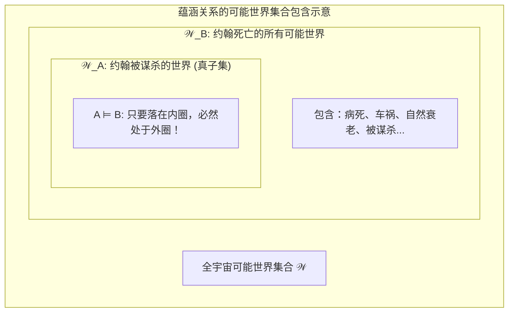

# Lec 17 句法语义过渡：极小移位、丁卡语与真值条件

> MIT 24.900 · 语言学导论 · 主讲 Norvin W. Richards

## TL;DR

- **极小移位确立局部经济性**：句法探针必须吸引结构距离最近的候选算子，跨越更近疑问词会直接触发疑问孤岛（Wh-Island）违规。
- **丁卡语确证跨语言几何同构**：南苏丹丁卡语展现出严格的 V2 移位竞争，实证了不论语音外化多么迥异，心智底层共享同一套句法拓扑。
- **语义学以真值条件奠基**：理解句子的意义等价于掌握使其为真的可能世界集合（Truth Conditions），而非查阅经验词典。
- **否定测试法剥离蕴涵与预设**：蕴涵（$A \vDash B$）在主句加否定后灰飞烟灭，而背景预设（如罗素“法国国王是秃头”）在否定下依然顽固存活。

## 1. 课程定位与问题意识

在完成了句法树的层次投射、X-杠理论以及三大移位体系后，句法学留下了一个至关重要的未解悬念：当一个句子内部存在多个结构完全合法的移位候选者时，句法系统依照何种物理原则进行仲裁？

本讲前半部分以“极小移位原则（Shortest Move）”收官句法学核心模块，并引入南苏丹丁卡语（Dinka）的田野实证，证明移位经济性是跨越语系的生物普适硬件；后半部分则迈过句法与意义的界碑，正式推开**形式语义学（Formal Semantics）**的哲学殿堂——告别基于主观词典的模糊定义，建立基于“可能世界”的真值条件、逻辑蕴涵与预设识别框架。

## 2. 核心概念

| 概念 | 严密定义（用自己的话） | 容易混淆的邻居 | 典型实例 / 判据 |
|---|---|---|---|
| **极小移位原则（Shortest Move / Attract Closest）** | 普遍语法中的计算局部性公理：当泛函中心语探针需要吸附成分时，必须且只能吸引结构距离最近的合法目标。 | 自由移位（自然语言不允许跳过更近的同类算子去抓取远距离成分）。 | 阻断跨越疑问词提取：*\*Who do you wonder what Bill gave to [t]?* |
| **疑问孤岛限制（Wh-Island Constraint）** | 一旦从句的补足语说明语位置（Spec, CP）被一个疑问词占据，该从句整体便沦为封闭孤岛，禁止外部探针从中提取其他成分。 | 复杂名词短语孤岛（疑问孤岛特指由内嵌疑问算子引起的局部性干扰与特征干涉）。 | *\*Which book did Mary ask who read [t]?* |
| **真值条件（Truth Conditions）** | 形式语义学的核心范畴：一个陈述句的语义等价于使该句子判定为“真”的现实或可能世界的充要条件集合。 | 经验真假（真值条件是“何种条件下为真”，即使现实中为假，句子仍然具有完全确定的真值条件）。 | *“拜登是单身汉”* 的真值条件是：存在一个实体拜登且具有未婚成年男性的属性。 |
| **真值蕴涵（Entailment, $\vDash$）** | 命题间的语义包含关系：如果对于所有使命题 $A$ 为真的可能世界，命题 $B$ 也必定为真，则称 $A$ 蕴涵 $B$（$A \vDash B$）。 | 语用推理（蕴涵是纯逻辑真值必然性，不依赖语境、听话人预期或说话人礼貌原则）。 | *“约翰被谋杀了”* $\vDash$ *“约翰死了”*。 |
| **预设（Presupposition）** | 保证一个句子能够具有真值评价资格所必须预先满足的共同背景信念，具有否定恒常性。 | 蕴涵（蕴涵在主句加否定后失效；预设在主句加否定、转疑问或加情态动词后依然存活）。 | *“法国国王是秃头”* 预设 *“世上存在一个法国国王”*。 |

## 3. 证据链与形式推导

### 3.1 极小移位原则与疑问孤岛的生成

考察包含双疑问词的底层间接疑问句：
- **底层深层结构**：*You wonder [CP Bill gave **WHAT** to **WHO**]*
- **合法局部移位**：内嵌从句吸附最近的 *what*，生成合法的间接疑问句：
  - *You wonder [CP **what** Bill gave [t] to who]*
- **灾难性非法移位**：如果此时主句的顶层疑问探针试图跨过内嵌从句，去抓取更远处的 *who*：
  - *\*Who do you wonder **what** Bill gave to [t]?*（**严重语法崩溃 ❌！**）

```mermaid
flowchart TD
    subgraph WhIslandConflict ["疑问孤岛与极小移位冲突图解"]
        C0Top["主句顶层探针 C⁰ [+Q] (需要吸附 Wh-疑问词)"]
        
        subgraph EmbeddedCP ["内嵌从句 CP 孤岛"]
            SpecCP["Spec, CP: [ WHAT ] (更近的目标，距离 1 步)"]
            InnerTP["TP: Bill gave ..."]
            TargetWho["PP: to [ WHO ] (更远的目标，距离 2 步)"]
            
            SpecCP --- InnerTP
            InnerTP --- TargetWho
        end
        
        C0Top -->|合法搜寻：吸附最近目标| SpecCP
        C0Top ==x|❌ 绝对禁止：跨越更近的同类算子 (极小移位违规)| TargetWho
    end
```

这种现象由语言学家 Luigi Rizzi 归纳为**相对极小性理论（Relativized Minimality）**：一个类型为 $X$ 的探针，在向下搜寻目标 $Y$ 时，其视线绝对不能被中间具有相同范畴类型的介入者 $Z$ 所遮挡。内嵌的 `what` 构筑了一堵特征干涉墙，任何试图跨越该墙提取 `who` 的操作都会瞬间遭遇计算过载。

### 3.2 南苏丹丁卡语（Dinka）的跨语言田野验证

极小移位与局部性约束绝非印欧语系英语的专利。考察东非南苏丹的尼罗-撒哈拉语系代表语言——**丁卡语（Dinka）**。

丁卡语以其极致复杂的语音特征闻名（三级对立的元音长度：短、长、超长；松紧元音与嘎裂声对立）。而在句法结构上，丁卡语展示了极其严苛的 **动词第二位（V2）** 与局部性竞争：
1. **主句强制双槽位要求**：主句第一位（Spec, CP）必须有短语移入，动词紧随第二位；
2. **双宾语竞争格局**：当句子包含“给予”类动词与双宾语（与格短语与受事短语）时，探针必须严格根据层级距离仲裁哪个论元拥有优先移位权；
3. **经验启示**：丁卡语母语者在缺乏任何西方语言学训练的情况下，其大脑在毫秒间精准执行了与英语母语者完全相同的极小移位判决。这为普遍语法在全人类物种层面的生物同质性提供了坚实不可摧的田野实证。

## 4. 机制与形式推导：迈向语义学与可能世界

### 4.1 形式语义学的基石：真值条件与可能世界

日常生活中，人们常误认为“语义”就是给字词下定义的百科知识。但形式语言学指出，**人类掌握语言意义的核心机制，是大脑对命题真值条件（Truth Conditions）的形式演算**。

::: definition 形式语义真值条件公理
理解一个陈述句 $S$ 的语义，在形式上等价于掌握一套由该语言句法与词汇规则共同确立的判定函数：
$$f: \mathcal{W} \rightarrow \{0, 1\}$$
其中 $\mathcal{W}$ 为所有可能世界（Possible Worlds）构成的宏观宇宙。该函数能够无歧义地将世界划分为两个不相交的集合：
- 使 $S$ 为真的世界子集：$\mathcal{W}_{true} = \{w \in \mathcal{W} \mid \text{Eval}(S, w) = 1\}$
- 使 $S$ 为假的世界子集：$\mathcal{W}_{false} = \{w \in \mathcal{W} \mid \text{Eval}(S, w) = 0\}$
:::

无论现实世界中当前事实上发生了什么，只要心智掌握了该句的语法结构与词义组合，便能瞬时确定 $\mathcal{W}_{true}$ 的几何边界。

### 4.2 真值蕴涵（Entailment）矩阵与单向性

蕴涵是形式语义学中最纯粹的命题拓扑包含关系。若命题 $A$ 的真值可能世界集合完全被命题 $B$ 的可能世界集合所包含（$\mathcal{W}_A \subseteq \mathcal{W}_B$），则记作 $A \vDash B$。

| 命题 A（前提） | 命题 B（推论） | 蕴涵判定（A $\vDash$ B） | 逆命题判定（B $\vDash$ A） | 集合论解释与边界反例 |
|---|---|---|---|---|
| *Joe Biden is a bachelor.*<br>（拜登是个单身汉） | *Joe Biden is unmarried.*<br>（拜登是未婚的） | **必然蕴涵 ✅** | **绝不蕴涵 ❌** | 单身汉的世界是未婚世界的真子集；若拜登是婴儿、罗马教宗或鳏夫，则未婚但不属于单身汉。 |
| *John was murdered.*<br>（约翰被谋杀了） | *John is dead.*<br>（约翰死了） | **必然蕴涵 ✅** | **绝不蕴涵 ❌** | 谋杀世界的全集包含于死亡世界；若约翰死于癌症或自然老衰，则死亡但不属于被谋杀。 |
| *Norman and Don are brothers.* | *Don and Norman are brothers.* | **必然蕴涵 ✅** | **必然蕴涵 ✅** | 兄弟关系是对称二元谓词，两个命题的可能世界集合完全重合（真值等价）。 |



### 4.3 蕴涵与预设的界碑：否定测试法（The Negation Test）

在语言理解中，最棘手的混淆莫过于将**蕴涵（Entailment）**与**预设（Presupposition）**混为一谈。语义学家发展出了锋利的**否定测试法**：

::: theorem 否定测试法定理（The Negation Test）
当对包含特定语义推论的命题 $A$ 实施否定操作（生成 $\neg A$）时：
- **蕴涵推论彻底覆灭**：如果原本由 $A$ 蕴涵的推论 $B$ 在 $\neg A$ 下不再必然成立，则 $B$ 仅为 $A$ 的**真值蕴涵**；
- **背景预设顽固存活**：如果无论断言 $A$ 还是断言 $\neg A$，推论 $P$ 均必须预先成立才能使全句具有评价意义，则 $P$ 为命题的**预设**。
:::

::: example 伯特兰·罗素的世纪世纪公案：法国国王是秃头吗？
考察分析哲学家罗素（Bertrand Russell, 1905）提出的著名命题：
- **肯定命题**：*“The King of France is bald.”*（法国国王是个秃头。）
- **否定测试**：*“The King of France is **NOT** bald.”*（法国国王不是个秃头。）
- **疑问测试**：*“Is the King of France bald?”*（法国国王是个秃头吗？）

在上述三种变形下，说话人都默认了一个不可动摇的前提舞台：
$$\text{预设 P}：\mathbf{\text{“当前世界上存在着一个唯一的法国国王。”}}$$
如果这个世界上根本不存在法国国王（如当今现实世界），那么该命题既不能说是真的，也不能简单说成是假的——它遭遇了**预设失败（Presupposition Failure）**，导致真值判定机器直接陷入“无真值（Truth-Value Gap）”的语义宕机！
:::

## 5. 我的理解与批判性反思

::: insight 句法是算力，语义是真理
站在句法学与语义学的交界山口回望，我们能深刻体会到人类语言设计的精妙双层架构：
1. **句法的无情拓扑**：极小移位原则向我们展示，句法计算是一个完全不关心人类情感、道德或意图的冷酷“物理引擎”。它只量测树形拓扑上的相对距离。丁卡语与英语在句法底层共享极小移位，证明了人类心智在形式算法上的普适收敛。
2. **语义的可能世界**：形式语义学最激进的飞跃，在于彻底破除了“词语即事物标签”的朴素经验论。一个句子的意义不是现实世界中某个物体的镜像投影，而是心智赋予现实的**无限可能世界约束条件**。我们即使从未见过外星生命，也能完全理解 *“火星地表下生活着硅基浮游生物”* 这句话，因为我们的大脑能够精确建立使该陈述为真的世界模型。
3. **预设的常识舞台**：否定测试法揭示了语言沟通中深邃的“冰山模型”。每一个显性陈述的字词不过是露出水面的冰山一角，水面之下沉睡着庞大而隐秘的背景预设。掌握一门语言的高级境界，不仅在于解码其表层的真值蕴涵，更在于精准体察那些在否定与反讽下依然岿然不动的隐形预设舞台。
:::
