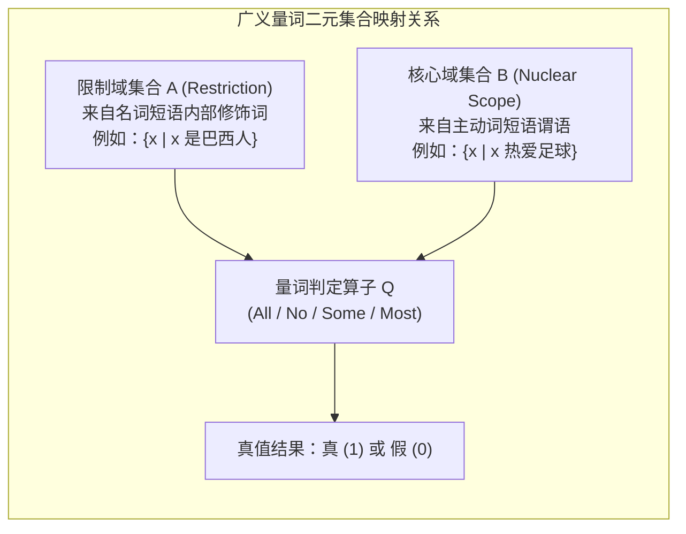

# Lec 18 语义学（二）：广义量词理论与量词提升

> MIT 24.900 · 语言学导论 · 主讲 Norvin W. Richards

## TL;DR

- **广义量词推翻实体指称假设**：量词短语（All, Some, No, Most）不是现实世界中的独立实体，而是限制域集合与谓词核心域集合之间的代数包含关系。
- **集合论严格定义一阶量词真值**：全称量词映射为真子集（$A \subseteq B$），全称否定为交集为空（$A \cap B = \varnothing$），存在量词为交集非空，多数词为交集大于差集。
- **辖域竞争派生双重可能世界**：经典例句展示了全称与存在算子的辖域排布竞争（$\forall > \exists$ 对应多元独立个体，$\exists > \forall$ 对应单一超级实体）。
- **逻辑式（LF）隐形移位消除歧义**：罗伯特·梅的量词提升（QR）假说确证句法树在语音外化后仍经历隐形位移，用统一的句法几何消解了深层语义歧义。

## 1. 课程定位与问题意识

在日常对话中，我们常常脱口说出类似 *“这间屋子里的每个人都会讲两门语言”* 这样平淡无奇的句子。然而，如果用精密的形式语义放大镜审视它，会发现该命题在人类心智中瞬间分裂出两幅截然不同的世界图景：
- **世界 A（分布解读）**：全屋都是双语者，但每个人掌握的语种可以完全不同（爱丽丝懂英法，鲍勃懂德西，查理懂中日）。
- **世界 B（共指解读）**：全场存在某两门固定的通用语言（例如英语和汉语），屋内的每一个人都无一例外地精通这两门特定的语言。

表面上完全相同的线性发音序列，为何能在听者的认知系统中激发出两套彼此不相容的真值条件？

这标志着语言学研究深入到了句法与语义的核心交界面。本讲将引入由巴怀斯与库珀（Barwise & Cooper）创立的**广义量词理论（Generalized Quantifier Theory, GQT）**，用一阶集合论重构人类语言中的所有限定词；并借助罗伯特·梅（Robert May）的**量词提升（Quantifier Raising, QR）**机制，证明人类大脑在看不见的**逻辑式（Logical Form, LF）**维度上，依然在不知疲倦地执行着隐形的句法移位！

## 2. 核心概念

| 概念 | 严密定义（用自己的话） | 容易混淆的邻居 | 典型实例 / 判据 |
|---|---|---|---|
| **广义量词理论（Generalized Quantifier Theory, GQT）** | 将自然语言中的限定词与量词短语严密形式化为“两个集合之间的二元关系（Relations between Sets）”的形式语义理论框架。 | 实体指称（专有名词如 *John* 指代个体；广义量词如 *every student* 是集合之间的二元谓词）。 | *“Every student smiled”* 等价于学生集合是微笑者集合的子集。 |
| **限制域与核心域（Restriction & Nuclear Scope）** | 量词所统辖的两个核心集合参数：限制域（$A$）由量词直接修饰的名词短语决定；核心域（$B$）由分句的动词谓语短语决定。 | 主语与谓语（主谓是句法概念；限制域与核心域是语义集合的代数划分）。 | 在 *“Most cats sleep”* 中，限制域 $A=\{x \mid \text{cat}(x)\}$，核心域 $B=\{x \mid \text{sleep}(x)\}$。 |
| **辖域歧义（Scope Ambiguity）** | 当一个句子包含两个或更多量化算子（如全称 $\forall$ 与存在 $\exists$）时，因算子相互管辖层级顺序不同而产生的命题解读分歧。 | 词汇歧义（词汇歧义源于一词多义如 *bank*；辖域歧义源于深层逻辑层级关系的不确定性）。 | *“A boy loves every girl”*（某个男孩爱所有女孩 vs 每个女孩都有一个男孩爱她）。 |
| **逻辑式（Logical Form, LF）** | 生成语法倒 Y 模型中连接句法计算与语义解释（Semantics Interface）的隐形结构表征层，在此层面上语音发音已被剥离。 | 表层结构（表层结构 PF 面向耳朵发音；逻辑式 LF 面向心智的语义真值演算）。 | 句子发音完毕后，句法树在 LF 层继续进行不可见的算子拓扑排布。 |
| **量词提升（Quantifier Raising, QR）** | 罗伯特·梅（Robert May）提出的隐形句法移位假说：在 LF 阶段，停留在句法深层的量词短语被整体拔高并附着至高阶分句边缘以确立辖域。 | 显性 Wh-移位（Wh-移位改变口头声学发音；量词提升只在隐性 LF 发生，完全不改变声音）。 | 将宾语位置的 *every building* 在 LF 拔升至句首 $TP$ 节点之上。 |

## 3. 证据链与形式推导：广义量词的集合论代数

在经典亚里士多德逻辑与早期谓词逻辑中，学者常把专有名词（如 *Paul*）与量词名词短语混同处理。例如专有名词 *Paul* 直接对应现实世界个体论域中的单一元素 $p \in \mathcal{U}$。此时排中律与矛盾律严格生效：
- 断言：*“Paul 在室内，且 Paul 在室外”* $\implies$ 触发经典逻辑矛盾悖论（$\bot$）。

然而，观察带有量词的名词短语：
- 断言：*“Several Americans are inside, and several Americans are outside.”*（几个美国人在室内，几个美国人在室外。）
- 这一表述在现实日常中不仅完全合情合理，且毫无一丝逻辑矛盾！

这一反差无可辩驳地证明：**自然语言中的量词短语（QP）绝不能被还原为单一的个体实体！**

### 3.1 限制域与核心域的二元集合关系

广义量词理论确立了量词的真值本质：一个限定量词 $Q$ 在形式语义类型论中，本质上是一个以两个一阶谓词性质集合（类型均为 $\langle e, t \rangle$）作为输入的二阶真值关系谓词（类型为 $\langle \langle e, t \rangle, \langle \langle e, t \rangle, t \rangle \rangle$）。这两个集合在句法树结构中具有极其明确的来源映射：
1. **限制域集合 $A$（Restriction）**：由限定词直接统领的名词短语（NP）提供，限定了当前量化计算所聚焦的论域子集范围（例如所有“巴西人”的集合）；
2. **核心域集合 $B$（Nuclear Scope）**：由分句中的动词谓语短语（VP）提供，描述了实体是否满足某种特定的行为或状态属性（例如所有“热爱足球者”的集合）。



这种两分结构展示了自然语言与传统一阶谓词逻辑（FOL）的深刻差异：标准一阶逻辑通常假设一个漫无边际的全宇宙论域 $\mathcal{U}$，量词通过全称蕴涵（$\forall x [\phi(x) \rightarrow \psi(x)]$）或存在合取（$\exists x [\phi(x) \land \psi(x)]$）进行全域遍历；而人类自然语言天生采用**分类量化（Sortal Quantification）**——量词短语永远先通过限制域集合 $A$ 划定考察边界，然后再去测量核心域集合 $B$ 在该边界内的投影截面。这种局部化的集合论映射，极大地降低了心智在实时语音处理时的认知计算负荷。

### 3.2 核心广义量词的形式语义真值矩阵

通过一阶集合论的交集、并集、差集与子集关系，我们可以将自然语言中所有核心量词的真值条件彻底数学化：

| 自然语言量词陈述句 | 涉及的两个集合定义 | 形式语义集合论充要真值条件 | 几何韦恩图与测度关系 |
|---|---|---|---|
| **“All Brazilians love soccer.”**<br>（所有巴西人都热爱足球） | $A$: 巴西人集合<br>$B$: 热爱足球者集合 | **$A \subseteq B$**<br>（集合 $A$ 完全包含于集合 $B$ 中） | 限制域集合圆 $A$ 被核心域圆 $B$ 彻底吞没，差集 $A - B = \varnothing$。 |
| **“No Italian is a hangglider.”**<br>（没有意大利人开滑翔翼） | $A$: 意大利人集合<br>$B$: 开滑翔翼者集合 | **$A \cap B = \varnothing$**<br>（两个集合的交集严格为空集） | 集合圆 $A$ 与集合圆 $B$ 彼此完全分离，无任何重叠区域。 |
| **“Some Americans are rich.”**<br>（部分美国人很富有） | $A$: 美国人集合<br>$B$: 富有者集合 | **$A \cap B \neq \varnothing$**<br>（两个集合的交集不为空集） | 集合圆 $A$ 与集合圆 $B$ 存在显性重叠阴影区，至少存在一个共有元素。 |
| **“Most students passed.”**<br>（大多数学生通过了考试） | $A$: 学生集合<br>$B$: 通过考试者集合 | **$|A \cap B| > |A - B|$**<br>（交集元素基数严格大于差集基数） | 交集阴影部分的元素数量，严格多于留在外侧未能及格的学生数量。 |

::: definition 广义量词保守性定理（Conservativity / Condition of Living On）
全人类自然语言中的所有量词都必须满足**保守性公理（Conservativity）**：
$$Q(A, B) \iff Q(A, A \cap B)$$
例如：*“All Brazilians love soccer”* 在真值上严格等价于 *“All Brazilians are Brazilians who love soccer”*。量词计算仅聚焦于限制域内部被谓词命中的交集比例，绝对不关心限制域外部（非巴西人是否爱足球）的任何信息！这是普遍语法为心智运算施加的降维保护机制。
:::

## 4. 机制与形式推导：逻辑式（LF）与隐形量词提升（QR）

### 4.1 辖域歧义的形式逻辑表达

考察理论语言学中著名的辖域歧义例句：
$$\text{“A guard is standing in front of every building.”} \quad (\text{一名警卫正站在每栋大楼前。})$$

在直觉逻辑中，该命题可以被翻译为两套完全不等价的谓词公式：

::: example 两种截然不同的辖域可能世界
- **解读 1：表面辖域 / 存在算子优先（$\exists > \forall$）**
  $$\exists x [\text{Guard}(x) \land \forall y (\text{Building}(y) \rightarrow \text{StandInFrontOf}(x, y))]$$
  - **可能世界图景**：全宇宙存在一个极其庞大、能跨越时空同时出现在各处的“超级警卫”个体，他独自一人站在了所有的建筑门前。在日常世界中，这几乎是一个荒诞的超现实科幻场景。
- **解读 2：逆向辖域 / 全称算子优先（$\forall > \exists$）**
  $$\forall y [\text{Building}(y) \rightarrow \exists x (\text{Guard}(x) \land \text{StandInFrontOf}(x, y))]$$
  - **可能世界图景**：对于每一栋独立的大楼 $y$，都存在着某一位专属的警卫 $x$ 站在其门前。全场可能共有 20 栋大楼和 20 位不同的警卫。这正是人类母语者在常识下所激活的常规解读！
:::

在表层语音结构（Surface Structure / PF）中，存在量词短语 `a guard` 占据句首主语槽位，而全称量词短语 `every building` 处于介词补足语的句尾深处。如果语义解析只能按照耳朵听到的线性前后顺序自左向右解读，**我们的大脑在数学上根本不可能生成常识解读 2**！

### 4.2 罗伯特·梅的量词提升（Quantifier Raising, QR）推导

为了解决这一理论危机，语言学家罗伯特·梅（Robert May, 1977）在其 MIT 博士论文中提出了划时代的假说：
句法移位绝不仅限于嘴巴能发出的显性位移（如 Wh-前置）。在句法树离开表层结构、走向语义解释接口的**逻辑式（Logical Form, LF）**通道中，量词短语为了获得其解释管辖范围，必须发生**隐形量词提升（Quantifier Raising）**！

```mermaid
flowchart TD
    subgraph QuantifierRaisingLF ["逻辑式 (LF) 上的隐形量词提升拓扑"]
        TPTop["TP (全句最高逻辑解释域)"]
        
        QP_Every["【隐形提升算子】<br>[every building]_j (全称量词 ∀)"]
        TPMid["较低层 TP 节点"]
        QP_Guard["【保留或降级算子】<br>[a guard]_i (存在量词 ∃)"]
        TPrime["T'"]
        VP["VP 动词短语: is standing in front of t_j"]
        
        TPTop --> QP_Every
        TPTop --> TPMid
        TPMid --> QP_Guard
        TPMid --> TPrime
        TPrime --> VP
        
        QP_Every -.->|自顶向下施加全局管辖辖域 (c-command)| TPMid
    end
```

在 LF 的树形拓扑中：
1. 介词短语内部的 `every building` 发生隐形提升，拔起跃迁并附着（Adjoin）至最高阶的 $TP$ 节点上方；
2. 此时，`every building` 占据了树形的绝对支配位置，对下方包括 `a guard` 在内的整棵子树实施**成分统领（c-command）**；
3. 句法统领关系在语义接口处被严密翻译为算子辖域关系：居于上位统领者，优先获得量化管辖权！
4. 于是，逆向辖域解读 $\forall > \exists$ 在 LF 层面上得到了纯粹由几何拓扑驱动的形式派生。

## 5. 我的理解与批判性反思

::: insight 看不见的维度与心智物理学
广义量词理论与量词提升假说的结合，是人类认知科学史上一次极其优美的“爱因斯坦式跃迁”：
1. **摆脱日常经验的常识陷阱**：在朴素常识看来，每个名词都对应世界上的一件东西；但数学语义学证明，“每一个”和“大多数”根本不是具体实体，而是人类大脑用来统辖概念集合关系的代数算子。语言不是现实的照片，而是心智对现实概念实施的集合代数运算。
2. **倒 Y 模型的深层几何对称**：生成语法最震撼的假说在于，心智拥有一条不为人知的隐形地下管道——逻辑式（LF）。我们此前见到的 Wh-移位和助动词倒装，只是露在地表、能被声波麦克风记录的显性物理位移；而量词提升证明，在声波熄灭之后，大脑的句法机器还在暗处继续重排树形网络。
3. **歧义即多维拓扑投影**：一句话之所以会有双重歧义，并不是因为语言含糊不清，而是因为同一个表层线性序列对应着 LF 维度上两种不同的几何拓扑排布。正如三维物体在二维平面上能投下不同的阴影，人类语言的丰富性恰恰来源于心智在深层空间对概念算子的多层级构形。
:::
