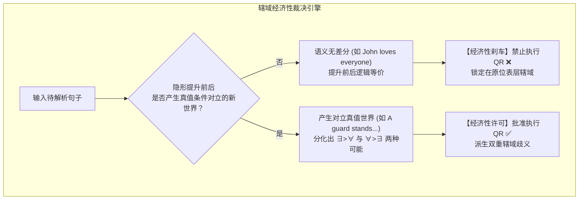
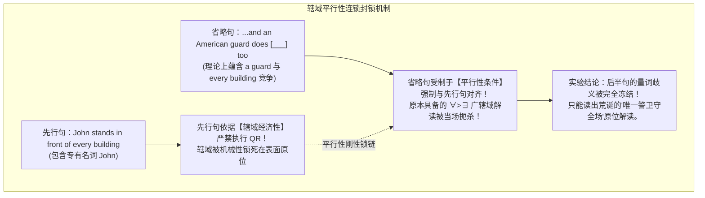
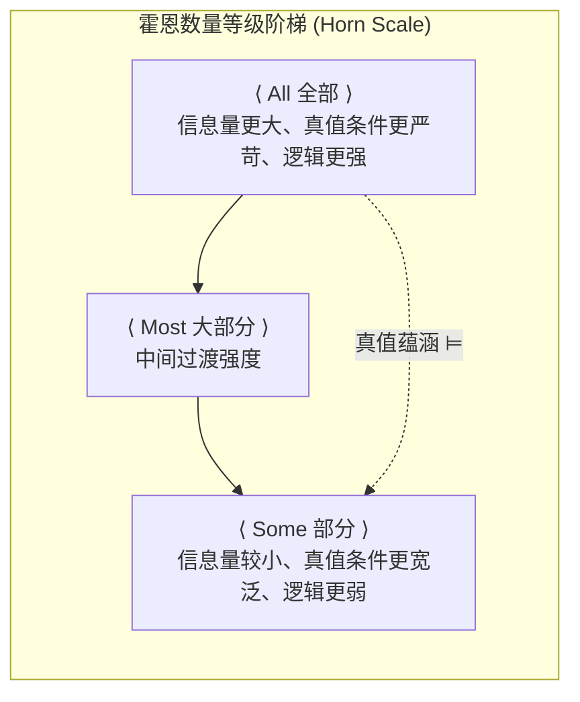

# Lec 19 语义学（三）：辖域经济性、动词短语省略与单调性逻辑

> MIT 24.900 · 语言学导论 · 主讲 Norvin W. Richards

## TL;DR

- **辖域经济性驾驭隐形移位**：丹尼·福克斯（Danny Fox）证明心智严禁无意义的量词提升（QR），只有能量化派生全新真值条件的位移才能被大脑运算批准。
- **动词短语省略确证平行拓扑**：在 VP 省略结构中，先行句与省略句的辖域几何必须保持绝对平行，交叉混合解读被心智全面封锁。
- **单调性逻辑驱动集合推理**：向上单调（UE）允许从子集推导母集，向下单调（DE，如 *No, Few*）倒转推理矢量并许可否定极项（NPI）。
- **标量隐涵弥合逻辑与交际**：基于霍恩等级（Horn Scale）与格莱斯数量准则，弱真值表达（*some*）在语用博弈中被逆向收窄为“非全部”。

## 1. 课程定位与问题意识

在第 18 讲中，我们发现人类语言在逻辑式（LF）层面上存在不可见的隐形量词提升（Quantifier Raising, QR）。然而，这一假说立刻引发了一个深刻的理论质问：如果量词短语可以神不知鬼不觉地在树形深处隐形跃迁，那么心智语法系统该如何防止算法陷入无休止、无目标的乱移位状态？

本讲首先引入麻省理工学院语义学家丹尼·福克斯（Danny Fox）的**辖域经济性原理（Principle of Scope Economy）**，通过动词短语省略（VP-Ellipsis）与平行性法则，展示心智如何以近乎极简主义的数学铁腕锁死无意义的隐形运算；随后，我们将目光投向形式语义学的方向性公理——**单调性（Monotonicity）**，揭示向上单调与向下单调在集合论推理中的代数对偶；最后，跨越语义真值与人类交际博弈的边界，解析**标量隐涵（Scalar Implicatures）**的计算本质。

## 2. 核心概念

| 概念 | 严密定义（用自己的话） | 容易混淆的邻居 | 典型实例 / 判据 |
|---|---|---|---|
| **辖域经济性原理（Principle of Scope Economy）** | 普遍语法的计算成本控制公理：隐形量词提升（QR）受到严格限制，唯有当其能派生出与原位在真值条件上不等价的新解读时，才被允许执行。 | 自由隐形移位（心智绝不执行语义上“劳而无功”的冗余移位）。 | *John loves everyone* 严禁 QR；*A guard stands in front of every building* 准许 QR。 |
| **动词短语省略平行性（VP-Ellipsis Scope Parallelism）** | 在包含动词短语省略的复合句中，省略从句所重构的量词相对辖域顺序，必须与先行分句保持绝对的几何拓扑同构。 | 词汇表面同形（平行性不仅要求动词短语词项相同，更强制要求 LF 层的量化层级顺序严格对齐）。 | 先行句若取 $\forall > \exists$，省略句绝对禁止跨越取 $\exists > \forall$。 |
| **向上单调 / 单调递增（Upward Entailing, UE）** | 允许从真子集向超母集（From Subsets to Supersets）实施保真逻辑推理的语义环境。 | 向下单调（UE 保持原有的概念包含方向，通常由 *some, many, every* 的核心域体现）。 | *“有人抽雪茄”* $\implies$ *“有人吸烟”*。 |
| **向下单调 / 单调递减（Downward Entailing, DE）** | 将逻辑推理矢量彻底反转，允许从超母集向真子集（From Supersets to Subsets）实施保真推理的语义环境。 | 向上单调（DE 具有反转集合包含关系的代数性质，通常由否定算子 *no, few, without* 触发）。 | *“没人吸烟”* $\implies$ *“没人抽雪茄”*。 |
| **标量隐涵（Scalar Implicature）** | 听话人基于格莱斯合作原则（数量准则），从说话人选用了强度较弱的词汇项推断出其对立的高强度词项不成立的会话含义。 | 逻辑真值蕴涵（蕴涵不可取消；标量隐涵可以通过补充语境被合法取消，如 *Some, in fact all*）。 | 说 *“吃了部分饼干”* 语用隐涵 *“没有吃全部饼干”*。 |

## 3. 证据链与形式推导

### 3.1 隐形移位的缰绳：辖域经济性原理

如果隐形量词提升是不受约束的，那么在包含专有名词与全称量词的句子中：
$$\text{“John loves everyone.”} \quad (\text{约翰爱所有人。})$$

- **若不执行 QR**：$John$ 为主语，$everyone$ 留在动词宾语原位。其真值条件为：约翰具有“爱论域中所有人”的属性；
- **若强行执行 QR**：将 $everyone$ 隐形拔升至句首，对全句施加统领。其形式逻辑公式为：$\forall x [\text{Person}(x) \rightarrow \text{Love}(\text{John}, x)]$。

仔细比对两者的真值世界：在全宇宙的所有可能世界中，上述两种推导所覆盖的真值集合**完全百分之百重合**！换言之，这次隐形提升没有给人类心智带来任何增量语义价值。

丹尼·福克斯（Danny Fox, 2000）指出，人类心智语法遵循着极高的能耗经济原则：
> **辖域经济性定律**：  
> 任何句法操作（尤其是隐形移位）都需要消耗认知算力。若一个操作在语义输出端无法制造真值条件的差异（Semantically Vacuous），则普遍语法在底层将其全面死锁！

### 3.2 动词短语省略（VP-Ellipsis）与平行性实验

如何从实验上证明“大脑真的因为没有语义差异而阻止了 QR”？语言学家设计了一组极其精巧的并列句省略对比实验。

考察双量词并列句的动词短语省略：
$$\text{“An American guard stands in front of every building, and a Canadian guard does [___] too.”}$$

后半句的 `does [___] too` 省略了整个动词短语 `[stand in front of every building]`。理论上，前半句有 2 种辖域解读（$\exists > \forall$ 或 $\forall > \exists$），后半句也有 2 种辖域解读，理论组合应有 4 种：

| 理论组合序号 | 前半句辖域解读 | 后半句辖域解读 | 母语者自然直觉接受度 | 形式理论判定机制 |
|---|---|---|---|---|
| **组合 1** | $\forall > \exists$（每楼配独立美警） | $\forall > \exists$（每楼配独立加警） | **完全自然合法 ✅** | 满足平行性法则（双向全称优先） |
| **组合 2** | $\exists > \forall$（唯一巨型美警守全场） | $\exists > \forall$（唯一巨型加警守全场） | **完全自然合法 ✅** | 满足平行性法则（双向存在优先） |
| **组合 3** | $\forall > \exists$（每楼配独立美警） | $\exists > \forall$（唯一巨型加警守全场） | **绝对禁止违规 ❌** | 违反平行性（几何交叉不对称） |
| **组合 4** | $\exists > \forall$（唯一巨型美警守全场） | $\forall > \exists$（每楼配独立加警） | **绝对禁止违规 ❌** | 违反平行性（几何交叉不对称） |

母语者直觉斩钉截铁地枪毙了组合 3 与组合 4！这确立了**辖域平行性公理（Scope Parallelism）**：省略结构要求逻辑式中的量化算子层级必须与先行项保持严格对齐。

现在，进行最震撼的**连锁冰冻实验**：我们将前半句的主语替换为一个专有名词 *John*：
$$\text{“John stands in front of every building, and an American guard does [___] too.”}$$

这一连锁反应提供了铁一般的证据：如果心智中没有隐形的 LF 拓扑与经济性法则，前半句一个毫无量词歧义的专有名词，绝对不可能隔空把后半句原本合法的逆向辖域解读完全“谋杀”掉！

## 4. 机制与形式推导：单调性与标量隐涵

### 4.1 形式语义学的方向性：向上单调 vs. 向下单调

在数学集合论中，函数可以保序（单调递增）或反序（单调递减）。形式语义学发现，人类自然语言中的所有量词环境，均表现出严格的**单调性（Monotonicity）**特征：

::: definition 单调递增与单调递减算子
设概念集合 $A \subseteq B$（如 $A$ 为吸雪茄者集合，$B$ 为所有吸烟者集合）：
1. **向上单调算子（Upward Entailing, UE）**：若环境 $f$ 满足 $A \subseteq B \implies f(A) \vDash f(B)$，则该环境为向上单调环境（允许从真子集向超母集保真推理）。
2. **向下单调算子（Downward Entailing, DE）**：若环境 $f$ 满足 $A \subseteq B \implies f(B) \vDash f(A)$，则该环境为向下单调环境（允许从超母集向真子集倒转保真推理）。
:::

| 量词环境与例句 | 逻辑推理方向 | 形式代数推导过程 | 理论判定结论 |
|---|---|---|---|
| **Some Americans smoke cigars.** （有些美国人抽雪茄） | 子集 $\rightarrow$ 母集 （吸雪茄 $\rightarrow$ 吸烟） | $A \cap \text{Cigar} \neq \varnothing \implies A \cap \text{Smoke} \neq \varnothing$ （雪茄交集非空必然保证吸烟交集非空） | **向上单调（UE）✅** 推理保真成立 |
| **No Americans smoke cigars.** （没有美国人抽雪茄） | 子集 $\rightarrow$ 母集 （吸雪茄 $\rightarrow$ 吸烟） | 没人抽雪茄，完全推不出没人抽卷烟或水烟！母集断言可能完全为假。 | **向上单调失败 ❌** 正向推理崩溃 |
| **No Americans smoke.** （没有美国人吸烟） | 母集 $\rightarrow$ 子集 （吸烟 $\rightarrow$ 吸雪茄） | $A \cap \text{Smoke} = \varnothing \implies A \cap \text{Cigar} = \varnothing$ （吸烟交集为空必定保证其任何子集交集为空） | **向下单调（DE）✅** 逆向保真成立 |
| **Few students smoke.** （很少有学生吸烟） | 母集 $\rightarrow$ 子集 （吸烟 $\rightarrow$ 吸雪茄） | 满足总体吸烟者很少，则吸雪茄的子集必然更少（$|A \cap \text{Cigar}| \le |A \cap \text{Smoke}| < k$）。 | **向下单调（DE）✅** 逆向保真成立 |

向下单调性（DE）在现代语言学中具有极其崇高的地位：它不仅是一套数学真值性质，更是人类语言中许可**否定极项（Negative Polarity Items, 如英语 *any*, *ever*）**的充要语法土壤！所有允许合法使用 *any* 的句法环境，其底层无一例外都是严格的向下单调环境。

### 4.2 标量隐涵与格莱斯数量准则

最后，考察语义真值与日常会话之间的经典断层：
$$\text{“Mary ate some of the cookies.”} \quad (\text{玛丽吃了其中的一些饼干。})$$

- **纯逻辑语义事实**：根据广义量词定义，`some` 仅要求交集 $A \cap B \neq \varnothing$。如果玛丽吃光了全部饼干（All），该交集同样绝对非空！因此在纯形式逻辑上，若玛丽吃了全部，“玛丽吃了部分”依然是绝对的**真命题**。
- **人类语用事实**：在日常生活中，如果一个人明知玛丽吃光了全部却说出该句，听话人会强烈认定其具有欺骗性。

哲学家保罗·格莱斯（Paul Grice）的合作原则（Cooperative Principle）完美解密了这一心智计算：
1. **数量准则（Maxim of Quantity）**：说话人有义务提供在当前情境下所能提供的最大充分信息量。
2. **霍恩阶梯（Horn Scale）**：词汇项在心智认知中排布为由强到弱的认知阶梯：$\langle \text{All, Most, Some} \rangle$。
3. **逆向心理博弈推理**：
   $$\text{说话人掌握了事实} \land \text{说话人选择了较弱的 Some} \implies \text{说话人无法真诚断言更强的 All}$$
   $$\implies \textbf{听者推断：更强的命题不成立（吃了一些，但绝非全部）！}$$

这种基于博弈推理生成的会话含义被称为**标量隐涵（Scalar Implicature）**。它不同于刚性的真值蕴涵，如果在后文补充说明 *“Mary ate some of the cookies; in fact, she ate all of them.”*，隐涵可以被完全合法地取消（Defeasible），而句法不会产生自相矛盾。

## 5. 我的理解与批判性反思

::: insight 极简的缰绳与博弈的艺术
本讲为我们呈现了一幅形式逻辑与人类心智在约束与自由之间优雅舞蹈的图景：
1. **没有无缘无故的移位**：丹尼·福克斯的辖域经济性原理揭示出心智深处的奥卡姆剃刀。大脑绝不是一台盲目堆叠移位算符的机械怪兽，每一项隐形操作都必须用真值差异来“购买门票”。VP 省略中的平行性锁链向我们证明，语言的底层几何具有令人敬畏的数学刚性。
2. **单调性的代数之美**：自然语言并非毫无章法地处理概念，向上单调与向下单调的对偶性，赋予了人类语言精准的代数推理矢量。正是向下单调环境在母集与子集之间的逆向折射，为人类语言中的否定、质疑与极项词汇提供了精密的地基。
3. **语用是语义的透镜**：标量隐涵生动表明，人类语言绝非冷冰冰的布尔代数。我们在日常对话中理解的“意义”，永远是纯形式真值条件与格莱斯交际意图博弈的双重结晶。理解英语的高级境界，在于既能洞悉底层集合运算的绝对真假，又能敏锐捕获音段背后那层若隐若现的语用推波助澜。
:::
