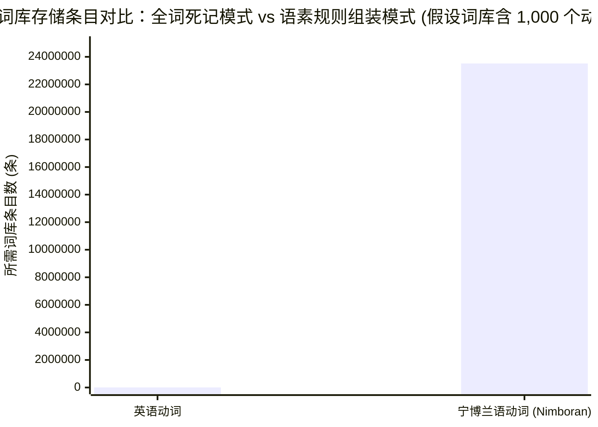
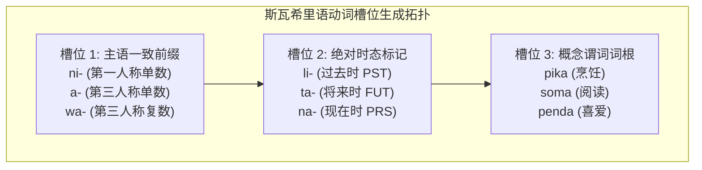

# Lec 2 形态学 I：田野实战、语素

**开场白**

当你面对一个说未知语言的人时，你究竟该如何展开调查？你不可能直接问他们：“请问你们语言里的中缀如何与动词音步对齐？”因为哪怕是母语者自己也讲不清这些术语。为了向大家演示科学的田野调查法，我今天特意虚构了一门语言——**火星语（Martian）**。

## TL;DR

## 火星语田野实战：从数据搜集到假设检验

田野调查语言学（Field Linguistics）从第一性原理出发，假定研究者登陆火星面对一位火星发音人（Native Consultant）。我们既无法翻阅词典，也无法进行元语言沟通，唯一的科学武器就是控制变量的最小对立诱导。通过控制句意中的某一个变量（如由“我吃”变为“他吃”，或由“现在吃”变为“昨天吃”），观察声学序列中同步发生的局部音段交替，从而严格推导语素边界。

### 第一步：锁定专有名词与行间标注

在面对一门完全陌生的语言时，最明智的开局策略是：**先询问人名**。如果句子中包含一个固定的人名，你在分析后续句子时就立即锁定了其中一个已知的拼图单元。

>**我**：“你们火星上最常见的名字叫什么？”  
>**火星人**：“X!oo”（开头带一个吸气咔嗒音）。
>**我**： "X!oo" 怎么写？

如果你的发音人所用的语言采用罗马字母书写，直接使用其正字法；如果不采用罗马字母，你可以和发音人协商一套约定俗成的拼音方案，或者像我一样先用临时符号记音（后续第 5 讲我们将正式学习国际音标 IPA）。

> **我**： how do you say "X!oo is a linguist"?
> **火星人**:  X!oo kuulduud bii

发音人告诉我这句话包含三个独立的词。如何确定每个词的意思？

> **我**：哪一个词代表语言学家？ 或者构造 ”那‘X!oo 是物理学家’怎么说“?
> **火星人**：

由此我们获得了语言学界通用的**三行标准行间标注格式（Leipzig Glossing Rules）**：

$$\begin{aligned}
&\text{第 1 行（原文）：} && \text{X!oo} && \text{kuulduud} && \text{bii} \\
&\text{第 2 行（逐词对齐标注）：} && \text{X!oo} && \text{linguist} && \text{is} \\
&\text{第 3 行（整句翻译）：} && \text{‘X!oo 是个语言学家。’}
\end{aligned}$$

从这组简单的数据中，我们已经发现了火星语的第一条句法规律：与英语的 SVO（主-谓-宾）语序不同，火星语将动词“是”（bii）放在句末，表现为 **SOV 语序**！

### 第二步： 调查火星语的否定结构和时态

> **我**： X!oo 不是语言学家 又该怎么说？...

几轮对话后，就能得出

| 肯定句                                           | 否定句                                             |
| ------------------------------------------------ | -------------------------------------------------- |
| **X!oo kuulduud bii**<br>(X!oo 是语言学家)       | **X!oo kuulduud noowee**<br>(X!oo 不是语言学家)    |
| **X!oo amsterdam digdug**<br>(X!oo 挖了一条运河) | **X!oo amsterdam digwedug**<br>(X!oo 没有挖运河)   |
| **X!oo amsterdam gudgid**<br>(X!oo 正在挖运河)   | **X!oo amsterdam gudwegid**<br>(X!oo 没有在挖运河) |

观察动词形态的微观演化：

- `digdug`（过去时：挖） $\rightarrow$ `digwedug`（过去时否定：没挖）
- `gudgid`（现在时：正在挖） $\rightarrow$ `gudwegid`（现在时否定：没在挖）

显然，火星语通过向动词中插入一个否定标记 **`-we-`** 来表达否定。那么，**`-we-` 究竟插入在什么位置？**

现场同学提问： “会不会是数第 3 和第 4 个字母？” ？
**语言学第一原则：语言是听觉与发音系统，而不是文字拼写系统！** 文盲和没有文字的社会同样拥有完全严密的语法系统。人类大脑绝不会通过“数英文字母个数”来执行心智语法。

那么如何在“第一个音节之后”与“最后一个音节之前”之间做出裁决？  
**我们需要收集更长的多音节动词！**

于是我们继续向火星发音人索取数据：

- “X!oo 正在唱歌”：`X!oo yodeleehihuu`
- “X!oo 摧毁了一艘飞船”：`X!oo roovaa munchmunchyum`

要求发音人将其否定：

- `yodeleehihuu`（4 个音节） $\rightarrow$ 否定形式是 **`yodeleehiwehuu`**！
- 这一下推翻了假说 1（如果是第一个音节后，应该是 `*yowedeleehihuu`）；
- 它支持了**假说 2：`-we-` 插入在词尾倒数第一个音节之前！**

要求发音人将其否定：

- `yodeleehihuu`（4 个音节） $\rightarrow$ 否定形式是 **`yodeleehiwehuu`**！
- 这一下推翻了假说 1（如果是第一个音节后，应该是 `*yowedeleehihuu`）；
- 它支持了**假说 2：`-we-` 插入在词尾倒数第一个音节之前！**

### 语言学家关于官方和方言的态度

在田野实战中，发音人常常会告诉你：“噢，那个说法是很糟糕的俚语，我中学老师听到会打我的手板，真正的讲法语应该去很偏远的村庄找老人……”

**语言学家的严正立场**：

- 学校教育灌输的所谓“标准语”通常是政治与阶级建构的**规定性语法（*Prescriptive Grammar*）**；
- 语言学家关注的是真实大脑中自然生长出的**描述性语法（*Descriptive Grammar*）**。
- 发音人日常脱口而出的所谓“不规范表达”，在认知结构上与莎士比亚的诗句具有同等完全平等的科学价值！

## 心理词典

现在让我们进入今天的主题——**形态学（*Morphology*）**。什么是形态学？它是**研究词汇内部结构以及词汇如何由更小意义单位组装而成的学科**。

在索绪尔（Ferdinand de Saussure）的经典理论中，词汇的“发音”与“含义（所指）”之间的联结是高度任意的，比如英语用 \[kæt\] 代表猫？法语用 \[ʃa\]（chat），西文用 \[gato\]（gato），中文用 \[mɑʊ\]（猫）， 必须在童年期死记硬背将发音与概念联结起来。大脑中存储这种任意联结的数据库，就是我们的**心理词典（*Mental Lexicon*）**。

为什么大脑不能死记硬背所有单词？请看看巴布亚新几内亚的**宁博兰语（Nimboran）**：宁博兰语的每一个及物动词拥有 49 种不同的后缀位置类（涵盖主语、宾语人称、空间方位、移动方向、体貌与时态），语言学家的严格计算表明：**宁博兰语中的一个及物动词，拥有整整 23,520 种合法的屈折屈折形式**



如果宁博兰人必须将每一个形式死记硬背，他们的脑容量将在童年时期瞬间爆炸！同情一下宁博兰人吧！人类心智绝不会采用这种愚蠢的存储方案。大脑选择的方案是：**只在词库中存储最小的有意义单元，并赋予一套精密的递归算法，在需要表达时动态生成与拆解词汇！**

### 逆构词

你怎么知道大脑真的在动态拆解语素，而不是把词汇作为一个死板的整体？历史语言学中的**逆构词（*Back-formation*）**现象给出了不可辩驳的证据：

1. **editor $\rightarrow$ edit**：
   拉丁语借词 *editor* 原本是一个不可分割的单词（来自拉丁语 *edere* + *-tor*）。但英语母语者听到末尾的发音类似于代理人后缀 `-er`（如 *teach* $\rightarrow$ *teacher*），便在大脑中自发执行了“剪掉词缀”的逆向操作，从而生造出了历史上原本不存在的动词 **`edit`**！
2. **sculptor $\rightarrow$ sculpt**、**swindler $\rightarrow$ swindle**、**burglar $\rightarrow$ burgle**：全部诞生于母语者脑海中语素规则的逆向切割。
3. **pease $\rightarrow$ pea（豌豆）**：
   在古英语中，*pease* 原本是一个像 *water*（水）或 *sand*（沙子）一样的不可数物质名词（Mass Noun）。但由于其末尾发音带 [z]，后代母语者误以为这是一个复数形式（\*pea + -s），于是在心理上把结尾的“复数”剥离，诞生了今天的可数单数名词 **`pea`**！

## 形态学核心术语与拓扑分类

为了精确刻画词汇内部的结构，我们需要建立一套形式化术语体系：

### 4.1 语素的基本二分

- **语素（Morpheme）**：人类语言中**最小的音义结合体**（不可再被切分且具备独立语法或语义功能的单位）。
  - 单语素词（Single morpheme）：`cat`、`dog`、`book`
  - 多语素词（Multi-morphemic）：`cat-s`（2 个语素）、`in-dust-ri-al-iz-at-ion`（工业化：6 个语素）
- **词根（Root）**：词汇中最核心、承载主要概念意义的语素基底（如 *cat*, *dog*, *worth*）。
- **词缀（Affix）**：必须依附于词根或词干的依附性语素。
- **自由语素（Free Morpheme）**：能够独立成词、单独在句中立足的语素（如 *dog*, *chair*）。
- **黏着语素（Bound Morpheme）**：绝对不能独立成词、必须与其他语素绑定的语素（如复数后缀 *-s*、否定前缀 *un-*、词根 *atroc-*）。

> **跨语言警示**：某种语法功能在一种语言里是黏着词缀，在另一种语言里可能完全是自由语素！
>
> - 英语的名词复数是黏着后缀 `-s`；
> - 但在菲律宾他加禄语（Tagalog）中，复数标记是一个完全自由独立的词 **`mga`**（读作 /maŋa/）：
>   *mga malalaking saging*（许多大香蕉）——`mga` 作为一个独立词立于句首，并不依附在香蕉上。

## 1. 核心问题

### 驱动问题
当我们面对一门从未接触过的未知语言时，在完全不懂任何正字法拼写的情况下，语言学家如何凭借纯粹的声音与情境映射，精准切分出最小的语法构件？

### 形式本质与火星语思想实验
语言绝不是孤立字词的混乱集合。在形态学中，即使是一个外表极其简短的动词形式，也可能内嵌着对主语人称、时态、体貌以及宾语数特征的精密代数编码。

田野调查语言学（Field Linguistics）从第一性原理出发，假定研究者登陆火星面对一位火星发音人（Native Consultant）。我们既无法翻阅词典，也无法进行元语言沟通，唯一的科学武器就是**控制变量的最小对立诱导（Elicitation via Minimal Pairs）**。通过控制句意中的某一个变量（如由“我吃”变为“他吃”，或由“现在吃”变为“昨天吃”），观察声学序列中同步发生的局部音段交替，从而严格推导语素边界。

## 3. 证据链与形式推导

### 3.1 斯瓦希里语（Swahili）的语素矩阵剥离
观察东非班图语支斯瓦希里语的动词形态交替：

::: example 斯瓦希里语屈折语素诱导矩阵
- *nilipika*：“我煮了（食物）”
- *alipika*：“他/她煮了（食物）”
- *nilisoma*：“我读了（书）”
- *nitasoma*：“我将要读书”
- *watasoma*：“他们将要读书”
:::

通过建立正交对比矩阵，我们可以像解线性代数方程组一样无歧义地解构每个语素：

```text
nilipika  =  ni-  +  li-  +  pika
alipika   =  a-   +  li-  +  pika
nilisoma  =  ni-  +  li-  +  soma
nitasoma  =  ni-  +  ta-  +  soma
watasoma  =  wa-  +  ta-  +  soma
```

由此得出斯瓦希里语严整的动词前缀模板体系：
$$\text{Verb} = [\text{Subject Agreement}] + [\text{Tense}] + [\text{Verb Root}]$$
- **主语人称一致前缀**：`ni-` (1SG), `a-` (3SG), `wa-` (3PL)
- **时态前缀**：`li-` (过去时 PST), `ta-` (将来时 FUT)
- **动词词根**：`pika` (煮 cook), `soma` (读 read)

标准化莱比锡行间标注呈现为：
> *ni-ta-soma*  
> 1SG-FUT-read  
> “我将要阅读。”



### 3.2 叠词（Reduplication）的音系-形态接口
在菲律宾他加禄语（Tagalog）中，将来时的表达并不依赖外部附加固定字母，而是提取词根的首个音节进行“**声母+元音（CV）局部克隆**”：

::: example 他加禄语将来时不完全叠词
- `sulat`（写） $\implies$ `su-sulat`（将要写）
- `bili`（买） $\implies$ `bi-bili`（将要买）
- `kain`（吃） $\implies$ `ka-kain`（将要吃）
:::

这一现象铁证了形态学运算不仅检索词库中的语义标签，还必须能实时读取音系学表征的**音节骨架（Syllable Template）**。

## 4. 机制与形式推导：英语叹词中缀与韵律音步

英语通常被视为只有前缀和后缀的语言。但在口语高能情感表达中，英语存在极其严密的**粗口中缀化（Expletive Infixation）**：

::: example 英语中缀的插入位置
- *fan-fucking-tastic*（合法） vs. *\*fantas-fucking-tic*（极度违规）
- *ala-fucking-bama*（合法） vs. *\*alaba-fucking-ma*（极度违规）
- *kalamazoo* $\implies$ *kalama-fucking-zoo*
:::

为什么母语者无需教学，就能对插入位置保持惊人的一致？
形式音系形态学推导表明：中缀**绝不能随意插在音节之间，它必须严格落在主要重音所在的强音步（Metrical Foot）边界之前**！
- *fan-TÁS-tic*：主要重音在第二音节，音步划分为 `(fan)(TÁS-tic)`，中缀精准插入在强音步左边界；
- 这一规则证明，即使是大众文化中看似最粗俗的俚语，其底层同样受到普遍语法与节律音步几何的无情支配。

## 5. 我的理解与批判性反思

::: insight 构词的多样性与人类认知的有限性
巴布亚新几内亚的宁博兰语（Nimboran）每个动词拥有多达 23,520 种规则屈折形式，能够在一个单字内同时编码动作方向、发生时间、参与者空间坐标与身体姿态；而汉语作为极端孤立语，则几乎将形态屈折剥离为零，完全依赖外部虚词与句法语序。

初看之下，跨语言形态系统似乎呈现出令人绝望的离散性。但形式语言学的深入表明：**所有形态构词机制，本质上都只是“单向邻接（Linear Adjacency）”或“层级内嵌（Hierarchical Embedding）”这两种代数拓扑在发音通道上的具象化**。无论是多式综合语的一词成句，还是孤立语的意合拼贴，人类心智背后的概念内嵌深度与论元结构网络完全是同构的。形态学不是语言的外在装饰，而是概念网络与发音器官之间的第一道物理转译协议。
:::
