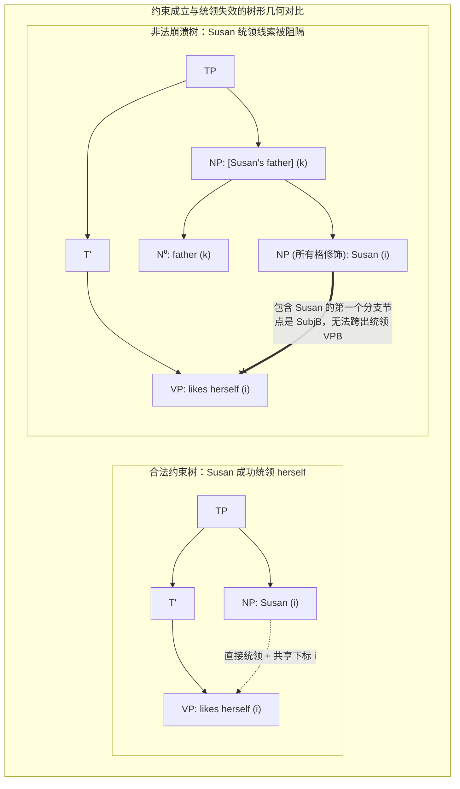
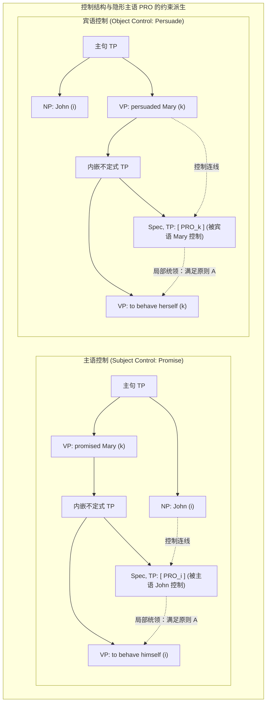

# Lec 20 语义学（四）：管辖约束论与隐形主语 PRO

> MIT 24.900 · 语言学导论 · 主讲 Norvin W. Richards

## TL;DR

- **约束的形式数学定义**：节点 $\alpha$ 约束 $\beta$ 当且仅当 $\alpha$ 成分统领（c-command）$\beta$ 且二者同标共指，单纯线性前后关系无法构成合法约束。
- **三大约束原则确立互斥分布**：原则 A 规定照应语必须在局部时态短语（Local TP）内被约束；原则 B 规定普通代词在局部必须自由；原则 C 严禁任何代词统领专有名词。
- **无声主语 PRO 的科学发现**：控制动词对立（*promise to behave himself* vs. *persuade to behave herself*）无可辩驳地证明不定式从句内驻守着隐形主语 PRO。
- **心智语法的符号实体性**：PRO 犹如粒子物理中被预言的暗物质粒子，虽无声波外化，却在心智深处严密维系着原则 A 的几何完备性。

## 1. 课程定位与问题意识

在日常语言交流中，我们极其自然地使用代词与反身代词来指代世界上的实体。观察以下两句最基础的英语短句：
1. **Susan$_i$ likes herself$_i$.**（苏珊喜欢她自己。）
2. **Susan$_i$ likes her$_j$.**（苏珊喜欢她 [除苏珊之外的某人]。）

为什么仅仅添加了一个词尾 `-self`，人类大脑对于“代词指涉谁”的判决就会发生 180 度的剧烈反转？为什么在第一句中两人必须是同一实体，而在第二句中两人绝对不能指同一个人？

更神秘的是：在没有显性主语的不定式结构中，为什么 *“John promised Mary to behave himself”* 只能选择男性反身代词，而 *“John persuaded Mary to behave herself”* 却必须选择女性反身代词？

本讲将系统引入生成语法中最富数学优雅感的核心基石——**管辖与约束理论（Government and Binding Theory）**，形式化定义成分统领与三大约束原则（Principles A, B, and C）；并展示语言学家如何像物理学家探测暗物质粒子一样，通过约束条件的严密逻辑闭环，确证人类心智中无声隐形人——**控制主语 PRO** 的真实存在。

## 2. 核心概念

| 概念 | 严密定义（用自己的话） | 容易混淆的邻居 | 典型实例 / 判据 |
|---|---|---|---|
| **约束（Binding）** | 句法树中节点间的结构支配关系：节点 $\alpha$ 约束节点 $\beta$，当且仅当 $\alpha$ 成分统领 $\beta$，且 $\alpha$ 与 $\beta$ 携带完全相同的共指数字下标（Coindexed）。 | 语义共指（单纯指代同一个人不等于约束；若前者未统领后者，则只是语用指称重合而非句法约束）。 | *John$_i$ loves himself$_i$* 构成约束；*[John's father]$_k$ loves himself$_i$* 无法约束。 |
| **照应语与原则 A（Anaphor & Principle A）** | 自身缺乏独立指称能力、必须在最小局部约束域（Local TP）内被上位先行词统领约束的名词表达式（反身代词与相互代词）。 | 普通代词（照应语在局部必须被约束；普通代词在局部必须保持自由）。 | 英语中的 *himself, herself, themselves, each other*。 |
| **普通代词与原则 B（Pronominal & Principle B）** | 可以在语境中独立寻找指称、但必须在其最小局部约束域（Local TP）内保持自由（Free，即不被同标节点统领）的名词表达式。 | 照应语（普通代词禁止在同一个最小单句内被主语约束，但可以被外部主句主语跨从句指引）。 | 英语中的 *he, she, it, they, him, her*。 |
| **指称表达式与原则 C（R-expression & Principle C）** | 自带固有客观现实世界指称的专有名词或限定名词短语，在全句任何层级都必须保持绝对自由，严禁被任何代词统领。 | 变元代词（专有名词享有最高自由尊严，哪怕跨越多个从句，也绝对禁止被上位先行代词所统领）。 | 英语中的 *Susan, John, the linguist, the dog*。 |
| **隐形控制主语 PRO（Silent Subject PRO）** | 驻守在非限定动词不定式或动名词分句主语位置（Spec, TP）、无语音声学外化但携带完全人称性数特征的隐形代词。 | 语迹 Trace（语迹是由显性移位留下的空范畴；PRO 是在词库合并阶段就作为独立论元空降的基础生成范畴）。 | *John promised Mary [PRO to leave]* 中的 $PRO$ 由主语 *John* 实施控制。 |

## 3. 证据链与形式推导

### 3.1 约束的形式数学定义与统领失效

理论语言学对约束的定义拒绝任何含糊的直觉推断，其拥有冰冷、严密的图论公理：

::: definition 约束（Binding）公理
对于句法树中的任意两个标称节点 $\alpha$ 与 $\beta$，我们断言 $\alpha$ 约束 $\beta$（记作 $\alpha \text{ Binds } \beta$），当且仅当满足以下两条充要条件：
1. **几何条件**：$\alpha$ 成分统领（c-commands）$\beta$（即：包含 $\alpha$ 的第一个分支分叉节点，同样严格支配包含 $\beta$ 的节点，且 $\alpha$ 不支配 $\beta$）；
2. **索引条件**：$\alpha$ 与 $\beta$ 共享相同的共指下标（Coindexed, $\alpha_i \dots \beta_i$）。
:::

观察以下经典对比案例：
- **案例 A（主语直接统领）**：
  $$\text{Susan}_i \quad \text{likes} \quad \text{herself}_i. \quad (\text{完全合法 ✅})$$
  包含主语 $Susan$ 的第一个分支节点是全句的顶层时态短语 $TP$；$TP$ 支配下方的所有分支，因此 $Susan$ 成功成分统领直接宾语 $herself$，几何与索引条件同时满足，约束成立！
- **案例 B（修饰语深埋失效）**：
  $$\text{*\“[Susan’s father]}_k \quad \text{likes} \quad \text{herself}_i.\text{”} \quad (\text{严重语法崩溃 ❌})$$

在案例 B 中，尽管专有名词 *Susan* 在物理线性顺序上同样位于全句的开头，但因为她被嵌套在主语名词短语的所有格内部（$PossNP$），包含她的第一个分支节点是主语短语 $SubjB$。这一层短语边界如同一堵结构绝缘墙，粗暴截断了 *Susan* 向外施加成分统领的射线通道。统领失败直接导致约束流产，反身代词 *herself* 沦为无源之水，触发了母语者强烈的非语法排斥。

### 3.2 约束理论三大铁律（Principles A, B, and C）的互斥分布

约束理论由三大互为镜像的原则构成，它们划定了名词系统在局部约束域（Local Binding Domain，通常为包含该词的最小限定分句 $TP$）内的管辖边界：

| 约束原则 | 适用名词范畴 | 核心结构限制公理 | 合法句例证（Grammatical） | 非法语义崩溃反例（Ungrammatical） |
|---|---|---|---|---|
| **原则 A** | **照应语（Anaphor）** 反身代词、相互代词 | 必须在包含它的**最小局部 $TP$ 域内**被成分统领约束。 | *Susan$_i$ likes herself$_i$.* | *\*Susan$_i$ thinks that I like herself$_i$.* （内嵌从句主语为 *I*，先行词跨从句失效） |
| **原则 B** | **普通代词（Pronominal）** *he, she, her, him* | 必须在包含它的**最小局部 $TP$ 域内保持自由（Free）**。 | *Susan$_i$ thinks that I like her$_i$.* （在内嵌从句局部自由，跨从句共指合法） | *\*Susan$_i$ likes her$_i$.* （在最小局部 $TP$ 内被统领，严重触电） |
| **原则 C** | **指称表达式（R-expression）** 专有名词、普通描述语 | 在**全句的任何层级**必须保持绝对自由，严禁被任何代词统领。 | *After she$_i$ arrived, Susan$_i$ sat down.* （状语从句代词无法统领主句专有名词） | *\*She$_i$ thinks that Susan$_i$ is brilliant.* （代词高居主句统领内嵌专有名词，绝对禁止） |

原则 A 与原则 B 在最小分句域内构成了严密的互补分布（Complementary Distribution）：照应语要求必须有主子约束，普通代词要求严禁主子在场。这种工整的对称性展现了普遍语法在形式美学上的极简造诣。

## 4. 机制与形式推导：无声主语 PRO 的科学实证

### 4.1 控制动词的不定式反身代词谜题

如果说三大约束原则只是解释了显性单词的分布，那么它在非限定从句（Infinitive Clauses）中的应用，则彻底证明了其作为硬科学理论的深层预言力。

考察以下两句仅替换了一个主要动词的控制句（Control Constructions）：
1. **John$_i$ promised Mary$_k$ [ to behave himself$_i$ ].**（约翰向玛丽承诺会规矩检点**自己**。）
2. **John$_i$ persuaded Mary$_k$ [ to behave herself$_k$ ].**（约翰劝说玛丽要规矩检点**她自己**。）

::: pitfall 朴素表层语法的致命困境
在传统学校语法的表层分析中，括号内部的不定式短语 `[ to behave ... ]` 是一个“没有主语”的非谓语从句。
如果不定式从句真的没有主语，那么：
- 句子 (1) 中的 `himself` 所在的最小从句内部根本不存在先行词，它只能跨越从句去寻找远方的 `John`，这公然踩踏了**原则 A（照应语严禁跨从句约束）**！
- 更荒谬的是：如果照应语真的被允许跨从句寻找先行词，为什么动词从 `promise` 换成 `persuade` 后，后半句就绝对禁止使用 `himself`，而必须强制选择 `herself`？
  $$\text{*\“John persuaded Mary to behave himself.”} \quad (\text{严重语病 ❌})$$
:::

### 4.2 隐形控制主语 PRO 的形式几何证明

普遍语法给出了解密该谜题的唯一自洽方案：**不定式从句在句法底层绝对不是真空，其主语槽位 $[Spec, TP]$ 驻扎着一个声学上无声的隐形代词——PRO！**

形式推导严密闭环：
1. **动词控制特性的词库赋能**：
   - 动词 `promise` 在词库中定义为**主语控制动词（Subject Control Verb）**，它强制将其内嵌从句的隐形主语 PRO 的指代下标与主句主语绑定：$\text{John}_i \longrightarrow \text{PRO}_i$；
   - 动词 `persuade` 在词库中定义为**宾语控制动词（Object Control Verb）**，它强制将 PRO 的下标与主句宾语绑定：$\text{Mary}_k \longrightarrow \text{PRO}_k$。
2. **原则 A 在从句内部完美复活**：
   - 在内嵌不定式时态短语 $[_{TP}\ \text{PRO}_i \ [_{VP}\ \text{behave himself}_i ]]$ 内部，无声的 $\text{PRO}_i$ 在树形几何上**直接成分统领**宾语位置的反身代词；
   - 因为 PRO 与反身代词同处一个最小的 $TP$ 约束域，原则 A 在微观局部得到了百分之百的忠实满足！

约束理论无需对非限定从句做出任何例外妥协；相反，正是通过坚持原则 A 的绝对刚性，我们“逆向工程”捕获了人类语言潜意识深处无处不在的隐形符号构件。

## 5. 我的理解与批判性反思

::: insight 心智的暗物质与形式的尊严
约束理论与隐形主语 PRO 的发现，是二十世纪理论语言学最耀眼的理性胜利之一：
1. **物理声波与心智实体的撕裂**：凡夫俗子以为语言就是耳朵听到的声波，没发出的声音就是“无”。但约束理论以无可辩驳的数学证据证明：人类心智语言器官中运转的符号系统，远比外化发音的声波世界丰富得多。隐形主语 PRO 虽无半点声学振动，却真实地拥有性数格特征，能在从句内部行使崇高的句法统领权。
2. **局部性与远距离的辩证统一**：原则 A 看似是一条严苛的“地方保护主义”律令，禁止反身代词跨省办案；但通过控制动词对 PRO 的远程赋值，语言实现了一种极其精妙的分层代理机制——外部主语无需肉身涉险降临从句，只需通过 PRO 代理人即可在微观局部合宪运作。
3. **英语学习的降维视角**：对于中国英语学习者而言，常常困惑于为何不定式后要用 *himself* 还是 *herself*。如果死记句子翻译，只会疲惫不堪；而一旦洞悉了控制动词对隐形主语 PRO 的指派机制，你会发现整个句子在几何拓扑上严密得如同精密齿轮。掌握了管辖约束论，就是在用上帝视角俯瞰自然语言在心智中的逻辑运行法则。
:::
