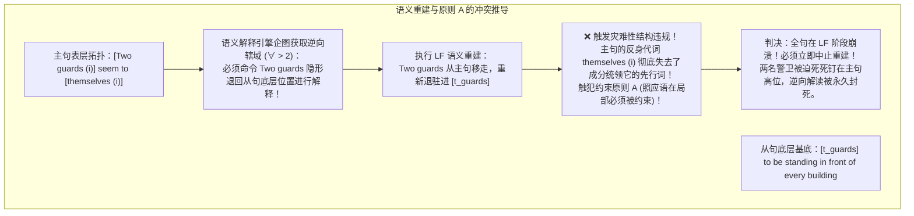
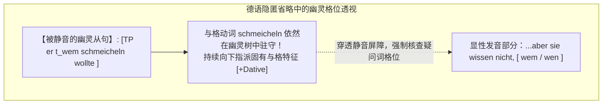
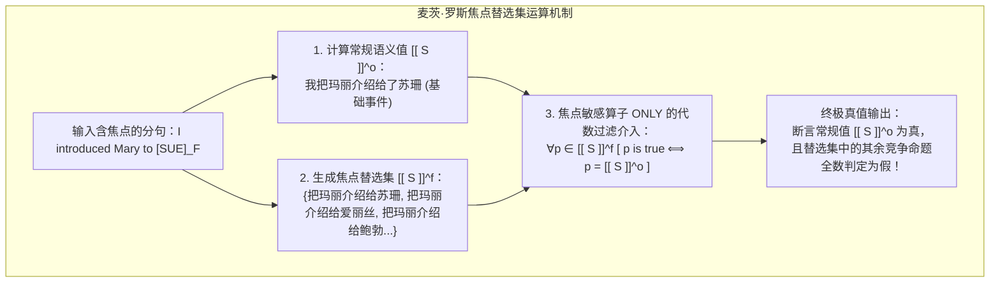

# Lec 21 语义学（五）：语义重建限制、隐匿省略与焦点替选集

> MIT 24.900 · 语言学导论 · 主讲 Norvin W. Richards

## TL;DR

- **句法约束优先于语义重建**：为了满足原则 A，主句反身代词（*themselves*）会刚性死锁主语的下沉路径，一票否决逆向量化辖域的生成。
- **隐匿省略确证幽灵句法存在**：德语疑问隐匿省略（Sluicing）中的与格/宾格匹配（*wem* vs. *wen*）证明被静音的从句在句法树内部具备完整的符号与格位指派现实。
- **焦点音调直接颠覆世界真值**：麦茨·罗斯（Mats Rooth）替选集语义学证明，声调重音会激活概念替选集 $\llbracket S \rrbracket^f$，算子 *only* 强制将所有替选命题排他性判定为假。
- **跨模块几何同构圆满收官**：音系重音、句法树拓扑与可能世界真值的精密咬合，展现了形式语言学高度自洽的跨学科数理全貌。

## 1. 课程定位与问题意识

在完成了逻辑式（LF）上的量词提升与管辖约束理论之后，理论语言学迎来了几组最具挑战性的前沿交界面：
1. **移位与解释的拉锯**：当一个已经移位到表层的主语需要为了语义解释退回底层（语义重建 Reconstruction），而句法的约束原则 A 又要求它必须呆在高位充当先行词时，心智语法系统将如何裁决这种“结构与意义的撞车”？
2. **静音省略是虚无还是幽灵**：当我们说出 *“亚当吃了某样东西，但我不知道是什么”* 时，后半句被删去的从句在心智中究竟是彻底消失的白纸，还是在发音前一刻被静音的完整句法树？
3. **声调重音如何改变真理**：为什么仅仅改变一个单词的声学重音（*I only introduced MARY to Sue* vs. *I only introduced Mary to SUE*），就能彻底颠覆一句话在可能世界中的真假判断？

本讲作为理论语言学核心模块（音系-句法-语义）的压轴之作，将通过语义重建的刚性阻断、德语隐匿省略（Sluicing）的格位透视，以及罗斯（Mats Rooth）的替选集语义学（Alternative Semantics），为心智语法的跨模块协同画上圆满的句号。

## 2. 核心概念

| 概念 | 严密定义（用自己的话） | 容易混淆的邻居 | 典型实例 / 判据 |
|---|---|---|---|
| **语义重建（Semantic Reconstruction）** | 句法成分在表层结构中虽然显性移位至高位，但在逻辑式（LF）解释阶段，其量化辖域被解读为其底层基底位置的逆向操作。 | 物理原位（语义重建只在看不见的 LF 发生，并不改变表层声学语序）。 | *Two guards seem to be standing...* 可解读为“底层存在两名警卫”。 |
| **约束否定权（Priority of Binding over Reconstruction）** | 普遍语法的跨模块公理：句法树的几何管辖与约束原则（如原则 A）具有绝对优先级，若语义重建会导致原则 A 崩溃，则重建被彻底禁止。 | 自由辖域变异（辖域解读不是孤立的语义自由，必须向句法树的合法性妥协）。 | *Two guards$_i$ seem to themselves$_i$...* 严禁逆向辖域解读。 |
| **疑问隐匿省略（Sluicing）** | 在间接疑问分句中，除了分句前沿的疑问词（Wh-phrase）被保留外，其余完整的时态从句（TP）在语音表层被完全静音删除的现象。 | 动词短语省略（VP 省略保留助动词；隐匿省略只保留最前端的 Wh-短语，删除整个 TP）。 | *Adam ate something, but I don't know what [___].* |
| **常规语义值（Ordinary Semantic Value, $\llbracket S \rrbracket^o$）** | 命题在形式语义学中的基础真值命题，描述现实或可能世界中客观事件本身是否成立（类型为 $t$）。 | 焦点语义值（常规值是命题本身，不考虑被选中的替选竞争者）。 | $\llbracket \text{Mary loves Bob} \rrbracket^o = 1 \iff \text{玛丽爱鲍勃}$。 |
| **焦点替选集（Focus Semantic Value / Alternatives, $\llbracket S \rrbracket^f$）** | 由音系重音激活的、将焦点词替换为同范畴其他可能概念后派生出的一组可能命题构成的集合。 | 词汇联想（替选集具有严格的语义类型对齐，由焦点算子如 *only* 直接读取）。 | 焦点在 *Bob* 时：$\llbracket S \rrbracket^f = \{\text{玛丽爱鲍勃, 玛丽爱约翰, 玛丽爱比尔...}\}$。 |

## 3. 证据链与形式推导

### 3.1 语义重建与原则 A 的碰撞：约束对辖域的一票否决权

在第 18 讲中，我们知道在提升动词结构中，主语可以发生语义重建。
考察以下对比基准句：
$$\text{“Two guards seem to me to be standing in front of every building.”}$$
- **解读 1（表面辖域 $2 > \forall$）**：有两个特定的警卫站在所有大楼门前；
- **解读 2（重建逆向辖域 $\forall > 2$）**：对于每栋大楼，都有两个专属独立的警卫站在其门前（主语 `two guards` 退回从句底层基底位置解释）。

然而，当我们在主句中插入反身代词短语 **to themselves** 时，语言学奇观出现了：
$$\text{“Two guards}_i \quad \text{seem to } \mathbf{\text{themselves}}_i \quad \text{to be standing in front of every building.”}$$

::: pitfall 逆向辖域的神秘蒸发
在母语者的严格直觉测试中，句子 (2) 的逆向辖域解读（每栋大楼配两个警卫）**彻底消失了**！全句只能被强制理解为：“有两个特定的自恋警卫，他们觉得自己正站在所有的建筑前”。
:::

为什么一个反身代词的介入，能瞬间摧毁全句的逆向量化辖域？
形式推导揭示了句法与语义在 LF 接口处的惨烈冲突：

这一实验无可辩驳地宣告：**普遍语法的句法约束原则（原则 A）拥有凌驾于语义运算之上的绝对最高宪法地位！** 心智宁可牺牲一个潜在的量词可能世界，也绝不允许句法树的几何管辖受到丝毫破坏。

### 3.2 疑问隐匿省略（Sluicing）与德语格位透视

考察日常对话中的隐匿省略：
$$\text{“Adam ate something, but I don’t know what [ \ \ \ \ \ \ \ \ \ \ ].”}$$

后半句被删除的空白区域，究竟是“真的什么都没有”，还是“驻扎着完整的无声语法树”？
德语的格位匹配实验给出了决定性的裁决。德语动词对宾语有着极其严苛的固有格（Inherent Case）要求：
- 动词 **schmeicheln**（谄媚/奉承）在词库中强制指派**与格（Dative）**；
- 动词 **loben**（表扬/赞扬）在词库中强制指派**宾格（Accusative）**。

| 先行句谓语动词与格位指派 | 隐匿省略句表层发音现象 | 德语疑问词形态选择判定 | 句法学结论 |
|---|---|---|---|
| **schmeicheln（与格动词）** *Er will jemandem (与格) schmeicheln.* （他想奉承某人） | *...aber sie wissen nicht, [ \ \ \ \ ]* （...但他们不知道是谁） | **wem（与格疑问词）✅ 完全合法** *\*wen（宾格疑问词）❌ 严重报错！* | 疑问词必须精准呈现与格标记 `-m` |
| **loben（宾格动词）** *Er will jemanden (宾格) loben.* （他想表扬某人） | *...aber sie wissen nicht, [ \ \ \ \ ]* （...但他们不知道是谁） | **wen（宾格疑问词）✅ 完全合法** *\*wem（与格疑问词）❌ 严重报错！* | 疑问词必须精准呈现宾格标记 `-n` |

如果省略处真是一片虚无的常识脑补，母语者的大脑根本不可能在毫秒之内强迫剩下的那个疑问词精准背负起已被静音的动词所要求的特定格位！
这证明了生成语法的核心假说：**省略不是心智的空白，而是物理发音（PF）层面对完整句法结构的显性遮蔽**。

## 4. 机制与形式推导：焦点语义学与替选集模型

### 4.1 重音挪移与可能世界颠覆

观察焦点敏感算子 **only** 在不同声调重音下的惊人语义差异（大写表示重音焦点）：

::: example 重音挪移引发的真值条件巨变
1. **“I only introduced Mary to [SUE].”**（重音落在 SUE 上）
   - **真值条件**：我向苏珊引见了玛丽，但我**没有**把玛丽引见给爱丽丝、没有引见给鲍勃……
2. **“I only introduced [MARY] to Sue.”**（重音落在 MARY 上）
   - **真值条件**：我把玛丽引见给了苏珊，但我**没有**把爱丽丝引见给苏珊、没有把鲍勃引见给苏珊……
3. **“I only [INTRODUCED] Mary to Sue.”**（重音落在动词 INTRODUCED 上）
   - **真值条件**：我仅仅是把玛丽引见给了苏珊，我**没有**向苏珊吹捧玛丽，也**没有**当众羞辱玛丽……
:::

虽然三个句子由完全相同的词汇串联而成，但仅靠声波振幅与音高的微小挪移，就让三个句子在现实世界中指涉了互不相交的真值条件！

### 4.2 麦茨·罗斯替选集语义学（Rooth 1992）形式化

形式语义学家麦茨·罗斯（Mats Rooth）构建了经典的**双层语义值模型（Two-Dimensional Semantics）**：

::: definition 常规语义值与焦点语义值公理
对于任意带有焦点的表达式 $\alpha$：
1. **常规语义值（Ordinary Value, $\llbracket \alpha \rrbracket^o$）**：表示该表达式基础的客观真值或实体指称；
2. **焦点替选集（Focus Value, $\llbracket \alpha \rrbracket^f$）**：表示将焦点成分用同语义类型的其他概念进行替换后所构成的命题全集：
   $$\llbracket \text{introduced Mary to } [\text{SUE}]_F \rrbracket^f = \{\lambda x. \text{introduced Mary to } y \mid y \in \mathcal{D}_e\}$$
:::

焦点副词 `only` 的数学本质，就是一个跨维度的真值过滤器：它要求在替选集 $\llbracket S \rrbracket^f$ 激发的整个命题宇宙中，**当且仅当该命题恒等于常规值 $\llbracket S \rrbracket^o$ 时它才为真**；所有其他替选命题全部被一阶逻辑强行否定。

## 5. 我的理解与批判性反思

::: insight 隐形结构的交响乐与语言学的硬科学品格
学完本讲，我们仿佛站在了理论语言学的殿堂穹顶，俯瞰着各子系统交织出的崇高秩序：
1. **暗物质的真实存在**：无论是不定式中的隐形主语 PRO、德语隐匿省略中仍在暗中指派格位的幽灵动词，还是逻辑式上由于原则 A 阻断而无法下沉的语义重建，它们共同证明了一个真理：人类语言的心智现实绝不仅限于喉咙震动的声学波形。那些无声的、看不见的几何节点，以令人震撼的数学刚性统治着全部可听见的世界。
2. **多维投影的终极统一**：重音焦点与替选集语义学生动诠释了模块间的精密咬合——喉咙发出的一个音高重音（音系学），在树形结构上被打上焦点标签（句法学），随后在逻辑空间激发出由可能命题构成的替选集合（语义学），最后被算子截断生成真值排他（逻辑学）。这种严丝合缝的跨模块互动，展现了自然语言作为心智硬科学的非凡魅力。
3. **中国学习者的认知升维**：很多英语学习者在理解 *only* 或强调句时，往往停留在“起强调作用”的文学描述上。一旦掌握了替选集理论，你就会明白：重音焦点是人类心智用来在可能世界宇宙中实施精确定位与降维排他的代数工具。真正的语言能力，不仅是记住单词的发音，更是能自如调度这套多维交响乐般的底层认知引擎。
:::
