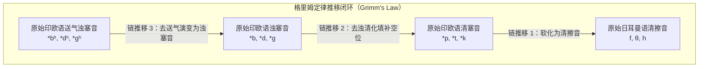
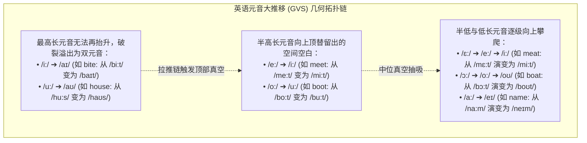
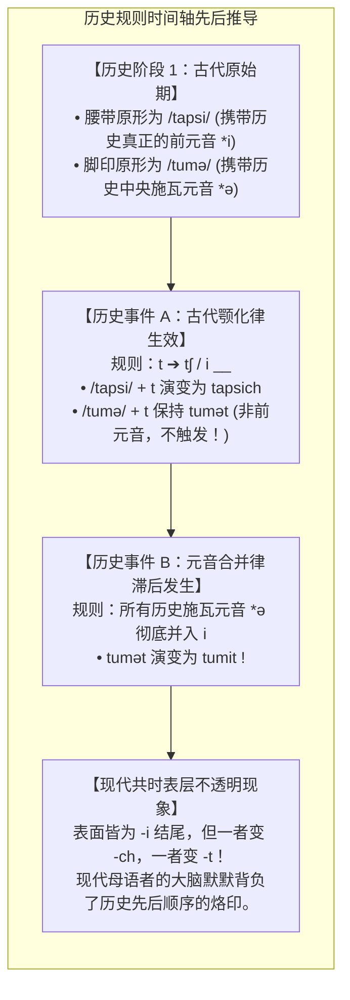

# Lec 23 历史语言学：比较法、格里姆定律、元音大推移与科学构拟

> MIT 24.900 · 语言学导论 · 主讲 Norvin W. Richards

## TL;DR

- **语音演变无例外奠基科学构拟**：青年语法学派确立了音变规律的机械必然性（Ausnahmslosigkeit），将历史语言学从表面相似猜想升维为数学般严密的系统对应法则。
- **格里姆定律打通印欧音系链条**：通过清塞音变擦音、浊塞音变清塞音的系统链推移，严密绑定了拉丁语（*pater, cord-*）与英语（*father, heart*）的跨语族同源血缘。
- **元音大推移造成拼读历史断层**：早期现代英语长元音向上旋转与双元音化链推移，发生于正字法基本定型之后，造成了现代英语“字音分离”的特异格局。
- **索绪尔喉音理论展现终极预言力**：索绪尔在 21 岁仅凭形式对称推导出的未知“幽灵辅音”，半世纪后在小亚细亚出土的赫梯语泥板中分毫不差地得到实证检验。

## 1. 课程定位与问题意识

语言并不是一块永恒凝固的花岗岩，而是一条永不停歇的历史长河。现代英语母语者若翻开八百年前乔叟的《坎特伯雷故事集》，尚能勉强辨识半数词句；若再往前翻到一千多年前的《贝奥武夫》，眼前的古英语对他们而言已彻底沦为一门需要专门翻译的外语。

语言是如何随时间演化的？当相隔数千公里的不同文明语言展现出惊人相似时（例如梵语的 *mātā*、希腊语的 *mētēr*、拉丁语的 *māter* 与英语的 *mother*），我们如何科学判断它们是血脉相通的同源演变，还是纯粹的统计巧合？

更为深刻的是：为什么现代英语会出现“字母 *a* 读成 `/eɪ/`（如 *cake*），字母 *i* 读成 `/aɪ/`（如 *time*）”这样极其别扭反常的正字法规则？本讲将系统梳理**历史语言学（Historical Linguistics）**的黄金工具——比较法（Comparative Method）、格里姆定律、链推移与历史规则不透明性，并见证索绪尔喉音理论如何完成了语言学史上最震撼的“暗物质预言与验证”。

## 2. 核心概念

| 概念 | 严密定义（用自己的话） | 容易混淆的邻居 | 典型实例 / 判据 |
|---|---|---|---|
| **比较法（The Comparative Method）** | 通过比对多门疑似亲属语言中词汇系统的严密语音对应规律，逆向科学构拟出其未见共同祖先母语（Proto-language）的核心科学方法。 | 词汇外观对比（比较法依靠的是抽象无例外的音位对应律，绝非表面的字形相似）。 | 通过日耳曼语、罗曼语、梵语与希腊语构拟出原始印欧语（PIE）。 |
| **同源词（Cognates）** | 从一个共同祖先祖语中的同一原始词根，经过千百年各自独立但规律的语音演变分化而来的亲属词汇。 | 借词与外来词（借词是后天地缘文化接触横向输入的；同源词是祖传垂直遗传分化的）。 | 英语 *father* 与拉丁语 *pater* 为同源词；英语 *paternal* 则是从拉丁语横向借入的借词。 |
| **格里姆定律（Grimm's Law）** | 雅各布·格里姆确立的印欧语系辅音大推移：原始印欧语的清塞音在原始日耳曼语中变为清擦音，浊塞音变为清塞音，送气浊塞音变为浊塞音。 | 偶发辅音脱落（格里姆定律是整个日耳曼语族区别于其他印欧语族的系统性宏观音变基石）。 | PIE `*p` $\to$ Gmc `*f`（拉丁 *ped-* 严格对应英语 *foot*）。 |
| **元音大推移（Great Vowel Shift, GVS）** | 发生在公元 1400-1700 年间近代英语的所有长元音系统性向上抬升、最高长元音破裂为双元音的宏观音位链推移。 | 辅音弱化（GVS 特指英语长元音系统的空间重构，是现代英语拼读分离的直接历史根源）。 | 中古英语 `/bi:t/`（现代写为 *bite*）抬升破裂演变为现代英语 `/baɪt/`。 |
| **索绪尔喉音理论（Saussure's Laryngeal Theory）** | 索绪尔于 1879 年仅凭原始印欧语元音交替对称性，纯数学推演出的未知辅音音位假说，半世纪后被赫梯语泥板破译完全证实。 | 纯思辨假想（喉音理论被誉为语言学界等同于门捷列夫元素周期表预言的标志性理论奇迹）。 | 构拟喉音 `*h₂` 解释了赫梯语中保留的擦音 $h$（如 *tarh-*）。 |

## 3. 证据链与形式推导：格里姆定律与语音规律的严格性

### 3.1 跨语言基础数词与格里姆定律（Grimm's Law）

比对印欧语系各大独立分支的基础数词与核心词汇，可以发现高度工整的几何对应：

| 原始印欧语辅音类 | 演变形式律 | 古希腊语 / 拉丁语（罗曼语族） | 古英语 / 现代英语（日耳曼语族） | 严格同源例证剖析 |
|---|---|---|---|---|
| **清塞音 $\to$ 清擦音** | $\text{*p} \to \text{f}$ $\text{*t} \to \theta$ $\text{*k} \to \text{h}$ | **p**ater（父）, **p**isces（鱼） **t**rēs（三）, **t**ū（你） **c**anis（狗）, **c**ord-（心） | **f**ather, **f**ish **th**ree, **th**ou **h**ound, **h**eart | 拉丁清塞音 `*p, *t, *k` 在日耳曼语中全员整齐演变为清擦音 `*f, *θ, *h`。 |
| **浊塞音 $\to$ 清塞音** | $\text{*d} \to \text{t}$ $\text{*g} \to \text{k}$ | **d**ecem（十）, **d**uo（二） **g**ranum（谷物）, **g**elū（寒冰） | **t**en, **t**wo **c**orn, **c**old | 拉丁不送气浊塞音在日耳曼语中全员清化，移位填补清塞音留下的空间。 |
| **送气浊塞音 $\to$ 浊塞音** | $\text{*bʰ} \to \text{b}$ $\text{*dʰ} \to \text{d}$ | 拉丁特化为 *f-*（*frāter*） 梵语保留送气：*bhrātā* | **b**rother（兄弟） **d**oor（梵语 *dvār-*） | 原始印欧语的送气浊音丢失送气成分，降解为标准浊塞音。 |

这种工整的轮转证明：看似毫不相干的词汇在千年前是完全同一个词汇项：
- 拉丁语 *centum*（读作 `/kentum/`）与英语 *hundred* 是完全同源的（拉丁 *k* 对应英语 *h*，拉丁 *t* 对应日耳曼 *d/th*）；
- 拉丁语医学词根 *cordial*（真心的、心脏的）与英语本土词 *heart* 拥有完全相同的原始印欧语基因。

### 3.2 青年语法学派命题：外观相似既不充分，也不必要

19 世纪 70 年代，莱比锡青年语法学派（Neogrammarians）提出了语言学史上最著名的公理：
::: theorem 语音规律无例外命题（Ausnahmslosigkeit der Lautgesetze）
在相同的音位环境与地理时空下，语音演变是纯粹机械、生理的必然物理规律，绝不容许任何无理由的随机例外。如果观察到表面的“破例”，必须通过更严密的音变环境细分（如重音位置导致的韦尔纳定律 Verner's Law）、形态类推（Analogy）或外来借词进行精确排查。
:::

青年语法学派彻底埋葬了外行“看长得像就认作亲戚”的伪科学狂热：
1. **外观完全不像，但同源（不必要性）**：
   - 现代亚美尼亚语中的“二”是 **erku**，现代英语是 **two**。两者表面发音毫无共同点，但历史语言学证明两者均完美源自原始印欧语 `*dwō`，其演变路径中的辅音置换、前元音增生完全服从亚美尼亚语无例外的音变法则！
2. **外观完全一致，纯属偶然巧合（不充分性）**：
   - 澳大利亚土著语言姆巴巴拉姆语（Mbabaram）中，“狗”这个词的发音极其不可思议地恰好就叫做 **dog**！
   - 外行常常兴奋地宣称“澳洲土著源自古英国”。但田野调查还原了该词的历史轨迹：姆巴巴拉姆语的 *dog* 源自原始澳洲土著语 `*gudaga`，经历了词首辅音脱落与元音弱化（`*gudaga` $\to$ `*guda` $\to$ `*gdog` $\to$ `dog`），与日耳曼语族的英语 *dog* 在发生学上没有任何半点血缘关系！
3. **假朋友同源陷阱**：
   - 英语动词 *have* 与拉丁语 *habēre* 表面词形和含义高度重合，但根据格里姆定律，拉丁的 *h-* 绝不可能对应英语的 *h-*！英语 *have* 真正的同源词是拉丁语 *capere*（抓取）；而拉丁语 *habēre* 的日耳曼对应词其实是英语动词 *give*！

## 4. 机制与形式推导：链推移、共时不透明性与科学构拟

### 4.1 英语元音大推移（Great Vowel Shift, GVS）

在公元 1400 至 1700 年间，英格兰南部的长元音系统爆发了一场席卷所有长元音的“向上旋转”链推移。丹麦语言学家奥托·叶斯柏森（Otto Jespersen）首次系统总结了这一音变链条。语音空间在感知上是一个闭合的二维几何容器（舌位高低与前后）：当某种音位发生移动时，周边音位必须连动调整以避免特征重叠与交际混淆。

历史语言学家长期争论元音大推移究竟是**推链（Push Chain）**还是**拉链（Drag Chain）**：
- **拉链假说（Drag Chain）**：最高长元音 `/i:/` 与 `/u:/` 首先发生破裂（Diphthongization），双元音化为 `/aɪ/` 和 `/aʊ/`，在元音四边形的最顶端腾出了巨大的空间真空；为了填补这一声学空白，处于半高位置的长元音 `/e:/` 与 `/o:/` 被向上强力抽吸，进而引发低元音的连锁向上位移。
- **推链假说（Push Chain）**：低位长元音由于发音张力增强而向上挤压，迫使半高元音向上逃逸；当半高元音挤入最高位时，原本的最高长元音退无可退，被迫破裂分化为双元音。

| 词汇例词 | 中古英语拼写与发音（乔叟时代） | 元音大推移演变路径 | 早期现代英语（莎士比亚时代） | 现代英语标准发音 |
|---|---|---|---|---|
| **bite**（咬） | *bite* `/bi:t/`（长元音类似于 *beet*） | `/i:/ \to /\partial i/ \to /aɪ/` | `/baɪt/` | `/baɪt/` |
| **house**（房屋） | *hous* `/hu:s/`（长元音类似于 *whose*） | `/u:/ \to /\partial u/ \to /aʊ/` | `/haʊs/` | `/haʊs/` |
| **meet**（遇见） | *mete* `/me:t/`（长半高前元音） | `/e:/ \to /i:/` | `/mi:t/` | `/mi:t/` |
| **boot**（靴子） | *bote* `/bo:t/`（长半高后元音） | `/o:/ \to /u:/` | `/bu:t/` | `/bu:t/` |
| **mate**（伙伴） | *mate* `/ma:t/`（长低前元音） | `/a:/ \to /\varepsilon:/ \to /e:/ \to /eɪ/` | `/me:t/` | `/meɪt/` |

元音大推移为现代英语留下了最深重的历史遗毒：**正字法冻结（Orthographic Freezing）**。
古腾堡印刷术在 15 世纪末传入英国，威廉·卡克斯顿等早期出版商迅速将拼写规则固定了下来。不巧的是，元音大推移在此后两百年间全面爆发！这导致**现代英语是用 14 世纪的拼写，去硬套 18 世纪以后的读音**——字母 *i* 写的是中古的 `/i:/`，嘴里发出的却是现代双元音 `/aɪ/`。

### 4.2 历史规则排序与现代共时不透明性（Opacity）

共时音系学中复杂的规则排序，往往是历时演化的历史沉积物。著名音系学家保罗·基帕斯基（Paul Kiparsky）将这种音系规则的相互干扰分为透明关系与不透明关系。当一条后续发生的规则破坏或掩盖了前一条规则的触发环境或推导痕迹时，就会产生极其反常的**不透明性（Opacity）**。

考察阿拉斯加伊努皮克语（Inupiaq）中令人费解的复数变体：
- “腰带”单数 `/tapsi/` $\to$ 复数 `/tapsitʃ/`（后缀变体为 `-ch`）；
- “脚印”单数 `/tumi/` $\to$ 复数 `/tumit/`（后缀变体为 `-t`）。

在共时表层上，两个名词单数均以高前元音 `i` 结尾，所处的音系音段环境在物理声学上完全没有任何区别。按照严格的音位变体互补分布，如果 `i` 能够触发齿音 `/t/` 颚化为塞擦音 `/tʃ/`，那么两个词应该同等地发生颚化；然而现实中一个发生了颚化，另一个却顽固拒绝颚化。

历史语言学揭开了时间轴上的先后两步演变：

这种被后续规则遮蔽的历史因果链条在理论上被称为**逆阻碍不透明性（Counter-feeding Opacity）**：
元音合并规则（`*ə $\to$ i`）本应为颚化规则“喂养（Feed）”更多的前元音输入，但因为该合并在历史上发生得太晚，错过了古代颚化规则的有效作用窗口期，导致最终表面形态呈现出“该触发却未触发”的假象。现代儿童在习得该语言时，必须在其心智的深层心理表征中为两类 `i` 建立两套不同的抽象音系特征，历史的时间序列就这样被永久固化为了心智语法的内部层级。

### 4.3 语言学伪科学批判：词汇年代学与大词比较法的破产

科学的历史语言学必须建立在严格可证伪的基础上，本课程严肃批判了大众媒体中泛滥的两类伪科学：
1. **词汇年代学（Glottochronology，斯瓦迪士假说）**：
   - 试图用类似碳 14 放射性半衰期的数学公式 $t = \frac{\log C}{2 \log r}$ 计算语言分化年代。
   - **科学批判**：词汇更替根本不是物理恒温衰变！冰岛语隔绝千年，核心词保留率超 95%，现代冰岛人能直接读懂古诺斯萨迦；而英语经诺曼征服遭遇剧烈语言接触，词汇遭遇断崖式更替。所谓“每千年流失 14%”的宇宙常数完全是虚构的幻象。
2. **大词超级比较法（Megalocomparison，格林伯格假说）**：
   - 不顾严格的语音对应律，直接在几百门语言中挑选发音隐约相似的词汇，企图构拟“全人类原始母语（Proto-World）”。
   - **科学批判**：全世界有 7000 多种语言，辅音音位只有几十个，纯靠统计随机概率也必然能捞出一大批巧合（如前述姆巴巴拉姆语的 *dog*）；此外，全球婴儿最易发出的吮吸双唇音 *mama/papa* 是生理通性，绝不能作为母语同源依据。

### 4.4 科学构拟的双重历史荣耀

真正恪守比较法的历史语言学，展现出了比肩硬核自然科学的崇高力量：

::: theorem 索绪尔喉音理论（Laryngeal Theory）与赫梯语奇迹
1. **纯形式推演（1879 年）**：21 岁的索绪尔发现原始印欧语动词元音交替中，某些长元音动词（如 `*dhē-`）表现反常。他大胆断言：这些动词底层拥有完全标准的 $e/o/\emptyset$ 阶，只是词根末尾曾带有一个全人类已知活语言均已消失的**未知辅音（喉音 $H$）**。该喉音在元音后脱落导致元音补偿性拉长（$e + H \to \bar{e}$），在辅音间弱化为央元音施瓦。
2. **出土泥板的终极验证（1927 年）**：在索绪尔去世十几年后，捷克破译小亚细亚出土的楔形文字赫梯语泥板。波兰语言学家库里沃维奇震惊地发现：**赫梯语中完整保留了一个擦音辅音 $h$（如表示“穿过”的动词 *tarh-*），其所在位置分毫不差，正好严丝合缝地坐落在索绪尔在半个世纪前仅凭草稿纸推演出的喉音 $H$ 槽位之上！**
:::

2008 年，美国历史语言学家爱德华·瓦伊达（Edward Vajda）恪守严密的动词前缀复合形态对应与辅音法则，正式证实了**德内-叶尼塞语系（Dene-Yeniseic）**，成功拉通了西伯利亚中部濒危的凯特语（Ket）与北美西北部的纳-德内印第安语族（Na-Dene，如纳瓦霍语），达成了人类历史上首个严格跨越白令海峡获得公认的旧大陆-新大陆语系大联结。

## 5. 我的理解与批判性反思

::: insight 时间长河中的代数晶体
历史语言学是理论语言学中最具浪漫情怀与数理严密性的分支：
1. **语言是时间的化石**：当我们考察现代英语中那些最令初学者抓狂的“不规则”现象（为什么 *tooth* 的复数是 *teeth*？为什么 *bite* 的过去式是 *bit*？为什么字母 *a* 读成 `/eɪ/`？），你会发现它们没有一个是随机的混乱。每一个破格的语法点，都是千百年来元音和谐、元音大推移与格里姆定律留在现代语言肌体上的地质年轮。
2. **盲目物理律中的秩序之美**：青年语法学派的“音变无例外”命题揭示了人类语言演进中冷酷而客观的物理属性。发音器官的微小生理滑动，会在数百年的代际传递中以惊人的数学精度辐射至整个词库。音位系统为了维持自身的感知距离，会如多米诺骨牌般引发全系统的链推移。
3. **索绪尔预言的理性光芒**：索绪尔在赫梯语出土前五十年，仅凭纯粹的代数逻辑和对称性美学，就“算”出了原始印欧语中早已灭绝的喉音辅音。这向世人证明：语言学绝不是琐碎文献的搜集罗列，而是一门探究人类心智抽象符号生成法则的硬核理性科学。面对漫漫历史长河，人类的心智语法展现出了令人屏息的对称与尊严。
:::
