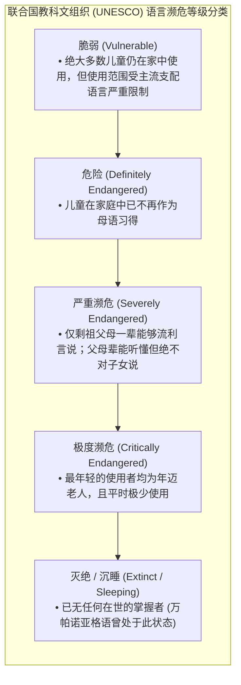
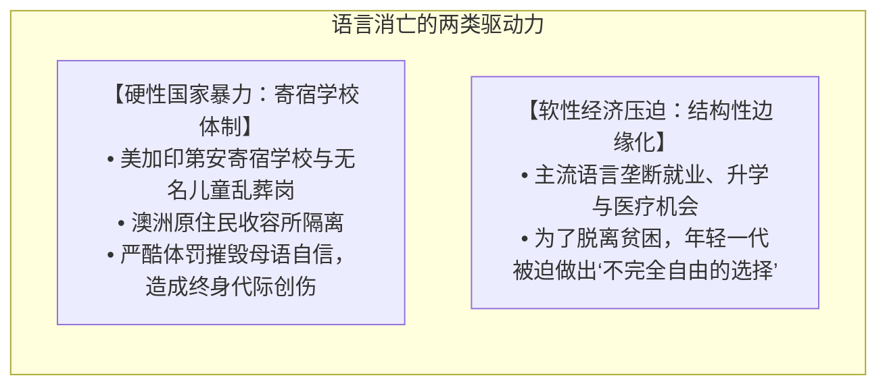

# Lec 24 濒危语言与语言复兴

开场白——沉睡百年的声音——万帕诺亚格语

在我们每天使用的现代英语中，潜伏着无数未被察觉的原住民语言印记：从北美日常词汇中的臭鼬（*skunk*，源自 *sukôq*）、南瓜（*squash*，源自 *asquutasquash*）、莫卡辛软皮鞋（*moccasin*，源自 *mahkusunash*），到地理名称马萨诸塞（*Massachusetts*，源自大河之域 *muhs-uhtuq*）。然而，创造了这些词汇的马萨诸塞本土语言——**万帕诺亚格语（Wampanoag / Wôpanâôt8âôk）**，却在长达一个多世纪里未曾有过一位在世的母语者（native speaker）。

如今，万帕诺亚格人正在全力以赴让他们的祖语重新被世人开口言说。但这无疑是一场极其艰难的逆水行舟，因为他们身边早已没有活着的母语者可以请教。他们不得不扎进古老的历史文献中，像破译密码一样，一点一点逆向推导自己的语言究竟该如何发音和言说。

万帕诺亚格语并不是个例。在美国，所有的原住民语言都面临着不同程度的危险。

联合国教科文组织（UNESCO）有一套语言濒危分级标准：从最轻微的“脆弱”（即虽然周围有强势主流语言，但孩子们仍在学说），一直到“极度濒危”（最年轻的母语者都是风烛残年的老人，平时也很少开口）。  

**美国本土的所有印第安原住民语言，无一例外都在这个危险序列中。** 其中绝大多数属于“极度濒危”。

## TL;DR

- **全球语言大灭绝危机**：联合国教科文组织预测本世纪末人类将丧失 50% 至 90% 的语言，寄宿学校的国家暴力与经济同化是代际传承断裂的根源。
- **不可替代的认知图景**：第一人称包含式与排除式（Clusivity）对立证明语言塑造特定的美学留白，《西雅图夜未眠》的浪漫误解在澳洲拉尔迪尔语（8 个“我们”）中根本无法发生。
- **语言流利度与生命存续**：流行病学调查证实传统母语保存度与原住民青少年自杀率呈强负相关，祖语传承构成了社群最坚韧的文化免疫力。
- **文献构拟与沉睡语言复兴**：MIT 原住民语言倡议项目通过 17 世纪埃利奥特圣经与格律诗篇词序反转，成功侦破失传 350 年的万帕诺亚格语重音法则，迎来了百年首批母语儿童。

## 语言消亡究竟是好是坏？

### 观点一：翻译磨损

英语的 *we* 只表示“我以及某些其他人”，至于听话人究竟包不包括在内，语法上是不交代的。  而在许多原住民语言中，这种模糊性是不存在的！以我做过田野调查的澳大利亚原住民语言拉尔迪尔语（Lardil）为例：

- 拉尔迪尔语强制区分包含式“我们”（Inclusive we）与排除式“我们”（Exclusive we）；
- 如果汤姆·汉克斯打算邀请梅格·瑞恩一起走，他必须使用包含式代词 lag-ri-mol；
- 如果他打算抛下梅格·瑞恩带着儿子开溜，他必须使用排除式代词 yeddi！
- 事实上，拉尔迪尔语中有多达 8 个不同的词来表达“我们”！甚至还能区分交谈双方的代际谐和关系。

如果在一个平行的宇宙里，拉尔迪尔语征服了全球，全世界都说拉尔迪尔语，而英语是一门濒临灭绝的少数族裔语言。当人们试图把《西雅图夜未眠》翻译成拉尔迪尔语时，这场戏在物理上是无法成立的！ 男主角一开口，要么直接剧透表白，要么当场决绝告别，那层微妙的心碎、误解与绝地反转的美学空间被语法范畴直接扼杀了！  

**所有作家、吟游诗人依靠词语间的多义性、双关、韵律和头韵构建的语言艺术，在跨语言翻译中几乎全部都会灰飞烟灭**。

### 观点2： 语言编码的文化世界观

语言往往是社区看待世界、文化思考方式以及人与空间互动关系的直接投射。如果原始语言消失了，我们其实失去了一种观察生命与世界的整全视角。这对人类整体知识库来说是巨大的损失。我把这个总结为 *Linguistically encoded cultural attitudes*

### 观点3：经济流动性与语言死亡

在某种意义上，今天如此大规模的语言消亡现象，背后恰恰反映了一种**积极的经济阶层流动性**。人们丢弃传统母语，往往是因为传统母语与经济萧条的贫困地区捆绑在一起，而强势主流语言则代表着现代就业与改变命运的机会。

### 观点4: 消亡原因

有很多语言之所以濒危，是因为存在另一个强大的统治集团，处心积虑、有系统地试图摧毁它们。

在加拿大和美国，社会上曝出了一系列令人毛骨悚然的丑闻：在当年的印第安寄宿学校旧址上，发现了大量原住民儿童的无名坟墓！这绝非遥远的古代历史。今天依然有幸存的老人活着，他们向我们讲述当年可怕的遭遇：幼童被强行带离父母，送进旨在“开化”他们的学校。如果他们在学校里说了一句自己的母语，就会遭到极其残酷的毒打和虐待！  很多孩子进入学校时是纯粹的母语单语者，在恐怖的高压下，他们的一生都生活在对说母语的恐惧与羞耻之中。他们长大后发誓绝不对自己的孩子讲母语。寄宿学校在消灭原住民文化的目标上，执行得残忍而高效。

我在澳大利亚做拉尔迪尔语田野调查时也是如此。当年岛上实行男女儿童宿舍隔离制。当时的白人管理者有一套所谓“女孩子娇嫩脆弱，需要重点保护不受家庭影响”的偏见，于是把女童锁在宿舍里严加看管，永远不准回家；而对男童则宽松一些，允许他们偶尔回营地探望父母。  其直接后果是：几十年后教我拉尔迪尔语的最后一代母语者，清一色全都是年迈的老爷爷！ 那个时代所有的女性母语记忆，在童年宿舍的高墙内被彻底抹杀干净了。

他回忆说，在他童年的三四十年代，缅因州针对帕萨马科迪原住民的种族歧视严重到了极点——任何原住民都绝无可能在白人的英语世界里找到一份体面的办公室工作。孩子们唯一的生计，就是去农田里给白人捡土豆。  但纽厄尔先生指出，这里存在一个极其讽刺、荒谬的社会学反转：  **当种族歧视最严重的时候，他们的语言反而受到了一种畸形的保护！** 因为既然学好英语也改变不了当苦力的命运，社区里就没有任何人会觉得“如果我多说英语我就能飞黄腾达”，大家世世代代无忧无虑地讲着帕萨马科迪语。  而到了今天，种族歧视大大减轻，帕萨马科迪人可以成为护士、教师、公务员和店员（这显然是巨大的社会进步！），**但这种经济自由，第一次将全方位的母语同化压力直接压在了年轻一代身上！**

### 观点5: 文化认同

2007 年加拿大不列颠哥伦比亚省有一项著名的公共卫生实证研究：学者们调查了全省几十个原住民部落，发现**青少年的自杀率与该社区传统语言的保存状态存在极其显著的强相关**！  

在那些祖语传承稳固、年轻人能够流利说母语的部落，青少年自杀率远低于平均线甚至为零；而在祖语彻底断绝的社区，青年自杀率飙升到令人心碎的地步。  
拥有一门属于你自己的语言，让你明白即使身处贫困保留地，你依然拥有专属于你的精神家园和文化尊严。

## MIT 原住民语言倡议项目（MITILI）

正是基于这样的历史与现实，MIT 语言学系创办了一个特殊的硕士项目——**MITILI（MIT Indigenous Language Initiative，我喜欢把它读作“mightily”）**。  

这个项目全额资助来自濒危语言社区的原住民学者来到 MIT 攻读语言学硕士学位。他们在这里学习音系学、句法学和历史语言学工具，掌握科学分析祖语的武器，回去编写本土教材与词典。我们已经培养了纳瓦霍族、米克马克族（Mi'kmaq）、万帕诺亚格族、帕萨马科迪族以及因纽特伊努皮克族的学者；明年还将迎来一位来自孟加拉国吉大港山区的玛尔玛族（Marma）学生，研究极度缺乏描写的藏缅语族濒危语言。

### 万帕诺亚格语破译：从 17 世纪历史文献中复活语言

万帕诺亚格语拥有北美洲最丰富的原住民早期文献

1. **埃利奥特印第安圣经（Eliot Bible）**：由英国清教徒传教士约翰·埃利奥特（John Eliot）于 1663 年在马萨诸塞剑桥镇印刷出版（第二版为 1685 年）。这是整个西半球印刷出版的第一部基督教圣经（比北美出版第一部英语圣经早了一百多年！）。  我在 MIT 的一位同事告诉我，史密森学会（Smithsonian）有时需要为美国总统就职典礼提供宣誓用的古董圣经。曾有人向他们借阅“美国本土印刷的第一部圣经”，史密森学会的工作人员总是哭笑不得地回答：“相信我，你绝对不会想在就职典礼上用那本圣经宣誓的——因为它是用万帕诺亚格语写的！”

2. **传教过程中的真实原住民发问**：埃利奥特留下的记录里记载了万帕诺亚格人当年向他提出的各种神学问题，非常耐人寻味：

   - 有人问：“耶稣基督受洗时，是整个人浸入水里的（full immersion），还是只是往头上洒水（sprinkling）？”
   - 有人问：“如果洗礼能洗清人的罪孽，为什么我们的孩子刚接受完洗礼，转头就立刻又开始犯罪了？”
   - 最令人心碎的一个反复被问及的问题是：“**如果我们改信你们的上帝，上帝能否保护我们免受瘟疫的侵害？**”当时欧洲殖民者带来的天花和流行病摧毁了整个部族，某些城镇的死亡率高达 80% 至 90%。万帕诺亚格人有自己的传统医术，但在致命的新病毒面前束手无策。我们不知道埃利奥特当时是如何回答他们的。

3. **出埃及记 22:18 与英语借词 *powwow***：埃利奥特在翻译时竭力消灭原住民传统宗教信仰。例如旧约出埃及记 22:18 中有一句著名的戒律：*“Thou shalt not suffer a witch to live.”*（不可容留女巫存活）。  
   在万帕诺亚格圣经中，埃利奥特把“女巫”翻译成了原住民词汇：**pawaw**！  
   这个词正是现代英语单词 **powwow** 的词源！在万帕诺亚格传统中，*pawaw* 指的是主持传统宗教仪式的祭司或精神领袖（今天常称为烟斗守护者 pipe carriers）。埃利奥特借用圣经训诫原住民：“凡是行使你们传统宗教祭祀的 *pawaw*，统统都得处死！”

4. **万帕诺亚格语逻辑学教材**：埃利奥特还编写了一本用万帕诺亚格语写成的逻辑学入门教本，试图用圣经命题教原住民三段论，以便他们能自行辩论传教。因此我们极其意外地知道了万帕诺亚格语中关于“三段论（syllogism）”的单词——其字面意思是“一段短小的演说”，因为三段论把冗长的论证提炼成了最简短的核心。

5. **原住民契约与血泪请愿书**：万帕诺亚格人当年的识字率一度不亚于白人移民，留下了大量土地买卖契约（如大卫·奥克斯 David Oks 将房屋卖给艾萨克·图克门 Isaac Tuhkemen 的地契）。甚至还有马什皮（Mashpee）原住民向波士顿殖民事务专员递交的血泪请愿书：  

   > *“我们深信真相是这样的——我们这些可怜的印第安人，很快将无立足之地，因为这些英国白人正在无休止地侵扰我们……”*

万帕诺亚格部落语言学家、麦克阿瑟“天才奖”得主**杰西·利特尔·多伊·贝尔德（Jessie Little Doe Baird）**在 MIT 获得了语言学硕士学位。她带领族人，以这些严谨破译的语言学成果为基石，创造了全美原住民语言复兴的奇迹：

- 部落开办了名为 **Mukayuhsak Weekuwam（孩子们的小屋）** 的全日制沉浸式语言幼儿园；
- **诞生了一个多世纪以来第一批以万帕诺亚格语为第一母语的新一代儿童！**
- 部落出版了包含上万词条的规范字典与教程，使这门曾沉睡百年的古老语言，重新在马萨诸塞的大地上回响！
