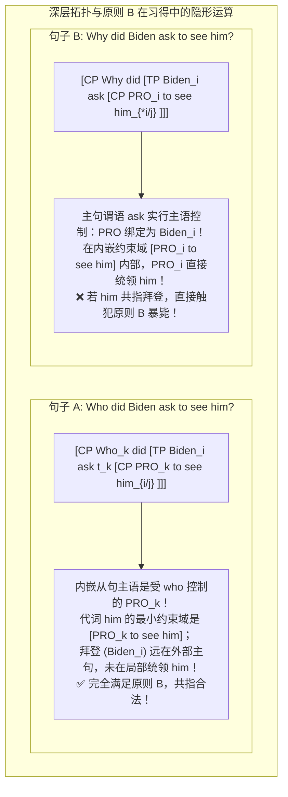
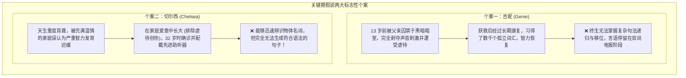
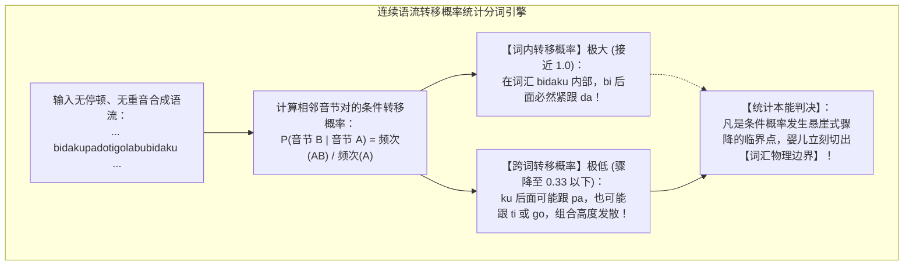
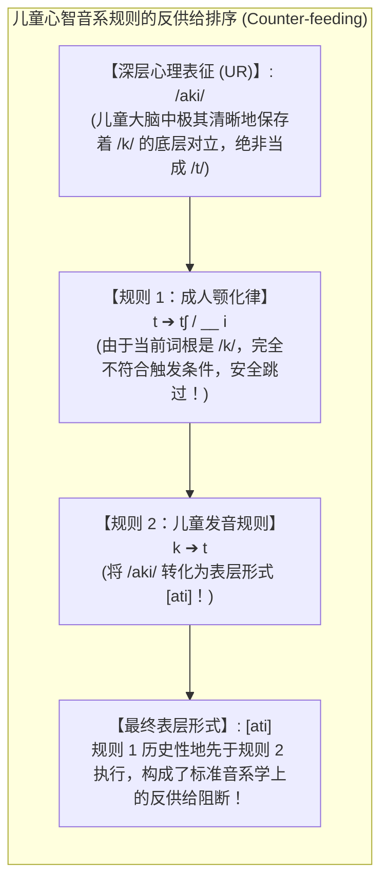

# Lec 25 语言习得：柏拉图问题、关键期假说、统计分词与两岁语法之谜

> MIT 24.900 · 语言学导论 · 主讲 Norvin W. Richards

## TL;DR

- **刺激贫乏确立先天普遍语法**：柏拉图问题揭示儿童在破碎、缺乏负面纠错（Negative Evidence）的语料中，能在 5 岁前精准掌握成分统领与原则 B 等高阶约束。
- **关键期划定句法可塑性硬边界**：未受虐待的重度耳聋个案切尔西（Chelsea）证明，若在青春期前缺乏语言输入，大脑组装句法结构的核心神经网络将永久闭合。
- **婴儿统计概率分词本能**：8 个月大婴儿凭借相邻音节间的转移概率（Transitional Probability）骤降点，无声破解连续物理声波中的离散词汇边界。
- **两岁幼儿拥有成熟句法引擎**：德语 2 岁幼童安德烈亚斯（Andreas）对 V2 助动词移位与句末不定式规则的高精度调控，粉碎了“儿童语言是成人残缺模型”的陈腐偏见。

## 1. 课程定位与问题意识

经过整整一个学期的学习，我们见证了人类语言在音系交替、X-杠理论、中心语移位、量词提升与约束原则上展现出的令人叹为观止的数学严密性。然而，正是这种令人敬畏的复杂度，引出了二十世纪认知科学最震撼的终极哲学命题：

**如果人类语言的句法和语义规则如此艰深晦涩，那些连扣纽扣和系鞋带都尚未完全熟练的四五岁人类幼儿，究竟是如何在毫无任何形式逻辑训练的前提下，轻而易举地完全掌握这套宏大符号系统的？**

这就是诺姆·乔姆斯基（Noam Chomsky）所定义的**柏拉图问题（Plato's Problem）**。
本讲将系统梳理**语言习得（Language Acquisition）**的核心实证图景：从“刺激贫乏论”与父母纠错的缺失，到关键期假说在极端个案中的神经学验证；从婴儿在摇篮中利用贝叶斯式统计转移概率的连续分词，到 2 岁幼儿在德语 V2 移位与音系规则排序中所展现出的惊人心智早熟。

## 2. 核心概念

| 概念 | 严密定义（用自己的话） | 容易混淆的邻居 | 典型实例 / 判据 |
|---|---|---|---|
| **柏拉图问题与刺激贫乏论（Plato's Problem & Poverty of Stimulus）** | 理论语言学的核心命题：儿童所接触到的外界外部语言输入极其有限且充满噪音，但最终习得的心智知识系统却高度一致且极其复杂，证明知识来自先天的普遍语法（UG）。 | 行为主义经验学习（行为主义错误认为语言纯属后天奖惩试错刺激反应的产物）。 | 5 岁儿童无师自通地掌握约束原则 B 与隐形 PRO 的控制机制。 |
| **缺乏负面证据（No Negative Evidence）** | 心理语言学实证事实：在自然家庭语言环境中，父母几乎从不对儿童的句法结构性错误进行系统性纠错，儿童仅凭借正面例句输入即可自发诱导全部正确规则。 | 显性语法教学（学校外语课依赖负面证据挑错；母语自然习得完全不依赖负面证据）。 | 孩子说 *Nobody don't like me*，父母纠正 8 次后孩子仍按内在系统生成。 |
| **关键期假说（Critical Period Hypothesis）** | 伦内伯格（Eric Lenneberg）提出的生物语言学假说：人类大脑拥有特殊的语言习得神经敏感窗口期（从出生至青春期前）；错过该时期，完整的形式句法生成机制将无法被激活。 | 成人二语习得困难（成人二语难是母语迁移与可塑性下降；关键期假说特指从未接触语言者终身无法建立句法能力）。 | 重度失聪个案切尔西（Chelsea）在成年后装助听器，只能记孤立单词，终生无法组句。 |
| **统计分词（Statistical Word Segmentation）** | 婴儿在物理上毫无停顿的连续声波语流中，通过无意识计算相邻音节之间的条件转移概率骤降点，精准识别离散单词物理边界的本能计算机制。 | 依赖词典停顿（真实语流中单词间无停顿；婴儿完全靠纯粹的统计概率逆向切分词界）。 | 萨弗兰（Saffran）实验中 8 个月婴儿对 $P(\text{音节}_2 \mid \text{音节}_1)$ 的无意识统计。 |
| **可选根无限式阶段（Optional Root Infinitive, ORI）** | 幼童在 2 至 3 岁时普遍经历的句法发展阶段：在主句独立句（Root Clause）中，儿童频繁且合法地交替使用带时态有限动词与不带时态的动词原形不定式。 | 随意胡乱说（ORI 绝非胡乱发音；儿童使用不定式时严格将其放置在底层原位，绝不违背该语言的深层拓扑）。 | 德语幼童安德烈亚斯（Andreas）：带时态动词必放第二位，不定式必放句末。 |

## 3. 证据链与认知边界：柏拉图问题与关键期

### 3.1 柏拉图问题：代词指称的隐形深渊

考察以下两句仅相差一个疑问副词的英语句子，请判断代词 *him* 是否可以指代主语拜登（Biden）：
1. **Sentence A**：*Who did Biden ask to see him?*（拜登要求谁去见他？）
2. **Sentence B**：*Why did Biden ask to see him?*（拜登为什么要求见他？）

母语者的直觉是极其苛刻且毫无犹豫的：
- 在句子 A 中，*him* 既可以指外部的某个人（张三），**也可以完全合法地指代拜登本人（Biden）**；
- 在句子 B 中，*him* 绝对禁止指代拜登本人（$\text{Biden}_i \dots \text{him}_{*i}$）！只要你强行让 *him* 指代拜登，全句立刻崩溃为严重语病。

全人类 5 岁的母语儿童，都能毫厘不差地执行这种指称判断。然而，全世界没有哪怕一个父母曾向幼儿讲授过“成分统领”、“不定式空范畴 PRO 的控制特性”或“管辖约束论”。这种**输出知识的精微完备与输入刺激的贫乏破碎之间的巨大鸿沟**，正是乔姆斯基普遍语法（UG）最无可辩驳的证据——儿童的心智中预装了人类通用的句法几何操作系统。

### 3.2 负面证据的缺失与父母纠错的神话

常人常以为儿童是通过父母纠错学会说话的。但数十年的心理语言学真实家庭录音推翻了这一经验主义神话：**父母在日常生活中根本不关注语法，父母只在乎孩子说的是否是事实（真值评价）！**

::: example 真实母子对话实录：真理压倒语法
- **场景 1（语法严重破碎，但内容真实）**：
  - **儿童**：*“Momma isn't a boy, he a girl.”*（妈妈不是男孩子，他是个女孩子——代词错用为男性 *he*，漏掉系动词 *is*）
  - **母亲**（欣喜夸奖）：*“That's right, honey!”*（完全正确，宝贝真棒！）
- **场景 2（语法无懈可击，但内容失真）**：
  - **儿童**：*“Walt Disney comes on Tuesday.”*（迪士尼节目周二放映——语法完全正确）
  - **母亲**（严肃否定）：*“No, he does not!”*（不对，绝对不是周二播！）
  :::

当儿童输出违背成人语法的句子时，父母的强行纠错不仅劳而无功，反而滑稽可笑：
- **儿童**：*“Nobody don't like me.”*
- **母亲**：*“No, say 'Nobody likes me'.”*
- （母亲反复机械纠正 8 次之后）
- **儿童**（恍然大悟状）：*“Oh! Nobody don't likes me!”*

儿童的大脑具有强大的**自主内生语法诱导机制**。他们根据内在的普遍语法模板，主动吸收周围语言的零碎信号，自发构建出完整的树形生成系统，根本不需要外部逐字逐句的纠偏指导。

### 3.3 关键期假说（Critical Period Hypothesis）的极端实证

埃里克·伦内伯格（Eric Lenneberg, 1967）在其划时代著作《语言的生物学基础》中提出：人类语言器官的发展如同视觉皮层或鸟类鸣啭一样，受制于严格的神经发育生物钟。从出生到青春期前（约 7 至 12 岁），大脑皮层保持着极高的神经突触可塑性（Plasticity），左右半球具备高度的语言功能代偿潜力。随着青春期脑侧化（Lateralization）的完成，左脑布罗卡区与韦尼克区的神经环路逐渐固化定型；若在此之前未曾接受外界语言刺激的“点火”，该神经回路将永久丧失组装形式句法树形结构的能力。

相比于遭受严重虐待的吉妮（Genie），加州个案**切尔西（Chelsea）**具有更高的实证纯度：她在充满关爱的正常家庭中长大，未遭受任何心理创伤。然而，当她在成年后首次获得听觉与语言输入时，尽管她能轻松记忆上千个名词词汇，却永远无法将词汇组装为包含主谓短语结构的句子。这也解释了为什么普通成年人学习第二语言时必须借助显性规则死记，而儿童却能在自然交流中瞬间吸收——成年人的句法专属神经硬件早已关闭，只能调用前额叶皮层的通用问题求解机制勉强代偿。

## 4. 机制与形式推导：连续分词与幼儿句法早熟

### 4.1 婴儿的高振幅吮吸（HAS）与统计概率分词

在接触复杂的句法规则之前，婴儿在摇篮中面临着极其残酷的物理世界挑战：真实世界的物理声学波形是一条平滑连续的能量流，单词之间根本不存在像书面文本那样的空格或静音停顿！
然而，实验心理语言学证实，刚出生的婴儿不仅是敏锐的语音学家，更是天生的概率统计大师。

在语音辨别层面，研究者利用**高振幅吮吸范式（High-Amplitude Sucking, HAS，由彼得·艾马斯 Peter Eimas 等人开创）**发现：
- 当给初生几个月大的日本婴儿连续播放音节 `/ra/` 时，婴儿起初用力吮吸安抚奶嘴以听取声音，随着时间推移逐渐感到无聊，吮吸频率大幅衰减（**习惯化 Habituation**）；
- 此时研究者突然将刺激声切换为微弱差异的 `/la/`，日本婴儿的吮吸频率瞬间暴增，显示出强烈的**去习惯化（Dishabituation）**兴奋！
- 这无可辩驳地证明：刚出生的婴儿是全人类语言的“世界公民”！日本婴儿完全具备分辨 `/r/` 与 `/l/` 的敏锐听觉，英语婴儿也能分辨印地语齿音与卷舌音。直到 6 至 10 个月大时，随着母语统计输入的积累，大脑才主动修剪掉非母语的音位对立，将感知范畴彻底锚定在母语空间。

而在词汇切分层面，萨弗兰、阿斯林与纽波特（Saffran, Aslin, & Newport, 1996）做出了划时代的实验发现：**8 个月大的婴儿在无意识中精准执行着贝叶斯式的条件转移概率计算！**

在仅仅收听两分钟人工合成的单调语流后，8 个月大的婴儿便能凭借相邻音节间的条件概率突变点，自发而精准地将连续声波切割为离散的单词积木。这种与生俱来的统计学习机制，构筑了人类语言习得的第一级火箭推进器。

在 8 个月大时，婴儿仅需听两分钟无任何重音和韵律起伏的无意义音节连续流（*bidakupadotigolabu...*），就能敏锐利用条件转移概率的落差，精确切分出 *bidaku* 是一个完整的独立单词。这种强大的统计计算本能，让儿童在 1 岁前就完成了母语词汇边界的无监督解码。

### 4.2 日本 3 岁幼儿的音系规则反供给排序实录

很多家长误以为幼儿口齿不清是“肌肉笨拙”。但心理语言学深入音系学推导后，揭示了令人震惊的心智秩序：
考察一位 3 岁零 2 个月的日本幼儿：他在发音上尚无法外化软腭塞音 `/k/`，全部替代为齿龈塞音 `[t]`：
- *mikan*（蜜柑） $\to$ **mitan**；
- *neko*（猫） $\to$ **neto**。

在成人标准日语中，齿龈音 `/t/` 遵循极其刚性的同化规则：在闭前元音 `/i/` 前，强制颚化为 `[tʃ]`（如 *machi* “城市”）；在闭后元音 `/ɯ/` 前，强制塞擦化为 `[ts]`（如 *matsu* “等待”）。该幼儿在普通词汇中完全掌握了这套规则（能流利发出 *matchi* 与 *matsu*）。

现在考察该幼儿发包含 `/k/` 的词汇时会发生什么：
- 日语“秋天”是 `/aki/`；“熊”是 `/kuma/`。
- 如果幼儿仅仅是物理发不出 `/k/` 而直接将其当成 `/t/`，那么遇到 `/i/` 时，理应顺理成章地发生颚化，把“秋天”念成 *\*achi*，把“熊”念成 *\*tsuma*！

然而，实验室真实测定的幼儿发音震撼了所有人：
> **秋天**：发音为 **ati**（绝不念 *\*achi*！）  
> **熊**：发音为 **tuma**（绝不念 *\*tsuma*！）

这一推导无可辩驳地宣告：这名 3 岁幼儿的大脑深处，完好无损地储存着与成人完全相同的底层音位 `/k/` 与 `/t/` 的本质对立！幼儿的心智不仅拥有完备的深层表征，还严格建立了两套按先后次序执行的音系重写演算流水线。

### 4.3 德语两岁幼童安德烈亚斯的 V2 句法奇迹

在 2 岁左右，欧洲多门语言的儿童经历**可选根无限式阶段（Optional Root Infinitive, ORI）**，常常在主句中使用动词原形不定式。
然而，德语 2 岁 1 个月大的幼童安德烈亚斯（Andreas）的语言记录，向世人展示了幼儿句法系统无与伦比的精密：

| 句式类型与例句 | 动词形态 | 动词在分句中的物理位置 | 句法学理论机制 | 幼童安德烈亚斯遵循率 |
|---|---|---|---|---|
| **Ich hab ein' großen Ball.** （我有一个大球） | **屈折有限动词（Finite Verb）** *hab*（第一人称现在时） | **全句第二位（Second Position, V2）** | 动词执行 T-to-C 中心语移位，跃迁至 $C^0$ 槽位。 | **> 95% 绝对精准合规 ✅** |
| **Thorsten Caesar haben.** （托尔斯滕 恺撒 拥有.INF） | **不带时态不定式（Infinitive）** *haben*（原形动词） | **全句最末尾（Clause-Final）** | 无时态特征驱动移位，动词牢牢停留在底层 SOV 的动词原位。 | **> 95% 绝对精准合规 ✅** |

安德烈亚斯仅仅是在功能范畴层面上误以为“主句有时可以省略时态标记”，**但他对德语宏观语序的 V2 移位规则与底层中心语在后的几何拓扑，掌握得与海德格尔或歌德毫无二致！**

## 5. 我的理解与批判性反思

::: insight 心智的预制宫殿与儿童的理性尊严
语言习得是理论语言学中最涤荡人心的科学篇章，它彻底颠覆了人类对童年的传统傲慢：
1. **打破白板说的迷梦**：几百年来，经验主义哲学习惯于把新生儿视作一张任由环境涂写的白纸。然而，柏拉图问题与刺激贫乏论用无可辩驳的事实宣告：人类心智绝非被动接受印刻的容器，而是一座早已奠定宏伟地基的预制宫殿。婴儿不是通过反复试错来发明语法，而是用周围破碎的声音作为火种，点亮基因中早已写好的普遍语法宇宙。
2. **儿童的错误是科学的窗口**：无论是日本幼儿在 `/k/ \to [t]` 背后严密的规则排序，还是安德烈亚斯在两岁时对德语 V2 与句末动词的精密调度，它们都雄辩地证明：儿童绝不是成人的残缺微缩模型。儿童口中每一个令成人哑然失笑的“错误”，在句法学透镜下都是心智在参数空间中精准探索的理性闪光。
3. **中国学习者的二语启示**：为什么我们成年后背诵千万条语法规则却依然无法流畅表达？关键期假说与统计分词机制给出了深刻警示：成年人之所以学得痛苦，是因为我们试图用通用的逻辑认知区，去硬抗早已关闭的专门语言器官。掌握英语的真谛，绝不是死记语法规则，而是通过沉浸式的高频真实输入，重新唤醒心智对概率分布与结构拓扑的直觉本能。
:::
