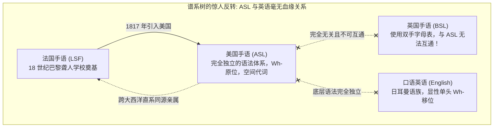

# Lec 26 手语语言学：空间句法、手势音系学、空间指称与普遍语法超越

**开场白**

欢迎来到本学期的最后一堂Lecture，不搞走过场的学期总结，而是将聚光灯投向一个极其宏大、迷人且直击人类语言本质的领域——手语语言学（Signed Languages）！

美国聋人群体所使用的，叫做美国手语（American Sign Language, ASL）。它是一门拥有完全独立、高度精细之语法体系的独立人类语言。

。

### 1.1 证据一：谱系树历史与英美手语的彻底不互通

证明手语不是口语手势翻版的最好证据，就是它的历史谱系：

- **ASL 与法国手语（LSF）亲缘极其紧密**：美国历史上最早的聋人学校是由来自法国的教育家（洛朗·克莱克 Laurent Clerc 与托马斯·高立德 Thomas Gallaudet）建立的。因此，ASL 在谱系上是法国手语的后裔；
- **ASL 与英国手语（BSL）完全无关且无法互通**：英式英语与美式英语虽然经常被互相开玩笑，但彼此完全可以无障碍沟通。然而，一个讲 ASL 的美国聋人和一个讲 BSL 的英国聋人相遇，两人根本无法理解对方的手语！因为它们属于两个完全不同的语系。ASL 绝不是英语，而是一门用身体（尤其是双手和面部）言说的独立语言。

### 1.2 证据二：句法层面的 Wh-原位现象

在句法结构上，ASL 与英语也有着巨大的差异：

- 英语必须进行显性的 Wh-移位（*Who did John see?*）；

- 而许多其他语言（如汉语普通话）不发生显性移位，属于 Wh-原位语言（Wh-in-situ）；

- **在这方面，ASL 更像汉语，而不是英语！** 在 ASL 中，询问“约翰看见了谁”的标准自然打法是：

  > `JOHN` `SEE` `WHO`  
  > （字面词序：约翰 看 谁？）

不仅如此，提问者在打出这个疑问句时，不仅手在动，面部也必须严格协同：**必须微微歪头，并且紧紧皱起眉头（Furrow your brow），做出困惑的表情**。波士顿大学（BU）的卡罗尔·内德尔（Carol Neidle）教授实验室对 ASL 进行了极度精细的语料库标注。研究发现，这种“皱眉”并不是整个句子都在做，而是精确受控于句法疑问域的边界！

### 1.3 聋人社区的社会语言学现状与文化手势借用

在美国，绝大多数聋人儿童出生在健听人（Hearing parents）家庭。如果父母在孩子被确诊耳聋之前不懂 ASL，他们就必须拼命赶在童年关键期关闭前快速学习 ASL，这是一件极度艰难的事情。因此，聋人儿童从小往往同时暴露在身边的英语手势文化中。  
这就导致了手语与口语文化手势之间的**借用（Borrowing）**：

- **第一人称代词“我”**：
  - 在美国手语（ASL）中，打“我”的手势是用食指指向**自己的胸口**；
  - 在日本手语（JSL）中，打“我”的手势则是用食指指向**自己的鼻尖**！
  - 这显然是各自吸收了美国人与日本人日常文化中表示“我”的习惯性手势。

## 结束语

这门课程最核心的宗旨之一，就是向大家证明：人类语言绝非平平无奇的日常工具，它背后潜藏着极其深奥、神秘的心智宇宙！

语言学是一门年轻而朝气蓬勃的科学。即使在这样一门导论课里，我们也能轻而易举地把大家直接带到人类已知知识的最前沿边缘，邀请大家站在悬崖峭壁上，凝视下方深不见底的未解之谜深渊，并思考该如何搭建通往彼岸的下一座桥梁！  我由衷地希望，你们当中的一些人会受到启发，在未来的日子里选修更多高级语言学课程；我更期待未来的某一天，你们能成为替全人类解开这些心智奥秘的先驱学者！
