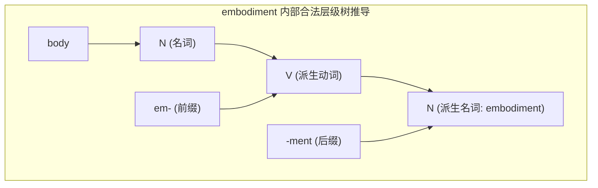
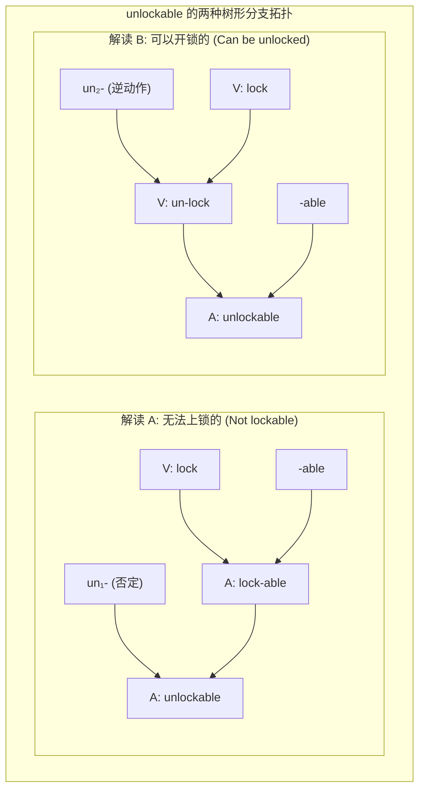

# Lec 3 形态学（二）：层级树形结构、范畴选择与语素变体

> MIT 24.900 · 语言学导论 · 主讲 Norvin W. Richards

## TL;DR

- 词汇内部的层次性：单词绝非线性的字母串联，而是具有严密分支层级（Hierarchical Structure）的微型句法树。
- 范畴选择限制（Selectional Restrictions）：词缀对依附基底的词类拥有严格的形式限定（如 `-able` 必须选择动词，`re-` 必须依附动词）。
- 词法结构歧义：多词缀复合词（如 *unlockable*）的两种不同解释直接映射为两套截然不同的二叉树合并拓扑路径。
- 底层式与音系中和：通过波兰语词尾去浊交替（*wuk* vs. *wuga*），确立形态分析必须透过表层中和、构拟抽象底层式（UR）的方法论准则。

## 1. 核心问题

### 驱动问题
为什么英语中可以说 *embodiment*（具身/体现），却绝对不可以说 *\*bodyment*？为什么 *unlockable* 既可以表示“无法上锁的”，也可以表示“可以开锁的”？

### 形式本质：微观句法与范畴选择
初学者容易将构词想象为简单的乐高积木平铺拼接。然而，形态学实质上是**词库内部的微观句法学（Micro-Syntax）**。每一个黏着语素在心智词库中都携带着严格的“词类子范畴选择特征（Subcategorization / c-selection）”。

当多个语素组合在一起时，它们必须按照特定的逻辑先后顺序发生递归合并。如果其中一步合并违反了词缀的范畴准入条件，整个派生树形结构就会在中间节点发生类型崩溃。单词的合法性不取决于其最终意义是否“讲得通”，而取决于其内在二叉树的分支步骤是否处处合法。

## 2. 核心概念

| 概念 | 严密定义（用自己的话） | 容易混淆的邻居 | 典型实例 / 判据 |
|---|---|---|---|
| **范畴选择限制（Selectional Restrictions）** | 黏着词缀在合并时对其宿主基底（Base）的词性范畴（N, V, A）施加的强制性语法禁令。 | 语义选择限制（Semantic Selection 关注动词对其论元在概念意义上的合理性，如“喝”要求液体）。 | 后缀 `-able` 必须依附动词（$V + \text{-able} \to A$），故 *\*cat-able*（名词基底）非法。 |
| **词法结构歧义（Morphological Ambiguity）** | 表面完全相同的单字由于内部词缀合并次序的分歧，对应两棵不同树形结构并产生截然不同语义的现象。 | 句法歧义（句法歧义发生在短语和句子层级，如“咬死猎人的狗”）。 | *unlockable*（可开锁的 vs. 无法上锁的）。 |
| **底层构形（Underlying Representation, UR）** | 存储在心智词库中的抽象语素音位序列，尚未经历后续音系规则或环境交替修补的原型。 | 表层形式（Surface Form 是最终经由发音器官物理输出的声学形式）。 | 英语复数底层式为 /-z/，波兰语“弓”底层式为 /wug/。 |
| **同位异音/语素变体中和（Neutralization）** | 两个在底层截然不同的音位或语素，在特定语音环境下因音系规则作用而外化为完全相同表层形式的现象。 | 自由变体（自由变体在同一环境下可随意互换，中和是受环境严密制约的必然对立消除）。 | 波兰语词尾阻碍音清化：底层的 /g/ 与 /k/ 在词尾处全部中和为 [k]。 |

## 3. 证据链与形式推导

### 3.1 词缀选择限制的数学形式化
在心智词库中，黏着语素表现为一种特殊的“类型转换函数”：

```text
-able:    [ __ V ] --> A        (将动词转化为形容词: read --> readable)
re-:      [ __ V ] --> V        (将动词转化为新动词: write --> rewrite)
-ment:    [ __ V ] --> N        (将动词转化为名词: develop --> development)
em-:      [ __ N ] --> V        (将名词转化为动词: power --> empower, body --> embody)
```

现在我们推导为何 *\*bodyment* 违规，而 *embodiment* 合法：

::: example embodiment 的合法推导树 vs. *bodyment 的类型崩溃
1. **推导 *bodyment**：
   - 词根 `body` 的词类为 $N$；
   - 后缀 `-ment` 的选择环境为 $[ \_\_ V ]$；
   - 类型冲突：`-ment` 试图与 $N$ 合并，违反准入限制！推导在底层直接暴毙：
     $$\text{*[ } [body]_N\text{ -ment ]}$$
2. **推导 embodiment**：
   - 第一步：前缀 `em-` 与名词 `body` 合并：
     $$[em-]_V + [body]_N \implies [[embody]_V]$$
     输出结果成功晋升为合法的动词 $V$！
   - 第二步：后缀 `-ment` 与新生成的动词 `embody` 合并：
     $$[[embody]_V] + [-ment]_N \implies [[[embodiment]_N]]$$
     每一层合并均完美契合选择限制，词汇合法生成！
:::



### 3.2 经典结构歧义案：unlockable 的双树解构
前缀 *un-* 在英语中实际上包含两个不同的同音异义语素：
1. **否定前缀 $un_1-$**：依附于形容词，构成新形容词（$[ \_\_ A ] \to A$），意为“非……”（如 *unhappy*）；
2. **逆向动作前缀 $un_2-$**：依附于动词，构成新动词（$[ \_\_ V ] \to V$），意为“撤销/反转动作”（如 *untie, unlock*）。

当 *un-*, *lock*, *-able* 三者结合为 *unlockable* 时，存在两条完全独立的分支合并路径：



- **解读 A（无法上锁的）**：先由 *lock + -able* 生成形容词 *lockable*（可上锁的），再由否定前缀 $un_1-$ 与形容词合并生成 *un-lockable*；
- **解读 B（可以开锁的）**：先由逆向动词前缀 $un_2-$ 与 *lock* 合并生成动词 *unlock*（开锁），再由 `-able` 与动词合并生成形容词 *unlock-able*。

词汇内部的层次深度，直接在发音完全相同的前提下，衍生出截然相反的两种真值命题！

## 4. 机制与形式推导：波兰语词尾去浊与底层式构拟

词汇在表层发出的声音，常常掩盖了其心智底层的真实形态。观察波兰语的阻碍音交替现象：

::: example 波兰语主格与属格最小对立
- 单词 1：“弓”（bow）
  - 主格（单数）：`[wuk]`
  - 属格（单数）：`[wuga]`
- 单词 2：“韭葱”（leek）
  - 主格（单数）：`[wuk]`
  - 属格（单数）：`[wuka]`
:::

在主格单数中，“弓”和“韭葱”发音完全一致，均读作 `[wuk]`。如果仅仅依赖表层听音，语言学家无法得知其词根末尾的辅音到底是什么。

### 逆向构拟：为什么属格形式才是底层式的灯塔？
波兰语属格后缀是元音 `-a`。在元音之前，词根末尾辅音受到后续音节核的保护，真实地展现出了对立：
- “弓”的辅音是浊塞音 `[g]`；
- “韭葱”的辅音是清塞音 `[k]`。

**音系形态学形式推导**：
1. **词库底层构形（UR）**：
   - 词根“弓”：`/wug/`
   - 词根“韭葱”：`/wuk/`
2. **波兰语音系规则：词尾阻塞音清化律（Word-final Devoicing）**：
   $$[+\text{obstruent}] \implies [-\text{voiced}] \ / \ \_\_\ \#$$
   （阻碍音在处于词边界时，强制变为无声清音！）

当 `/wug/` 独立成词（主格）时，词尾 `/g/` 触发清化规则，表层输出为 `[wuk]`；当后续接有元音后缀 `-a`（属格 `/wug + a/`）时，`/g/` 成为音节首辅音，脱离了词边界环境，清化规则不满足触发条件，完好保留其底层的浊辅音形式！

## 5. 我的理解与批判性反思

::: insight 表象具有欺骗性，心智系统由不可见的底层维系
波兰语的词尾去浊与英语的 *unlockable* 歧义，在方法论上为整个认知科学确立了一个崇高的公理：**感官所能直接接收到的物理表象，往往是高度中和、压缩且充满歧义的低维投影；而认知系统的真正规律，深藏在人类无法直接肉眼观察的高维抽象表征（Underlying Representations & Tree Hierarchies）中。**

如果一个语言学家仅仅停留在“忠实记录表层声音”，他会把波兰语的“弓”和“韭葱”当成完全同音的词根，并在属格形态前陷入莫名其妙的例外困境；唯有假设人类心智中独立运作着一个不受表面发音扭曲的抽象底层式，以及一套形式化的映射规则，全语言系统的混乱表象才能瞬间坍缩为优美而对称的物理法则。这正是形式语言学之所以成为硬核心智科学的魅力所在。
:::
