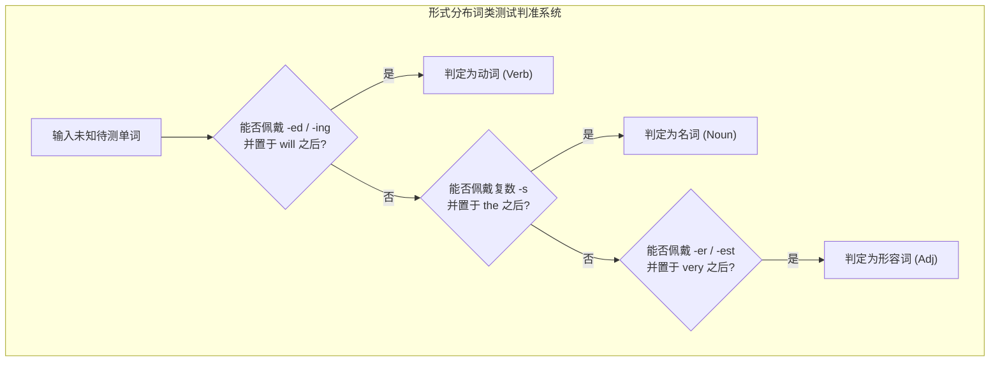
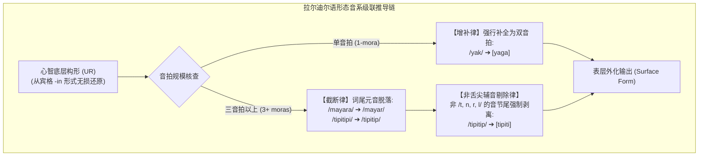

# Lec 4 形态学（三）：词类分布测试、形态类型学与极小词推导

> MIT 24.900 · 语言学导论 · 主讲 Norvin W. Richards

## TL;DR

- 词类的形式分布定义：严厉破除“名词即人事物、动词即动作”的语义学迷思，确立基于句法结构槽位与形态标记的分布测试（Distributional Tests）。
- 四大形态类型学谱系：孤立语（Analytic）、胶着语（Agglutinating）、屈折语（Fusional）与多式综合语（Polysynthetic）的连续坐标体系。
- 极小词约束（Minimal Word Constraint）：澳大利亚拉尔迪尔语（Lardil）证明词汇必须满足双音拍（Two-mora）的生理音步下限。
- 复杂规则级联推导：拉尔迪尔语展示了末尾元音截断律、非舌尖辅音脱落律与极小词增补律之间的严密规则排序（Rule Ordering）。

## 1. 核心问题

### 驱动问题
为什么小学老师教的“名词是人事物、动词是动作行为”在科学语言学中完全破产？当一个词既可以指代动作也可以指代状态时，语言如何判定其词性？此外，跨语言的形态复杂度差异极大，从毫无词尾变化的汉语到一词成句的多式综合语，它们背后的共同计算约束是什么？

### 形式本质：结构分布与形态音系学推导
词性从来不是由概念的“物理实在”决定的。*fist*（拳头）是物体还是动作？*destruction*（毁灭）在物理上是纯粹的动作，但在语法上却是毫无争议的名词；*red* 在 *red car* 中是形容词，在 *red is my favorite color* 中却是名词。

科学语言学必须建立**分布标准（Distributional Criteria）**——一个词属于什么范畴，完全取决于它能够出现在哪些句法语境槽位中，以及能佩戴哪些特定的形态屈折。同时，澳大利亚原住民语言拉尔迪尔语（Lardil）展现了人类形态学推导的巅峰美学：表层看似极度混乱的词汇外化，完全由一套严格级联排序的音系规则直接支配。

## 2. 核心概念

| 概念 | 严密定义（用自己的话） | 容易混淆的邻居 | 典型实例 / 判据 |
|---|---|---|---|
| **分布测试（Distributional Tests）** | 依据词汇在句子树形结构中所能填补的局部槽位及所受形态屈折，判定其词类的形式化检验方法。 | 语义直觉分类（语义法漏洞百出，无法解释 *flour* 是物质而 *pease* 曾是不可数名词）。 | 名词测试：能否填入 $[ \text{the} \ \_\_ ]$；形容词测试：能否填入 $[ \text{very} \ \_\_ ]$。 |
| **孤立语 / 分析语（Isolating / Analytic）** | 词与语素的比率接近 1:1，语素绝大多数为自由语素，语法关系完全由句法语序表达的语言。 | 胶着语（胶着语词内富含多个语素，且边界极其清晰）。 | 汉语（普通话）、越南语。 |
| **胶着语（Agglutinating）** | 单词由多个语素像串珠一样拼接而成，每个语素与语法意义保持一对一严整对应，语素边界极易切分。 | 屈折语（屈折语中一个语素同时融合多种语法范畴，边界难以剥离）。 | 土耳其语、芬兰语、斯瓦希里语、日语。 |
| **屈折语（Fusional / Inflectional）** | 单个语素内部融合了多种不可分割的语法范畴（合形语素 Portmanteau Morpheme），词根常伴随内部音变。 | 胶着语（屈折语语素高度融合变形，无法像胶着语那样按槽位整齐切分）。 | 拉丁语、俄语、西班牙语（如拉丁语 *-ō* 同时编码第一人称、单数、现在时、陈述语气）。 |
| **多式综合语（Polysynthetic）** | 动词能够将名词论元深度整合（名词抱合 Noun Incorporation），单个复合词即可表达完整句子命题的语言。 | 复杂派生词（多式综合语的词内整合具有句法论元选择的生产力性质）。 | 北美因纽特语、莫霍克语、马萨诸塞万帕诺亚格语。 |
| **极小词约束（Minimal Word Constraint）** | 语言在音系学上强制要求任何独立成词的表层形式必须满足最小音步规模（通常为两个音拍或两个音节）。 | 简单发音习惯（极小词约束是强制性的形式生成屏障，单音拍底层式必须经由音系增补方能外化）。 | 拉尔迪尔语单音节词根必须增补元音（/yak/ $\implies$ [yaga]）。 |

## 3. 证据链与形式推导

### 3.1 词类的三大形式分布测试标准
语言学家使用三组形式框架来确立词类范畴。这一测试方法将词汇放入标准化的句法测试环境中，观察其能否自然接入相应的句法槽位并接受屈折标记的约束检验：

::: example 英语三大主要词类的形式测试
1. **名词（Noun）分布测试**：
   - 句法槽位：能够出现在冠词/指示代词之后：$[ \text{the / this} \ \_\_ ]$；
   - 形态特征：能够佩戴复数标记（`-s`）以及所有格标记（`'s`）。
2. **动词（Verb）分布测试**：
   - 句法槽位：能够紧随情态动词之后：$[ \text{will / should} \ \_\_ ]$；
   - 形态特征：能够佩戴过去时屈折（`-ed`）、第三人称现在时单数（`-s`）及进行体（`-ing`）。
3. **形容词（Adjective）分布测试**：
   - 句法槽位：能够被程度副词修饰：$[ \text{very / too} \ \_\_ ]$；或处于限定位置：$[ \text{the} \ \_\_ \ \text{noun} ]$；
   - 形态特征：能够佩戴比较级与最高级后缀（`-er / -est`）。
:::

### 3.2 形态类型学四象限
全人类语言并不是截然割裂的孤岛，而是分布在“语素/词汇比（Synthesis）”与“语素融合度（Fusion）”构建的连续双维坐标系中。在极端分析端，现代汉语与越南语的每个单词基本由单一自由语素构成，依赖句法语序与虚词表达语法关系；沿综合度坐标向上延伸，土耳其语、芬兰语与斯瓦希里语展现了典型的胶着特征，形态词缀像串珠一样整齐排列；而在高融合度的拉丁语和德语中，单个语素往往同时浓缩了时态、语气、人称与数等多维特征；在最极端的综合端，北美原住民语言展现了庞大的多式综合抱合能力：

| 类型学类别 | 综合度（语素/词比率） | 融合度（特征集中度） | 典型代表语言 | 核心句法形态特征 |
| :--- | :--- | :--- | :--- | :--- |
| **孤立语 (Isolating)** | 极低（接近 1:1） | 极低（零内部音变） | 现代汉语、越南语 | 缺乏黏着屈折，语法关系完全由严格词序与独立语法虚词表征 |
| **胶着语 (Agglutinating)** | 中到高（一词多语素） | 极低（语素边界清晰） | 土耳其语、斯瓦希里语、日语 | 词缀如积木般线性拼接，每个语素与语法意义保持一对一的严整映射 |
| **屈折语 (Fusional)** | 中等（有限词缀） | 极高（单语素多重特征） | 拉丁语、俄语、西班牙语 | 单一屈折词尾融合性、数、格、时态等多种范畴，词根常伴随内部屈折音变 |
| **多式综合语 (Polysynthetic)** | 极高（一词即可成句） | 变动（胶着与融合并存） | 因纽特语、万帕诺亚格语、莫霍克语 | 动词能够将名词论元深度抱合（Incorporation），单个复合词直接外化复杂命题 |

这一类型学四分法不是互斥的离散标签，而是反映不同语言在形态综合与形式融合两个自由度上的权衡取舍。理解这一连续光谱有助于我们在面对跨语言语料时，迅速定位该语言的核心形态处理策略，从而采用恰当的解构工具。

## 4. 机制与形式推导：拉尔迪尔语（Lardil）形态音系学与规则排序

澳大利亚莫宁顿岛的拉尔迪尔语拥有世界语言学界最负盛名的形态推导范例。
在拉尔迪尔语中，**宾格后缀是 `-in`（辅音后）或 `-n`（元音后）**，它像保护罩一样完整保留了词根的原型；而**主格形式不带任何词缀（零形式）**，因而完全暴露在外部音系截断与增补规则的绞杀之下！

### 4.1 核心音系规则清单
1. **规则 1：双音拍极小词增补律（Minimal Word Augmentation）**：
   - 任何独立成词的主格必须拥有至少两个音拍（双音节）。若底层词根只有一个音拍，强制在词尾插入元音 `a`！
2. **规则 2：末尾元音截断律（Apocope）**：
   - 在多于两个音节的单词中，词尾元音必须脱落（$V \to \emptyset \ / \ \sigma\sigma\_\_\#$）；
3. **规则 3：非舌尖辅音脱落律（Non-apical Drop）**：
   - 在词尾位置，只有舌尖音（Apical，齿龈塞音/流音/鼻音：`/t, d, n, r, l/`）能够合法充当音节尾；非舌尖音（唇音 `/p, m/`、软腭音 `/k, ŋ/`）强制脱落！

### 4.2 级联推导矩阵

::: example 拉尔迪尔语实证推导矩阵
- **案例 A：“鱼”（单音拍词根）**
  - 宾格形式：`yak-in` $\implies$ 底层式确认为 `/yak/`；
  - 主格推导：底层式 `/yak/` 仅有单音拍，不满足极小词约束！触发增补律：
    $$/yak/ \implies [yaga] \quad \text{（表层主格读作 yaga！）}$$
- **案例 B：“彩虹”（三音节词根）**
  - 宾格形式：`mayara-n` $\implies$ 底层式确认为 `/mayara/`；
  - 主格推导：三音节满足截断条件，触发规则 2（末尾元音脱落）：
    $$/mayara/ \implies /mayar/ \quad \text{（/r/ 为舌尖流音，合法保留，输出 [mayar]！）}$$
- **案例 C：“发带”（多重非舌尖音脱落）**
  - 宾格形式：`mungkunmungku-n` $\implies$ 底层式确认为 `/mungkunmungku/`；
  - 主格推导：
    1. 规则 2（元音脱落）：`/mungkunmungku/ \implies /mungkunmungk/`；
    2. 规则 3（非舌尖音脱落）：末尾软腭音 `/k/` 违规，强制剔除 $\implies /mungkunmung/$；
    3. 再次触发规则 3：末尾软腭鼻音 `/ŋ/` 依然违规，再次剔除 $\implies [mungkunmu]$！
- **案例 D：“石鳕鱼”（双音节免疫）**
  - 宾格形式：`tipitipi-n` $\implies$ 底层式确认为 `/tipitipi/`；
  - 主格推导：脱落末元音后变为 `/tipitip/`，词尾唇音 `/p/` 违规脱落变为 `[tipiti]`！
:::

## 5. 我的理解与批判性反思

::: insight 规则排序的物理本质：时间性与计算遮蔽
拉尔迪尔语的推导向我们展示了理论语言学最震撼的发现之一：**共时规则排序（Synchronic Rule Ordering）实际上是历史历时音变（Diachronic Sound Changes）在人类当代大脑中的结构化沉淀。**

为什么拉尔迪尔语在脱落末尾元音后，能够暴露出不合法的辅音并进一步将其剔除？这说明人类大脑在执行形态音系运算时，绝不是一次性并行坍缩的，而是具有严格的**串行级联时间步（Serial Computation Steps）**。后一步规则的输入，严格依赖于前一步规则的清洗产物。

这也解释了为什么儿童在习得这种高度不透明的语言时从未遇到困难——儿童并没有去硬背每一个词汇表面上残缺不全的形式，儿童的大脑直接内化了生成该结果的算法编译器。语言学习的本质，不是向大脑仓库中搬入成千上万个孤立的表层结果，而是向心智计算核心中装载那几行简洁、优美且普适的推导规则。
:::
