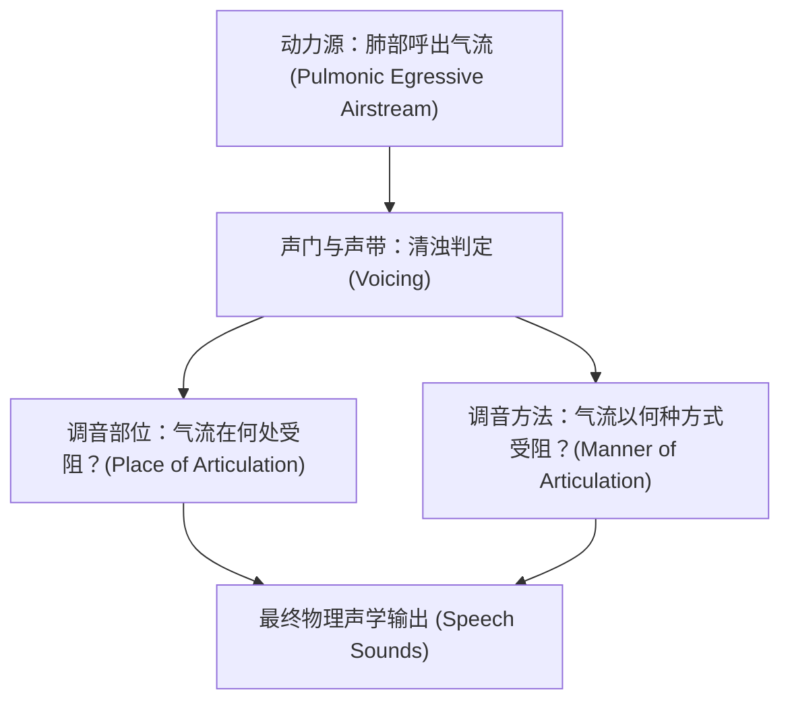
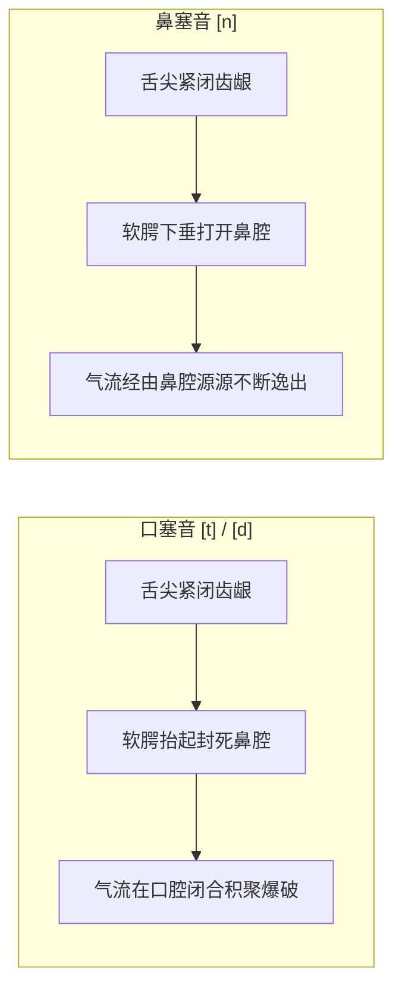

# Lec 5 语音学 I ：发音器官 & 国际音标

**开场白**

当我们开口说话时，我们在物理上所做的，本质上是产生一股气流，这股气流通常来自你的肺部（虽然并不绝对），气流向上涌出并在声道（Vocal tract）中遭遇各种各样的阻碍。因此，语言学中描述不同人类语音的标准范式，就是回答两大核心物理追问：

1. **气流在声道的什么具体解剖位置遭遇了阻碍？**（WHERE is it obstructed? $\rightarrow$ **发音部位 Place of Articulation**）
2. **气流是以何种物理方式受到阻碍的？**（HOW is it obstructed? $\rightarrow$ **发音方法 Manner of Articulation**）
3. 此外，还要考察声带在此过程中是否发生周期性振动（$\rightarrow$ **清浊状态 Voicing**）。

这就是我们今天与下节课将要系统展开的核心工作。

---

## 一、Place of Articulation：从双唇到声门的声道巡礼

我们首先探讨“阻碍发生在哪里”。对声道给气流施加的各种阻碍进行分类的核心维度，正是**发音部位（*Place of Articulation*）**。

现在请看解剖图，这在解剖学上被称为**正中矢状切面（Sagittal section）**——也就是把人类的头部正中剖成两半，以便清晰观察口腔、咽腔和喉头的内部结构。

我们首先探讨“阻碍发生在哪里”。对声道给气流施加的各种阻碍进行分类的核心维度，正是**发音部位（Place of Articulation）**。

请看上图解，这在解剖学上被称为**正中矢状切面（Sagittal section）**——也就是把人类的头部正中剖成两半，以便清晰观察口腔、咽腔和喉头的内部结构。

我们沿着声道，由外向内进行一次发音部位巡礼：

### 1.1 双唇音（Bilabial）

- **发音动作**：上下两片嘴唇共同参与调音。
- **代表词汇**：英语单词 *paint*、*bath*、*mouth* 的首音，以及 *wipe* 的首音（发 *wipe* 时双唇虽未完全紧闭接触，但双唇都在明显位移运动）。
- **双唇音音标包括**：清塞音 **`[p]`**、浊塞音 **`[b]`**、双唇鼻音 **`[m]`**、双唇近音 **`[w]`**。

### 1.2 唇齿音（Labiodental）

- **发音动作**：由**上门齿（Top teeth）**与**下唇（Lower lip）**相互贴近构成阻碍。
- **代表词汇**：*face* 与 *vase* 的开头辅音。发音时，下唇极其贴近上排牙齿，在此处收窄气流通道并激发出空气湍流摩擦。
- **跨语言类型学事实**：在人类已知的所有自然语言中，**没有任何一门语言**是靠“下门齿接触上嘴唇”来发出唇齿音的。你可以试着发一下，极其别扭、反人类。

### 1.3 齿间音（Interdental）

- **发音动作**：舌尖伸出上下门齿之间，让气流从中逸出摩擦。
- **代表词汇**：*thistle*（蓟）**`[θ]`**与 *this*（这个）**`[ð]`**开头的辅音。
- **跨语言分布**：齿间音在世界语言谱系中**并不普遍**。英语拥有齿间音；部分阿拉伯语方言和一些柏柏尔语族（Berber）语言也有，但在全球范围内属于相对少见的辅音类型。
- 国际音标赋予它们两个互不混淆的独立符号：
  - 希腊字母 **`[θ]`**（Theta）：代表 *thistle*、*thin* 开头的清齿间擦音；
  - 古英语与冰岛语字母 **`[ð]`**（Edh）：代表 *this*、*the* 开头的浊齿间擦音。

### 1.4 齿龈音（Alveolar）

- **发音动作**：请大家用舌头做个探索：先把舌尖抵在上门牙正后方，然后顺着上颚慢慢往后滑动。你会先经过门牙，接着是一块平坦硬朗的小台阶肉垄，然后整个口腔顶部穹顶才开始急剧向上隆起。那块紧贴牙齿后方的小平台，在解剖学上称为**齿龈嵴（Alveolar ridge）**。
- **代表词汇**：当你的舌尖抵住齿龈嵴时，便能发出 *teeth* [t]、*duck* [d]、*nail* [n] 开头的辅音；如果舌尖极其贴近该位置但不完全接触，则能发出 *sail* [s] 和 *zoom* [z]。大家此刻都在自己的口腔里仔细探索这个肉垄了吧？

### 1.5 齿龈后音（Postalveolar）

- **发音动作**：也常被称为龈腭音。现在大家交替发出 *s* 和 *sh*（如 *ship* 的开头）：`s, sh, s, sh, s, sh`——这听起来非常具有抚慰催眠效果。
- **本体感觉与解剖定位**：在交替过程中，你能清晰感受到舌头在前后摇晃：发 `[s]` 时舌尖朝前指向齿龈嵴；而发 `[ʃ]` 时，**舌叶（Tongue blade，即紧随舌尖后方的扁平区域）**微微向上拱起卷拢，调音位置退移至**齿龈嵴正后方（Slightly behind the alveolar ridge）**。
- **国际音标**：
  - *ship* 开头的清擦音写作 **`[ʃ]`**（长 s 形符号 Esh）；
  - *azure* 或 *measure* 中间的浊擦音写作 **`[ʒ]`**（Ezh）。

### 1.6 硬腭音（Palatal）

- **发音动作**：位于齿龈嵴更后方，也就是口腔顶部骨质穹顶最高的位置。
- **代表词汇**：英语本土唯一的硬腭音，是单词 *year* 开头的半元音 `y`。
- **国际音标陷阱**：
  - *year* 开头的硬腭近音，在国际音标中写作 **`[j]`**！这是 IPA 中第一个专门用来“迷惑初学者”的符号。
  - 原因在于：IPA 不是英语母语者凭空垄断发明的，德语等欧洲语言学者在制定标准时发挥了重大作用，而在德语中，字母 `j` 表达的正是在单词 *ja*（意为“是的”）中的这一硬腭发音。至于字母符号 `[y]`，在 IPA 中被留给了另一个完全不同的元音（即德语 *über* 或法语 *tu* 中的前高圆唇元音）。

### 1.7 软腭音（Velar）

- **发音动作**：继续沿着口腔向后走，舌根后部（Body of the tongue）抬起贴紧口腔后上方的柔软肌肉组织——**软腭（Velum / Soft palate）**。软腭就像一扇活动的活瓣门，控制着口腔通往鼻腔的通道。
- **代表词汇**：*kernel*、*caught* [k] 以及 *gone* [ɡ] 的开头辅音，以及 *sing*、*song* 词尾的鼻音 **`[ŋ]`**。

### 1.8 声门音（Glottal）

- **发音动作**：发音部位退至喉头深处的**声门（Glottis）**，由位于喉部甲状软骨内部的两片**声带（Vocal folds / Vocal cords）**直接控制气流。
- **声门塞音 `[ʔ]`（Glottal stop）**：当你将声带瞬间完全闭合、彻底截断任何气流逸出，然后再突然放开时，产生的爆破音就是**声门塞音 [ʔ]**：
  - 英语感叹词 *uh-oh*（“哦豁”，表示糟了）中间那个短暂的停顿断裂音；
  - 在伦敦东区英语（Cockney）及大量现代英美口语中，单词 *bottle*（瓶子）中间的 `tt` 往往不发齿龈音 [t]，而是直接读作声门塞音：**[bɒʔl]**；
  - 英语否定缩写 *can't* 在自然语流中，通常不是把末尾的 [t] 清晰爆破，而是读作带声门塞音的 **[kæŋʔ]**。
  - **4 种**使用声门塞音（Glottal Stop）的情况，而不仅仅是 3 种。以下是这四种情况的总结：
    1. **以元音开头的单词开头 ([1:07](https://www.youtube.com/watch?t=67s) - [1:58](https://www.youtube.com/watch?t=118s))**：在单词如 *oven* 的开头，发音前声带会先闭合阻止气流。
    2. **单词中间的 T 音 ([2:03](https://www.youtube.com/watch?t=123s) - [3:17](https://www.youtube.com/watch?t=197s))**：在某些单词（如 *button*, *cotton*, *forgotten*）中，T 音被声门塞音取代，并直接过渡到音节化的 N 音。
    3. **包含 N+撇号+T 的缩写 ([3:18](https://www.youtube.com/watch?t=198s) - [4:10](https://www.youtube.com/watch?t=250s))**：在诸如 *can't*, *won't*, *don't* 等否定缩写词中，使用声门塞音代替清晰的 T 音。
    4. **单词连接处 ([4:11](https://www.youtube.com/watch?t=251s) - [4:43](https://www.youtube.com/watch?t=283s))**：当一个单词以 T 音结尾，且紧随其后的单词以辅音开头时，也会使用声门塞音进行连接，例如 *let me* 或 *sit down*。
- **清声门擦音 `[h]`**：
  - 声带微微靠近留出缝隙，气流穿梭呼啸摩擦而过，如单词 *help*、*house* 的开头辅音。

### 1.9 相同声学信号的多样化生理实现

语音学家发现的最惊人案例正是美式英语的 **`[ɹ]`（r-sound）**：

- **两套截然相反的发音解剖模式**：
  - 一部分母语者使用**卷舌型（Retroflex [ɹ]）**：舌尖向上向后反卷指向硬腭；
  - 另一部分母语者使用**隆体型（Bunched [ɹ]）**：舌尖平躺朝下，而舌身正中部强烈隆起堆积在口腔中央！
- 这两组人在声道内部构造了完全不同的腔体几何形态，但最终辐射出来的声学共振峰频率（尤其是第三共振峰 F3 的大幅骤降）却**完全重合，听觉上没有任何人能分辨出差异**！

## 二、清浊性（Voicing）

掌握了发音部位，我们还远远不能穷尽辅音。比如齿龈音里同时有 `[s]` 和 `[z]`，它们在发音部位上完全一致，但声音质感天差地别。区分它们的黄金维度就是**清浊性（Voicing）**。

### 2.1 声带振动机制

- **清音（Voiceless）**：声带彼此分开拉大、平躺静止，气流顺畅穿过声门，**声带不发生自激机械振动**（如 `[s]`、`[t]`、`[p]`、`[f]`）。
- **浊音（Voiced）**：声带肌肉收紧并相互靠拢，呼出气流穿过狭窄缝隙时驱动声带发生高速剧烈的周期性拍打振动（如同用嘴吹响一片草叶，或簧片乐器的振动原理）。
- **身体自检**：将手掌紧贴自己的喉结部位，交替发出 `sssss` 和 `zzzzz`。发 `[s]` 时指尖下一片平静，切到 `[z]` 的瞬间，你会立刻感受到来自喉头声带的高速物理蜂鸣震颤！

### 2.2 音系学应用：英语复数词尾清浊一致律

**学生提问**：老师，这是否就是单词 *cats* 和 *dogs* 复数后缀发音不同的根本原因？

**Norvin Richards 教授**：  一语中的！在音系学家眼里，猫（cat）和狗（dog）的根本区别在于它们词尾辅音的清浊属性：

- *cat* 以**清音 `[t]`** 结尾，因此附加的复数后缀必须在清浊上与之同化（Agree in voicing），选择**清音 `[s]`** $\rightarrow$ `[kæts]`；
- *dog* 以**浊音 `[ɡ]`** 结尾，因此附加的复数后缀自动选择**浊音 `[z]`** $\rightarrow$ `[dɑɡz]`。

### 2.3 悄悄话物理悖论

**学生提问**：那当我们耳语（讲悄悄话）时，声带根本不振动，我们还能分清清音和浊音吗？

**Norvin Richards 教授**：  这个问题极其深刻！

- 当你耳语（Whispering）时，由于声带全程是完全静止不发生振动的，按理论推导，清音与浊音的对立（如 `[s]` vs `[z]`、`[f]` vs `[v]`、`[θ]` vs `[ð]`、*safe* vs *save*）应该在物理声学上彻底湮灭。
- 但事实并非如此！如果你悄悄对着室友耳语 *safe* 和 *save*，对方通常依然能准确分辨。
- **课堂现场实验**：请全班同学用纯耳语模式（不带声带振动）交替吹出 `f, v, f, v`：
  - *学生 1 观察*：发 `[v]` 时嘴唇似乎闭合得更紧、开口度更小；
  - *学生 2 观察*：发 `[v]` 时下颌有细微的上下移动；
  - *教授自身体验*：发清音 `[f]` 时气流速度明显更快、冲劲更猛，而发浊音 `[v]` 时气流明显受抑克制。
- **神经运动补偿机制**：实验语音学研究表明，人类大脑在耳语状态下，会自动调用一套副语言运动代偿机制——通过调整口腔压强、气流流速以及**前接元音的物理发音时长**（在浊辅音前的元音在生理上显著长于清辅音前的元音，如 *save* 的元音长于 *safe*），为听者提供充足的次级声学辨歧线索！

## 三、 发音方法（Manner of Articulation）

发音方法描述调音器官**以何种物理方式、对气流施加何种程度的阻碍**

### 3.1 塞音（Stop / Plosive）vs. 擦音（Fricative）

- **塞音（Stop）**：调音器官完全闭合、彻底封死声道气流通道，导致气压在闭合点后方急剧积聚，随后猛烈爆破释放（如 `[p], [b], [t], [d], [k], [ɡ], [ʔ]`）。教授习惯称其为 Stop，因为其物理本质正是完全停止（Stop）气流。
- **擦音（Fricative）**：调音器官逼近形成狭窄缝隙，气流挤过缝隙时形成高速不稳定的乱流摩擦杂音（如 `[f], [v], [θ], [ð], [s], [z], [ʃ], [ʒ], [h]`）。

### 3.2 鼻音与鼻塞音（Nasal Stops）

思考辅音 **`[n]`**：

- 它在清浊上是浊音（声带高速振动）；
- 它的舌位动作与 `[t]`、`[d]` 完全一样——舌尖紧紧贴死在齿龈嵴上，**完全阻断了口腔内部的气流**！因此从口腔解剖角度看，`[n]` 在技术定义上千真万确是一个塞音（Stop）。
- 那么气体究竟从哪里逸出？答案是**鼻腔**！
- **软腭的活瓣升降机制**：
  - 发 `[t]` 和 `[d]` 时，软腭（Velum）向上收缩紧贴咽后壁，封死通往鼻腔的通路；
  - 发 `[n]` 时，**软腭向下垂落打开**，气流通畅涌入鼻腔共振流出。
  - **身体自检实验**：捏住你的鼻孔，然后尝试发出持续的 `nnnnnn`——你将完全无法发声！
- **鼻音矩阵**：
  - 双唇鼻音 **`[m]`**：双唇闭合，软腭下垂气流走鼻腔；
  - 齿龈鼻音 **`[n]`**：舌抵齿龈，软腭下垂气流走鼻腔；
  - 软腭鼻音 **`[ŋ]`**：舌根抵住软腭闭死口腔，软腭下垂气流走鼻腔（如 *sing*, *king* 词尾）。

### 3.3 词首软腭鼻音 [ŋ] 的跨语言音位配列限制

- **英语配列禁令**：英语拥有音段 `[ŋ]`，但英语音系学有一条铁律——**软腭鼻音 [ŋ] 绝对禁止出现在词首或音节首位置**！我们绝不可能有以 `[ŋ]` 开头的英语单词。
- **跨语言事实**：全球大量语言极其热衷于将 `[ŋ]` 放在词首。例如他加禄语（Tagalog）中“现在”一词是 *ngayon* `[ŋa'jon]`；在粤语、越南语、毛利语中，词首软腭鼻音更是随处可见。

### 3.4 一些忽略的发音

- **近音（Approximant）**：发音时，调音器官会相互靠近，但不会完全闭合（形成阻碍），也不会像擦音那样产生可听见的**摩擦气流**，开口度比擦音大得多。
  - 英语中的近音：双唇软腭近音 **`[w]`**（*away*）、硬腭近音 **`[j]`**（*year*）、齿龈近音 **`[ɹ]`**（*rail*）、齿龈边音 **`[l]`**（*layer*）。
- 近音有时被称为“半元音”或“滑音”（glides），意思就是说，半元音在发音动作上就是**被极度加速播放的元音**！
  - 把 `[w]` 的发音动作定格冻结，它在生理上就是一个高后圆唇元音 **`[u]`**；
  - 把 `[j]` 的动作定格冻结，它在生理上就是一个高前不圆唇元音 **`[i]`**。

## 四. 国际音标周期表：跨语言空缺与解剖极限

如同化学界的门捷列夫元素周期表，当我们将发音部位与发音方法绘制成正交矩阵时，表格中的空白槽位就会引发语言学家的深刻好奇：**这些槽位在物理上是否存在？世界语言中有人在发出这些声音吗？**

| 发音部位 \ 发音方法         | 塞音 (Stop)                                  | 擦音 (Fricative)                             | 鼻音 (Nasal)   |
| --------------------------- | -------------------------------------------- | -------------------------------------------- | -------------- |
| **双唇音 (Bilabial)**       | `[p]` / `[b]`                                | *(英语空缺)* $\rightarrow$ **`[ɸ]` / `[β]`** | `[m]`          |
| **唇齿音 (Labiodental)**    |                                              | `[f]` / `[v]`                                |                |
| **齿音 (Dental)**           | *(英语空缺)* $\rightarrow$ **`[t̪]` / `[d̪]`** |                                              |                |
| **齿间音 (Interdental)**    |                                              | `[θ]` / `[ð]`                                |                |
| **齿龈音 (Alveolar)**       | `[t]` / `[d]`                                | `[s]` / `[z]`                                | `[n]`          |
| **齿龈后音 (Postalveolar)** |                                              | `[ʃ]` / `[ʒ]`                                |                |
| **硬腭音 (Palatal)**        |                                              |                                              |                |
| **软腭音 (Velar)**          | `[k]` / `[ɡ]`                                | *(英语空缺)* $\rightarrow$ **`[x]` / `[ɣ]`** | `[ŋ]`          |
| **小舌音 (Uvular)**         | *(英语空缺)* $\rightarrow$ **`[q]`**         | *(英语空缺)* $\rightarrow$ **`[χ]` / `[ʁ]`** |                |
| **咽音 (Pharyngeal)**       |                                              | *(英语空缺)* $\rightarrow$ **`[ħ]` / `[ʕ]`** |                |
| **声门音 (Glottal)**        | `[ʔ]`                                        | `[h]`                                        | *(解剖不可能)* |

### 4.1 空缺探索与跨语言案例

1. **双唇擦音（Bilabial Fricative）**：
   - 清双唇擦音 **`[ɸ]`**：上下唇微微靠近吹气，动作如同吹灭蜡烛。**日语中的 “f” 实际上正是清双唇擦音**！例如日本名山“富士山”（Fuji），在日语母语者口中绝对不能发成英语的唇齿音 [f]，而是双唇摩擦音 **`[ɸɯdʑi]`**。
   - 浊双唇擦音 **`[β]`**：西班牙语中元音夹杂的字母 `b`（如 *abuela*“祖母”）真实读音正是 `[aˈβwela]`。
2. **清鼻音（Voiceless Nasal）**：
   - 鼻音通常都是浊音，但存在清鼻音 **`[m̥]`**（气流穿梭鼻腔但声带静止）。在越南的苗语（Hmong）以及藏语（Tibetan）中，均拥有完整的清鼻音对立！
3. **软腭擦音（Velar Fricative）**：
   - 清软腭擦音 **`[x]`**：德语著名作曲家巴赫的名字 *Bach* 结尾字母 `ch`，俄语作家契诃夫 *Chekhov* 结尾的读音，以及苏格兰语的 *loch*。
   - 浊软腭擦音 **`[ɣ]`**：西班牙语元音之间的 `g`（如 *agua*“水”，读作 `[ˈaɣwa]`）。
4. **解剖学悖论：声门鼻音 [ʔ̃]**：
   - 这是一个课堂恶搞脑筋急转弯！发鼻音的前提是软腭下垂让气流经过声门向上流经鼻腔；而声门塞音却直接在声带处把气流彻底卡死。如果气流连喉头都无法突破，它根本不可能进入鼻腔。除非通过某些不讲医德的外科手术改造声道，否则人类在解剖学上绝无可能发出声门鼻音！
5. **齿塞音 [t̪], [d̪] vs. 齿龈塞音 [t], [d]**：
   - 舌尖触碰门牙背后（加下附标小方框标记 `[t̪]`）。广泛分布于他加禄语、印度达罗毗荼语系（如泰米尔语）、澳大利亚原住民语言以及丁卡语（Dinka）。澳洲很多原住民语言拥有极其密集的调音部位（齿塞音、齿龈塞音、卷舌塞音严格对立），但却全盘**没有任何清浊对立**！
6. **卷舌音（Retroflex）**：
   - 舌尖向后反卷贴在硬腭下方（如 `[ʈ], [ɖ], [ʂ], [ʐ], [ɳ]`），盛行于印度各语言、澳洲大陆及印度尼西亚。
7. **小舌音（Uvular）**：
   - 舌根向后触碰悬雍垂（小舌）。因纽皮雅特语（Inupiaq，词根 *Inu*“人类” + 后缀 *-piaq*“真正的/正统的”，意为“正常人类”）、阿拉伯语均有小舌塞音 `[q]`。而标准法语单词 *rouge*（红色）开头的 `r`，正是一个浊小舌擦音 **`[ʁ]`** 或小舌颤音 **`[ʀ]`**。
8. **咽音（Pharyngeal）**：
   - 舌根极度后缩收紧咽喉壁通道（清咽擦音 **`[ħ]`**、浊咽擦音 **`[ʕ]`**），这是阿拉伯语与柏柏尔语的标志性特征。

## 五、元音（Vowels）

在进入元音之前，大家思考一个问题：如果你们在美国上小学，老师教你们英语有几个元音？小学会告诉你：英语有 5 个元音（A, E, I, O, U）。但在语音学事实中，**现代英语拥有 12 至 14 个截然不同的元音！**

为什么我们只有 5 个元音字母？因为这套字母表是两千年前**古罗马人**赐予我们的。古典拉丁语确实只有 5 个元音（各有长短对立体），拉丁字母完美契合拉丁语。但当盎格鲁-撒克逊人接盘了这套字母表，却不得不硬着用 5 个字母去勉强拼写十几个复杂元音！这正是为什么英语世界拥有全球独一无二的“全国拼字大赛”（Spelling Bee）——如果把拼字比赛搬到芬兰语中，比赛将永远无法结束，因为芬兰语的每个单词发音与拼写几乎完全是一对一绝对映射的！

### 维度一：舌位高低（Tongue Height）

元音发音时，声道内部没有任何两处组织紧密接触或产生摩擦，气流平滑共振流出。区分元音的第一黄金维度，是**舌身隆起的垂直高度（Tongue Height）**

### 维度二：舌位前后（Backness）与唇形圆展（Rounding）

- **课堂发音实验**：对比 *he* 与 *who* 的元音，全班一起交替念：`ee-ooh, ee-ooh, ee-ooh`！
- **唇形特征（Rounding）**：
  - 发 `[u]`（*who*）时，嘴唇明显圆拢噘起（Rounded）；
  - 发 `[i]`（*he*）时，嘴唇向两侧自然扁平展开（Unrounded）——这就是为什么人们拍照时总让你喊“Cheese”（包含 `[i]` 元音），就是为了迫使你的嘴唇展开微笑而不圆拢。
- **舌位前后位移（Backness）**：
  - 发 `[i]` 时，舌尖位于齿龈前部；
  - 发 `[u]` 时，抛开嘴唇动作，你能清晰感知到舌头正整体向后回缩，避开臼齿，蜷缩悬挂在口腔深处！
- **后元音谱系（Back Vowels）**：
  - 高后圆唇元音 **`[u]`**（*who*）；
  - 中后圆唇元音 **`[o]`**（*hoed*）；
  - 低后不圆唇元音 **`[ɑ]`**（*hot*）。

### 紧元音（Tense）vs. 松元音（Lax）

英语元音拥有一组至关重要的对立体：

| 舌位区域     | 紧元音 (Tense) | 松元音 (Lax) | 极小对立体对比      |
| ------------ | -------------- | ------------ | ------------------- |
| **高前元音** | **`[i]`**      | **`[ɪ]`**    | *heed* vs. *hid*    |
| **高后元音** | **`[u]`**      | **`[ʊ]`**    | *who'd* vs. *hood*  |
| **中前元音** | **`[e]`**      | **`[ɛ]`**    | *raid* vs. *red*    |
| **中后元音** | **`[o]`**      | **`[ɔ]`**    | *coat* vs. *caught* |

- **肌肉张力状态**：发紧元音时舌位更接近极端边缘位置，肌肉高度收紧；发松元音时肌肉整体放松，舌位向中央适度塌陷。
- **音节配列铁律（Phonotactic Constraint）**：
  - 英语母语者的潜意识里有一条不可违背的底层语法——**英语的重读单音节开音节词（不以辅音结尾的单词），绝对禁止以高/前松元音结尾！**
  - 我们可以有：*flee* `[fliː]`、*flu* `[fluː]`、*flay* `[fleɪ]`（均以紧元音结尾）；
  - 但我们绝对不可能有：\**[flɪ]*、\**[flʊ]*、\**[flɛ]* 这样的合法单词！（现代口语中唯一的边缘俚语例外大概只有表示敷衍冷漠的叹词 *meh* `[mɛ]`）。

### 央元音（Central Vowels）

- **非重读弱化央元音 Schwa `[ə]`**：英语中最懒惰、出现频率最高的元音，位于元音四边形绝对几何中心，声带发声时舌头处于完全中立状态（如 *machine* 的首音节 `[məˈʃiːn]`）。
- **重读央元音 Wedge `[ʌ]`**：形状如同楔子，常用于 *dove*（鸽子）、*cup*。在教授本人的方言中，单词 *above* `[əˈbʌv]` 的第一个元音与第二个元音是严格对立的两个不同央元音（非重读 `[ə]` vs. 重读 `[ʌ]`）。

### 英语方言元音合并（Dialect Mergers）

不同英语方言在元音库存上表现出戏剧性的重组与合并：

1. **caught-cot 合并（Low Back Merger）**：
   - 在教授等美东/波士顿传统方言中，*caught*（开中后元音 `[kɔt]`）与 *cot*（开后不圆唇元音 `[kɑt]`）是两个完全不同的词；
   - 现场多位来自美国中西部和西部的同学当场演示发音，对他们而言，*caught* 和 *cot* 的发音已经彻底合二为一，完全无法辨析区分。
2. **Mary-marry-merry 三重合并（Mary-marry-merry Merger）**：
   - 教授本人在日常讲话中，将 *merry*（快乐）、*marry*（结婚）、*Mary*（人名玛丽）三个单词**全部读作完全相同的发音 `[ˈmɛɹi]`**；
   - 现场一位来自新泽西州（New Jersey）的同学则当场展示了对立发音：在她的母语直觉中，*Mary* 依然保留着鲜明的低前元音 Ash 符号读音 `[ˈmæɹi]`！
