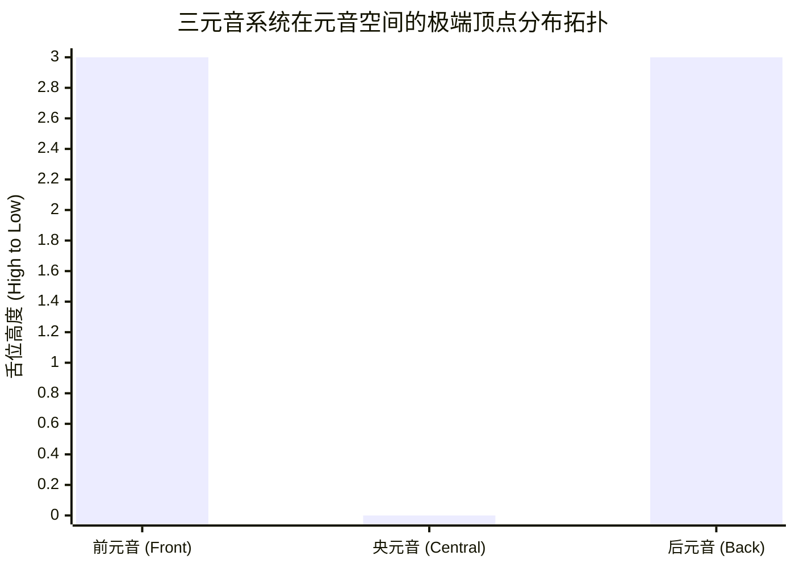
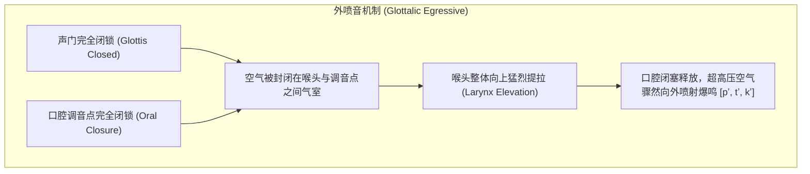
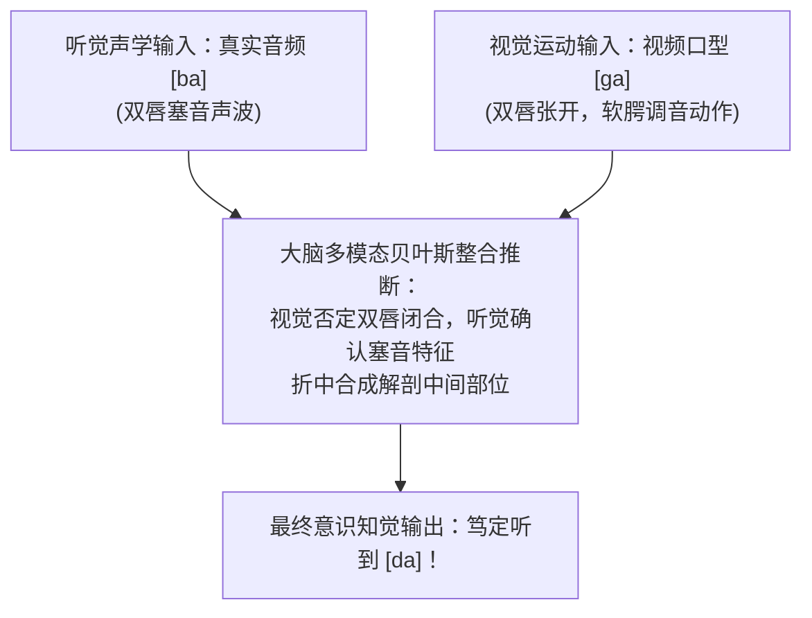
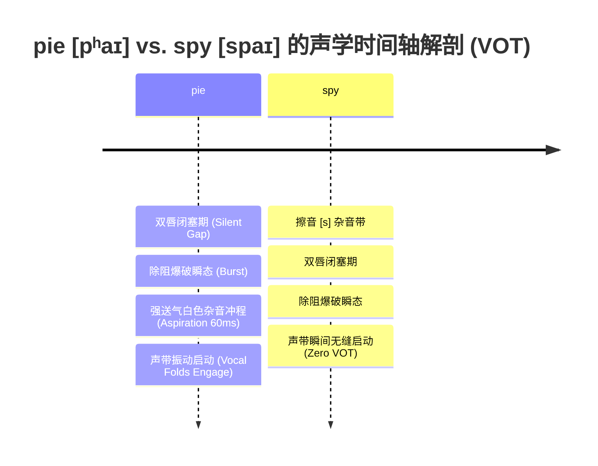

# Lec 6 语音学（二）：非肺部气流、声学语图与语音知觉机制

**开场白**：

讲一个有趣的问题——对于希腊语、拉丁语这些早已经不再有人作为母语日常言说的古代语言，现代语言学家究竟凭什么知道它们在两千年前的真实发音？

1. **古代文献记述**：古希腊和古罗马学者本身就曾试图系统描述自己母语的声音特征；
2. **民间的拼写错误（Misspellings）**：小孩子、初学者或未受过良好教育的平民在书写时，常常会因为“怎么读就怎么拼”而写出错别字。如果某一类特定的拼写错误在出土文献中大规模、集中性地出现，我们就可以据此反推当时的实际语音；
   - 例如古希腊语字母 $\Upsilon$（Upsilon）：早期罗马人在借写时，时而拼成 `u`，时而拼成 `i`，说明它当时是一个前高圆唇元音 **`[y]`**（类似于德语 *über* 或普通话“鱼”）；但到了后期，民间文献高度稳定、一致地将其错拼为 `i`，这雄辩地证实它在当时已经彻底并流演化为了现代希腊语的 **`[i]`**。
3. **跨语言借词与庞贝古城涂鸦**：
   - 古希腊语字母 $\Phi$（Phi）：在古典时期，它并不是擦音 `[f]`，而是一个**清双唇送气塞音 $[p^h]$**（也就是在发 `[p]` 的同时伴随一股强烈的呼气冲程），与不送气的 $\Pi$（`[p]`）严格对立。而这个音后来演变为了现代希腊语的擦音。
   - 我们如何精确断定这一音变发生的历史年代？证据来自拉丁语对希腊语的借词（例如单词 *philosophia*）：
     - 拉丁语本土原本就拥有字母 `F`。如果罗马人当时听到的希腊语 $\Phi$ 已经是擦音 `[f]`，他们理所当然会直接用 `F` 来拼写。但罗马学者却专门用 **`P + H`** 组合来拼写它，这证明当时的罗马人清晰捕捉到了它是一个带强呼气送气的 $[p^h]$。
     - 更绝妙的铁证来自庞贝古城（Pompeii）墙壁上的民间涂鸦：早期的底层平民在写到 *philosophia* 时，经常漏掉送气标记 `H`，误拼为 **`P-`**（写成 *pilosophia*）；而到了几个世纪后的罗马晚期，涂鸦中的错别字突然全盘变成了 **`F-`**（写成 *filosofia*）！
     - 这为历史语言学家提供了最严丝合缝的时代锚点：正是在那几个世纪的交替期，西方语言完成了从送气塞音 $[p^h]$ 到唇齿擦音 $[f]$ 的历史跃迁。

- **弗莱明最优化元音空间理论（Fleming's Theory of Optimal Vowel Space）**：
  - 我的 MIT 同事爱德华·弗莱明（Edward Fleming）对此做过经典的理论建模：在有限的口腔声学共鸣空间内，人类认知系统要求不同元音之间具有**最大化的知觉可区分度（Maximally Contrastive）**。
  - 只有将元音推向几何空间的极值边缘，听者在嘈杂环境下的辨歧难度才最低。
- **鼻化元音（Nasalized Vowels）**：
  - 部分语言在此基础上扩展出另一条路径：在发元音的同时垂落软腭，让气流经鼻腔共鸣逸出。例如法语中的 *main*（手，带鼻化元音 `[mɛ̃]`）与 *met*（菜肴，口元音 `[mɛ]`）构成严格最小对立体；葡萄牙语同样具有丰富的鼻化元音。

## 一、元音类型

放眼全球看， 世界上不同语言的元音库存丰富度极其悬殊：英语拥有 12 至 14 个元音，属于非常臃肿庞大的系统；很多语言只有 5 个元音（如拉丁语、西班牙语、日语）；还有不少语言仅仅拥有 3 个元音。

**三元音系统的世界公理**：

- 如果一门语言仅有 3 个元音，这 3 个元音**几乎无一例外必然是 `[a]`, `[i]`, `[u]`**！
- 观察元音四边形，这三个音恰恰占据了整个发音与声学几何空间最极端的外侧顶点：闭前角（`[i]`）、闭后角（`[u]`）与开底角（`[a]`）。
- 

## 3. 从语音到音系：土耳其语元音和谐律（Vowel Harmony）

我们为什么要煞费苦心地将元音分类为“高/低”、“前/后”、“圆唇/不圆唇”？不仅是为了生理上的分类乐趣，更是因为这些特征是解释**自然音系变化规则（Phonologically natural sound changes）**的底层基石！

请观察土耳其语的名词单复数数据（如果读过 C.S.刘易斯的《纳尼亚传奇》，大家可能会立刻认出第一个词）：

| 单数形式  | 词义         | 复数形式      | 词义       | 词干主要元音类型     |
| --------- | ------------ | ------------- | ---------- | -------------------- |
| **aslan** | 狮子 (Aslan) | **aslan-lar** | 狮子们     | 后低元音 `[ɑ]`       |
| **kol**   | 手臂         | **kol-lar**   | 手臂们     | 后中圆唇元音 `[o]`   |
| **kul**   | 奴隶         | **kul-lar**   | 奴隶们     | 后高圆唇元音 `[u]`   |
| **kız**   | 女儿         | **kız-lar**   | 女儿们     | 后高不圆唇元音 `[ɯ]` |
| **yel**   | 风           | **yel-ler**   | 风（复数） | 前中元音 `[e]`       |
| **diş**   | 牙齿         | **diş-ler**   | 牙齿们     | 前高不圆唇元音 `[i]` |
| **gül**   | 玫瑰         | **gül-ler**   | 玫瑰们     | 前高中圆唇元音 `[y]` |

**课堂推导**：
土耳其语的复数后缀显然在 **`-lar`** 与 **`-ler`** 之间分裂。为什么？

**学生 Joseph 发言**：这是**元音和谐律（Vowel Harmony）**！

**Norvin Richards 教授**：  
完全正确！这就是经典的**前后元音和谐（Front-Back Harmony）**：

- 观察左半组：`aslan`, `kol`, `kul`, `kız`，它们词干中的元音全部属于**后元音（Back Vowels）**；因此附加的复数后缀必须选择带有后元音的 **`-lar`**；
- 观察右半组：`yel`, `diş`, `gül`，词干中的元音全部属于**前元音（Front Vowels）**；因此附加的复数后缀自动切换为带有前元音的 **`-ler`**！
- 后缀元音的“前/后”特征完全被它所依附的词干元音所同化控制。在土耳其语中，此外还存在基于唇形的**圆唇和谐（Rounding Harmony）**。
- 这雄辩地证明：元音的“前”与“后”绝非语音学家的人造概念，而是母语者大脑中实实在在用于驱动形态计算的**自然类（Natural Class）**！

---

## 4. 非肺部气流机制 I：外喷音 / 挤喉音（Ejectives）

在第 5 讲中我们曾提到：人类语言绝大多数使用从肺部呼出的气流（Pulmonic egressive）。但我当时神秘地笑称“大自然还有其他狂野的气流选项”。今天我们就来揭晓这些奇妙的声音。

本节展示的所有珍贵原声录音，均来自已故的 UCLA 传奇语音学大师**彼得·拉迪福吉德（Peter Ladefoged）**生前建立的世界语音数据库。

第一类奇特声音是**外喷音 / 挤喉音（Ejectives）**：

- 欧洲语言完全没有挤喉音，但它们广泛分布于美洲印第安原住民语言（北美与南美）、高加索语言以及部分非洲语言。
- **全班发音动作教学（以齿龈挤喉音 [tʼ] 为例）**：
  1. 首先，**屏住呼吸**（这会彻底闭合你的声门，形成声门塞音 `[ʔ]`）；
  2. 保持屏气的同时，舌尖紧抵齿龈嵴闭死口腔通道；
  3. 喉头（Larynx）向上剧烈提拉，猛烈压缩密闭口腔中的空气；
  4. 突然释放舌尖闭锁，高压气体猛烈喷发，随后松开声门滑入元音。
  5. 全班合练：`ah, tʼa! ah, tʼa!`

*（现场播放拉科塔语 Lakota 录音——一种分布在美国南北达科他州的苏语族 Siouan 语言）：*

- 软腭挤喉音 **`[kʼ]`** vs. 普通软腭塞音 **`[k]`** 的对比；
- 双唇挤喉音 **`[pʼ]`**。

### 挤喉音的气动力学本质

**学生 Raquel 提问**：挤喉音跟“一个普通塞音 `[k]` 紧接着发一个声门塞音 `[ʔ]`”有什么物理区别？

**Norvin Richards 教授**：  
两者极其相似但动力源完全不同！

- 发普通 `[k]` 时，气流直接来自肺部；
- 发外喷音 `[kʼ]` 时，声门闭合与软腭闭合构成了**双重闭锁（Dual Closure）**。气体被死死封锁在声带与软腭之间的狭窄气室中。
- 随后，说话者通过**向上猛提整个喉头**，像活塞一样压缩该气室内的空气。当软腭闭锁骤然打开时，喷射而出的高压气流完全来自喉头提拉产生的压力差，**根本不是来自肺部呼出**！这就是为什么它带有一种如同金属爆裂般的坚硬质感。

---

## 5. 非肺部气流机制 II：搭嘴音 / 咔嗒音（Clicks）

第二类极度特异的声音是**搭嘴音 / 咔嗒音（Clicks）**，其物理本质是**软腭吸气机制（Velaric Ingressive Airstream Mechanism）**。

### 5.1 跨语言分布与达明语（Damin）特例

- 搭嘴音在世界语言谱系中极为罕见，主要高度集中在南部非洲纳米比亚等地的**科伊桑语系（Khoisan）**，以及受其长期接触影响的部分班图语支语言（Bantu，如祖鲁语 Zulu、科萨语 Xhosa——纳尔逊·曼德拉的母语）。
- **非洲大陆之外的唯一奇迹**：澳大利亚原住民拉尔迪尔人（Lardil）在年轻男子通过严苛的成年割礼仪式后，被传授使用一套高度形式化的秘密代用语——**达明语（Damin）**。达明语包含大量非洲之外绝无仅有的奇异语音，其中就包含了搭嘴音！

### 5.2 三大基础搭嘴音与日常肢体隐喻

人类其实在日常生活中一直在使用搭嘴音，只是未将其作为音位编码进单词：

1. **齿搭嘴音 [ǀ]（Dental Click）**：
   - 舌尖轻贴上门齿背后，舌根紧贴软腭闭死，舌体下压制造负压，舌尖突然放开吸入空气。
   - **日常动作**：面对令人谴责或遗憾的事情时发出的**啧啧声（*tsk-tsk*）**。
2. **边搭嘴音 [ǁ]（Lateral Click）**：
   - 舌尖抵齿龈，空气从舌头两侧边缘向内倒吸抽动。
   - **日常动作**：骑马者用来**催促马匹小跑发出的打马声**（全班现场尝试发出哒哒声）。
3. **齿龈后/硬腭搭嘴音 [ǃ]（Postalveolar / Palatal Click）**：
   - 舌叶紧贴硬腭吸气，随后猛然剥离，发出极其响亮的**马蹄声或模仿母鸡啼鸣的咯咯声（[CLUCKING]）**。

### 5.3 祖鲁语的精细后释音对立（Click Accompaniments）

*（现场播放祖鲁语实地录音）：*
祖鲁语不仅拥有上述三大发音部位的搭嘴音，更通过**伴随释放机制（Effluxes）**衍生出极其严密的次级音位对立：

- **清不送气搭嘴音**（基础释放）；
- **送气搭嘴音（Aspirated Click）**：伴随剧烈的呼出气流喷涌；
- **浊搭嘴音（Voiced Click）**：在发出吸气脆响的同时，声带保持低沉振动；
- **鼻化搭嘴音（Nasalized Click）**：软腭下垂，伴随鼻腔共鸣的搭嘴音！

科伊桑语系甚至在此基础上演化出了**双唇搭嘴音 [ʘ]**（双唇闭合吸气，类似于极响亮的亲吻声）。将这些气流机制与调音部位交叉组合，使得科伊桑语言的辅音库存能够膨胀至惊人的 80–120 个！

---

## 6. 非肺部气流机制 III：内爆音（Implosives）与颤音家族

### 6.1 声门吸气机制：内爆音（Implosives）

- **内爆音（Implosives，音标带弯钩 `[ɓ], [ɗ], [ɠ]`）**：
  - 调音动作：在双唇或口腔闭死的同时，声带保持闭合振动，并**将整个喉头向下强行拖拽拉低**！
  - 腔体物理变化：喉头下沉导致口腔内部容积暴增、气压瞬间暴跌至显著低于外界大气压；在口腔闭锁释放的刹那，体外空气被倒吸抽入口腔。
  - 跨语言分布：广泛存在于印度部分语言、印度尼西亚原住民语言及非洲斯瓦希里语中。
  - *（现场播放印度尼西亚语者发双唇内爆音 `[ɓ]`、卷舌内爆音 `[ᶑ]` 及软腭内爆音 `[ɠ]` 与常规浊塞音的对比音频）。*

### 6.2 跨语言吸气言语（Inhaled Speech）现象

- 世界上是否存在必须在吸气时发音的元音音位？语言学至今未发现任何将“吸气元音”作为常规音位系统的语言。
- 但存在特定的文化习俗言语行为：在芬兰，中年女性在日常对话中表达肯定“是的（Yes）”时，有一种标志性的社会方言习惯——**通过深吸一口气发出倒吸喘息声 `[GASP]`**，这成为了芬兰中年女性极具辨识度的社会语言学特征。

### 6.3 颤音家族（Trills）：在气流中拍打的旗帜

颤音不需要特异的气流方向，它依托伯努利效应驱动发音器官发生高速周期性机械拍打：

1. **齿龈颤音 [r]（Alveolar Trill，大舌颤音 / Rolled 'r'）**：
   - 舌尖靠近齿龈嵴，呼出气流驱动舌尖以每秒数十次的高频连续拍击齿龈（意大利语、西班牙语、俄语、达罗毗荼语系托达语 Toda）。
   - 语言病理学反思：在意大利，如果母语者生理上无法弹舌发出大舌颤音，会被视为严重的言语缺陷；而如果母语是英语，则完全无关紧要。
2. **小舌颤音 [ʀ]（Uvular Trill，小舌音）**：
   - 悬雍垂在呼出气流中剧烈拍动，动作类似于仰头漱口（Gargling）（德语、法语古典传统发音）。
3. **双唇颤音 [ʙ]（Bilabial Trill）**：
   - 双唇紧闭并让气流驱动嘴唇高速扑棱拍打（现场学生展示打嘟嘴动作）。
   - 加蓬的凯莱语（Kele）与波利尼西亚的泰坦语（Titan）均拥有双唇颤音音位。
4. **俗称“Rolled 'r'”的由来源流**：
   - 这一非学术俗称源于其听觉声学效果类似于军鼓的滚奏（Drum roll），或弹珠顺着楼梯连续弹跳滚落的密集撞击感。

---

## 7. 声学语音学：Praat 软件现场实操与共振峰物理本质

现在，我们告别发音器官的纯生理体验，切入客观度量声音的物理科学范式——**声学语音学（Acoustic Phonetics）**与**声谱图 / 语图（Spectrogram）**。

*（教授现场在投屏上切换至经典的开源语音学分析软件 **Praat**）*：

> “Praat 是一款由阿姆斯特丹大学语言学家开发的经典免费软件。它是语言学家写的，不是商业软件工程师写的，所以大家一眼就能看出来——界面相当笨重简陋（Clunky），但它的内核极其硬核。我强烈推荐大家在课后下载它，对着麦克风玩一玩自己的发音。”

### 7.1 傅里叶变换与共振峰（Formants）

- 当声带振动时，声源产生了一根包含基频（$F_0$）与大量密集等距谐波的声波柱；
- 声波在声道内部反复折射反射，声道各腔体的固有几何构型决定了哪些频率会被极度放大、哪些频率会被吸收过滤；
- 通过**傅里叶变换（Fourier Analysis）**，复杂的时域声波信号被解析为频域能量分布；
- 声谱图上那几道最清晰、颜色最深黑的水平共振能量聚集带，被称为**共振峰（Formants）**！

### 7.2 现场录音实测：从 [i] 到 [u] 的共振峰滑移

教授在 Praat 中现场录制自己念 `ee - oo` `[iː - uː]` 的发音：

- 在语图上，全班清晰目睹：第二共振峰（$F_2$）随着发音从 `[i]` 滑向 `[u]`，**呈现出极其惊人的断崖式阶梯下跌！**
- 教授笑称自己的录音听起来像海豚在叫唤；
- **耳语声学实证**：请大家用纯耳语交替念 `ee - oo`——抛开声带振动，你的耳朵能清晰听到一个音高阶梯式骤降的哨音，那个声学音高正是不断下坠的第二共振峰 $F_2$！

### 7.3 声道腔体容积的物理学第一性原理

为什么从 `[i]` 切换到 `[u]` 会导致共振峰频率剧烈暴跌？

- **后高圆唇元音 `[u]` 的腔体构型**：
  - 舌体高高隆起蜷缩在口腔最深处；
  - 双唇向前圆拢噘起；
  - **这一组合在舌身前方制造出了一个容积尽可能庞大、通道狭长的口腔前共鸣腔**！
- **前高不圆唇元音 `[i]` 的腔体构型**：
  - 舌面大幅向前上方推挤，紧贴硬腭；
  - 双唇向两侧扁平展开；
  - **原本巨大的前腔被彻底压缩坍塌，缩短为一个容积极其微小的缝隙空间**！
- **共鸣物理学公理**：
  - 极其微小的共振腔（`[i]`）产生极高频率的声学共振（高 $F_2 \approx 2300\text{ Hz}$）；
  - 极其庞大的共振腔（`[u]`）产生极低频率的共振响应（低 $F_2 \approx 800\text{ Hz}$）！

---

## 8. 共振峰过渡音（Formant Transitions）与音节普适结构

在展示完元音后，教授在 Praat 中现场录制了三个音节：**`"bab - dad - gag"`**（保持元音均为 `[æ]` 不变）。

### 8.1 塞音感知的核心秘密

- **核心认知悖论**：
  - `[b]`, `[d]`, `[ɡ]` 都是塞音。在调音器官闭塞的几十毫秒内，声道完全阻断，在语图上表现为**一段完全静音的空白无声段**；
  - 既然闭塞期间没有任何声音辐射，人类的耳朵究竟靠什么在 50 毫秒内瞬间分辨出对方说的是 `[b]`、`[d]` 还是 `[ɡ]`？
- **共振峰过渡音（Formant Transitions）**：
  - 答案不在辅音本身，而在紧随其后的**相邻元音**上！
  - 塞音除阻放开、滑向后续元音的 20–50 毫秒内，舌头与嘴唇的快速移动导致元音开头的共振峰发生特征性弯曲：
    - 双唇音 `[b]`：由于双唇闭合极大延长了声道前腔，后续元音的共振峰起始端呈现**向下低垂并迅速向上仰冲**的走势；
    - 软腭音 `[ɡ]`：后续元音的共振峰呈现特征性的**“软腭收拢镊状图样”（Velar Pinch）**——上面的共振峰向下弯曲（皱眉状），下面的共振峰向上弯曲（微笑状），两者在起点紧密靠拢！
  - 人类大脑正是凭借元音开头被辅音“污染/扭曲”的几十毫秒弯曲痕迹，倒推计算出前置塞音发生闭合的解剖坐标！

### 8.2 语言类型学推论：为什么全世界语言普遍偏好 CV（辅音-元音）音节？

- 语音感知实验表明：元音是承载辅音发音线索的最佳声学显示屏；
- 如果某种语言允许在塞音和元音之间硬塞一个擦音（例如英语禁止像 \*psah, \*pfah 这样的音节），就会阻断共振峰过渡音的直接传递，导致感知解码难度成倍增加；
- 这完美解释了全球所有自然语言为何无一例外均以 **CV（辅音-元音）** 作为最基础、最通用的核心音节骨架！

### 8.3 全辅音语言的感知容错

**学生 Joseph 提问**：那像某些允许长串塞音、甚至完全没有元音的极端语言，母语者是怎么听清的？

**Norvin Richards 教授**：  
这正是音系学家极度痴迷的理论前沿！

- **北美萨利希语系贝拉库拉语（Bella Coola）**：全语言拥有大量完全没有元音的词汇，例如单词 *s-q'ts*（意为“海豹油脂”），由清小舌擦音、清小舌塞音和清擦音连缀而成，全程没有一个元音；
- **摩洛哥柏贝贝语（Tashlhiyt Berber）**：同样包含全辅音构成的句子（例如 *t-rst-t*“你扭伤了它”）；
- 在缺失元音过渡音线索的环境下，听觉神经系统被迫全面依赖极其微弱的**塞音除阻爆破瞬态（Burst Transients）**与**气流摩擦杂音谱**进行次级容错解码。

---

## 9. 视听多模态知觉整合：麦格克效应（The McGurk Effect）

人类语音感知究竟是一支单纯被动记录声音频率的录音笔，还是心智综合跨感官通道主动推断的产物？教授在屏幕上投出了著名的**麦格克效应（McGurk Effect, 1976）**实验视频。

### 9.1 现场全班视听错觉实测

1. **第一次播放（睁眼观看并聆听）**：
   - 视频中的男子反复念一个音节；
   - 教授现场统计：全班同学举手极其分散，有人听到 `[ba]`，有人听到 `[da]`，有人听到 `[ɡa]`，甚至有人觉得同时听到了多个声音混杂；
2. **第二次播放（指令：请全班闭上眼睛）**：
   - 全体同学闭上双眼，仅凭耳朵聆听；
   - 结果：**全场 100% 的同学整齐划一、无比笃定地听到了清晰的双唇爆破音 `[ba - ba - ba]`！**

### 9.2 神经贝叶斯融合机制剖析

- **客观物理输入**：扬声器播放的音频信号千真万确是 **`[ba]`**，但视频画面经过精密时间轴对齐，画面中男子的面部嘴唇正在清晰发出软腭音 **`[ɡa]`** 的口型动作（双唇全程保持张开、没有闭合）。
- **睁眼时大脑的知觉重构冲突**：
  - 眼睛清晰报告：“说话人嘴唇完全没有贴拢，绝对不可能是双唇音 `[ba]`！”
  - 耳朵报告：“声学共振峰特征显示这像是一个 `[ba]`。”
  - 视觉线索在大脑中具有极高权重，直接否决了耳蜗传入的双唇音假说；为了兼顾视觉的“非双唇”与听觉的“塞音”，大脑潜意识自动妥协折中，合成出一个**处于双唇与软腭解剖正中央位置的齿龈音——你便真真切切地“听”到了根本不存在的 `[da]`！**

- **认知科学启示**：语音感知绝不仅是听觉事件，它是大脑调用多模态感知输入、主动构筑的**心智假说（Perceptual Hypothesis）**。

---

## 10. 声学前瞻与嗓音起始时间（VOT）Praat 现场解析

在下课前的最后几分钟，教授在 Praat 中现场录制了一组极富启发性的极小对比序列：**`"pie - bye - spy"`**，为下一讲音系学正式奠基。

- **`pie` `[pʰaɪ]` 的声学声谱图**：
  - 双唇闭塞释放后，出现了一段持续长达 **0.06 秒（60 毫秒）**的纯白高频噪声带——在此期间，肺部喷涌出的空气直接穿梭冲过声门，**声带尚未开始振动**！这微小的 60 毫秒空窗期，在声学上被称为**送气冲程（Aspiration）**。
- **`spy` `[spaɪ]` 的声学声谱图**：
  - 在前置擦音 `[s]` 之后，同一个辅音字母 `p` 发生了戏剧性变化：双唇释放的瞬间，声带几乎无缝、瞬间启动振动，完全没有送气杂音空白！
- **现场音频剪切实验**：
  - 教授在 Praat 中使用音频光标，精准剪掉 *spy* 前头的 `[s]` 杂音，仅播放从闭塞除阻开始的剩余片段；
  - **全班同学当场异口同声听成了：`"bye"`！**
- **核心音系学预告**：
  - 这微小的几十毫秒声带启动延迟，被称为**嗓音起始时间（Voice Onset Time, VOT）**。英语虽然在正字法中统统写作字母 `p`，但在物理声学上却因音位环境而分裂为**送气音 $[p^h]$** 与**不送气音 $[p]$**！
  - 下节课（第 7 讲），我们将正式跨越物理语音学的连续世界，步入**音系学（Phonology）**离散形式系统的殿堂！

---

## 知识框架全景总结：非肺部气流与声学参数速查

### 三大非肺部气流机制系统比对

| 气流机制类别                       | 气流动力源 (Initiator)                  | 气流方向              | 典型发音动作                                   | 核心 IPA 符号                              | 代表语言分布                                             |
| ---------------------------------- | --------------------------------------- | --------------------- | ---------------------------------------------- | ------------------------------------------ | -------------------------------------------------------- |
| **声门呼出 / 外喷音 (Ejectives)**  | 喉头向上剧烈提拉 (Larynx Up)            | 向外喷射 (Egressive)  | 声门与口腔双重闭锁，提升喉头压缩气室爆破       | `[pʼ]`, `[tʼ]`, `[kʼ]`                     | 北美拉科塔语 (Lakota)、高加索格鲁吉亚语、纳瓦霍语        |
| **软腭吸气 / 搭嘴音 (Clicks)**     | 舌体下压制造局部真空 (Tongue Back/Body) | 向内吮吸 (Ingressive) | 软腭与舌前部双重闭锁，下压舌面形成负压抽吸     | 齿 `[ǀ]`, 边 `[ǁ]`, 龈后 `[ǃ]`, 双唇 `[ʘ]` | 南部非洲科伊桑语系 (Khoisan)、祖鲁语、澳洲达明语 (Damin) |
| **声门吸气 / 内爆音 (Implosives)** | 喉头向下强行拖拽 (Larynx Down)          | 向内倒吸 (Ingressive) | 声带闭合振动同时沉降喉头，口腔负压倒吸体外空气 | `[ɓ]`, `[ɗ]`, `[ɠ]`                        | 印度语言、印尼语言、信德语、斯瓦希里语                   |

### 塞音与元音声学语图判读规则

| 声学特征                            | 语图视觉表现                           | 物理声学对应机制                                    | 听觉感知贡献                                             |
| ----------------------------------- | -------------------------------------- | --------------------------------------------------- | -------------------------------------------------------- |
| **闭塞无声段 (Silent Gap)**         | 纯白垂直空白带（浊音时底部有基音波带） | 调音器官完全紧闭截断声道气流                        | 判定辅音类别为塞音 (Stop)                                |
| **除阻爆破峰 (Burst)**              | 极狭窄垂直尖峰黑色细条纹               | 闭锁瞬间放开，压缩空气高速喷发冲程                  | 标记辅音释放时间零点                                     |
| **送气冲程 (Aspiration)**           | 爆破后持续 30–80ms 的高频灰色絮状杂音  | 声门保持开阔，肺部气流穿梭摩擦尚未激振声带 (正 VOT) | 区分送气音 $[p^h]$ 与不送气音 $[p]$                      |
| **共振峰过渡 (Formant Transition)** | 元音起首 20–50ms 弯曲弧线轨迹          | 调音器官从辅音除阻向元音构型滑移引发共鸣腔形变      | **大脑推算塞音具体发音部位（双唇/齿龈/软腭）的核心线索** |
