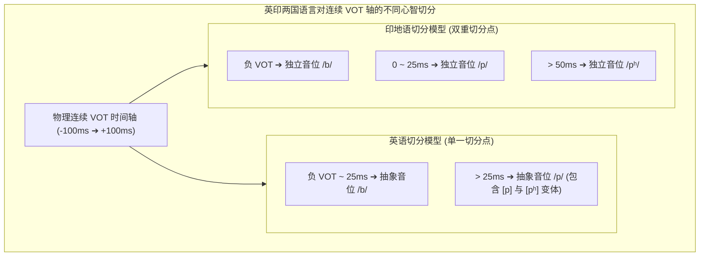

# Lec 7 语音到音系过渡：嗓音起始时间、音位变体与形式音系规则

> MIT 24.900 · 语言学导论 · 主讲 Norvin W. Richards

## TL;DR

- 物理连续性 vs. 心智离散性：声学世界是毫秒级的连续物理量，而人类心智通过范畴感知（Categorical Perception）将其强制离散化为抽象音位。
- 嗓音起始时间（VOT）：辅音除阻爆破与声带振动起始之间的物理毫秒时延，是跨语言区分清浊与送气的黄金声学参量。
- 音位 vs. 同位异音：最小对立对（Minimal Pairs）确立音位对立；互补分布（Complementary Distribution）与语音相似性确立同位异音。
- 形式重写规则：以严格的代数语法公式 $A \to B \ / \ C \_\_ D$ 刻画音系推导，解析韩语 [r]/[l] 互补分布与美语齿龈闪音律（Flapping）。

## 1. 核心问题

### 驱动问题
当我们在实验室中用合成器将辅音的声学参数做连续无级滑动调节时，为什么人类听到的不是平滑渐变的声音，而是在某个临界点瞬间跳变到另一个截然不同的辅音？物理世界上无限的声音，究竟如何被人类大脑压缩为有限的音位系统？

### 形式本质：从物理语音学跨越到形式音系学
语音学（Phonetics）关注的是人类发音器官的物理运动与声学波形（是连续的、物理的、普适的）；而音系学（Phonology）关注的是人类心智中抽象音段的组合逻辑与计算规则（是离散的、心智的、系统特异的）。

本讲作为全课程从语音学迈向音系学的关键枢纽，通过**嗓音起始时间（Voice Onset Time, VOT）**这一声学基准，展示了人类感知系统如何通过生物学硬件的非线性阶跃响应，在连续物理刺激中构建起坚不可摧的范畴认知边界。

## 2. 核心概念

| 概念 | 严密定义（用自己的话） | 容易混淆的邻居 | 典型实例 / 判据 |
|---|---|---|---|
| **嗓音起始时间（VOT）** | 塞音发音器官完全除阻爆破的瞬间，到后续声带开始自激周期性振动之间的物理时间差（以毫秒 ms 计）。 | 闭塞时长（闭塞时长测量的是闭合持续多久，VOT 测量除阻与声带启动的时序对齐）。 | 浊音 VOT 接近 0 或为负数；不送气清音约为 +10~+25 ms；送气清音 > +40~+80 ms。 |
| **范畴感知（Categorical Perception）** | 听觉认知系统对连续物理声学变化的“阶跃式”感知偏见：对范畴内部的物理差异极其钝化，而对跨越范畴边界的微小物理变化极其敏感。 | 连续梯度知觉（如光线亮度或声音大小的平滑主观感知）。 | 在 25 ms 临界点前百分之百识别为 [b]，跨过 25 ms 临界点后瞬间跃升为 [p]。 |
| **音位（Phoneme）** | 某种具体语言中能够区分词汇概念意义的最小抽象心智声音单位，通常用斜线 `//` 标示。 | 同位异音（音位是抽象原型，同位异音是其受环境制约的具体物理变体）。 | 英语中 `/p/` 与 `/b/` 是独立音位（*pat* vs. *bat* 意义截然不同）。 |
| **同位异音（Allophone）** | 属于同一个抽象音位、由特定语音环境条件规则触发的具体物理发音实现，用方括号 `[]` 标示。 | 独立音位（同位异音之间不构成词义对立，且处于互补分布中）。 | 英语 `/p/` 在词首为送气 [pʰ] (*pin*)，在 /s/ 后为不送气 [p] (*spin*)。 |
| **互补分布（Complementary Distribution）** | 两个或多个语音形式各自拥有互不重叠、互不冲突的环境领地，甲出现的地方乙绝不出现，反之亦然。 | 对立分布（Contrastive Distribution 允许出现在完全相同的环境中形成最小对立）。 | 超人与克拉克·肯特的关系：同一个实体的两种互斥外在面具。 |

## 3. 证据链与形式推导

### 3.1 跨语言 VOT 类型学对比：英语 vs. 印地语
这一现象深刻展现了人类心智如何对同一连续物理参数实施不同的认知离散化。不同语言社群在演化历史中，依据自身的区分性需求，在物理连续轴上锚定了不同数量与位置的声学判准边界。观察物理 VOT 连续轴在英语与印地语中的心智切分分歧：

```text
物理 VOT (毫秒 ms)
◄── 负 VOT (前浊音) ──── 0 ms (除阻) ──── +30 ms ──── +60 ms (长送气) ──►
        │                   │               │               │
        ▼                   ▼               ▼               ▼
      [b]                  [b]             [p]             [pʰ]
  (完全带声浊塞音)      (除阻即带声)     (短时迟滞不送气)   (长时气流送气)
```

1. **英语的二元系统（Two-way Contrast）**：
   - 英语在感知上只设立了一个大约 **+25~+30 ms** 的范畴切分点；
   - VOT 小于 25 ms 的声音统一归入音位 `/b/`；
   - VOT 大于 25 ms 的声音统一归入音位 `/p/`。不送气的清塞音 `[p]` 只是 `/p/` 在 `/s/` 之后的同位异音（如 *spin* 中的 `p` 物理上是不送气的！如果把录音中的 `s` 剪掉，英语母语者会毫不犹豫地听成 *bin*！）；
2. **印地语的三元甚至四元系统（Three/Four-way Contrast）**：
   - 印地语在同一轴线上设立了两个切分点，区分出三个独立的音位：
     - 浊塞音 `/b/`（负 VOT）：*bāl*（头发）
     - 清不送气塞音 `/p/`（0~+20 ms）：*pāl*（保护/抚养）
     - 清送气塞音 `/pʰ/`（> +50 ms）：*pʰāl*（犁刃）
   这三个词在印地语中构成严格的三重最小对立！



### 3.2 形式音系规则重写规范
音系推导使用形式化重写公式：
$$A \longrightarrow B \ / \ C \ \_\_\ \ D$$
- **A**：经历规则改变的目标输入项（底层式或音位）；
- **B**：规则执行后的输出结果（表层同位异音）；
- **/**：表示“在如下环境中”；
- **$C \ \_\_\ D$**：触发规则发生的局部音位环境（`__` 为目标项所在的位置）。

## 4. 机制与形式推导：两大经典同位异音判定案例

### 4.1 韩语 [r] 与 [l] 的互补分布证明
在现代韩语中，初学者常困惑于同一个字母为何有时读 [r] 有时读 [l]。语言学家通过环境分布矩阵解开其本质：

::: example 韩语流音的分布环境
- [r] 的出现环境：
  - *pari*（苍蝇）——处于元音 `a` 与 `i` 之间；
  - *sarang*（爱）——处于元音 `a` 与 `a` 之间；
- [l] 的出现环境：
  - *pal*（脚）——处于词尾闭音节尾；
  - *tal*（月亮）——处于词尾闭音节尾；
  - *il-ko*（读）——处于辅音 `k` 之前。
:::

**严格逻辑推理**：
1. [r] 仅出现在**元音之间（Intervocalic, $V \ \_\_\ V$）**；
2. [l] 仅出现在**音节尾或辅音前（Coda / Before C）**；
3. 两者的环境交集为 $\emptyset$（空集），构成严格的**互补分布**！
4. 结论：韩语中不存在独立的 `/r/` 音位，[r] 和 [l] 是同一个抽象底层音位 `/l/` 的同位异音！
   $$\text{韩语流音流音化律: } /l/ \longrightarrow [r] \ / \ V \ \_\_\ V$$

### 4.2 美式英语的齿龈闪音律（Flapping）
在美式英语中，单词 *writer*（作家）和 *rider*（骑手）中的齿龈塞音 `/t/` 和 `/d/` 均不再发成爆破音，而是变成舌尖在齿龈上快速弹击一次的齿龈闪音 `[ɾ]`：

::: example 齿龈闪音形式规则
$$/t, d/ \longrightarrow [ɾ] \ / \ V_{[\text{+stress}]} \ \_\_\ V_{[\text{-stress}]}$$
即：齿龈塞音在处于重读元音之后、非重读元音之前时，强制退化为闪音！
- *water* `/wɔtəɹ/` $\implies$ `[wɔɾəɹ]`
- *atom* `/ætəm/` $\implies$ `[æɾəm]`
- 但在 *atomic* `/əˈtɑmɪk/` 中，由于后续元音承载主要重音，不满足降级条件，必须完整爆破为送气清塞音 `[tʰ]`！
:::

## 5. 我的理解与批判性反思

::: insight 范畴感知的演化先验：心智对物理噪声的主动降维
范畴感知最令人惊叹的生物学实证，在于 1970 年代对**毛丝鼠（Chinchilla，栗鼠）**的听觉训练实验：
研究人员用食物强化训练南美栗鼠对人类英语 [ba] 和 [pa] 的区分，震惊地发现：**栗鼠在没有人类语言能力的前提下，其听觉神经系统在 VOT 连续轴上的临界跳变点，竟然与人类完全一致地落在 +25~+30 ms！**

这意味着什么？
范畴感知根本不是语言系统出现后才后天演变出来的“高级理性”，它原本就是哺乳动物听觉神经末梢在物理声学生物力学上的天然不连续性（声带物理开合动力学的天然共振阈值）。人类的普遍语法（UG）极其机敏地“借用”了这一演化预装的生理剪枝器，将原本平滑的模拟声波信号，在听觉输入阶段就直接硬件量化为高可靠性的“二进制数字逻辑”。心智语法的奇迹，不在于脱离肉身凭空发明规则，而在于以极致精巧的形式拓扑，驾驭并升华了古老的生物物理机制。
:::
