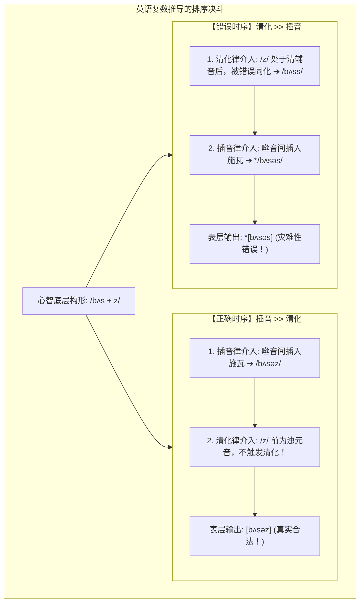
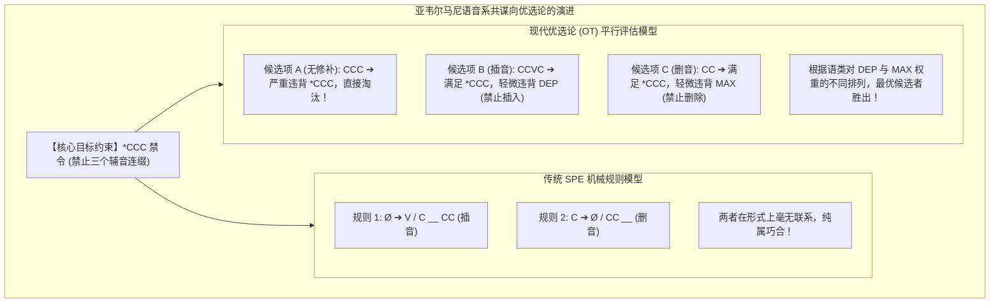

# Lec 8 音系学（一）：音系共谋、规则排序与优选论前瞻

> MIT 24.900 · 语言学导论 · 主讲 Norvin W. Richards

## TL;DR

- 规则排序的必然性：英语名词复数推导证明，插音规则（Epenthesis）必须严格先于清化规则（Devoicing）执行，否则将产生错误的表层形式。
- 音系共谋（Conspiracy）：加利福尼亚亚韦尔马尼语（Yawelmani）表明，删除与插音等多条独立规则，共同“共谋”达成避免三辅音丛（\*CCC）的单一表层目标。
- 优选论（Optimality Theory, OT）范式前瞻：揭示传统串行派生规则的理论局限，提出以普遍可违背约束层级（Constraint Hierarchy）取代机械重写规则的现代音系学转向。
- 供给与反吸收：解析音系推导中的串联互动关系，确立语言学形式演算的确定性与解释力。

## 1. 核心问题

### 驱动问题
当多条音系规则在同一个词汇上都有可能触发时，大脑是无序地同时应用它们，还是遵循严格的串行先后顺序？为什么一门语言中常常存在好几条看似互不相干的规则，却惊人一致地在为同一个“表层音节目标”服务？

### 形式本质：推导串行性与目标导向的冲突
经典生成音系学（Chomsky & Halle, 1968《英语声音模式》SPE）假定语言推导是一个**单向串行的指令流水线**。心智词库输出抽象底层式，规则库中的规则像工厂流水线一样按固定次序逐一扫描并修改音段。

然而，查尔斯·基瑟伯斯（Charles Kisseberth, 1970）指出了这一经典模型的深刻困境——“**音系共谋（Conspiracy）**”：如果语言规则只是一条条盲目孤立的代码，为什么一门语言会同时大费周章地发明“在辅音间插入元音”和“在辅音丛中删掉一个辅音”两条完全相反的规则，仅仅为了阻止三个辅音连在一起？这一深刻悖论最终催生了 20 世纪 90 年代音系学的划时代革命——**优选论（OT）**。

## 2. 核心概念

| 概念 | 严密定义（用自己的话） | 容易混淆的邻居 | 典型实例 / 判据 |
|---|---|---|---|
| **规则排序（Rule Ordering）** | 两条或多条形式音系规则在作用于同一输入时，必须遵循的固定的逻辑时间先后顺序。 | 随意无序应用（无序应用会导致同一底层式在不同场合输出相互冲突的表层乱码）。 | 英语复数推导：插音律必须严格排在清化律之前。 |
| **反流血排序（Counter-bleeding）** | 先执行的规则保留了环境，从而没有“剥夺”后续规则触发机会的良性排序关系；在历史回溯中常表现为表层不透明性。 | 供给排序（Feeding 关系中，前一条规则主动为后一条规则创造触发环境）。 | 英语复数中，插音将 /bʌs + z/ 拆开，从而阻止了清化规则将 /z/ 错误清化为 [s]。 |
| **音系共谋（Phonological Conspiracy）** | 表面上形式机制各异的多条独立音系规则，在功能上共同致力于消除某种特定禁忌音位配列、维护特定表层目标的现象。 | 单一规则泛化（共谋包含多条异质规则，如既有删除又有插入）。 | 亚韦尔马尼语通过元音插入律与辅音删除律共同消灭 \*CCC 音节违规。 |
| **优选论（Optimality Theory, OT）** | 艾伦·普林斯与保罗·斯莫伦斯基提出的形式范式：主张表层形式不是规则派生出来的，而是候选集在普遍可违背约束层级下评估出的最优点。 | 经典 SPE 派生规则（SPE 依赖规则推导过程，OT 依赖对候选表层结果的平行评估过滤）。 | 标靶约束（Markedness）与忠实度约束（Faithfulness）的层级博弈。 |

## 3. 证据链与形式推导

### 3.1 英语名词复数后缀的绝对规则排序论证
英语常规名词复数的表层外化形式存在三向交替：
- 在清非咝音后为 `[s]`：*cats* `/kæt-s/`, *maps* `/mæp-s/`
- 在浊非咝音后为 `[z]`：*dogs* `/dɔɡ-z/`, *beds* `/bɛd-z/`
- 在咝音（Sibilants: `[s, z, ʃ, ʒ, tʃ, dʒ]`）后为 `[ɪz]` / `[əz]`：*buses* `/bʌs-ɪz/`, *dishes* `/dɪʃ-ɪz/`

语言学家首先证明：**复数后缀的底层构形（UR）必定是带声的 /-z/，而不是无声的 /-s/**。
若假设底层为 /-s/，当我们在咝音后插入元音时（如 `/bʌs + s/ \implies [bʌsɪs]`），元音的插入没有任何理由把无辜的清音 [s] 异化为浊音 [z]！唯有假定底层是 /-z/，才能实现全系统的逻辑闭环。

现在，形式音系学必须执行两条规则：
1. **插音规则（Epenthesis）**：两个咝音相遇时，在中间插入施瓦央元音：
   $$\emptyset \longrightarrow [ə] \ / \ [+\text{strident}] \ \_\_\ [+\text{strident}]$$
2. **渐同清化规则（Progressive Devoicing）**：浊阻碍音在清辅音后被同化清化：
   $$[+\text{voice}] \longrightarrow [-\text{voice}] \ / \ [-\text{voice}] \ \_\_\ \#$$

我们对两种可能的排序路径进行数学验算：

::: example 英语复数推导的严格排序决斗
- **假设路径 1：插音规则先于清化规则（Epenthesis >> Devoicing）**
  - 输入底层式：`/bʌs + z/`（buses）
  - 步骤 1（应用插音律）：检测到两个咝音连缀，插入元音 $\implies$ `/bʌsəz/`；
  - 步骤 2（应用清化律）：检测 `/z/` 前面的音段，此时 `/z/` 前面是新插入的**浊元音 [ə]**，完全不满足清化环境！清化规则跳过；
  - **表层输出**：`[bʌsəz]`（**与真实母语发音完全吻合！**）
- **假设路径 2：清化规则先于插音规则（Devoicing >> Epenthesis）**
  - 输入底层式：`/bʌs + z/`
  - 步骤 1（应用清化律）：`/z/` 紧跟在清音 `/s/` 之后，满足清化条件！强制清化为 `[s]` $\implies$ `*/bʌss/`；
  - 步骤 2（应用插音律）：检测到两个咝音连缀，在中间插入元音 $\implies$ `*/bʌsəs/`；
  - **表层输出**：`*[bʌsəs]`（**荒谬的错误形式！没有任何母语者会把 buses 读成 bus-us！**）
:::

形式化推导无可辩驳地证明：**插音规则在人类心智的时序计算中，必须绝对优先于清化规则！**

## 4. 机制与形式推导：亚韦尔马尼语的音系共谋与优选论破晓

在美洲原住民加利福尼亚亚韦尔马尼语（Yawelmani Yokuts）中，音节结构严格服从模板禁令：**严禁复辅音出现在音节首或音节尾，且严禁在语流中出现连续三个辅音（\*CCC 禁令）**。

当形态学粘接词缀导致三个辅音发生碰撞时，亚韦尔马尼语动用了两种截然相反的手段消除违规：
1. **手段 A（元音插音律）**：在名词加词缀时，在第二与第三辅音间插入元音（$CCC \to CCVC$）；
2. **手段 B（辅音删除律）**：在特定动词后加后缀时，直接将第三个辅音彻底抹除（$CCC \to CC$）。

在传统的 SPE 派生模型中，语言学家必须分别撰写两套繁复冗长的上下文重写公式；但任何具备形式美学直觉的人都会追问：为什么这两条规则如此默契？
答案在于：**规则是假象，表层音节约束才是真理！**

优选论彻底抛弃了“先执行 A、后执行 B”的繁琐流水线，假定所有可能的形式候选者（Candidates）同时涌现，并在**标靶约束（Markedness: 结构力求简单）**与**忠实度约束（Faithfulness: 尽量不改变底层词汇）**的博弈大厦中接受平行筛选。

## 5. 我的理解与批判性反思

::: insight 从图灵机图谱到生物演化博弈
从串行规则排序走向优选论约束层级，是理论语言学在计算范式上完成的一次深刻跃迁。

传统的规则排序模型本质上是一个**图灵机式（Turing Machine）的符号重写流水线**——机器读取带子上的符号，按照指令表逐步跳转状态。这种模型虽然在形式上极度严密，但在生物学与认知心理学上却面临着“盲目性困境”：它无法回答系统为什么偏爱某些状态，只能通过在规则表中强行指定次序来维持表面的运转。

而优选论则将语言机能重新诠释为一个**约束满足网络（Constraint Satisfaction Network）或演化博弈系统**。人类大脑并不需要记住成百上千条刻板的修补代码，大脑只需维护一套普遍的认知偏好层级（例如：音节必须有元音、发音必须省力、词汇信息必须尽量保真）。当外部刺激输入时，神经网络在并行的多重张力中迅速松弛收敛至能量最低点。这一理论转向不仅完美消解了“音系共谋”的历史困惑，也让形式语言学与当代深度学习和认知计算神经网络建立了前所未有的数学亲缘。
:::
