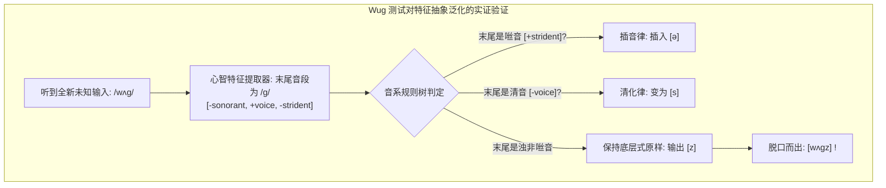

# Lec 9 音系学（二）：区别性特征、音位配列与修补策略

> MIT 24.900 · 语言学导论 · 主讲 Norvin W. Richards

## TL;DR

- 音段的亚原子结构：音位不是基本粒子，而是由二元区别性特征（Binary Distinctive Features: $\pm$）组合而成的特征束。
- 自然类（Natural Classes）：在音系规则中表现一致的一组声音必构成自然类；自然类的特征描述比其任一单一成员更为简洁紧凑。
- Wug 测试（Wug Test）：让 4 岁儿童面对从未见过的虚构词汇，证实人类语言规则是心智中真正自发运转的生成算法，而非孤立实例的统计模仿。
- 音位配列律与外来词修补：跨语言探讨合法音段组合禁令，分析借词如何通过元音增补或辅音删除被强行驯化入母语模板。

## 1. 核心问题

### 驱动问题
为什么当一个 4 岁的小孩第一次看到画着一只虚构怪兽并被告知“这是一只 Wug”时，他能不假思索地脱口而出两只怪兽是 *Wugs*（且精准读作浊辅音 `[z]` 而非 `[s]`）？如果小孩从未在日常生活中听过这个词，这套复数规则是如何被瞬间泛化应用的？人类大脑究竟把声音存储成了什么？

### 形式本质：区别性特征矩阵与自然类的数学优越性
经典语言学把音标视为不可分割的基本原子（如 [p], [t], [k]）。但这一观点在解释音系同化时陷入了灾难：为什么英语复数在 [s], [z], [ʃ], [ʒ], [tʃ], [dʒ] 后面都要插元音？这六个声音有什么神秘的共通之处？

罗曼·雅各布森（Roman Jakobson）与莫里斯·哈勒（Morris Halle）提出了**二元区别性特征理论（Distinctive Feature Theory）**：
音位就像化学元素，而区别性特征就是构成元素的“质子与电子”。人类发音器官的每一个动作开关都被抽象为二元开关（`[+voice]` / `[-voice]`，`[+nasal]` / `[-nasal]`）。所有的音系规则从来不直接对孤立字母生效，它们只对**自然类（Natural Classes）**——即共享同一组特征向量的声音集合生效。

## 2. 核心概念

| 概念 | 严密定义（用自己的话） | 容易混淆的邻居 | 典型实例 / 判据 |
|---|---|---|---|
| **二元区别性特征（Binary Features）** | 描述音段声学与发音属性的最小离散感知参量，取值为正 `[+]` 或负 `[-]`，构成音系的原子基底。 | 标称类别（如直接用“塞音”、“擦音”做标签，无法用布尔逻辑统一进行代数交叉运算）。 | `[±sonorant]` 响音性、`[±continuant]` 延续性、`[±voice]` 带声性。 |
| **自然类（Natural Class）** | 在一门语言中共享某一组特定区别性特征，且在音系规则中表现出协同动作行为的一组音段集合。 | 人为随机集合（自然类的特征描述必定比集合内任何单一音段的描述更短、更紧凑）。 | 咝音类（Sibilants / Stridents）：`[+coronal, +strident]`，包含 [s, z, ʃ, ʒ, tʃ, dʒ]。 |
| **音位配列律（Phonotactics）** | 某种具体语言中关于“哪些音段可以在特定音节位置（首音、核、尾）合法连缀共存”的形式结构禁令。 | 生理发音极限（配列律是具体语言的心智选择，非发音器官无能；如英语禁止词首 `/ŋ/`，越南语完全合法）。 | 英语禁止在词首出现清塞音加鼻音（古英语中 *knight* 曾读作 /knɪxt/，现代被修复）。 |
| **借词修补策略（Loanword Repair）** | 当来自外语的词汇违反了本土语言的音位配列律时，本土音系自动启动插入、删除或替换程序将其合法化的机制。 | 自由发音变形（修补策略具有严格的系统一致性与可预测性）。 | 日语借入英语 *strike* `/stɹaɪk/`，插入元音修补为四音节：`sutoraiku`。 |
| **Wug 测试（The Wug Test）** | 让·伯科·格利森（Jean Berko Gleason, 1958）设计的著名实验范式：通过向幼儿展示无意义伪词测试其屈折形态规则。 | 传统词汇记忆测试（伪词完全排除了先验接触与记忆模仿，唯一可能的数据来源是心智内部的生成语法）。 | *This is a wug. There are two ___* $\implies$ 幼儿稳定输出 `[wʌɡz]`。 |

## 3. 证据链与形式推导

### 3.1 让·伯科·格利森的 Wug 实验实证
格利森向从未上过学的学龄前儿童出示画有小鸟状幻想生物的图片，记录其反应：

::: example Wug 测试的各类型测试数据
- **测试项 1（非咝音浊辅音尾）**：
  - “这是一只 **wug**（/wʌɡ/）。现在又来了一只。这里有两只……”
  - **4 岁儿童全员正确输出**：`[wʌɡz]`（精确采用浊音 [z]，无一人念成 [s]！）
- **测试项 2（非咝音清辅音尾）**：
  - “这是一只 **bik**（/bɪk/）……这里有两只……”
  - **儿童输出**：`[bɪks]`（精准应用渐同清化律！）
- **测试项 3（咝音塞擦音尾）**：
  - “这是一只 **gutch**（/ɡʌtʃ/）……这里有两只……”
  - **儿童输出**：`[ɡʌtʃɪz]`（精准在咝音间插入元音！）
- **测试项 4（罕见浊擦音尾）**：
  - “这是一只 **kazh**（/kæʒ/）……这里有两只……”
  - **儿童输出**：`[kæʒɪz]`（即便在英语中词尾为 [ʒ] 的词极少，儿童依然能完美触发插音规则！）
:::

Wug 测试以无可辩驳的证据击碎了行为主义模仿论：**儿童学到的绝不是一个个死记硬背的单词复数清单，而是心智中自动对底层特征进行判定的泛化计算系统！**

### 3.2 二元区别性特征的核心架构
在形式音系学中，音段被解构为以下几组核心特征束：

1. **大类特征（Major Class Features）**：
   - `[±consonantal]`（辅音性）：声道中是否存在显著的发音阻碍；
   - `[±sonorant]`（响音性）：声门前后的跨腔压力是否平衡，能否持续保持自发带声（元音、鼻音、流音、滑音均为 `[+sonorant]`；塞音、擦音、塞擦音等阻碍音为 `[-sonorant]`）；
   - `[±syllabic]`（音节性）：能否独立占据音节核（Vowels 为 `[+syllabic]`）。
2. **喉部特征（Laryngeal Features）**：
   - `[±voice]`（带声）：声带是否振动；
   - `[±spread glottis]`（声门张开/送气）：如英语送气清塞音 `[pʰ]` 为 `[+s.g.]`。
3. **发音方法特征（Manner Features）**：
   - `[±continuant]`（延续性）：气流是否在中央口腔持续逸出（擦音与元音为 `[+cont]`；塞音与鼻音为 `[-cont]`）；
   - `[±strident / delayed release]`（糙音/延时释放）：是否产生剧烈的高频撕裂白噪声（咝音为 `[+strident]`；塞擦音为 `[+del.rel.]`）；
   - `[±nasal]`（鼻音）：软腭是否下垂。

## 4. 机制与形式推导：用自然类代数重写英语复数规则

在引入区别性特征之前，英语复数插音规则被迫将 6 个具体的字母符号硬编码在一起：
$$\emptyset \longrightarrow [ə] \ / \ \{ s, z, ʃ, ʒ, tʃ, dʒ \} \ \_\_\ \{ s, z, ʃ, ʒ, tʃ, dʒ \}$$
这种写法极其拙劣，它无法解释为什么偏偏是这六个音，而不是包含 [m] 或 [k]。

在雅各布森与哈勒的特征代数中，这六个声音恰好构成了一个极其工整的**自然类——舌叶/齿龈以上且带有剧烈湍流的高频糙音（Stridents / Sibilants）**！
通过二元特征，两行公式即可优雅地统一整个生成机制：

::: theorem 英语复数全规则的特征代数形式化
1. **插音规则（咝音防碰撞律）**：
   $$\emptyset \longrightarrow [ə] \ / \ \begin{bmatrix} -\text{sonorant} \\ +\text{strident} \end{bmatrix} \ \_\_\ \begin{bmatrix} -\text{sonorant} \\ +\text{strident} \end{bmatrix}$$
2. **同化清化规则（渐同去浊律）**：
   $$\begin{bmatrix} -\text{sonorant} \\ +\text{voice} \end{bmatrix} \longrightarrow [-\text{voice}] \ / \ [-\text{voice}] \ \_\_\ \#$$
:::

每一条规则只需使用 2 到 3 个特征，就自动覆盖并锁定了所有合法的音位变体！

## 5. 我的理解与批判性反思

::: insight 特征系统的奥卡姆剃刀与语言的可学性
为什么自然类（Natural Classes）的数学定义要求“**定义该集合所需的特征数量，必须严格少于定义集合中任何单一元素所需的特征数量**”？

这绝非语言学家的数字游戏，而是关于**人类语言可学性（Learnability）**的核心公理。
如果一个小孩在学习母语时，必须把 40 多个音位之间的两两组合关系全部孤立记忆，他需要处理的参数空间将高达数千种状态；但如果大脑硬件把声音表征为十几个正交的二进制物理开关（`[±voice]`, `[±strident]`, `[±nasal]`），整个参数解空间将被压缩几个数量级！

规则只要在 `[+strident]` 这一单个特征维度上被触发，所有具备该特征的声音就会瞬间像被磁铁吸引一样全员自动服从规则。语言学中的奥卡姆剃刀，不仅是研究者的理论美学，它更是人类儿童在有限的生命时间内，能够以不可思议的惊人速度征服语言宇宙的终极神经计算压缩算法。
:::
