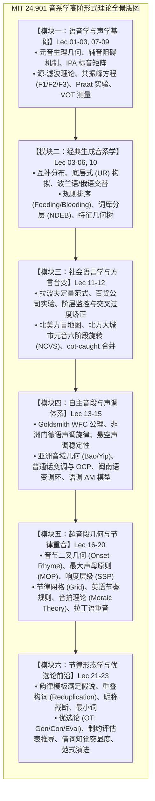

# 24.901 语言结构 I：音系学

MIT 24.901（Fall 2010，主讲 Michael Kenstowicz 教授）是麻省理工学院语言学系本科核心高阶音系学课程。课程系统探讨人类语言声音系统的形式生成机制，从发音与声学语音学出发，深入二元区别性特征（Distinctive Features）、音系交替与同位异音、规则推导与反供给/反吸收排序（Rule Ordering）、自主音段音系学（Autosegmental Phonology）、特征几何（Feature Geometry）、音节与节律重音理论（Metrical Stress），直至优选论（Optimality Theory）与外来词音系学前沿。

## TL;DR

- 解构人类语言声音的心智表征：揭示离散音位特征如何通过形式规则与制约系统转化为连续物理声学信号。
- 贯通非线性几何与节律音系学：从特征树蔓延、自主音段声调扩散到音拍（mora）计量与节律网格冲突消除。
- 跨越规则推导向优选论范式跃迁：剖析串行重写向通用可违背制约层级筛选的理论演化，覆盖美洲、非洲、东亚及印欧广泛语料。

## 课程描述

### 先修课程

- **24.900 语言学导论（Introduction to Linguistics）**：特别是语音学与音系学基础板块；或具备等同的理论语言学基本素养。

### 官方课程描述翻译

> 本课程旨在帮助学生初步理解不同语言的声音系统是如何构建的，以及它们彼此之间如何以及为何产生结构分歧。课程重点为学生提供音系学形式分析工具，使大家在学期结束时能够独立完成对一门未知语言完整音系系统的描写与形式化推导。
> 
> 在非语言学素养层面，本课程旨在通过范例向大家传授构建精确、严谨的形式描写命题的学术美德；并系统训练大家提出科学假说、设计证伪实验以及权衡竞争理论方案的核心分析技能。

### 培养目标

1. **掌握声学生理语音学分析技术**：透彻理解元音舌位四边形、辅音阻碍机制、源-滤波理论方程、共振峰轨迹与代用焦点理论，熟练运用 Praat 测量 VOT、基频与共振峰；
2. **掌握二元区别性特征与特征几何**：熟练运用雅各布森与哈勒的特征矩阵界定自然类，掌握以喉部、声上腔与部位节点为骨干的层级树形蔓延与去连接推导；
3. **深入音系交替与底层式构拟**：基于可预测性原则从表层变体逆向构拟单一底层形式（UR），掌握规则排序、供给/流血与派生不透明性；
4. **精通自主音段与超音段音系学**：掌握承调单位（TBU）、良构条件（WFC）与不交叉公理，掌握音节内部二叉分支、最大声母原则（MOP）、响度顺序原则（SSP）以及音拍增重规则；
5. **掌握节律重音与优选论推导**：熟练运用节律网格与二分音步分析交替重音与节奏冲突，掌握优选论（OT）有标记性与忠实性制约评估表（Tableaux）的严格推导技术。

### 参考书籍与教学材料

- **核心必读教材**：
  - **[PGG]** Kenstowicz, Michael (1994). *Phonology in Generative Grammar*. Blackwell.（生成音系学经典百科全书式奠基教材）
  - **[CIP]** Ladefoged, Peter (2005). *A Course in Phonetics* (5th ed.). Thomson.（实验语音学全球标准教材）
- **高阶专题文献**：涵盖 Chomsky & Halle (1968) *SPE*、Goldsmith (1976) *Autosegmental Phonology*、Pierrehumbert (1980) 语调 AM 模型、Prince & Smolensky (1993/2004) *Optimality Theory* 以及 Labov (2005) *Atlas of North American English*。

## 课程内容全景

### 模块架构与推导链条

全课程教学沿着现代形式音系学的逻辑演进线索展开，有机划分为六大环环相扣的核心知识模块：

1. **模块一（发音语音学与声学基础，Lec 01–03 & Lec 07–09）**：奠定生理与物理基石，从元音四边形与辅音阻碍出发，建立范特源-滤波方程、四分之一波长管共鸣、共振峰轨迹与 VOT 测量；
2. **模块二（经典生成音系学与规则推导，Lec 03–06 & Lec 10）**：建立音位与同位异音互补分布诊断，确立可预测性原则与底层式构拟，引入词库分层（NDEB）与特征几何树形同化；
3. **模块三（社会语言学与英语方言音系，Lec 11–12）**：将变异纳入形式系统，剖析拉波夫定量阶层文体监控、过度矫正交叉，以及北方大城市元音顺时针转移（NCVS）与低后元音合并；
4. **模块四（自主音段音系学与声调/语调，Lec 13–15）**：突破线性束缚，建立声调层与骨架层双轨映射，推导门德语声调旋律、普通话三声变调与 OCP 消除、闽南语变调环，以及语调 AM 模型；
5. **模块五（超音段几何与节律音系学，Lec 16–20）**：建立声母-韵基二叉音节树，运用 MOP 与响度层级（SSP）切分音节，引入节律网格与节奏规则，推导音拍理论（WbP）与古典拉丁语/印地语重音；
6. **模块六（形态音系界面与理论演进前沿，Lec 21–23）**：聚焦韵律模板满足假说、最小词条件与借词知觉突显度，终结于优选论评估表与全课程大综合。

### 讲义全景列表

全课程基于 MIT 官方发布的 23 篇核心讲座材料（注：官方 Session 12 为期中复习），建立全覆盖的高保真精讲笔记体系：

| 讲次 | 核心主题（Topic） | 核心机制与经典跨语言实证 | 讲义笔记链接 | 官方课件映射 |
| :---: | :--- | :--- | :---: | :---: |
| **Lec 01** | **语音学基础与元音描写体系** (Overview & Vowel Articulation) | 格里姆定律、索绪尔共时系统、元音舌位四边形、声学共振峰映射、英汉元音松紧对立 | [📄 lec01.md](./lec01.md) | Session 1 (lec01) |
| **Lec 02** | **辅音发音机制与二元特征系统** (Consonants & Distinctive Features) | 主被动发音部位、阻碍方式、主要类别特征、腔体特征矩阵、自然类与查莫罗语后元音前移 | [📄 lec02.md](./lec02.md) | Sessions 2–3 (lec02) |
| **Lec 03** | **音系表征与语音表征：互补分布** (Phonological vs Phonetic Rep.) | 抽象音位 vs 物理同位异音、最小对立体、英语清塞音送气、闪音化与加拿大双元音抬升不透明性 | [📄 lec03.md](./lec03.md) | Session 4 (lec04) |
| **Lec 04** | **音系交替与生成推导 I：底层形式** (Alternations & Derivations I) | 可预测性原则、波兰语词尾阻塞音清化、俄语元音弱化、英语复数后缀 $/z/$ 母音插入与清化流血 | [📄 lec04.md](./lec04.md) | Session 5 (lec05) |
| **Lec 05** | **音系交替与生成推导 II：词库敏感性** (Alternations II: Lexical Structure) | 坦加莱语词界元音脱落、非派生环境阻断（NDEB）、芬兰语咝音化、词库音系学分层与三音节缩短 | [📄 lec05.md](./lec05.md) | Session 6 (lec06) |
| **Lec 06** | **音位配列限制与负向制约** (Constraints in Phonology) | 静态配列禁令、日语连浊（Rendaku）、莱曼定律阻断、强制从形原则（OCP）、约库茨语音节共谋 | [📄 lec06.md](./lec06.md) | Session 7 (lec07) |
| **Lec 07** | **声学语音学 I：源-滤波理论与共振峰** (Acoustics of Vowels & Praat) | 简谐复合波、傅里叶定理、范特源-滤波方程、四分之一波长管共鸣推导、元音共振峰与 Praat 实验 | [📄 lec07.md](./lec07.md) | Session 8 (lec08) |
| **Lec 08** | **声学语音学 II：辅音声学与冲直条** (Acoustics of Consonants) | 塞音四段解剖、冲直条、嗓音起始时间（VOT）、焦点理论共振峰弯曲、鼻音反共振与卷舌音 $F_3$ 骤降 | [📄 lec08.md](./lec08.md) | Session 9 (lec09) |
| **Lec 09** | **声学语音学 III：音节感知与超音段** (Suprasegmentals & Syllables) | 音节推导性与文字史、诗歌格律音节约束、基频/时长/强度三维声学参数、重音多维声学线索加权 | [📄 lec09.md](./lec09.md) | Session 10 (lec10) |
| **Lec 10** | **特征几何：层级树与自主音段扩展** (Feature Geometry) | 扁平矩阵破产、根节点-喉部-声上腔-部位层级树、单线蔓延解释同部位同化、切断去口腔化（$[?], [h]$） | [📄 lec10.md](./lec10.md) | Session 11 (lec11) |
| **Lec 11** | **社会语言学变异与声音演变** (Sociolinguistic Variables) | 有序异质性、拉波夫纽约百货公司调查（*fourth floor*）、文体监控连续统、下层中产阶级交叉过度矫正 | [📄 lec11.md](./lec11.md) | Session 13 (lec13) |
| **Lec 12** | **北美英语方言音系与北方大城市转移** (American English Dialects & NCVS) | 北美三大方言版图、北方大城市元音六阶段顺时针链式旋转（NCVS）、推动链/拉动链、低后元音合并 | [📄 lec12.md](./lec12.md) | Session 14 (lec14) |
| **Lec 13** | **声调音系学 I：非洲语言声调扩散** (Tone I: African Languages) | 分段模型破产、自主音段声调层与骨架层、戈德史密斯良构条件（WFC）、悬空声调、门德语旋律映射 | [📄 lec13.md](./lec13.md) | Session 15 (lec15) |
| **Lec 14** | **声调音系学 II：亚洲声调与连读变调** (Tone II: Asian Tone Languages) | 密实型调型、赵元任五度标调法、音域几何（Register）、声调发生学、普通话三声变调与闽南语变调环 | [📄 lec14.md](./lec14.md) | Session 16 (lec16) |
| **Lec 15** | **语调音系学与自主音段-节律模型** (Tone III: Intonation & AM Theory) | 语调离散化革命、音高重音（$H^*, L^*$）、短语调（$T^-$）、边界调（$T\%$）、陈述降调 vs 疑问升调、降阶 | [📄 lec15.md](./lec15.md) | Session 17 (lec17) |
| **Lec 16** | **音节音系学 I：层级架构与音节化算法** (Syllables I: Structure & Syllabification) | 音节理论必要性、声母-韵基二叉树、最大声母原则（MOP）、卡恩音节化四阶段流水线、兼属音节 | [📄 lec16.md](./lec16.md) | Session 18 (lec18) |
| **Lec 17** | **音节音系学 II：响度层级与音节外成分** (Syllables II: Sonority Hierarchy) | 通用六级响度阶梯、响度顺序原则（SSP）、成音节辅音扩展、柏柏尔语全清塞音核、英语 $/s/+$ 塞音附着成分 | [📄 lec17.md](./lec17.md) | Session 19 (lec19) |
| **Lec 18** | **优选论与制约条件：有标记性与忠实性** (Optimality Theory & Constraints) | 规则向制约革命、Gen/Con/Eval 三联体架构、有标记性 vs 忠实性对抗、严格支配与评估表（Tableaux）推导 | [📄 lec18.md](./lec18.md) | Session 20 (lec20) |
| **Lec 19** | **节律重音理论 I：突显度网格与冲突消除** (Stress I: Prominence & Metrical Grid) | 相对突显度本质、节律网格（Metrical Grid）、网格冲突（Clash）与脱节、英语节奏规则（*thir-teen men*） | [📄 lec19.md](./lec19.md) | Session 21 (lec21) |
| **Lec 20** | **节律重音理论 II：音节重量与音拍理论** (Stress II: Syllable Weight & Moras) | 数量敏感性、古典拉丁语重音法则、音拍理论（$\mu$）、位置增重原则（WbP）、印地语三级重量竞争 | [📄 lec20.md](./lec20.md) | Session 22 (lec22) |
| **Lec 21** | **节律形态学：韵律模板与重叠截断** (Prosodic Morphology) | 模板满足假说、通用韵律层级、最小词条件（$2\mu$）、英语/日语昵称截断、伊洛卡诺语重叠构词 | [📄 lec21.md](./lec21.md) | Session 23 (lec23) |
| **Lec 22** | **外来词音系学：跨语言借词与知觉适应** (Loanword Phonology & Perception) | 外来词作为语法试金石、插入 vs 删除不对称修复、肯斯托维奇知觉突显度假说、粤语英语借词、亚音位驱动 | [📄 lec22.md](./lec22.md) | Session 24 (lec24) |
| **Lec 23** | **形式音系学全景综合与理论范式演进** (Course Review & Synthesis) | 六大理论范式跨越、表征与计算的辩证演化、阿尔冈昆语帕萨马夸迪语终极综合实证、声音的心智几何学 | [📄 lec23.md](./lec23.md) | Session 25 (lec25) |

## 前置知识与建议顺序

建议先修 [24.900 语言学导论](../24900_introduction_to_linguistics/index.md)（特别是语音学与音系学基础板块），并在完成本课程后进阶修读 [24.902 语言结构 II：句法学](../24902_language_and_its_structure_syntax/index.md)，共同构成理论语言学核心基础。

## 来源与参考资料

- MIT OpenCourseWare: [24.901 Language and its Structure I: Phonology (Fall 2010)](https://ocw.mit.edu/courses/24-901-language-and-its-structure-i-phonology-fall-2010/)
- 主讲教师：Prof. Michael Kenstowicz（MIT Department of Linguistics and Philosophy）
- 指定教材：Kenstowicz, Michael (1994). *Phonology in Generative Grammar*. Blackwell; Ladefoged, Peter (2005). *A Course in Phonetics*. Thomson.
