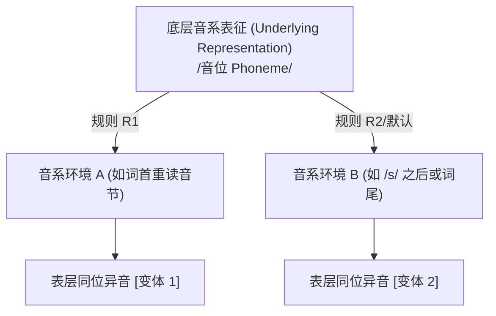

# Lec 03 音系表征与语音表征：音位、同位异音与互补分布（Phonological vs Phonetic Representations）

音系学的最核心任务之一，是解释**心理现实中的抽象符号**与**物理世界中的声学信号**之间的双层鸿沟。一个说话人可能完全没有意识到自己发出了两个在物理声学上截然不同的声音，但在听到另一个对立时却能灵敏察觉词义变化。在麻省理工学院 24.901 第四讲中，Michael Kenstowicz 教授系统建立了音位（Phoneme）、同位异音（Allophone）、最小对立体（Minimal Pairs）与互补分布（Complementary Distribution）的诊断方法论，正式拉开生成音系学推导形式体系的序幕。

## TL;DR

- **双层表征架构**：词库中储存的是抽象音位构成的底层式（UR），口语输出则是经由音系规则推导后的表层形式（SR）。
- **对立与辨义功能**：通过最小对立体检验两个声音是否具有辨义功能；若能区分词义，则分属不同音位。
- **互补分布与同位异音**：处于互不重叠的环境且语音学相似的声音，归纳为同一音位的可预测同位异音。
- **规则介入与感知盲区**：说话人的心智感知被其底层音系系统过滤，母语规则自动补全的环境细节往往被母语者无意识地“忽略”。

## 1. 音位与对立原则：最小对立体诊断

为什么同一种物理声音差异在不同语言中的地位截然不同？
在英语中，清浊对立具有刚性辨义功能：*sue* $[su]$ vs *zoo* $[zu]$、*lacy* $[\text{le}\mathrm{I}\text{si}]$ vs *lazy* $[\text{le}\mathrm{I}\text{zi}]$。但在芬兰语（Finnish）中，辅音清浊完全不对立，芬兰语母语者在认知上不利用 $[ \pm\text{voice} ]$ 区分词汇。在日语中，元音长短具有对比性（如 *e* '画' vs *e:* '是'），而在西班牙语中元音长短完全不具备辨义价值。

::: definition 最小对立体（Minimal Pair）
在两种语言形式中，除了在**同一环境下的单一音段差异**外，其余所有声音序列完全一致，且这种差异导致了词汇意义的不同。这一对词称为最小对立体，该单一差异点所涉及的两个声音分属两个独立的**音位（Phonemes）**。
:::

音位是抽象的心智范畴，通常记在斜杠内（如 $/p/$）；而在具体发音环境中实现的声学变体称为**同位异音（Allophones）**，记在方括号内（如 $[p^h], [p]$）。

## 2. 互补分布（Complementary Distribution）与同位异音归纳

如果两个在生理发音或声学上存在差异的声音**永远不会出现在完全相同的发音环境**中，并且它们具有发音上的相似性（Phonetic Similarity），那么它们就构成**互补分布**。

::: example 英语清塞音送气交替（Aspiration）
考察英语清塞音 $/p, t, k/$ 的分布事实：
1. **词首或重读音节首**：出现强送气音 $[p^h, t^h, k^h]$，如 *pin* $[p^h\mathrm{I}\text{n}]$、*ten* $[t^h\varepsilon\text{n}]$、*cat* $[k^h\ae\text{t}]$；
2. **辅音 $/s/$ 之后**：出现完全不送气音 $[p, t, k]$，如 *spin* $[\text{sp}\mathrm{I}\text{n}]$、*stand* $[\text{st}\ae\text{nd}]$、*skate* $[\text{ske}\mathrm{I}\text{t}]$；
3. **词尾**：常出现无声释放或喉化闭塞音 $[p^\urcorner, t^\urcorner, k^\urcorner]$，如 *nip* $[\text{n}\mathrm{I}p^\urcorner]$。

没有任何英语最小对立体能通过 $[p^h]$ 与 $[p]$ 区分词义。它们处于严格的互补分布：
$$/p/ \longrightarrow \begin{cases} [p^h] & / \quad \# \text{ \_\_\_ } V_{[\text{+stress}]} \\ [p] & / \quad \text{Elsewhere (默认环境)} \end{cases}$$
:::

::: example 朝鲜语（Korean）流音的互补分布
在现代朝鲜语中，存在齿龈弹音 $[{\text{r}}]$ 与齿龈边音 $[l]$ 两个发音：
- 元音之间（Intervocalic）：恒定出现弹音 $[{\text{r}}]$，如 *puri*（根）；
- 音节尾或辅音前：恒定出现边音 $[l]$，如 *mul*（水）、*k'ul*（蜜）。

由于 $[{\text{r}}]$ 与 $[l]$ 互补分布且发音相似，它们同属单一底层流音音位 $/l/$ 的环境条件变体。

:::

## 3. 英语元音长度与清浊环境关联

英语元音在表层声学上存在显著的长度差异，这一差异由后续辅音的声门特征严格决定：

::: example 英语元音长短规则
对比以下句对的元音持续时间（Duration）：
- *latter* $[\text{l}\ae\text{t}\partial\text{r}]$ vs *ladder* $[\text{l}\ae\text{:}\text{d}\partial\text{r}]$
- *writer* $[{\text{r}}a\mathrm{I}\text{t}\partial\text{r}]$ vs *rider* $[{\text{r}}a\mathrm{I}\text{:}\text{d}\partial\text{r}]$
- *cap* $[\text{k}^h\ae\text{p}]$ vs *cab* $[\text{k}^h\ae\text{:}b]$

元音在带声辅音（$[+\text{voice}]$）前自动显著延长；在无声清辅音前相对短促。规则可形式化为：
$$V \longrightarrow [+\text{long}] \quad / \quad \text{ \_\_\_ } \left[ \begin{array}{c} +\text{cons} \\ +\text{voice} \end{array} \right]$$
:::

## 4. 经典交叉论证：加拿大双元音抬升与齿龈闪音

美式与加拿大英语中的**齿龈闪音化（Tapping / Flapping）**与**加拿大双元音抬升（Canadian Raising）**构成了音系学推导排序的教科书级实证：

::: definition 闪音化规则与抬升规则
1. **闪音化（Flapping）**：舌尖在两个元音之间快速击打齿龈嵴，将 $/t/$ 与 $/d/$ 均中和为齿龈闪音 $[\text{ɾ}]$（条件是第二个元音非重读）：
   $$\left\{ /t/, /d/ \right\} \longrightarrow [\text{ɾ}] \quad / \quad V \text{ \_\_\_ } V_{[-\text{stress}]}$$
2. **加拿大双元音抬升（Canadian Raising）**：双元音 $/a\mathrm{I}/$ 与 $/a\mathrm{\upsilon}/$ 在无声清辅音前，起点由低元音抬升为中元音 $[\Lambda]$：
   $$/a\mathrm{I}/ \longrightarrow [\Lambda\mathrm{I}] \quad / \quad \text{ \_\_\_ } \left[ \begin{array}{c} -\text{son} \\ -\text{voice} \end{array} \right]$$
:::

考察加拿大英语中 *writer*（作家）与 *rider*（骑手）的发音：
- *writer*：表层发音为 $[{\text{r}}\Lambda\mathrm{I}\text{ɾ}\partial\text{r}]$
- *rider*：表层发音为 $[{\text{r}}a\mathrm{I}\text{ɾ}\partial\text{r}]$

::: insight 抽象表征的心智证据：不透明性与规则历史
注意表层矛盾：在 *writer* $[{\text{r}}\Lambda\mathrm{I}\text{ɾ}\partial\text{r}]$ 中，双元音后紧随的是带声的闪音 $[\text{ɾ}]$，而非清辅音！为什么抬升依然发生？
答案是：**在认知推导的时间轴上，抬升规则先于闪音化规则执行**。当双元音做出抬升判断时，底层音位依然是清辅音 $/t/$；随后的闪音化将 $/t/$ 擦除了表面痕迹。这铁证般证明了：**说话人的语言知觉并不是直接建立在声学波形上，而是建立在抽象的底层心智推导链条之上**。
:::

::: pitfall 音位归纳的常见误区：将正字法拼写等同于底层表征
初学者常受英语拼写（Orthography）干扰，误认为 *writer* 中的抬升是因为单词拼写带有字母 "t"。音系学是口头语言的科学，拼写只是历史文字记录；在没有任何文字系统的土著语言中，完全相同的推导排序与不透明性现象依然普遍存在。
:::
