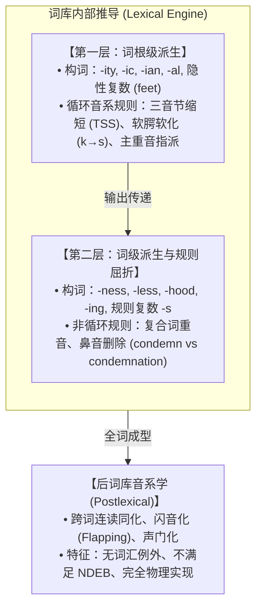

# Lec 05 音系交替与生成推导 II：词库敏感性与严格循环（Alternations II: Lexical & Morphological Structure）

早期的经典生成音系学（SPE 范式）倾向于将全部音系规则放置在一个单一、线性的全局流水线中，依靠语素边界符（$+$）与词界符（$\#$）控制规则触发。然而，随后的语言学经验事实表明：**音系规则与词法构词构词法紧密交织，展现出高度的层级敏感性与域限制（Domain Sensitivity）**。在麻省理工学院 24.901 第六讲中，Michael Kenstowicz 教授系统剖析形态界线对音系推导的控制机制，引入非派生环境阻断（NDEB）与词库音系学（Lexical Phonology）的严格循环假说。

## TL;DR

- **语素界限的触发效应**：许多音系规则仅在语素交界处（Morpheme Boundary）触发，词根内部静态序列具有免疫性。
- **非派生环境阻断（NDEB）**：严格循环原则确立——循环规则只能在由构词拼接或前置规则新创造的派生环境中执行。
- **芬兰语咝音化实证**：词根拼接处发生 $/t/ \to [s] / \text{ \_\_\_ } i$（如 *vete-i* $\to$ *vesi*），而词根内部的原生 *koti*（家）保持不变。
- **词库音系学（Lexical Phonology）分层架构**：区分第一层（词根派生词缀，伴随重音位移与三音节缩短）与第二层（词级屈折缀，重音中性且无形态音变），终结于后词库音系学。

## 1. 音系规则的形态域限制

音系规则的应用从来不是盲目扫过整个语音串，它受到句法树与词法结构的双重界定。

### 1.1 坦加莱语（Tangale）词界元音脱落

在尼日利亚北部的乍得语族坦加莱语中，词根末尾的元音在与后缀结合或构成复合名词时发生规律性脱落（Elision）：
- *tʊːdɛ*（马） $\to$ *tʊːd-dɪ*（她的马）
- *taːra*（牛） $\to$ *taːr-mʊ*（我们的牛）

然而，如果语素处于词尾无后缀孤立状态，元音必须保留。这证明脱落规则将特定的形态复合域作为充要触发条件。

### 1.2 意大利语附着词重音免疫

在标准意大利语中，主重音通常落在倒数第二（Penult）或倒数第三（Antepenult）音节：
- *téləfono*（我打电话，重音在首音节，即倒数第三）

当附加代词宾语附着词（Clitics）时，虽然从纯语音序列看单词变长了，但重音**绝不发生前移重新计算**：
- *téléfonami*（给我打电话！重音依然留在 *té-*，形成倒数第四音节重音）
- *téléfonamicelo*（把它打电话告诉我！重音甚至落在倒数第五音节）

这表明：**后加的附着成分处于后词汇域（Postlexical domain），无法侵入已经封闭的词汇主重音指派循环**。

---

## 2. 非派生环境阻断（NDEB）与严格循环

生成音系学史上最关键的发现之一，是**非派生环境阻断（Non-Derived Environment Blocking, NDEB）**现象：

::: definition 派生环境（Derived Environment）
一个音系环境如果满足以下两个条件之一，即被称为派生环境：
1. **形态拼接**：触发音段与被作用音段分属两个不同的语素，跨越了语素拼接边界（如 $A + B$）；
2. **前置规则产物**：触发音段是由先期执行的某条音系规则新生成的，而非词库底层的原生设定。
:::

::: example 芬兰语（Finnish）咝音化与同化交替
在芬兰语中，存在一条著名的齿龈塞音咝音化规则：
$$t \longrightarrow s \quad / \quad \text{ \_\_\_ } i$$
考察其形态交替实证：
- 词根 *vete*（水）在单数主格附加后缀 *-i* 时：/vete + i/ $\to$ *vesi*（$t$ 转化为 $s$）；
- 词根 *käte*（手）在单数主格附加后缀 *-i* 时：/käte + i/ $\to$ *käsi*。

然而，在芬兰语词库内部，大量词汇在单语素内部直接包含 $ti$ 序列，却**永远不会转化为咝音**：
- *koti*（家） $\nrightarrow *[\text{kosi}]$
- *äiti*（母亲） $\nrightarrow *[\text{äisi}]$
- *neiti*（少女） $\nrightarrow *[\text{neisi}]$

如果咝音化是一条纯粹的物理表面规则，*koti* 必须变音；但由于 *koti* 中的 $ti$ 是非派生的底层原生结构，NDEB 原则刚性阻断了规则的侵入。
:::

---

## 3. 词库音系学（Lexical Phonology）的分层推导模型

为了彻底解决边界符堆叠与 NDEB 冲突，基帕斯基（Paul Kiparsky 1982）提出了**词库音系学（Lexical Phonology）**架构。推导被严密组织在词库内部的分层阶梯（Strata）与词库外后置运算中：

### 3.1 英语三音节缩短（Trisyllabic Shortening, TSS）

在第一层派生词缀（如 *-ity*）介入时，前置长元音/双元音由于后续音节总数达到三个以上，强制缩短为松元音：
- *divine* $[a\mathrm{I}]$ $\to$ *divinity* $[\mathrm{I}]$
- *serene* $[i]$ $\to$ *serenity* $[\varepsilon]$
- *sane* $[e\mathrm{I}]$ $\to$ *sanity* $[\ae]$

但当加上第二层中性词缀（如 *-ness*）时，即使音节数量同样达到三音节，规则坚决不执行：
- *divineness* $[a\mathrm{I}]$（保持双元音，不发生缩短）
- *sereneness* $[i]$（保持长元音）

### 3.2 软腭软化（Velar Softening）的阶层归属

第一层规则将软腭塞音 $/k/$ 转化为咝音 $[s]$（在特定前元音前）：
- *electric* $[k] \to$ *electricity* $[s]$
- *critic* $[k] \to$ *criticism* $[s]$

第二层词缀则完全免疫：*milky* $[k]$、*rocking* $[k]$ 从不软化。

::: insight 词库分层作为认知计算的复杂度约束
为什么人类语言的心智语法要设计出多层词库？如果所有规则都在一个平面竞争，推导的回溯与条件判定复杂度将呈组合爆炸。通过将“不规则、与词汇强绑定、改变重音”的运算封印在第一层，而将“高生产力、规则化、透明”的运算放在第二层与后词库，大脑实现了语言处理在记忆储存与即时计算之间的最优平衡。
:::

::: pitfall 忽视后词库规则的无例外性
学习者常混淆词库规则与后词库规则。词库规则允许存在词汇例外（如某些特定外来词不发生 TSS），受形态边界制约；而后词库规则（如美式英语的闪音化 $[t] \to [\text{ɾ}]$）则是跨越词界的自动生理音变，对所有符合声学条件的音段无差别生效，绝不允许词汇例外。
:::
