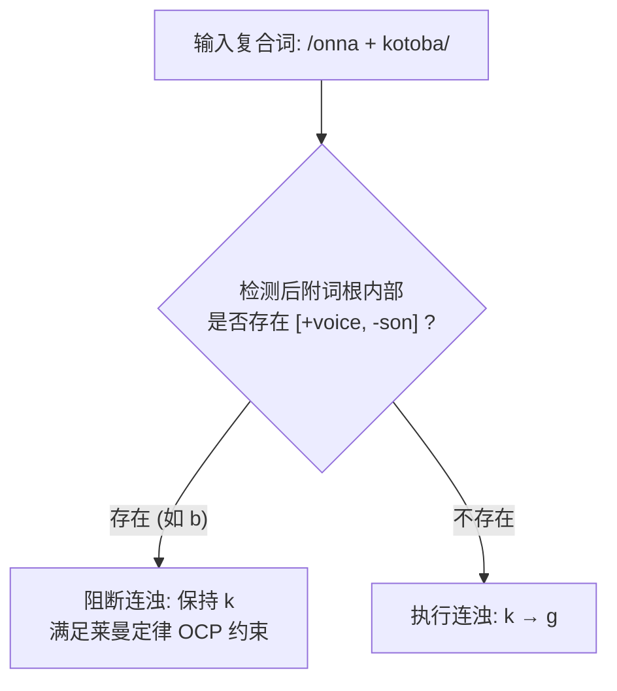

# Lec 06 音位配列限制、负向制约与修复策略（Constraints & Repair Strategies）

在经典生成音系学的早期推导框架中，唯一的理论运算机制是动态的**重写规则（Rewrite Rules: $A \to B / C \_\_ D$）**。然而，语言学家逐渐发现，仅靠重写规则无法捕捉人类语言心智中大量静态的、跨词库的结构禁令。许多看似互不相干的音系规则，其背后其实都在为了同一个目标而协同运作。在麻省理工学院 24.901 第七讲中，Michael Kenstowicz 教授系统引入音系制约（Constraints）、配列限制（Phonotactics）、强制从形原则（OCP）以及基瑟伯斯（Charles Kisseberth 1970）的“规则共谋（Conspiracy）”假说，为后来颠覆生成音系学的优选论（OT）奠定理论路基。

## TL;DR

- **重写规则的局限性**：动态重写规则难以解释为什么多种不同的规则（如插入、删除、特征改变）会指向同一个输出结构目标。
- **日语连浊与莱曼定律（Lyman's Law）**：复合词首音节浊化（Rendaku）受到词根内部负向制约的刚性否决——若词根已含浊阻塞音，则浊化受阻。
- **强制从形原则（OCP）**：相邻或共域的相同特征被严格禁止，莱曼定律本质上是针对 $[+\text{voice}]$ 特征的 OCP 效应。
- **规则共谋与修复策略**：语言中的多种音系规则是针对非法结构的“修复手段”，制约条件是驱动音系计算的原动力。

## 1. 静态音位配列限制（Phonotactic Constraints）

人类语言对声音序列的组合方式存在极其严格的形态几何许可：
- 英语允许词首出现三辅音丛，但必须严格遵循 `/s/ + 清塞音 + 流音/滑音`（如 *spring*, *street*, *scratch*），绝不允许 $*[\text{lb-}]$ 或 $*[\text{ps-}]$；
- 夏威夷语禁止任何复辅音（Consonant Clusters），且禁止任何辅音处于音节末尾（所有音节必须是开音节 $CV$ 或 $V$）；
- 经典阿拉伯语词根中，严禁在同一个词根中出现相同发音部位的阻塞音（如齿龈塞音 $t$ 与 $d$ 不能共存于同一三辅音词根中）。

这些限制并非偶然的词汇缺位，而是说话人心智语法中原生的**负向制约（Negative Constraints）**。

---

## 2. 日语连浊（Rendaku）与莱曼定律（Lyman's Law）

日语和语词汇（Yamato Vocabulary）中的复合词连浊现象是音系制约研究的绝佳试金石。

### 2.1 连浊规则的常规触发

在日语名词复合时，后一个词素的清辅音首音通常会发生系统性的同化浊化（Rendaku）：
- *ori*（折） $+$ *kami*（纸） $\to$ *ori-gami*（折纸，$[k] \to [g]$）
- *hana*（鼻） $+$ *chi*（血） $\to$ *hana-ji*（鼻血，$[t\int] \to [d3]$）
- *ao*（青/蓝） $+$ *sora*（天空） $\to$ *ao-zora*（蓝天，$[s] \to [z]$）
- *nuri*（涂） $+$ *fashi*（筷子） $\to$ *nuri-bashi*（漆筷，$[h/\Phi] \to [b]$）

规则看似非常明确：后附词素的首位阻塞音 $[-\text{son}]$ 转换为 $[+\text{voice}]$。

### 2.2 莱曼定律的刚性阻断（Lyman's Law）

然而，考察以下表面完全相同的复合构词：
- *onna*（女） $+$ *kotoba*（言语） $\to$ *onna-kotoba*（$\nrightarrow *[\text{onna-gotoba}]$，连浊失败！）
- *shiro*（白） $+$ *tabi*（足袋/日式短袜） $\to$ *shiro-tabi*（$\nrightarrow *[\text{shiro-dabi}]$，连浊失败！）
- *haru*（春） $+$ *kaze*（风） $\to$ *haru-kaze*（$\nrightarrow *[\text{haru-gaze}]$，连浊失败！）

::: definition 莱曼定律（Lyman's Law）
在日语单个本族语词素内部，**严禁出现多于一个的浊阻塞音（Voiced Obstruents: $[b, d, g, z]$）**。
若后附词素内部已经包含了一个浊阻塞音（如 *koto<u>b</u>a*, *ta<u>b</u>i*, *ka<u>z</u>e*），连浊规则被**彻底阻断**。
:::

注意：鼻音与流音（$[m, n, r]$）作为响音虽然带声，但它们带有 $[+\text{sonorant}]$ 特征，因此不触发莱曼定律（如 *ori-gami* 中的 $m$ 不阻止 $k \to g$）。这精准印证了特征矩阵分类的客观心理现实。

---

## 3. 强制从形原则（OCP）与重复性困境

莱曼定律绝非日语孤立的特例，它直属于生成音系学的宏观普遍原理——**强制从形原则（Obligatory Contour Principle, OCP）**。

::: theorem 强制从形原则（Obligatory Contour Principle, OCP）
在特定的音系域（如词根、音节或特定自律层）内，**禁止出现两个相邻或同级的相同特征取值标记**。
$$* \left[ \alpha F \right] \left[ \alpha F \right]$$
:::

### 3.1 SPE 的“重复性困境（The Duplication Problem）”

在经典 SPE 模型中，音系学家必须写出两套互不相干的代码：
1. **静态语素结构制约（MSC）**：声明词库内部不存在包含两个浊阻塞音的词素；
2. **动态连浊规则的前提条件**：在重写规则的条件中再次硬编码“后文不得含有浊阻塞音”。

这种两度表达完全相同语言事实的窘境被称为**重复性困境**。它表明：规则本身只是仆从，静态的输出制约才是主宰。

---

## 4. 规则共谋（Conspiracy）与修复策略

基瑟伯斯（Kisseberth 1970）在对美洲土著语约库茨语（Yawelmani Yokuts）的奠基性研究中提出了“共谋”概念。

::: example 约库茨语的音节守恒共谋
在约库茨语中，音节结构严格受制于一条刚性禁令：**禁止三个连续辅音（$*CCC$），且禁止词尾双辅音（$*CC\#$）**。
为了维护这一表面制约，语言激活了多条看似毫无关联的规则：
1. **元音插入规则（Epenthesis）**：在两个辅音与第三个辅音相遇时插入母音 $/i/$；
2. **元音删除规则（Syncope）**：在安全的双辅音环境中消除元音以压缩音节；
3. **辅音删除规则（Consonant Deletion）**：在某些形态后缀相撞时直接抹除特定辅音。
:::

这些规则各自拥有不同的生理发音机制，但它们在功能上**协同共谋**，只为了确保输出表层绝不出现违禁的辅音堆叠。

::: insight 从重写规则到优选论的范式转折
“共谋”现象的发现宣告了纯粹机械重写规则时代的黄昏。既然多种不同的规则都在为同一个静态目标服务，那么音系学的核心就不应当是描述“如何一步步重写”，而是建立“目标结构是什么，以及当目标冲突时优先牺牲谁”。这直接催生了以通用制约层级排序（Constraint Ranking）为核心的优选论（Optimality Theory）。
:::

::: pitfall 误将制约当成规则本身
初学者常把制约条件写成重写规则。例如，莱曼定律本身不是一条把浊音变清音的操作，而是一道**否定性过滤器（Negative Filter）**。音系规则是主动的提案者，而制约条件是拥有一票否决权的审查官。
:::
