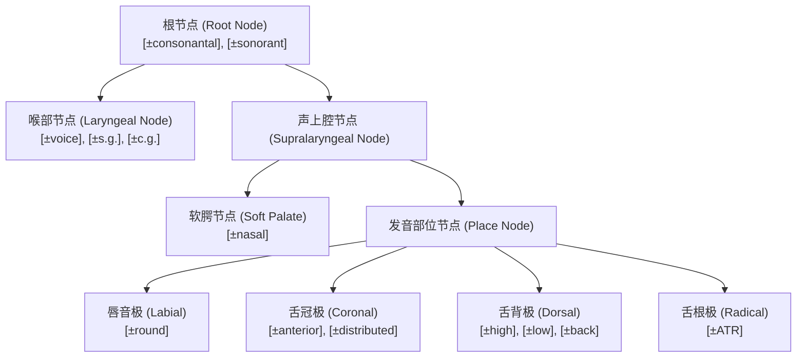

# Lec 10 特征几何：二元特征层级树与自主音段节点扩展（Feature Geometry）

在经典 SPE 模型中，一个音段被形式化为一个无序扁平的特征向量（Unordered Feature Matrix）。然而，这种扁平结构遭遇了严重的理论危机：它无法解释为什么自然语言中某些特定的特征子集（如整个“发音部位”群）总是一同发生同化、位移或消除。在麻省理工学院 24.901 第十一讲中，Michael Kenstowicz 教授系统引入克莱门茨（G. N. Clements 1985）、塞吉（Elizabeth Sagey 1986）与莫里斯·哈勒（Morris Halle 1992）开创的**特征几何理论（Feature Geometry）**，将二元特征组织为具有生理亲和力与自主音段层级的树形拓扑结构。

## TL;DR

- **扁平矩阵假说的破产**：若特征是无序扁平的，任何特征组合在数学上都应当等概率参与交替，这与跨语言同化模式严重相悖。
- **特征树形层级（Tree Hierarchy）**：特征以根节点（Root Node）为主轴，自上而下派生出喉部节点（Laryngeal）、声上腔节点（Supralaryngeal）与部位节点（Place）。
- **同化即单线蔓延（Spreading）**：发音部位同化本质上是高阶部位节点向相邻音段引出一条关联线，瞬间打包继承所有末端细分特征。
- **去连接与去口腔化（Delinking & Debuccalization）**：切断特定分支能够直接解释辅音弱化（如塞音去除部位节点坍缩为声门塞音 $[?]$ 或擦音坍缩为 $[h]$）。

## 1. 为什么需要特征几何？扁平向量的理论缺陷

考察跨语言中最普遍的**同部位鼻音同化（Homorganic Nasal Assimilation）**：
在英语前缀 *in-* 中，后续辅音决定了鼻音的表层发音：
- *in-tangible* $[\text{nt}]$（齿龈部位）
- *im-possible* $[\text{mp}]$（双唇部位）
- *in-credible* $[\eta\text{k}]$（软腭部位）

在扁平矩阵模型中，如果要书写一条软腭同化规则，必须机械罗列部位相关的全部二元特征：
$$\left[ \begin{array}{c} +\text{nasal} \\ +\text{coronal} \\ +\text{anterior} \end{array} \right] \longrightarrow \left[ \begin{array}{c} -\text{coronal} \\ -\text{anterior} \\ +\text{high} \\ +\text{back} \end{array} \right] \quad / \quad \text{ \_\_\_ } \left[ \begin{array}{c} -\text{coronal} \\ -\text{anterior} \\ +\text{high} \\ +\text{back} \end{array} \right]$$

::: pitfall 扁平模型的数学过度生成（Overgeneration）
如果这四个特征在矩阵中是完全平级独立的，那么理论上自然语言应该同样频繁地出现如下规则：“一个鼻音在软腭音前只同化 $[+\text{high}]$，但坚决拒绝同化 $[+\text{back}]$”。然而，在人类现存数千种语言中，**发音部位要么整体同化，要么完全不同化**！扁平特征集允许了无数在人类心智中根本不可能存在的荒谬规则。
:::

---

## 2. 哈勒（Halle 1992）特征几何树形架构

特征几何主张：**特征并不是散落的扑克牌，而是解剖学生理器官分支的抽象投影**。音段是一棵树：



### 2.1 核心节点与末端特征（Terminal Features）

1. **根节点（Root Node）**：树的顶峰，承载最核心的主要类别特征 $[ \pm\text{cons} ]$ 与 $[ \pm\text{son} ]$。根节点的删除等于整个音段从时间轴上蒸发；
2. **喉部节点（Laryngeal Node）**：统领声门物理状态，下辖 $[ \pm\text{voice} ]$（声带振动）、$[ \pm\text{spread glottis} ]$（送气）与 $[ \pm\text{constricted glottis} ]$（喉化）；
3. **部位节点（Place Node）**：支配由四大主动发音器官构成的解剖极点：
   - **唇音节点（Labial）**：下属末端特征 $[ \pm\text{round} ]$；
   - **舌冠节点（Coronal）**：下属末端特征 $[ \pm\text{anterior} ]$ 与 $[ \pm\text{distributed} ]$；
   - **舌背节点（Dorsal）**：下属元音与软腭辅音特征 $[ \pm\text{high} ]$、$[ \pm\text{low} ]$、$[ \pm\text{back} ]$；
   - **舌根节点（Radical / Pharyngeal）**：下属 $[ \pm\text{ATR} ]$。

---

## 3. 音系运算的几何形式化：蔓延与去连接

在特征几何中，一切音系变体操作都被严格约束为两种拓扑图运算：**画线（Spreading）**与**切线（Delinking）**。

### 3.1 节点蔓延（Spreading）：同化的高阶优雅解释

在传统线性推导中，同化往往被理解为右侧音段强行把自身的值强加给左侧音段。而在特征几何与自主音段体系中，同部位鼻音同化不再是多个孤立特征的并联重写，而是**相邻阻碍音的“部位节点（Place Node）”向上引出一条新的自主音段关联线，附着到前序鼻音的声上腔节点上**。

在几何推导过程中，原本从属于鼻音的原生舌冠部位关联线被音系规则自动解离并清除，随后来自右侧阻塞音的高阶发音部位（Place）支配节点同时投射并连向两个音段的声上腔结构。这种树形分叉意味着两个表层音段在底层共享了完全相同的发音部位实体。其内部拓扑拓扑关系如下所示：

```text
       鼻音 (N)              阻塞音 (C)
      Root                 Root
       │                    │
      SL                   SL
     /  \                    \
 [nasal] Place  ──X──        Place ──┐
          │                    │     │
         Cor                  Dor    │
                              / \    │
                           +hi  +bk  │
                                     │ (蔓延关联线)
     (旧部位节点断开) ◄──────────────┘
```

一条高度概括的操作指令（`Spread Place`），自动携带下属的所有舌冠、舌背或唇音末端细节。规则形式化从繁琐易错的矩阵罗列跃升为优雅的单节点连边，不仅大幅压缩了心智推导规则集，更从根本上预测了发音部位特征不可拆分的整体性。

### 3.2 节点去连接（Delinking）与去口腔化（Debuccalization）

辅音在音节尾或词尾发生弱化是一种普遍的跨语言现象：
- 英语方言中 /t/ 在音节末尾弱化为声门塞音 $[?]$（如 *bottle* $[\text{b}\alpha ?\text{l}]$）；
- 古希腊语或西班牙语方言中 /s/ 在词尾弱化为声门擦音 $[h]$（如 *los amigos* $\to$ *loh amigoh*）。

在特征几何中，这种看似剧烈的音变本质极其简单：**仅仅是切断了连接在部位节点（Place Node）上的那条关联线（Delinking Place）**！
- 当塞音 $/t/$ 的部位节点被切除后，它保留了 $[-\text{son}, -\text{cont}]$ 与闭塞特征，在失去口腔部位后，唯一定位发音点只能退守至喉部声门，自然成为声门塞音 $[?]$；
- 当擦音 $/s/$ 的部位节点被切除后，它保留了擦音气流特征 $[+\text{cont}]$，失去口腔狭窄后，自然化为无部位的声门擦音 $[h]$。

::: definition 去口腔化（Debuccalization）
在声上腔节点（SL）层级上**切断发音部位节点（Place Node）**的关联线，使辅音彻底丧失所有口腔解剖特征，仅保留喉部状态特征，从而退化为声门音（$[?]$ 或 $[h]$）。
:::

::: insight 特征树作为自然类的几何判定器
特征几何从根本上限定了何为“可能的音系规则”。如果某个假想规则需要同时操作两个在树形结构上风马牛不相及的特征（例如强行将 $[+\text{round}]$ 与 $[+\text{voice}]$ 打包，而排除所有中间节点），那么在几何拓扑上就无法画出单一条连线。特征几何将语言学家的直觉经验转化为了刚性的图论约束。
:::
