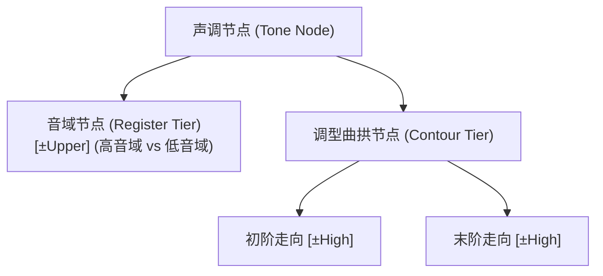
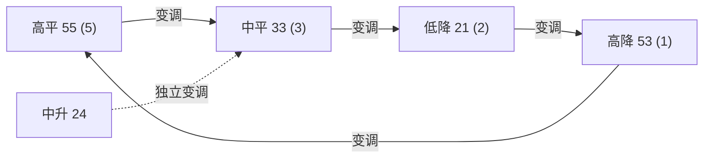

# Lec 14 声调音系学 II：亚洲声调语言、音域划分与连读变调（Tone II: Asian Tone Languages & Tone Sandhi）

如果说非洲语言展示了声调跨越音节边界的自由扩散，那么东亚与东南亚语言（汉藏语系、苗瑶语系、壮侗语系）则展现了声调在单个音节内部高度复杂的几何构建。在这些语言中，声调不仅是全音节的固定属性，更具有极为丰富的曲拱形态（Contours）与严密的音域分割（Registers）。在麻省理工学院 24.901 第十六讲中，Michael Kenstowicz 教授基于赵元任五度标调法、叶宝玲（Moira Yip）与包智明（Bao Zhiming）的声调特征几何，系统解构汉语声调的音域-调型双层模型、普通话三声变调的 OCP 解构，以及闽南语经典的连读变调环（Tone Circle）。

## TL;DR

- **亚洲密实型声调系统特征**：与非洲声调的稀疏扩散不同，东亚语言中几乎每个音节均天然绑定一个精细的声调曲拱（Contour Tone）。
- **赵元任五度标调法与音系二元化**：将音高均分为 1 至 5 五个等距区间；在特征几何中分解为高低音域（$[ \pm\text{Upper} ]$）与音域内走向（$[ \pm\text{High} ]$）。
- **历史声调发生学（Tonogenesis）**：声带清浊对后续元音基频的扰动沉淀为音系对立——古清辅音声母演化为高音域（阴调），古浊声母演化为低音域（阳调）。
- **普通话三声变调与 OCP 消除**：两个低曲拱三声（214）相遇触发声调 OCP 禁令，前字异化升格为二声（35）；闽南语更展现了全环封闭的置换链式变调。

## 1. 亚洲声调语言的拓扑特征与五度描写系统

非洲与东亚声调语言在音系学形态上呈现两种截然不同的范式：
- **非洲稀疏型声调（Sparse / Accentual Tone）**：声调常独立于音节，依赖复杂的扩散、悬空与降阶（Downstep）规则跨词流动；
- **东亚密实型声调（Dense Contour Tone）**：声调是音节内部不可剥离的固有构型，调型极度丰富（平、升、降、曲折折调共存），且声调空间被音域精细切分。

中国语言学先驱赵元任先生创立了**五度标记法（Chao Tone Letters）**，将说话人的绝对音高范围分为 1（最低）至 5（最高）五度。以现代标准普通话为例：

| 声调名称 | 传统五度标调 | 调型走势 (Contour) | 典型词汇对立体 | 声学基频轨迹 ($F_0$) |
| :---: | :---: | :---: | :---: | :--- |
| **第一声 (阴平)** | $55$ | 高平调 (High Level) | *mā* (妈) | 恒定高基频平台，无明显起伏 |
| **第二声 (阳平)** | $35$ | 中高升调 (High Rising) | *má* (麻) | 从中频平滑攀升至最高位 |
| **第三声 (上声)** | $214$ | 低曲折调 (Dipping / Low-falling-rising) | *mǎ* (马) | 深幅下沉探底至极低频，后段微弱拉高 |
| **第四声 (去声)** | $51$ | 高降调 (High Falling) | *mà* (骂) | 从最高频陡峭骤跌至最低限度 |

---

## 2. 亚洲声调的特征几何模型：音域与调型

为了用统一的形式语法表达亚洲声调，叶宝玲（Yip 1980）与包智明（Bao 1999）建立了**音域-曲拱几何树**。他们指出：人类感知声调并不是逐点记忆绝对频率，而是将声道声调空间切分为两大层级：

1. **音域特征（Register: $[ \pm\text{Upper} ]$）**：将生理音高空间划分为上半区与下半区；
2. **曲拱特征（Contour: $[ \pm\text{High} ]$）**：在所选定的音域内部，表达局部的升降斜率。

::: definition 历史声调发生学机制（Tonogenesis）
为什么东亚语言普遍分裂出“阴平/阳平”、“阴去/阳去”两套平行系统？
实验语音学证实：**清辅音声母在发音瞬间声门开张张力极大，使后续元音的起始基频天然偏高约 $15\text{--}30\text{ Hz}$；而浊辅音声母由于声带自发阻力，使起始基频天然偏低**。在历史演变中，当原有的辅音清浊对立消亡时，这一微小的生理协同效应被心智语法放大并固化为音系对立：
- 古清声母 $\to$ **高音域（$[+\text{Upper}]$，阴调类）**；
- 古浊声母 $\to$ **低音域（$[-\text{Upper}]$，阳调类）**。
:::

---

## 3. 连读变调（Tone Sandhi）的形式推导

在连续口语语流中，当两个或多个声调音节相邻拼合时，声调往往被迫改变自身调型，这种现象称为**连读变调（Tone Sandhi）**。

### 3.1 普通话三声变调与 OCP 制约

普通话最著名的变调规则发生在两个连续的三声（上声 $214$）之间：
- *nǐ*（你，214） $+$ *hǎo*（好，214） $\longrightarrow$ **[ní hǎo]**（*ní* 变调为二声 35）
- *hǎo*（好，214） $+$ *mǐ*（米，214） $\longrightarrow$ **[háo mǐ]**（35 + 214）

::: example 三声变调的自主音段解释
第三声的本质核心是一个**极低的音谷（Target L）**。当两个连续的第三声在时间轴上拼合时，前一个音节的低调目标与后一个音节的低调目标紧密相邻，直接引发了针对低调特征的**强制从形原则（OCP）冲突**：
$$* \left[ \text{L} \right] \left[ \text{L} \right]$$
为了避免两个沉重的低频音谷连环相撞造成发音生理负荷与感知模糊，音系引擎执行异化修复：**将前一个低音域解除关联，并向高位拉伸重构为高升调（$[LH] = 35$）**。
:::

### 3.2 半三声规则（Half-Third Tone）

当第三声出现在第一声、第二声、第四声或轻声之前时，它并不变为二声，而是**自动脱落其后半段抬升的假音尾巴，只保留前半段平稳的沉底低调（$214 \to 21$）**：
- *hǎo tiān*（好天，214 + 55） $\to$ $[21 + 55]$
- *hǎo rén*（好人，214 + 35） $\to$ $[21 + 35]$
- *hǎo kàn*（好看，214 + 51） $\to$ $[21 + 51]$

这证明三声的底层本质并非不可拆分的 214，而是由两个连续的自主音段特征拼接而成：在后续有其他声调顶接时，后半截被自动修剪以实现平滑过渡。

---

## 4. 闽南语（Taiwanese / Southern Min）连读变调环

如果说普通话变调只是局部的同化与异化，那么以厦门话、台湾闽南语为代表的东南沿海方言则展现了令全球语言学家叹为观止的**置换链式变调环（Tone Circle）**。

在闽南语中，凡是处于名词短语前部或非句尾非焦点位置的音节，其声调必须强制转换为另一个固定的声调，整个系统形成一个封闭的置换置换圈：

- 原调为 $55$ 的字，在非末尾变调为 $33$；
- 原调为 $33$ 的字，在非末尾变调为 $21$；
- 原调为 $21$ 的字，在非末尾变调为 $53$；
- 原调为 $53$ 的字，在非末尾闭环变调为 $55$！

::: insight 封闭链式变调的心智计算深度
闽南语变调环彻底打破了“变调只是生理发音省力（Ease of Articulation）”的庸俗观点。将一个高降调（53）变为高平调（55），或者将低降调（21）变为高降调（53），在发音能量上根本没有减少。这种高度抽象、甚至形成拓扑闭环的置换系统，证明了人类大脑能够维护一套高度形式化、自包含的纯符号映射机器。
:::
