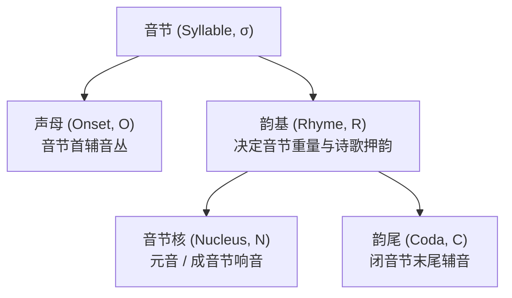
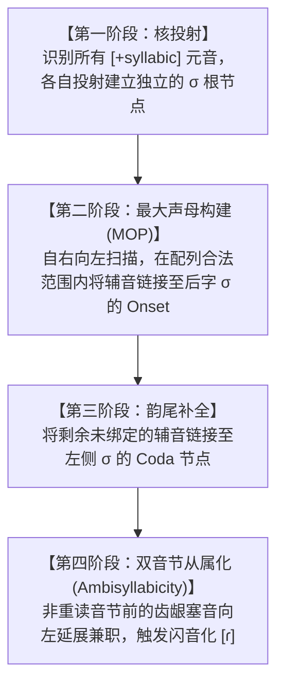

# Lec 16 音节音系学 I：音节内部层级架构与音节化算法（Syllables I: Structure & Syllabification）

在经典 SPE 模型中，音节曾经被作为“不必要的多余衍生概念”而被排除在底层语法之外。然而，随后的音系学研究彻底推翻了这一激进主张：若无音节概念，大量的音位配列规则与音变环境将退化为冗长脆弱的辅音计数符。在麻省理工学院 24.901 第十八讲中，Michael Kenstowicz 教授系统阐述引入音节的核心经验证据，确立声母-韵基（Onset-Rhyme）二叉层级几何，并详解统领全人类语言音节构建的普适计算程序——**最大声母原则（Maximal Onset Principle, MOP）**与卡恩（Daniel Kahn 1976）音节化演算法。

## TL;DR

- **音节的理论不可或缺性**：音节是音位配列禁令的真实作用域，也是送气化、舌根化与闪音化等规则的最简环境触发点。
- **音节内部二叉层级几何**：音节（$\sigma$）非对称二叉分裂为声母（Onset, $O$）与韵基（Rhyme, $R$）；韵基内部再次分裂为音节核（Nucleus, $N$）与韵尾（Coda, $C$）。
- **韵基构成素的证据**：诗歌押韵与音节重量判定均严格取决于音节核与韵尾的组合，而声母辅音在任何语言中均不影响音节重量。
- **最大声母原则（MOP）**：跨元音辅音丛在合法配列允许的前提下，优先全量归属为后字音节的声母，残余辅音才被动收归前字韵尾。

## 1. 为什么生成音系学必须确立音节范畴？

在没有音节概念时，规则必须用繁琐的辅音与边界符硬编码环境。音节的引入带来了三大关键简化：

1. **配列限制的最简表述**：
   英语禁止 $*[\eta-]$ 出现在词首，也禁止 $*[\text{tl-}]$ 出现在词首。如果不设音节，在词中遇到 *Atlantic* 时，规则无法解释为什么 *tl* 不能连在一起发音。音节理论指出：**词中位置的辅音配列必须受到独立的音节声母合法性约束**；
2. **音系规则环境的本质捕获**：
   - 英语清塞音送气规则：若无音节，规则必须冗长写为“在词首、或在辅音后但不在 /s/ 后...”。有了音节，规则仅需一句：**“处于音节首位置（Syllable-Initial: $[_\sigma \text{ \_\_\_ }]$）的清塞音发生送气”**；
   - 英语流音暗化（Dark $l$）：$/l/$ 在音节核后（即韵基/韵尾位置 $\text{ \_\_\_ } ]_\sigma$）自动软腭化为暗 $l$（$[ɫ]$，如 *feel*, *milk*），而在音节首保持清脆明 $l$（$[l]$，如 *leaf*）；
3. **重音计算的自然载体**：重音是跳跃在音节阶梯上的，而不是跨越单个辅音计算。

---

## 2. 音节内部层级几何树

音节绝非平面的字母堆叠，其内部拥有严密的向心树形分支：

::: definition 韵基（Rhyme）的核心地位与不对称性实证
为什么声母（Onset）与韵尾（Coda）在几何地位上截然不对称？
1. **诗歌押韵的定义**：全人类诗歌的“押韵”永远只要求韵基（$R = N + C$）完全相同，声母 $O$ 必须不同（如 *cat* $[k-\ae t]$ 与 *hat* $[h-\ae t]$ 押韵）。没有任何人类文化存在“只要求声母相同、元音和韵尾任意变化”的押韵法则；
2. **音节重量的普遍计算**：在古典拉丁语、阿拉伯语与印地语中，决定音节是“轻”是“重”的指标**严格由韵基所含的音段数量决定**（长元音或带韵尾的音节为重音节）。无论声母堆叠了一个、两个还是三个辅音（如 *strike* vs *ike*），声母永远不贡献任何音节重量！
:::

---

## 3. 最大声母原则（Maximal Onset Principle, MOP）

当两个元音之间出现一系列辅音序列（$V \mathrm{C}_1 \mathrm{C}_2 \dots \mathrm{C}_n V$）时，音系计算程序如何决定切分边界？

::: theorem 最大声母原则（Maximal Onset Principle, MOP）
在将连续音段切分为合法音节时，**优先将元音之间的所有辅音尽可能多地指派为后一个音节的声母（Onset）**，但前提是该辅音丛必须完全符合该语言词首声母的合法配列禁令（Phonotactically Legal）。无法被后字声母容纳的辅音，才被动退回归属为前字音节的韵尾（Coda）。
:::

### 3.1 经典词汇切分推导实证

考察英语单词的音节边界判定：

::: example *astronomy* vs *Atlantic* 的音节化分野
1. **单词 *astronomy*（天文学）**：
   中间出现辅音丛 $[-str-]$。在英语中，辅音丛 $/str-/$ 是完全合法的词首组合（如 *street*, *strong*）。根据 MOP 原则，全部三个辅音被一口气打包归入后一个音节：
   $$\text{切分结果}: \mathbf{a \ . \ stro \ . \ no \ . \ my} \quad (\text{首音节为开音节 } [a])$$
2. **单词 *Atlantic*（大西洋）**：
   中间出现辅音丛 $[-tl-]$。在英语中，$*[\text{tl-}]$ 是被严格禁止的非法词首组合（不存在任何以 $tl$ 开头的英语词汇）。因此，后一个音节的声母最多只能接收 $[l]$，滞留的 $[t]$ 被迫被前一个音节接纳为韵尾：
   $$\text{切分结果}: \mathbf{At \ . \ lan \ . \ tic} \quad (\text{首音节被闭合为 } [At])$$
:::

---

## 4. 卡恩（Daniel Kahn 1976）音节化算法

卡恩建立了生成音系学中标准的四阶段音节构建流水线：

### 4.1 兼属音节（Ambisyllabicity）与闪音化触发

在美式英语中，单词 *water* 或 *city* 中的 $[t]$ 为什么会变成闪音 $[\text{ɾ}]$？
卡恩指出：当一个单辅音处于重读元音与非重读元音之间时，它在 MOP 原则下首先归属后字声母；但由于后续音节缺乏重音引力，该辅音被同时捕获到前一个重读音节的末尾，产生**兼属两界的“兼属音节辅音（Ambisyllabic Consonant）”**。正是这种既是声母又是韵尾的脆弱状态，诱发了齿龈闪音化的生理弱化。

::: insight 音节作为认知拼图的网格
音节化算法展示了人类心智令人惊叹的自组织能力。说话人面对连续的辅音序列，并不需要死记硬背每个单词的切分点。大脑依靠简单的两个原语（核识别 + MOP 贪婪算法），在一瞬间便在无声的声学流中架设起稳固的韵律脚手架。
:::
