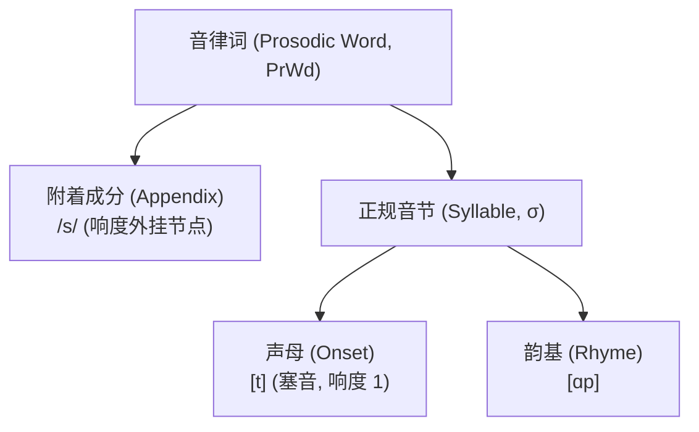

# Lec 17 音节音系学 II：响度层级、配列斜率与音节外成分（Syllables II: Sonority Hierarchy & Extrasyllabicity）

人类语言允许将哪些声音拼装进同一个音节？为什么所有语言都普遍允许 *tra*，却几乎一致禁止 $*[\text{rta}]$ 充当词首？在音节的内部几何中，支配辅音排列顺序的核心物理与认知法则是**响度层级（Sonority Hierarchy）**。在麻省理工学院 24.901 第十九讲中，Michael Kenstowicz 教授系统推导**响度顺序原则（Sonority Sequencing Principle, SSP）**、最小响度间距公理，剖析成音节辅音的跨语言极限（从英语流音到柏柏尔语全清塞音核），并解开印欧语中著名的“$/s/ +$ 塞音”逆响度悖论——附着成分与音节外性（Extrametricality）。

## TL;DR

- **全人类通用响度层级阶梯**：元音（6）$>$ 滑音（5）$>$ 流音（4）$>$ 鼻音（3）$>$ 擦音（2）$>$ 塞音（1）。
- **响度顺序原则（SSP）**：音节内部声能必须从声母向音节核单调陡峭爬升，并从音节核向韵尾平缓滑落，形成完美的山峰形包络。
- **成音节辅音扩展阶梯**：当元音缺失时，音节核权限沿响度阶梯自高向低向下兼容（流音 $\to$ 鼻音 $\to$ 擦音 $\to$ 塞音），柏柏尔语展现了这一兼容的终极形式。
- **$/s/ +$ 塞音逆响度之谜**：英语 *stop*, *spy* 表面违背 SSP，音系学证明首位 $/s/$ 并不处于声母树内，而是作为**词外附着成分（Appendix / Extrametrical Segment）**直接挂载在更高韵律层。

## 1. 通用响度阶梯（The Universal Sonority Scale）

声音的“响度（Sonority）”在语音学上对应着声道几何的开放程度与自发声能辐射效率。经过跨语言统计归纳，生成音系学确立了全人类共通的离散响度数值阶层：

::: definition 通用响度数值阶层（Sonority Hierarchy）
自然语言全部音段沿声能开放度划分为六大离散级别：
$$\begin{array}{rcl}
\text{低元音 / 中高元音 (Vowels)} & \mathbf{6} & [a, e, i, o, u] \\
\text{滑音 / 半元音 (Glides)} & \mathbf{5} & [j, w] \\
\text{流音 (Liquids: r, l)} & \mathbf{4} & [r, l] \\
\text{鼻音 (Nasals)} & \mathbf{3} & [m, n, \eta] \\
\text{擦音 / 嘈吵音 (Fricatives)} & \mathbf{2} & [s, z, f, v, \theta] \\
\text{塞音 / 破裂音 (Stops)} & \mathbf{1} & [p, t, k, b, d, g]
\end{array}$$
:::

---

## 2. 响度顺序原则（Sonority Sequencing Principle, SSP）

音节之所以在听觉上能够被识别为一个独立的节拍单元，正是因为其内部声能呈现高度可预测的“攀登-峰值-滑落”波形。

::: theorem 响度顺序原则（Sonority Sequencing Principle, SSP）
在任何良构的音节内部：
1. **声母上升斜率**：从音节最左端向音节核前进时，各音段的响度值必须**严格单调递增**；
2. **音节核顶点**：音节核（Nucleus）必须由全音节中响度值最高的音段担当（局部声能极大值点）；
3. **韵尾下降斜率**：从音节核向最右端韵尾滑落时，各音段的响度值必须**单调递减**（或维持平缓）。
:::

```text
响度 (Sonority)
6 |        N (元音, 峰顶)
  |       / \
5 |      /   \  (滑音)
4 |     /     \  (流音)
3 |    /       \  (鼻音)
2 |   /         \  (擦音)
1 |  O (塞音)    C (塞音, 谷底)
  |____________________________
     p    l    a    n    t
    (1)  (4)  (6)  (3)  (1)  <-- 严格满足 SSP 钟形对称
```

在单词 *plant* $[pl\ae nt]$ 中：
- 声母段：$[p]$（1）$\to [l]$（4）$\to [\ae]$（6），斜率大于 0，完美起跑；
- 韵尾段：$[\ae]$（6）$\to [n]$（3）$\to [t]$（1），斜率小于 0，完美着陆。

相反，序列 $*[lp\ae tn]$ 在全人类语言中均被判定为非法音节，因为其声母出现“流音(4) $\to$ 塞音(1)”的响度倒灌塌陷。

---

## 3. 音节核的扩展与成音节辅音阶梯

虽然在绝大多数语言中音节核（Nucleus）被独家授予元音，但在快速口语或特定语言中，当元音脱落后，音节核权限会严格沿着响度阶梯自上而下顺次开放：

1. **流音充当核**：英语 *bottle* $[\text{b}\alpha\text{tl}\mkern-9mu/]$、*bird* $[b{\text{r}}\mkern-9mu/d]$，捷克语/斯洛伐克语著名绕口令 *Strč prst skrz krk*（将手指穿过喉咙，全句无元音，由流音 $[r]$ 支撑每一个音节）；
2. **鼻音充当核**：英语 *button* $[\text{b}\Lambda\text{tn}\mkern-9mu/]$、*bottom* $[\text{b}\alpha\text{tm}\mkern-9mu/]$；
3. **终极全能核：摩洛哥塔什尔希特柏柏尔语（Dell & Elmedlaoui 2002）**：
   柏柏尔语展现了全人类音节语法的极致——**任何音段，包括完全无声的清塞音，均可被选举为音节核**！
   例如在纯辅音词汇 *t-ftk-t-stt*（你扭伤了它）中，音节核由塞音与擦音依照严格的局部最高响度算法自发推导构建，全词被完美切分为三个无声带振动的纯塞擦音节。

---

## 4. 逆响度之谜：英语 `/s/ +` 塞音的附着成分分析

在通用印欧语（包括英语、日耳曼语、拉丁语）中，存在一个令经典 SSP 原则极其尴尬的严重违例：
考察单词：*stop*, *spin*, *skate*, *street*, *split*。
- 在 *stop* $[st\alpha p]$ 中，首位是擦音 $[s]$（响度 = 2），紧随其后的是塞音 $[t]$（响度 = 1）；
- 响度走势：$2 \to 1 \to 6$！从首音到第二个音段，**响度不仅没有上升，反而发生了倒退暴跌**！

为什么所有日耳曼语言都在词首坦然接受这种“逆响度”怪胎？



::: theorem 附着成分公理（Appendix / Extrasyllabicity Theory）
音系学通过韵律分层解决了这一矛盾：**词首的 $/s/$ 根本没有进入音节的声母（Onset）树内！**
它是作为一个特殊的**音节外附着成分（Syllable-Adjoint / Appendix）**，直接跨级附着在更高层级的韵律词（Prosodic Word）节点之上。正规音节的声母从真正的塞音 $[t]$ 才正式开始算起。由于 $/s/$ 身处音节之外，它完全不受音节内 SSP 响度上升律的管辖。
:::

::: insight 响度层级作为气动力学的最优解
为什么人类大脑偏好响度按阶梯爬升？这背后是声道流体力学（Aerodynamics）的精密控制。塞音需要蓄积最大口腔压力，擦音需要高速狭缝射流，响音则需要通畅共鸣。若将低能量闭塞辅音置于高能量流音之后，气流的湍流与反射波将相互抵消撕裂。SSP 是人类发音生理器官在百万年演化中，使声学信号输出信噪比最大化的最优物理滤波方案。
:::
