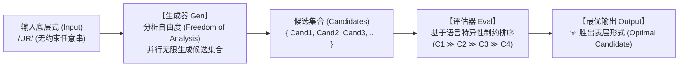

# Lec 18 优选论与制约条件：有标记性、忠实性与评估表推导（Optimality Theory & Constraints）

自 1968 年 SPE 问世以来的二十余年间，生成音系学长期被“串行重写规则（Serial Rewrite Rules）”范式所统领。然而，前几讲所揭示的“规则共谋（Conspiracy）”与“重复性困境”最终迫使理论走向深刻的范式革命。1993 年，艾伦·普林斯（Alan Prince）与保罗·斯莫伦斯基（Paul Smolensky）创立了**优选论（Optimality Theory, OT）**。音系学自此告别机械的逐步重写，全面转向**并行候选生成与通用可违背制约层级筛选（Parallel Evaluation & Ranked Violable Constraints）**。在麻省理工学院 24.901 第二十讲中，Michael Kenstowicz 教授系统解构优选论的数理架构与制约评估表（Tableaux）推导技术。

## TL;DR

- **优选论三大引擎架构**：输入底层式经由生成器（Gen）无界产出候选集合，随后由评估器（Eval）在通用制约集（Con）的严格支配层级下并行筛选。
- **制约两大核心阵营**：有标记性制约（Markedness，惩罚发音困难的表层构型）与忠实性制约（Faithfulness，惩罚偏离底层输入的变异）。
- **严格支配公理（Strict Dominance）**：制约条件是普遍存在但**皆可违背（Violable）**的；高阶制约具有压倒性否决权，致命违规（$*!$）瞬间剥夺候选资格。
- **词库底层的丰富性（Richness of the Base）**：语言系统在底层输入端不设任何人为禁令，所有跨语言音位配列全部由表层制约排序自然涌现。

## 1. 优选论的宏观计算三联体：Gen, Con, Eval

在优选论中，生成语法被形式化为三元组机器：

1. **输入项（Input）**：词库中储存的抽象底层形式；
2. **生成器（Gen: Generator）**：根据“分析自由度（Freedom of Analysis）”公理，Gen 可以执行任何合法的删除、插入、重组操作，瞬间针对一个输入并行吐出无限多的可能表层候选词；
3. **制约集（Con: Constraints）**：跨语言普遍共享的、有认知依据的制约条件全集；
4. **评估器（Eval: Evaluator）**：将候选集放置在特定语言的**刚性制约排序（Constraint Hierarchy）**下逐级过筛，挑出违规代价最小的唯一胜出者（Optimal Output，以符号 $\text{☞}$ 标识）。

---

## 2. 核心对抗双子星：有标记性 vs 忠实性

优选论的全部音系张力，源于两类内在冲突的制约力量之间的永恒博弈：

### 2.1 有标记性制约（Markedness Constraints）

对表层输出结构（Output）的生理与声学难度进行审查，对特定“不完美、不稳定”的形式施加惩罚标记（$*$）：
- **$\text{\textsc{Onset}}$**：每个音节必须拥有声母（惩罚首音节裸露元音，如 $*[\text{a}]$）；
- **$\text{\textsc{NoCoda}}$**：音节严禁包含韵尾辅音（偏好无阻碍的开音节 $CV$）；
- **$*\text{\textsc{Complex}}$**：严禁复辅音（禁止复杂的辅音丛，如 $*[str-]$）；
- **$*\text{\textsc{Voice-Obs-Final}}$**：严禁词尾出现浊阻塞音（驱动波兰语/俄语清化）。

### 2.2 忠实性制约（Faithfulness Constraints: Correspondence Theory）

麦卡锡与普林斯（McCarthy & Prince 1995）在**对应论（Correspondence Theory）**中确立了保护底层输入的刚性防线：
- **$\text{\textsc{Max-IO}}$（全员保留，禁止删除）**：底层输入的每一个音段，在表层输出中必须拥有对应的映射实体（惩罚辅音或元音删除）；
- **$\text{\textsc{Dep-IO}}$（禁止空降，禁止插入）**：表层输出的每一个音段，在底层输入中必须拥有合法来源（惩罚外来母音或辅音插入）；
- **$\text{\textsc{Ident-IO}}[F]$（特征保真，禁止变质）**：对应音段的特征取值 $[F]$ 必须完全一致（惩罚清音变浊音或元音变质）。

---

## 3. 严格支配与评估表（Tableau）推导技术

优选论的推导核心是**评估表（Tableau）**。制约条件自左向右按支配强度（$C_1 \gg C_2 \gg C_3$）排列：

::: definition 致命违规（Fatal Violation: $*!$）
当多个候选者同时竞争时，若某候选在较高等级制约下产生了违背（$*$），而至少存在一个竞争对手在该制约下完美无损，则该违背立刻成为**致命违规（Fatal Violation, 标为 $*!$）**。该候选在此瞬间被永久淘汰，其后续列全部涂灰变暗，丧失进一步比拼的资格。
:::

### 3.1 音节修复类型的跨语言排序实证

考察一个底层带有非法韵尾闭音节的输入 `/kat/`。面对有标记性制约 $\text{\textsc{NoCoda}}$，不同语言如何抉择？

#### 语言 A（如夏威夷语）：优先插入元音（$\text{\textsc{NoCoda}}, \text{\textsc{Max}} \gg \text{\textsc{Dep}}$）

| 输入：`/kat/` | $\text{\textsc{NoCoda}}$ | $\text{\textsc{Max-IO}}$ | $\text{\textsc{Dep-IO}}$ |
| :--- | :---: | :---: | :---: |
| a. $[\text{kat}]$ | $*!$ (含韵尾 t) |  |  |
| b. $[\text{ka}]$ |  | $*!$ (删除了 t) |  |
| $\text{☞}$ c. $[\text{ka.ti}]$ |  |  | $*$ (插入了 i) |

候选 a 由于违反最高阶的 $\text{\textsc{NoCoda}}$ 被无情秒杀；候选 b 删除了辅音惨遭 $\text{\textsc{Max}}$ 淘汰；候选 c 虽然插入了元音违背了 $\text{\textsc{Dep}}$，但由于 $\text{\textsc{Dep}}$ 排在最末尾，候选 c 光荣胜出！

#### 语言 B（如某些澳洲土著语）：优先删除辅音（$\text{\textsc{NoCoda}}, \text{\textsc{Dep}} \gg \text{\textsc{Max}}$）

若将排序颠倒，将 $\text{\textsc{Dep}}$ 提升至高阶、$\text{\textsc{Max}}$ 置于底端，则完全相同的输入 `/kat/` 将推导胜出候选 b $[\text{ka}]$！

::: example 制约重排即语言多样性
优选论确立了一条颠覆性的宏观公理：**全人类语言共享完全相同的一套通用制约（Universal Constraints）**。英语、汉语、日语、夏威夷语的全部音系差异，仅仅是**对这套制约施加了不同的优先级排序（Permutation of Rankings）**而已。
:::

---

## 4. 词库底层的丰富性（Richness of the Base）

在经典音系学中，学者常编写“词库前置条件”来防止非法结构进入。优选论彻底废除了这一机制，确立了**词库底层的丰富性（Richness of the Base, RotB）**：

::: theorem 词库底层的丰富性（Richness of the Base）
语言的词库输入端严禁预设任何语言特异性的禁令。输入可以是全人类发音器官能够发出的任何荒谬序列。
**所有的音位配列约束（Phonotactics）必须百分之百由制约层级系统在评估阶段自动修剪和过滤！**
:::

即无论把多么违规的词汇塞进汉语或夏威夷语的 OT 评估器，高阶有标记性制约都会本能地将其粉碎并重构为符合该语言审美模式的合法形态。

::: insight 优选论作为认知冲突解决器
优选论在认知科学上具有极为深邃的和谐性。人类心智的日常决策本质上就是充满矛盾的制约博弈：既想要发音省力（有标记性），又想要精准传达原意（忠实性）。没有绝对不可违背的教条，只有在权衡取舍中的“全局最优（Optimality）”。优选论将生成语法提升到了现代约束优化理论的数学前沿。
:::
