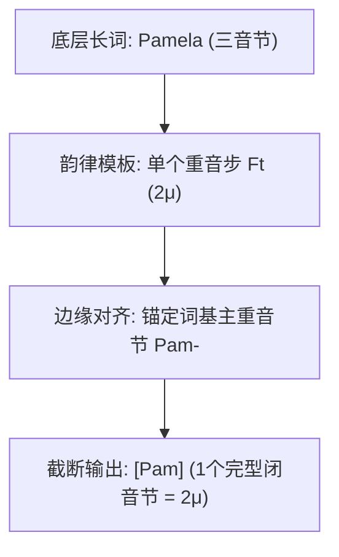

# Lec 21 节律形态学：韵律模板、重叠构词与截断形式（Prosodic Morphology: Reduplication & Truncation）

在传统词法学中，词缀附加通常被视为纯粹符号的线性粘接。然而在跨语言词汇派生中，存在大量极端奇特的构词操作：词缀的长度并不固定，而是精准复制词根的某一部分（重叠构词）；人名或长词被大刀阔斧地剪裁为固定尺寸的小巧形式（昵称截断）；更有甚者，如果词根长度达不到特定音重，构词将被直接阻断。在麻省理工学院 24.901 第二十三讲中，Michael Kenstowicz 教授系统推导麦卡锡与普林斯（McCarthy & Prince 1986/1996）开创的**节律形态学（Prosodic Morphology）**，阐释韵律层级、模板满足假说、最小词条件以及重叠构词与截断的几何推导。

## TL;DR

- **节律形态学核心主张**：形态操作的形状目标（Templates）必须且只能用真实的韵律单位（音拍、音节、音步、韵律词）定义，严禁以线性音段计数（如“取前三个字母”）。
- **最小词条件（Minimal Word Condition）**：在任何语言中，一个能够独立成词的实体必须至少构成一个合法的韵律音步（通常至少包含两个音拍 $2\mu$）。
- **截断与昵称构词（Truncation）**：英语人名截断（*Pamela $\to$ Pam*, *professor $\to$ prof*）与日语复合截断（*pasokon*）均以韵律单音步为模板目标。
- **重叠构词（Reduplication）**：词素复制以基本词（Base）与重叠素（Reduplicant）之间的对应关系为核心，通过模板填充与前缀附着生成。

## 1. 模板满足假说与韵律层级（The Prosodic Hierarchy）

传统形态学在描写重叠或昵称时，常写出诸如“复制前两个辅音和一个元音（$C_1 V C_2$）”之类的规则。麦卡锡与普林斯指出，这种规则是根本错误的，因为自然语言的心智语法中不存在“算盘式清点音段个数”的计数器。

::: theorem 模板满足假说（Template Satisfaction Hypothesis）
形态学中的所有空间模板（Templates），**必须严格以普遍韵律层级（Prosodic Hierarchy）中经形式定义的真实韵律范畴为基准**：
$$\mathbf{\text{韵律词 (PrWd)}} \quad \succ \quad \mathbf{\text{音步 (Foot, Ft)}} \quad \succ \quad \mathbf{\text{音节 (Syllable, } \sigma\text{)}} \quad \succ \quad \mathbf{\text{音拍 (Mora, } \mu\text{)}}$$
语言学模板可以要求“生成一个双音拍音步（$\text{Ft}_{\mu\mu}$）”或“复制一个轻音节（$\sigma_\mu$）”，但**绝对严禁**要求“复制 3 个音段”或“截断为 4 个字母”。
:::

---

## 2. 词形尺寸约束与最小词条件（Minimal Word Condition）

形态操作往往对词基（Base）的韵律尺寸施加刚性门槛：

### 2.1 英语比较级后缀 *-er* 的韵律限制

英语比较级 *-er* 只能自由附加在“短词”之后：
- 单音节词：*red-der*, *fast-er*, *tall-er*；
- 双音节且末音节轻弱的词：*yellow-er*, *happi-er*, *simple-er*；
- 重读多音节或长词：$*[\text{beautiful-er}]$, $*[\text{corrupt-er}]$, $*[\text{intelligent-er}]$（强制改为 *more beautiful*）。

这种限制并不是词汇列举，而是 *-er* 规则将作用域严格限定在**单个完型韵律音步（Single Foot: $\text{Ft}_{\mu\mu}$ 或双音节扬抑格）**之内。

### 2.2 最小词条件（Minimal Word Condition）

::: definition 最小词公理（Minimal Word Axiom）
在自然语言中，任何一个具有重音资质、可独立发音的音律词（Prosodic Word），其下层必须至少支配一个完整的韵律音步：
$$\text{PrWd} \ge \text{Foot} \ge \mathbf{2\mu}$$
因此，所有主重音词汇必须**至少包含两个音拍（Bimoraic）**。
:::

- 英语允许包含长元音或闭音节的单音节词：*see* $[si:]$ ($2\mu$)、*cat* $[\text{k}\ae\text{t}]$ ($2\mu$)；
- 英语**绝对禁止**包含短元音的开音节独立成词：不存在任何发音为 $*[\text{k}\ae]$ 或 $*[\text{b}\mathrm{I}]$ 的名词！因为单个短开音节只有 $1\mu$，违背最小词公理。

---

## 3. 截断构词（Truncation）与昵称化

在现代口语中，将长词截断为昵称或简称的现象极其普遍：
- 英语人名截断：*Pámela* $\to$ **Pam**；*Elízabeth* $\to$ **Liz**；*Samántha* $\to$ **Sam**；*proféssor* $\to$ **prof**；*télevision* $\to$ **telly**；
- 澳大利亚英语截断：*afternoon* $\to$ **arvo**；*barbecue* $\to$ **barbie**。

截断规则的本质是：**将词基的主重音音节提取出来，直接映射填充至预设的“双音拍最小音步模板（$\text{Ft}_{\mu\mu}$）”中**。多余的无声学突显度的音节被整体抛弃。

### 3.1 日语外来词截断与双音步对称

日语在吸收英语超长外来词时，将其整齐划一地裁剪为**两个双音拍音步（$2\mu + 2\mu = 4\mu$）的完美对称结构**：
- *personal computer* $\longrightarrow$ **paso-kon**（$2\mu + 2\mu$）
- *remote controller* $\longrightarrow$ **rimo-kon**（$2\mu + 2\mu$）
- *pocket monster* $\longrightarrow$ **poke-mon**（$2\mu + 2\mu$）

如果截断只是随意的快读缩略，绝不可能在数百个完全不相关的借词中精确收敛至统一的 $4\mu$ 韵律模板。

---

## 4. 重叠构词（Reduplication）与对应论

重叠构词是南岛语系、美洲土著语及非洲语言中极其高产的屈折与派生手段（表达复数、进行体、反复或减弱）。

::: example 菲律宾伊洛卡诺语（Ilokano）重叠构词
在伊洛卡诺语中，名词复数通过在前部附加一个重叠素（Reduplicant, RED）形成：
- *kaldíng*（山羊） $\to$ **kal-kaldíng**（群羊）
- *púsa*（猫） $\to$ **pus-púsa**（群猫）
- *yán*（地方） $\to$ **yan-yán**（许多地方）
:::

重叠素的前缀模板被严格定义为**“双音拍重音节（Heavy $\sigma = 2\mu$）”**。在复制时，重叠素自左向右从词基中抽取辅音和元音填满自身的 $2\mu$ 空间，遇到开音节短元音甚至自发拉长元音或抓取后续辅音闭合，以确保完美满足韵律模板。

::: insight 节律形态学对形式主义音系学的终极辩护
节律形态学彻底粉碎了将形态学与音系学割裂为两个独立黑盒的传统见解。它以无可辩驳的经验事实证明：音系学所推导出来的最抽象的树形范畴（音拍、音节核、音步），同时正是形态学构词操作直接调用的积木块。人类心智的语言大厦，是由同一套优美的数理几何原理从底层到高阶一气呵成的。
:::
