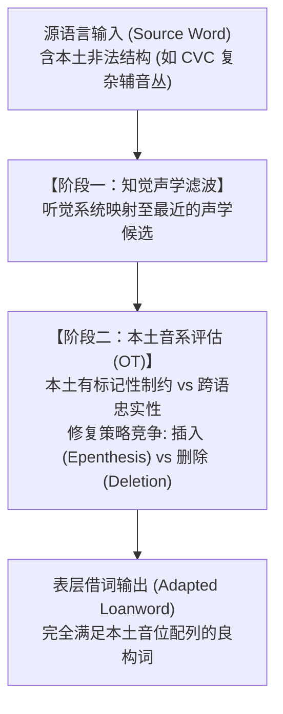

# Lec 22 外来词音系学：跨语言借词同化、知觉适应与修复竞争（Loanword Phonology & Perceptual Salience）

当一种语言从外部语言中吸收外来借词（Loanwords）时，借入词往往包含受体语言本土音系所绝对禁止的音段或复辅音组合。然而，母语者并不会因此陷入沉默，而是自发、迅速且高度一致地将外来词重构为完全合乎母语语法的形态。外来词同化因此被誉为**检验人类心智音系语法活性运作的天然实验室**。在麻省理工学院 24.901 第二十四讲中，Michael Kenstowicz 教授结合自己在外来词音系学领域的奠基性研究（Kenstowicz 2005, 2007; Kenstowicz & Suchato 2006），剖析借词修复策略的不对称性竞争、知觉突显度假说（Perceptual Salience），以及亚音位声学细节对心智计算的深层驱动。

## TL;DR

- **外来词的双重张力**：忠实于源语言（Source）物理声学信号与服从受体语言（Host）本土音位配列禁令之间的剧烈冲突。
- **修复策略的不对称性**：面对相同的音位配列违规，语言往往在元音插入（Epenthesis）与辅音删除（Deletion）之间做出极其精细的音段特异性抉择。
- **知觉突显度假说（Kenstowicz）**：具有高能量、强内部听觉线索的音段（如咝音 $[s]$）优先通过元音插入予以抢救保留；而缺乏内部线索的弱爆破音则优先被删除。
- **粤语借词实证**：粤语吸收英语 *tips* 插入元音变为 $[t^h\mathrm{I}\text{p.si}]$，但吸收 *pump* 时却直接删除末尾破裂音变为 $[p\text{ɐ}m]$。

## 1. 外来词音系学的核心理论命题

传统观点常以为外来词改造仅仅是说话人的“口音缺陷”或随意的听觉误差。然而现代生成音系学证明：**借词同化是受体语言底层音系语法（Grammar）在全新外来语料上的严格计算演绎**。

这一推导过程必须在两大互相背道而驰的诉求中寻找平衡：
1. **跨语言忠实性（Faithfulness to Source）**：尽量让借入词听起来像原词，避免音段信息的无谓流失；
2. **本土结构制约（Host Markedness & Phonotactics）**：绝对捍卫母语的音位配列禁令（如不允许特定韵尾、不允许复辅音）。

---

## 2. 修复策略的不对称性与粤语经典实证

当源语言包含母语不允许的辅音组合时，音系系统主要依赖两大经典修复手段：
- **元音插入（Epenthesis）**：插入一个微弱元音，将非法韵尾辅音升格为新音节的声母；
- **辅音删除（Deletion）**：直接抹杀违规辅音。

为什么同一种语言面对同一种非法闭音节，有时采用插入，有时却坚决采用删除？
Michael Kenstowicz 教授考察了中国广州话（Cantonese）吸收英语借词的经典反差：

| 英语源词 | 英语音标 | 粤语表层借词 | 采用的音系修复手段 | 语音学与感知机制对比 |
| :--- | :---: | :---: | :---: | :--- |
| **tips** (小费) | $[\text{t}\mathrm{I}\text{ps}]$ | **[tʰip.si]** | **元音插入 (Epenthesis)** | 插入高元音 $[i]$，完整保留末位咝音 $[s]$ |
| **pump** (水泵) | $[\text{p}\Lambda\text{mp}]$ | **[pɐm]** | **辅音删除 (Deletion)** | 直接抹杀末位爆破音 $[p]$，拒绝保留 |
| **stamp** (邮票) | $[\text{st}\ae\text{mp}]$ | **[si.tʰam]** | **混合修复** | 首位 $[s]$ 插入元音保留，末位 $[p]$ 惨遭删除 |

粤语音节结构虽然允许塞音韵尾（$-p, -t, -k$），但禁止任何复辅音。问题在于：**为什么处于末尾的 $[s]$ 享有插入元音的特权待遇，而处于末尾的 $[p]$ 却被无情抛弃？**

---

## 3. 肯斯托维奇知觉突显度假说（Perceptual Salience Hypothesis）

为了解释上述不对称，Kenstowicz 提出了**知觉突显度假说**：

::: theorem 知觉突显度与忠实性加权公理（Kenstowicz 2005）
音系评估器中的忠实性制约并非无差别地一视同仁，而是与音段的**内部声学突显度（Internal Acoustic Saliency）**成正比加权：
$$\text{\textsc{Preserve-Salient}}(\text{Sibilant } s) \quad \gg \quad \text{\textsc{Preserve-Weak}}(\text{Unreleased Stop } p)$$
- **嘈吵咝音 $[s]$**：拥有持续时间长（$> 80\text{ ms}$）、高能量、全频带可见的强烈湍流噪声。其声学线索完全自包含在摩擦段内部，听觉识别率极高。若将其删除，将对源声学信号造成灾难性的感知信息剥夺！因此语法宁愿牺牲 $\text{\textsc{Dep}}$ 插入元音，也必须捍卫 $[s]$；
- **鼻音后的闭塞塞音 $[p]$**：在辅音丛末尾通常无声释放（Unreleased），缺乏爆破冲直条，仅有微弱的闭塞静音。将其删除造成的声学信息损失微乎其微。语法判定：删除辅音的代价远远低于无端增加一个完整多余音节的代价。
:::

---

## 4. 亚音位（Subphonemic）细节对借词同化的决定性驱动

借词音系学最引人注目的发现是：**外来词改造并不是基于源语言的抽象音位字典，而是精细捕捉了源语言非对立、冗余但声学显著的亚音位物理细节**。

::: example 墨西哥西班牙语借入美式英语 *caddy*
在美式英语中，单词 *caddy*（球童）中的中间齿龈塞音在元音之间被弱化为齿龈闪音 $[\text{ɾ}]$。
西班牙语本土音系中同时拥有两个独立的音位：齿龈塞音 $/d/$（如 *cada*）与齿龈颤音/闪音 $/{\text{r}}/$（如 *caro*）。
如果同化是在抽象音位层进行的，*caddy* 应当映射为带 $/d/$ 的形式。然而，墨西哥西班牙语母语者却将其借为：
$$\text{英语 } [\text{k}\ae\text{ɾ}\mathrm{i}] \quad \longrightarrow \quad \text{西语 } \mathbf{/kadi/}$$
为什么美式英语的闪音 $[\text{ɾ}]$ 没有被借为西语现成的闪音 $/{\text{r}}/$？因为美式闪音带有轻微的下压闭塞阻抗，在西语母语者的听觉几何中，其与西语弱化塞音 $/d/$（表层常为近音 $[\text{ð}]$）的声学欧氏距离更近！
:::

::: insight 外来词作为语言心智能力的试金石
外来词研究彻底击碎了“母语者只会机械复读已知词汇”的经验主义假说。面对此前生命中从未听过的全新外语单词，哪怕是一个未经任何受教育训练的普通说话人，其心智计算系统也能在几十毫秒的知觉瞬间，调用一整套极其复杂的知觉滤波与制约层级评估网络，给出全局唯一的数学最优解。这展示了人类语言生成装置（Language Acquisition Device）不可思议的先验几何力量。
:::
