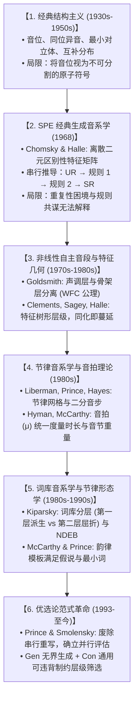

# Lec 23 形式音系学全景综合与理论范式演进（Course Review & Theoretical Synthesis）

作为麻省理工学院语言学系本科核心高阶音系学课程，MIT 24.901 历经一整个学期的严密推演，带领学习者穿越了形式音系学半个多世纪的风云激荡。从声道肌肉与共振峰物理声波出发，途经二元特征矩阵、词库规则排序、自主音段声调几何，最终抵达优选论（OT）与节律形态学的理论前沿。在第二十五讲期末综合研讨中，Michael Kenstowicz 教授系统回顾了现代音系学的六大理论范式演进，结合帕萨马夸迪语（Passamaquoddy）的多层级复杂实证，构筑起人类语言声音系统心智表征的形式主义全景画卷。

## TL;DR

- **音系学六大理论范式跨越**：古典结构主义（音位切分）$\to$ SPE 经典生成论（二元特征矩阵与规则串行推导）$\to$ 非线性自主音段理论（多轨几何）$\to$ 节律音步与音拍理论（格律拓扑）$\to$ 词库音系学（形态分层）$\to$ 优选论（并行通用制约评估）。
- **表征与计算的协奏演化**：音系学史是一部“富表征带来简运算”的进化史——音节、音拍与特征几何的发现，使原先繁琐臃肿的重写规则大幅精简。
- **帕萨马夸迪语终极综合实证**：弱化元音脱落、双音节抑扬格音步组装与重音网格冲突消除，在阿尔冈昆语复杂派生中交织演绎。
- **声音系统作为心智计算窗口**：人类语言声音并非不可捉摸的物理随机噪声，而是一个高度离散、遵循严格数理对称性与最小代价值的内在心智形式演算引擎。

## 1. 形式音系学半个世纪的理论演进范式

回顾现代音系学的思想史，理论范式经历了六次脱胎换骨的重大跃迁。每一次理论阵痛与范式革新，都源于先期模型在面对全新经验事实时的结构性解释枯竭：从结构主义对音段内部细节的漠视，到早期生成语法对动态规则堆叠的失控；再到非线性理论对多维几何的发现，直至优选论对输入输出并行评估的确立。

音系学研究由此从一门经验性的田野描写工具，蜕变为探讨认知计算与普遍语法公理的核心数理语言学科。全课程所涵盖的六大核心范式递进脉络如下所示：

通过上述六大演进阶梯，我们可以清晰地梳理出现代形式音系学如何一步步突破线性一维偏见，逐步构筑起包含音段层、特征几何树、音拍层、音节二叉树、音步网格以及通用制约层级的多维认知大厦。

### 1.1 核心线索：表征（Representation）与规则（Rules）的权力博弈

在整个发展脉络中，存在一条贯穿始终的辩证主线：**当理论的表征形式（Representation）越贫乏，所需的推导规则（Rules）就越繁复；而当理论发现了更丰富的几何表征，原先繁杂的规则就会自然消解**。
- 在 SPE 时代，缺乏音节与特征树表征，学者被迫为同部位鼻音同化和重音弱化编写极其冗长的代数代码；
- 当引入特征几何后，复杂的发音部位同化退化为“画一条蔓延连线”；
- 当引入音节内部二叉结构与音拍后，拉丁语与印地语复杂的重音公式退化为纯粹的“计算音拍数量与音步类型”；
- 最终，优选论将全部动态规则彻底连根拔起，宣告了“一切音系规则本质上都是输出有标记性与输入忠实性博弈的自然副产物”。

---

## 2. 帕萨马夸迪语（Passamaquoddy）的多层级综合检验

在期末总结中，Kenstowicz 教授援引美洲土著阿尔冈昆语系帕萨马夸迪语（LeSourd 1993）的高难度复杂语料，对一学期所学的所有理论模块进行极限压力测试。

考察其名词与动词词形派生中的重音跳跃与元音脱落：
- *wás-is*（孩子，单数） $\to$ *wás-ís-ek*（孩子们，复数）
- *pém-skót-e-k*（田野，单数） $\to$ *pém-skot-é-k-il*（田野，复数）
- *l-éwésto*（他说话） $\to$ *wík-ewésto*（他喜欢说话） $\to$ *séhtáy-ewésto*（他倒退着走路说话）
- *wícohké-m-a-l*（他帮助对方） $\to$ *wícóhke-kémo*（他提供帮助） $\to$ *wícohké-tahá-m-a-l*（他打算帮助对方）

::: example 帕萨马夸迪语推导链条的形式化剖析
在这些看似眼花缭乱的音调与重音跳跃背后，实际上交织着三大模块的严密配合：
1. **弱化元音音节外性（Stressless Syncope）**：词根中的非重读短元音在开音节中天然缺乏音拍赋值，音节结构被迫压缩；
2. **自左向右抑扬格音步组装（Iambic Parsing）**：音步构建算法自左向右以双音节抑扬格（弱-强 $[w \ s]$）铺设节律网格；
3. **韵律词主重音与冲突消除**：当形态前缀插入导致两个高位强拍并置时，网格冲突消除（Clash Avoidance）算法强制改写相邻次重音，呈现出长词中极富规律的奇偶交替跳动。
:::

---

## 3. 形式音系学在当代认知科学中的本体论地位

通过 24.901 的全面研读，我们获得的不仅是一套分析语言数据的工具箱，更是对人类心智计算架构的哲学反思：

::: definition 现代形式音系学的核心公理网络
1. **心智真实性（Psychological Reality）**：音位、特征、音拍与音步绝非语言学家的方便假设，它们在脑电失配负波（MMN）、失语症损伤、儿童语言习得以及跨语言借词同化中拥有坚不可摧的神经生物学现实；
2. **离散无限性（Discrete Infinity）**：发音器官的物理运动是连续平滑的模拟信号，但人类大脑用以思考和组织的语言核心却是由离散二元特征构成的数字系统；
3. **最优性计算（Optimization Computation）**：人类语言声音系统在生理节能（Least Articulatory Effort）与声学辨析（Maximum Perceptual Contrast）这两大物理极点之间，自组织演化出兼具对称性与稳定性的数理拓扑网络。
:::

::: insight 结语：声音的心智几何
从索绪尔的共时符号，到雅各布森的特征矩阵；从范特的源-滤波方程，到戈德史密斯的不相交关联线；再到普林斯的优选评估表。音系学向我们展示了理论物理学般的美感：在人类喉咙发出的极其混乱的空气振动表层之下，奔流着一部运转了数万年、严谨精密的数学计算机。研读音系学，就是研读人类心智内部最精巧的声音几何学。
:::
