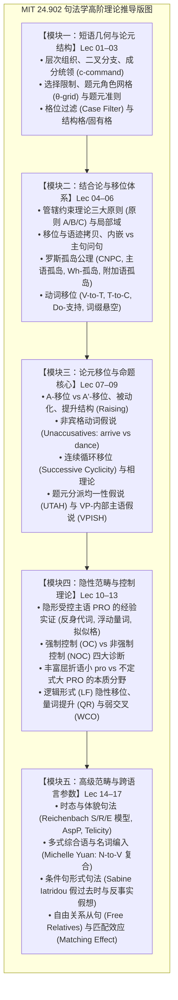

# 24.902 语言结构 II：句法学

MIT 24.902（Fall 2015，主讲 Sabine Iatridou 教授）是麻省理工学院语言学系面向高年级本科生与研究生的经典生成句法学核心高阶课程。课程以生成语法（Generative Grammar）为理论范式，系统探讨人类语言中短语与句子的**层级组织（Hierarchical Organization）**与形式生成机制。教学在**原则与参数（Principles and Parameters, P&P）**及**最简方案（Minimalist Program）**的现代框架下展开，深入剖析跨语言句法变异与普遍语法公理，揭示心智内部离散无限语言计算系统的数学与几何法则。

## TL;DR

- 解构人类语言句法的内在生成机制：基于二叉分支合并（Binary Merge）与投射原则推导离散无限的复杂句子。
- 贯通树形几何与移位约束：从成分统领（c-command）、中心语移位到 A-移位（被动/提升）、Wh-孤岛禁令与格位过滤。
- 确立普遍语法与参数变异：对比英语、希腊语、罗曼语、日德语及多式综合语，区分普遍原则与跨语言结构参数。

## 课程描述

### 先修课程

- **24.900 语言学导论（Introduction to Linguistics）**：特别是形态学基础、离散无限性、成分测试与基础移位概念；或具备等同的理论语言学基本素养。

### 官方课程描述翻译

> 本课程深入探讨语言学核心分支——**句法学（Syntax，即人类语言层级组织研究）**的基本观念、主要理论问题与重大科学发现。我们通常在被称为**生成语法（Generative Grammar）**的理论框架下开展探索。
> 
> 在本学期的学习中，我们将考察广泛的语言经验事实，深入探索那些在完全不相关的语言中普遍存在的句法现象。我们的目标是双重的：一方面理解全人类语言共通的**普遍属性（Universal Properties）**，另一方面理解不同语言在结构形态上产生分歧的**变异机制（Structural Diversity）**。
> 
> 本课程强调核心思想的阐发、经验论据的构建以及特定理论范式（特别是“原则与参数”句法学）的推导技术，同时兼顾语言习得与认知处理领域的相关交叉成果，向大家展示为什么句法学研究对于更广阔的语言认知科学而言不可或缺。

### 培养目标

1. **掌握形式句法学的严谨推导技术**：熟练运用 X-杠理论、二叉树形几何、中心语投射以及论元选择（$c$-selection 与 $s$-selection）对自然语言句子进行形式化推导；
2. **掌握格位理论与约束理论（Binding Theory）**：透彻理解结构格与固有格的授权机制，掌握管辖与结合论三大核心原则（原则 A、B、C）及其局部约束域的形式化定义；
3. **透彻理解显性移位与孤岛约束（Islands）**：掌握中心语移位（Head Movement: V-to-T, T-to-C）、论元移位（A-Movement: 被动化、提升结构、非宾格动词）与 A'-移位（Wh-Movement），严格掌握罗斯孤岛限制公理；
4. **深入理解隐形成分与控制理论（Control Theory）**：掌握题元分派均一性假说（UTAH）、VP-内部主语假说（VPISH），掌握隐形主语 PRO 的经验实证、强制控制（OC）与非强制控制（NOC）的严格诊断，以及大 PRO 与小 pro 的本质分野；
5. **具备跨语言实证与理论证伪能力**：能够通过跨语言语料（包括英语、现代希腊语、爱尔兰语、德语、意大利语、冰岛语、克里语等）检验并证伪句法假说，独立撰写符合学术规范的形式句法学研究论文。

### 参考书籍与教学材料

- **核心必读材料**：本课程不设单一死板的指定教科书。全部核心阅读材料为 Sabine Iatridou 教授每节课后发布的**官方全套高阶讲义幻灯片与专题研读论文**；
- **经典辅助参考书**：
  - Carnie, Andrew (2013). *Syntax: A Generative Introduction* (3rd ed.). Wiley-Blackwell.
  - Haegeman, Liliane (1994). *Introduction to Government and Binding Theory* (2nd ed.). Blackwell.
  - Adger, David (2003). *Core Syntax: A Minimalist Approach*. Oxford University Press.
  - Sportiche, Dominique, Hilda Koopman, and Edward Stabler (2014). *An Introduction to Syntactic Analysis and Theory*. Wiley-Blackwell.

## 课程内容全景

### 模块架构与推导链条

本课程的理论进阶严格沿着生成语法的推导逻辑展开。从局部的词库与短语结构出发，自下而上层层组装至全句拓扑，随后引入显性与隐性移位运算，最终向跨语言多样性与高级语义接口全面拓展。全课有机划分为五大环环相扣的核心知识模块：

1. **模块一（短语几何与论元结构，Lec 01–03）**：首先从经验上打破线性序列假说，通过二叉树形建立成分统领（c-command）的数学定义；继而考察中心语与补足语/附加语的层级落差，探讨选择限制与题元角色（$\theta$-roles）网格分派；最终确立题元准则的双射公理与格位过滤（Case Filter）对名词存活的刚性核准；
2. **模块二（结合论与移位体系，Lec 04–06）**：形式化建立管辖与约束理论的三大原则（原则 A/B/C）及其局部约束域；通过内部合并运算引入 Wh-移位与主从从句的不对称拓扑；系统论证罗斯五大孤岛公理作为移位诊断的试金石；深入英法动词移位（V-to-T 与 T-to-C）与否定词截击引起的 *Do*-支持最后手段；
3. **模块三（论元移位与命题核心，Lec 07–09）**：剖析论元移位（A-Movement）与非论元移位（A'-Movement）的本质分界，解析被动化与提升结构的格位驱动；深入非宾格动词假说（Unaccusatives）；通过爱尔兰语与西非语实证连续循环移位与相理论；确立题元分派均一性假说（UTAH）与 VP-内部主语假说（VPISH）；
4. **模块四（隐性范畴与控制理论，Lec 10–13）**：聚焦未发音的无声心智成分，全面推导隐形受控主语 PRO 的四大经验实证；严格对比强制控制（OC）与非强制控制（NOC）的诊断标准；明晰主语脱落语小 pro 与不定式大 PRO 的双轨体系；探索逻辑形式（LF）上的隐性量词提升（QR）与弱交叉（WCO）效应；
5. **模块五（高级范畴与跨语言参数，Lec 14–17）**：将生成理论推向复杂句式与类型学前沿，剖析赖兴巴哈时态与体貌投射（AspP）；探索北美原住民多式综合语的名词编入（Michelle Yuan 主讲）；研读 Sabine Iatridou 教授关于假过去时与反事实条件句的奠基性理论；终结于自由关系从句中的格位冲突与匹配效应（Matching Effect）。

各模块之间的推导脉络与衍生关系如下图所示：

### 讲义全景列表

全课程基于 MIT 官方发布的 16 讲核心讲座材料（注：官方 Session 7 为期中复习、Session 18 与 20 为随堂讨论，未设讲义），建立系统化精讲笔记体系：

| 讲次 | 核心主题（Topic） | 核心机制与经典跨语言实证 | 讲义笔记链接 | 官方课件映射 |
| :---: | :--- | :--- | :---: | :---: |
| **Lec 01** | **语言的层级组织** (Hierarchical Organization) | 短语结构规则极限、二叉树几何、成分统领严格定义、四大成分测试、结构歧义 | [📄 lec01.md](./lec01.md) | Class 1 Slides |
| **Lec 02** | **树形构建、局部性与题元角色** (Trees, Locality & $\theta$-Roles) | 自下而上合并（Merge）、中心语投射、选择限制（$c/s$-selection）、$\theta$-角色网格分派 | [📄 lec02.md](./lec02.md) | Class 2 Slides |
| **Lec 03** | **题元准则、格位理论与约束基础** (Case Theory & Binding Basics) | $\theta$-准则双射公理、格位过滤、主格/宾格结构指派、冰岛语固有格（Quirky Case） | [📄 lec03.md](./lec03.md) | Class 3 Slides |
| **Lec 04** | **管辖约束论与 Wh-移位基础** (Binding Theory & Wh-Movement) | 原则 A/B/C 形式化局部域、主句 vs 内嵌问句、Wh-移位、底层语迹与拷贝理论 | [📄 lec04.md](./lec04.md) | Class 4 Slides |
| **Lec 05** | **孤岛效应与移位限制** (Islands and Movement Restrictions) | 罗斯孤岛公理、复杂名词短语（CNPC）、主语孤岛、附加语孤岛、Wh-孤岛禁令 | [📄 lec05.md](./lec05.md) | Class 5 Slides |
| **Lec 06** | **动词移位：V-to-T 与 T-to-C** (Verb Movement: V-to-T & T-to-C) | Pollock 分裂 Infl 假说、英法动词移位对比、T-to-C 主谓倒装、Do-支持与词缀悬空 | [📄 lec06.md](./lec06.md) | Class 6 Slides |
| **Lec 07** | **论元移位与非宾格动词** (A-Movement & Unaccusatives) | A-移位 vs A'-移位、被动化格位吸收、提升结构（Raising）、非宾格动词假说 | [📄 lec07.md](./lec07.md) | Class 8 Slides |
| **Lec 08** | **移位深入：连续循环性与重建** (Successive Cyclicity & Reconstruction) | $[Spec, CP]$ 步进停靠站、爱尔兰语互补标补词证据、重建效应挽救原则 A | [📄 lec08.md](./lec08.md) | Class 9 Slides |
| **Lec 09** | **题元分派均一性与 VP-内部主语** (UTAH & VP-Internal Subjects) | 贝克 UTAH 定理、VPISH 假说、浮动量词（*all the boys*）、轻动词 $v$P 壳层 | [📄 lec09.md](./lec09.md) | Class 10 Slides |
| **Lec 10** | **隐形受控主语 PRO 的经验实证** (Empirical Arguments for PRO) | 不定式主语缺失之谜、反身代词绑定、次级谓词一致性、冰岛语拟似格保持证据 | [📄 lec10.md](./lec10.md) | Class 11 Slides |
| **Lec 11** | **强制控制（OC）与非强制控制（NOC）** (Obligatory vs Non-obligatory Control) | 强制控制四大严格诊断（局域性、不可或缺先行词、从属解读、De Se 认知解读） | [📄 lec11.md](./lec11.md) | Class 12 Slides |
| **Lec 12** | **空主语双轨制：小 pro 与大 PRO** (The Null Subject Dichotomy: Pro vs PRO) | 主语脱落（Pro-drop）意大利/西班牙语丰富屈折授权、结构主格 vs 惰性非限定格 | [📄 lec12.md](./lec12.md) | Class 13 Slides |
| **Lec 13** | **隐性移位与逻辑形式（LF）** (Covert Movement at Logical Form) | 模型论与 LF 界面、量词提升（QR）、弱交叉（WCO）效应作为 A'-移位试金石 | [📄 lec13.md](./lec13.md) | Class 14 Slides |
| **Lec 14** | **时态与体貌的形式句法拓扑** (Syntactic Architecture of Tense & Aspect) | 赖兴巴哈 S/R/E 模型、Klein 时间区间语义、AspP 投射层级、限定体与从句格位 | [📄 lec14.md](./lec14.md) | Class 15 Slides |
| **Lec 15** | **多式综合语与名词编入** (Polysynthesis & Noun Incorporation) | Michelle Yuan 主讲：贝克多式综合参数、名词编入（N-to-V 复合）、词缀依附假说 | [📄 lec15.md](./lec15.md) | Class 16 Slides |
| **Lec 16** | **条件句句法与假过去时** (Conditionals: Syntax & Fake Past) | Iatridou 代表作：假过去时（Past-as-unreal）、反事实假想、从属连词 *if* 与 CP 模态 | [📄 lec16.md](./lec16.md) | Class 17 Slides |
| **Lec 17** | **自由关系从句与匹配效应** (Free Relatives & The Matching Effect) | 自由关系从句混合投射、Bresnan & Grimshaw 匹配效应、格位冲突与词头分裂 | [📄 lec17.md](./lec17.md) | Class 19 Slides |

### 习题与研究论文规范

- **课后作业（Problem Sets）**：全学期共 8 次高难度问题集（Psets），涵盖手动画树、成分统领判定、跨语言异常格位推导与移位限制证明；
- **期末研究论文（Final Term Paper）**：要求每位学生完成一篇 5–10 页的原创新颖句法学实证研究论文。学生需自主选定一种语言的特定句法现象（如特定语言的 Wh-移位、反身代词、体标记或分裂句），构建形式化假说并运用本课掌握的推导工具提供严密论证；
- **期末综合考试（Final Exam）**：3 小时闭卷综合大考，覆盖从树形几何到相理论的全学期推导技术。

### 跨学科延伸与前沿方向

- **计算语言学（Computational Linguistics）**：二叉分支树形结构是现代自然语言处理中层次解析器（Constituency Parsers）与句法树库（Penn Treebank）的形式逻辑基石；
- **认知神经科学（Cognitive Neuroscience）**：利用脑电（ERP: LAN 与 P600 成分）与功能性磁共振成像（fMRI）实测句法移位与孤岛违规时布罗卡区（Broca's Area, BA 44/45）的电生理响应；
- **语言习得与病理学（Acquisition & Aphasiology）**：儿童对题元角色分派与约束原则的习得阶梯，以及失语症患者在非宾格动词与被动句解析中的特定选择性受损。
