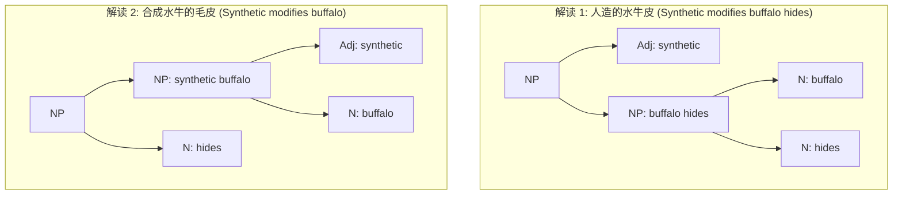
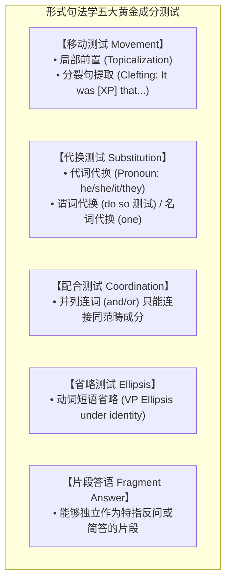
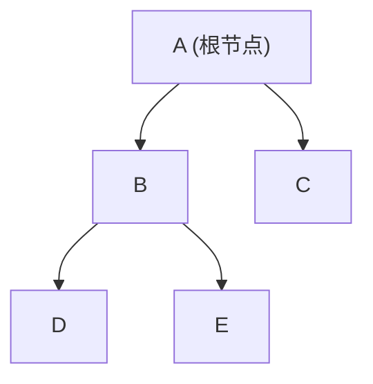
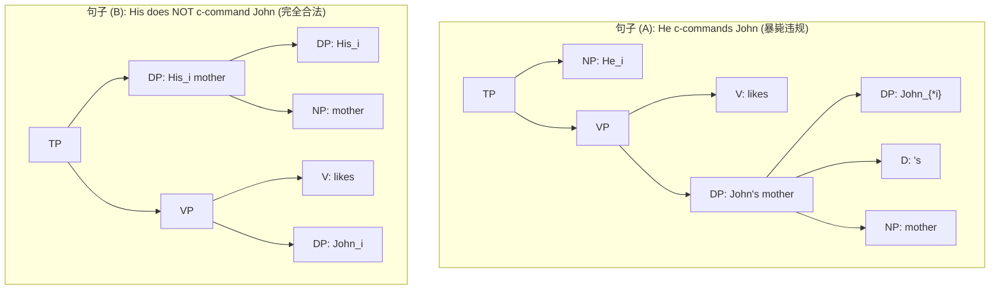

# Lec 1 语言的层级组织与二叉树形几何（The Hierarchical Organization of Language）

人类语言在物理表层上呈现为一维的时间声音流或线性的文字序列。然而，理论句法学自诺姆·乔姆斯基（Noam Chomsky）开创以来的最核心发现之一便是：**句子的内在心智表征绝非由词汇串联而成的扁平链条，而是由具有严格数学定义的抽象二叉树（Binary Trees）构成的多维层级系统（Hierarchical Organization）**。

在麻省理工学院 24.902 的第一讲中，Sabine Iatridou 教授引导我们跳脱直觉表象，通过结构歧义、成分测试与成分统领（c-command）的深层不对称性，确立形式句法学的第一原理。

## TL;DR

- 人类语言的心智真实性在于抽象层级几何，而非物理表层的线性前后邻接。
- 结构歧义（如 *unlockable*、*synthetic buffalo hides*）证明相同线性串可映射至不同层级树形。
- 五大经典成分测试（移动、代换、省略、配合、分裂句）形式化判定句法选块（Constituents）。
- 成分统领（c-command）作为核心几何关系，统治着约束原则 C 与量词辖域，证明线性顺序在心智计算中无解释力。

## 1. 线性序列假说的破产：结构歧义作为几何证据

如果人类大脑仅仅根据词汇的线性序列（Linear Precedence）计算语义，那么**相同的词汇排列且相同词性的序列，理应只能产生唯一确定的一种语义解读**。然而，自然语言中广泛存在的**结构歧义（Structural Ambiguity）**无可辩驳地粉碎了这一扁平假设。

### 1.1 形态学与短语层级的微型平行

在形态学中，经典单词 *unlockable* 拥有完全相反的两种含义：
1. **解读 A（能够开锁的）**：$[_{\text{Adj}} \text{ unlock } [_{\text{Suffix}} \text{ -able }]]$
2. **解读 B（无法上锁的）**：$[_{\text{Adj}} [_{\text{Prefix}} \text{ un- }] \text{ lockable }]$

这种由于括号层级合并次序不同引起的歧义，在句法短语中同样成系统地出现：

::: example 经典结构歧义句对
考察英语名词短语：
$$\text{synthetic buffalo hides}$$
该短语存在两种截然不同的现实指涉：
- **解读 1（人造的水牛皮）**：修饰语 *synthetic*（人造的）直接修饰复合名词 *buffalo hides*（水牛皮）。牛是天然的，但鞣制出来的牛皮是人造皮革；
- **解读 2（合成水牛的皮）**：修饰语 *synthetic* 仅修饰 *buffalo*（合成水牛），整块 *[synthetic buffalo]* 再修饰 *hides*。这指涉一种基因工程合成生物的天然皮毛。
:::

线性假说无法解释为什么同样的三个单词在词性没有改变的前提下能引发截然不同的真值条件。唯一的科学结论是：**大脑在无意识中投射了两种不同的树形几何结构**。

---

## 2. 句法成分的经验证伪：五大黄金成分测试

句子不是任意词语片段的自由堆砌，而是由离散的、具有独立句法行为的子树结构——**成分（Constituent）**——递归合并而成。我们如何科学判定一个词串是否构成一个成分？

句法学采用严密的**成分测试（Constituency Tests）**。核心公理为：**只有作为一个整体成分的节点，才能被句法操作整体移动、代换或省略。**

### 2.1 测试实战：走上楼梯 vs. 查阅资料

考察表面词性序列完全相同的经典对比：
- 句子 (1)：*John walked up the stairs.*（约翰走上了楼梯。）
- 句子 (2)：*Mary looked up the number.*（玛丽查阅了电话号码。）

表面上均为：$\text{NP} + \text{V} + \text{P} + \text{Det} + \text{N}$。然而：

1. **移动测试（Topicalization / Clefting）**：
   - 句子 (1)：*Up the stairs, John walked!* ✅ / *It was [up the stairs] that John walked.* ✅（*up the stairs* 构成完整介词短语 PP 成分）；
   - 句子 (2)：*\*Up the number, Mary looked!* ❌ / *\*It was [up the number] that Mary looked.* ❌（*up* 是副词小品词 particle，*up the number* 根本不是句法成分！）。
2. **代换测试（*do so* 代换）**：
   - *John walked up the stairs, and Bill [did so] too.*（*did so* 代换了整个动词短语 VP *walked up the stairs*）；
   - *Mary looked up the number, and Sue [did so] too.*（*did so* 代换了 *looked up the number*，而不能保留 *up*：*\*Sue did so up the address* ❌）。

::: pitfall 成分测试的单向充分性
成分测试遵循**单向充分非必要原则**：
- 如果一个词串**通过**了某项合理的移动或代换测试，通常是其构成成分的强有力证据；
- 但如果一个词串**未能通过**某项特定测试，**不能直接反推它不是成分**！因为特定的功能性孤岛限制（Islands）、格位核准或语义禁令可能会独立阻断该句法操作。
:::

---

## 3. 树形几何结构关系与成分统领（c-command）

在建立二叉分支树形后，我们必须严格定义节点之间的几何关系。这是全课程后续格位理论、约束理论与孤岛限制的数学基石。

::: definition 支配与直接支配（Dominance & Immediate Dominance）
- **支配（Dominance）**：若在树形结构中，从节点 A 到节点 B 存在一条**单调向下**的分支路径，则称节点 A 支配节点 B（记作 $A \text{ dominates } B$）；
- **直接支配（Immediate Dominance）**：若 A 支配 B，且 A 与 B 之间不存在任何其他中间节点，则称 A 直接支配 B（即 A 是 B 的母节点 Mother，B 是 A 的子节点 Daughter）；
- **姊妹节点（Sisters）**：被同一个母节点直接支配的两个不同节点互为姊妹节点。
:::

在上图中：
- A 支配 B、C、D、E；
- A 直接支配 B 与 C（B 与 C 互为姊妹）；
- B 直接支配 D 与 E（D 与 E 互为姊妹）；
- C 与 D 之间不存在支配关系。

### 3.2 形式句法学的核心几何引擎：成分统领（c-command）

语言学家塔蒂阿娜·雷因哈特（Tanya Reinhart）在 1976 年确立了现代句法学最重要的几何关系——**成分统领（Constituent Command, c-command）**：

::: definition 成分统领（c-command）
对于树形结构中的任意两个节点 X 与 Y，当且仅当满足以下两条公理时，称 **X 成分统领 Y（X c-commands Y）**：
1. X 不支配 Y，且 Y 也不支配 X；
2. **直接支配 X 的第一个分叉母节点（First Branching Node）支配 Y**。
:::

简言之：**一个节点成分统领其姊妹节点，以及其姊妹节点所支配的所有后代节点！**

---

## 4. c-command 的心智现实性证明：约束原则 C

为什么人类心智会计算如此抽象的“分叉母节点支配”几何，而不是人类直觉最容易感知的“线性先后顺序”？  
Sabine Iatridou 教授展示了著名的**代词共指与约束原则 C 实验**。

考察指称表达式（R-expression，如专有名词 *John*）与第三人称代词（*he / his*）的共指可能性：

::: example 线性顺序 vs. c-command 决战
- **句子 (A)**：
  $$\text{He}_i \text{ likes John}_{*i}\text{'s mother.}$$
  （他喜欢约翰的母亲。——代词 *he* **绝对不能**指代约翰本人！）
- **句子 (B)**：
  $$\text{His}_i \text{ mother likes John}_i\text{.}$$
  （他的母亲喜欢约翰。——代词 *his* **可以完全合法地**指代约翰本人！）
:::

### 4.1 理论证伪：线性先后假说当场暴毙

如果人类大脑依赖线性顺序计算指称禁令（例如假定规则为“代词不能出现在其指代的名词之前”）：
- 在句子 (A) 中，代词 *He* 在线性物理顺序上位于专有名词 *John* 之前，违规；
- 在句子 (B) 中，物主代词 *His* **在线性物理顺序上同样出现在专有名词 *John* 之前**！按照朴素的线性假说，句子 (B) 的代词与名词共指也应该被判定为彻底违规！
然而，实验证据与全世界所有母语者的心理直觉完全一致：句子 (B) 中的代词与名词共指没有任何问题，自然且合法！

这一强烈的反差表明，人类心智在处理指称关系时，完全将表层的线性前后距离置之度外，而是严格依据树形分支的层级几何来进行成分统领判定。

在句子 (A) 中，主语位置的代词 *He* 是顶级时态短语 TP 的直接子节点。因此，直接支配它的第一个分叉母节点就是整棵树的根节点 TP。由于该根节点支配着包括宾语在内的全句所有成分，代词 *He* 自然而然地成分统领了位于及物动词后方的名词短语 *John*。

相反，在句子 (B) 中，代词 *His* 仅仅是主语名词短语 *[His mother]* 内部的一个限定说明语。直接支配 *His* 的第一个分叉母节点是局部的主语 DP，而绝非主句的顶级根节点 TP。这个局部母节点仅仅支配主语内部的 *His* 和 *mother*，其支配路径完全无法延伸到及物动词及其右侧的宾语 *John*。因此，在几何层面上，代词 *His* 根本不成分统领 *John*。下面的两棵树形对比清晰地展现了这两种截然不同的层次支配与统领范围：

### 4.2 几何树形解释：约束原则 C（Principle C）

::: theorem 管辖与约束原则 C（Principle C of Binding Theory）
**指称表达式（R-expression）在任何域内都不能被成分统领它的先行词绑定（必须处处自由，Free everywhere）。**
:::

1. **在句子 (A) 中**：
   - 代词主语 *He* 是 TP 的直接子节点；直接支配 *He* 的第一个分叉节点就是顶级根节点 **TP**；
   - 顶级根节点 TP 支配整棵树的右侧分支，因而**支配句末的名词 *John***；
   - 因此，**He 严格 c-command John**！代词成分统领同标 R-式，直接触犯原则 C，句子暴毙！
2. **在句子 (B) 中**：
   - 代词所有格 *His* 并不是主句 TP 的直接子节点，它是主语短语 *[His mother]* 内部的限定词说明语；
   - **直接支配 His 的第一个分叉节点是主语 DP [His mother]，而不是 TP**！
   - 这个主语 DP 只支配 *His* 和 *mother*，**根本不支配位于动词后方的 *John***；
   - 因此，**His 根本不 c-command John**！原则 C 未被触犯，代词与名词合法共指！

::: insight 句法几何的心智超越性
这一经典推导雄辩地证明：**人类大脑在处理日常口语时，根本不在意发音在时间轴上的先后毫秒，而是在一瞬间解析出了深层树状结构的成分统领路径。** 空间几何与层次分支才是普遍语法的真正母语。
:::

---

## 5. 二叉分支假说（Binary Branching Hypothesis）

在早期的短语结构规则中，学者们曾允许多叉分支（$n$-ary branching），例如允许一个 VP 同时直接分叉出动词、间接宾语与直接宾语：
$$\text{VP} \longrightarrow \text{V} \quad \text{NP}_1 \quad \text{NP}_2$$

然而，现代最简方案与理查德·凯恩（Richard Kayne）的反称理论（Antisymmetry Theory）确立了**严格二叉分支公理（Strict Binary Branching）**：

::: theorem 二叉合并原则（Binary Merge）
句法推导的基本运算只有**合并（Merge）**。Merge 每次在数学上只能取两个且仅两个句法对象 $\alpha$ 和 $\beta$，将其无序集合化为新的结构体 $\{\alpha, \beta\}$，并由其中一个成分投射其中心语特征。三叉或多叉分支在生理计算与形式逻辑上均被排除。
:::

在后续课程中我们将看到，所有的双宾语句、附加语修饰与连动结构，表面上的多论元现象，底层均通过轻动词（$v$P 壳层）与多层二叉树形完美分解。人类语言的全部离散无限性，正是建立在这样极其简洁的二叉递归机器之上。
