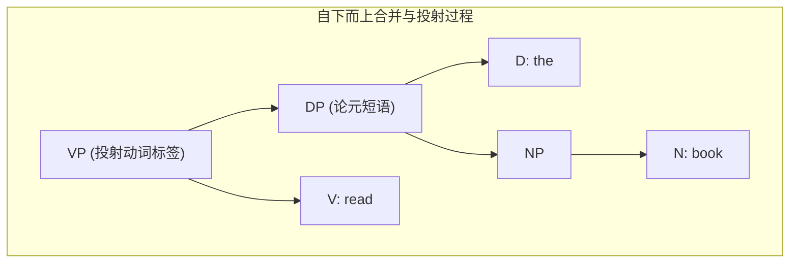
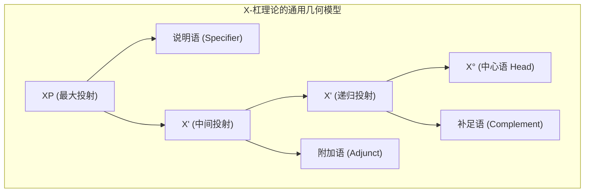
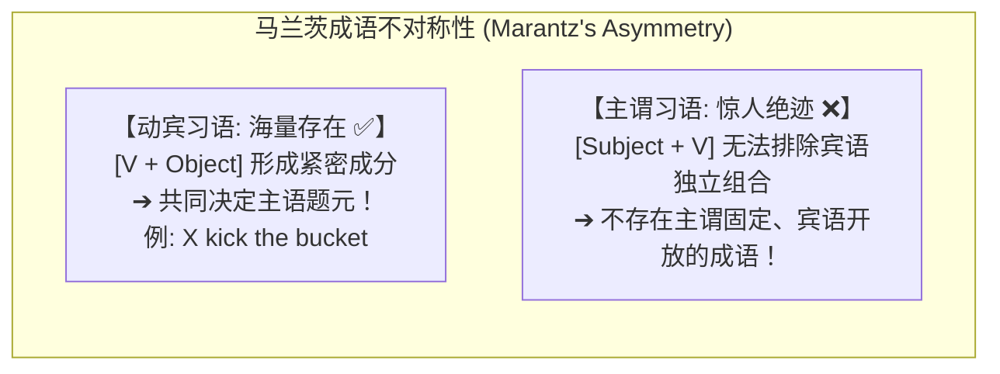

# Lec 2 树形构建、局部性与题元角色（Building Syntactic Trees, Locality Considerations & $\theta$-Roles）

在确立了语言心智表征的二叉层级本质之后，我们面临的核心课题是：**大脑中的句法计算机器究竟如何将词库（Lexicon）中的孤立词汇一步步合并为复杂的树形结构？这一组装过程受到哪些严格的局部性与语义选择限制？**

在 MIT 24.902 的第二讲中，Sabine Iatridou 教授系统讲授了自下而上的二叉合并（Merge）操作、中心语投射原则、范畴选择与语义选择（$c/s$-selection），并深入剖析了谓词对论元的**题元角色分派（$\theta$-Role Assignment）**及其背后的结构不对称性。

## TL;DR

- 句法树形遵循自下而上的递归合并（Merge），中心语（Head）决定生成短语的句法范畴标签。
- 严密区分范畴选择（$c$-selection）与语义选择（$s$-selection），破除词类搭配的直觉误区。
- 补足语（Complement）与附加语（Adjunct）存在本质几何差异：补足语与 $X^0$ 互为姊妹且唯一，附加语与 $X'$ 递归依附。
- 题元角色网格（$\theta$-grid）严格遵循局部性分派；马兰茨（Marantz）成语不对称性定理确证外论元是由 VP 整体复合赋予，而非词汇中心语直接分派。

## 1. 递归合并（Merge）与中心语投射（Projection）

现代生成语法将短语结构规则提炼为单一、无约束的核心运算——**合并（Merge）**。

::: definition 合并运算（Merge）
设 $\alpha$ 与 $\beta$ 为两个独立的句法对象（Syntactic Objects）。合并运算将其组合为一个新的无序集合 $K = \{\alpha, \beta\}$。在组合的同时，必须指定一个中心语（Head）将其范畴特征**投射（Project）**为新结构体的标签（Label）：
$$\text{Merge}(\alpha, \beta) \longrightarrow [_{\alpha} \ \alpha \ \beta ] \quad \text{或} \quad [_{\beta} \ \alpha \ \beta ]$$
:::

### 1.1 中心语的不可替代性（Endocentricity）

所有人类语言的短语结构均严格具有**向心性（Endocentricity）**。这意味着在句法中绝对不存在“无头短语（Exocentric Phrases）”或“随机复合体”。在任何一次合并操作中，合并后产生的新短语的句法性质、分布特征与外部选择要求，完全且唯一地由参与合并的核心词汇——即**中心语（Head, 记作 $X^0$）**决定：
- 动词短语（VP）的中心语必须是动词（V），其向外表现出谓词的全部句法潜能；
- 介词短语（PP）的中心语必须是介词（P），决定其在空间或格位上的修饰与论元角色；
- 限定词短语（DP）的中心语必须是限定词（D），控制其指称性与格位核准；
- 句子本质上是由屈折时态中心语（T）与标补中心语（C）主导的功能投射（TP 与 CP）。

在自下而上的生成过程中，底层的名词首先与限定词合并为论元短语 DP，随后该 DP 作为补足语与及物动词合并，动词的词汇特征决定了更高层级短语的 VP 标签，推导层次如下图所示：

---

## 2. 补足语（Complement）与附加语（Adjunct）的结构不对称

在 X-杠理论（X-bar Theory）的几何大厦中，初学者最容易混淆的概念是**补足语**与**附加语**的区别。它们在树形拓扑中占据完全不同的阶层：

| 句法维度 | 补足语（Complement） | 附加语（Adjunct） |
| :--- | :--- | :--- |
| **树形几何位置** | **$X^0$ 的直接姊妹（Sister to $X^0$）**，母节点为 $X'$ | **$X'$ 的直接姊妹（Sister to $X'$）**，母节点同样为 $X'$ |
| **数量限制** | **严格唯一（Unique）**，由中心语严格选定 | **可无限递归叠加（Iterative）** |
| **语义关系** | 核心论元（Argument），通常承担必不可少的 $\theta$-角色 | 修饰语（Modifier），提供时间、地点、方式等边际信息 |
| **与中心语间距** | 必须与中心语紧邻，不可被附加语插入 | 可以自由置于补足语之后或从句边缘 |

### 2.1 经典验证：语言学系的学生

考察短语：
$$\text{a student [of linguistics] [with long hair]}$$
1. *[of linguistics]* 是中心名词 *student* 的**补足语**（承担被学习的对象论元）；
2. *[with long hair]* 是修饰性的**附加语**。

**判定测试**：
- **顺序固化**：补足语必须紧贴中心语，附加语必须置于其外：
  - *a student of linguistics with long hair* ✅
  - *\*a student with long hair of linguistics* ❌（附加语非法插足 $X^0$ 与补足语之间！）
- **代词代换（*one*-substitution）**：
  *one* 只能代换 $X'$ 节点，绝不能代换孤立的 $X^0$ 中心语：
  - *I met the student of linguistics with long hair, and Mary met the [one] with short hair.* ✅（*one* 代换了 $X'$：*student of linguistics*）
  - *\*I met the student of linguistics, and Mary met the [one] of philosophy.* ❌（*one* 试图代换仅作为 $N^0$ 的 *student*，违背代换公理！）。

---

## 3. 谓词的选择限制：范畴选择（$c$-selection）与语义选择（$s$-selection）

当动词进入句法推导时，它对所接成分施加了两套截然不同的过滤器：

::: definition 双重选择系统
1. **范畴选择（Category Selection, $c$-selection）**：谓词对补足语的**纯句法词类范畴（Syntactic Category）**提出的刚性要求（历史上称次范畴化 subcategorization）；
2. **语义选择（Semantic Selection, $s$-selection）**：谓词对补足语的**语义认知属性（Semantic Properties）**提出的实质要求。
:::

::: example 动词选择的不对称性
- **动词 *ask***：
  - $c$-selection: 允许接宾语 DP（*ask a question*）或从句 CP（*ask if it is raining*）；
- **动词 *wonder***：
  - $s$-selection: 语义上要求补足语必须是一个“疑问命题（Question）”；
  - $c$-selection: **严格要求从句 CP，坚决拒绝名词 DP**！
    - *I wonder [CP whether Mary arrived].* ✅
    - *\*I wonder [DP the question / the answer].* ❌（哪怕语义完全通顺，但因不满足 $c$-selection 仍彻底暴毙！）
- **动词 *rely***：
  - $c$-selection: 必须强制选定由介词 *on* 引导的介词短语 PP（*rely on John*；*\*rely John* ❌，*\*rely with John* ❌）。
:::

---

## 4. 题元角色（$\theta$-Roles）与语义网格（$\theta$-Grid）

谓词是句子的逻辑核心。动词在词库中注册时，携带着一份**题元网格（$\theta$-Grid）**，规定了该动词必须赋予各个论元的语义参与者身份：

| 题元角色 | 核心语义定义 | 经典例句 |
| :--- | :--- | :--- |
| **施事（Agent）** | 具有自主意愿、蓄意发起动作的行为者 | **John** kicked the ball. |
| **受事（Theme / Patient）** | 承受动作影响、发生状态改变或空间位移的实体 | John kicked **the ball**. |
| **心理体验者（Experiencer）** | 感知心理、情绪或生理状态的有意识主体 | **Mary** fears spiders. |
| **目标（Goal）** | 动作导向的物理或抽象终点 | Mary sent a letter to **Bill**. |
| **源头（Source）** | 动作起源的初始位置或始发者 | Bill came from **Chicago**. |
| **工具（Instrument）** | 施事用来执行动作的物理中介物 | John opened the door with **a key**. |
| **处所（Location）** | 事件发生的空间物理背景 | The book lies on **the table**. |

::: definition 题元分派的局部性公理（Locality of $\theta$-Assignment）
**题元角色只能分派给谓词的姊妹节点（Sister），或分派给谓词最大投射的说明语（Specifier）。跨越从句边界的远程直接题元分派在句法上绝对禁止。**
:::

---

## 5. 外论元与内论元的鸿沟：马兰茨成语不对称性定理

根据传统语法直觉，大家往往认为动词同时拥有“主语”和“宾语”。然而，亚历克·马兰茨（Alec Marantz, 1984）在其里程碑式著作中提出了轰动语言学界的**成语不对称性定理（Idiom Asymmetry）**，揭示了**内论元（Internal Argument）**与**外论元（External Argument）**在心智中的深刻鸿沟。

### 5.1 震撼实证：全世界成语的单向倾斜

在英语乃至人类所有语言的词库中，我们可以毫不费力地找寻到成百上千个**由“动词 + 宾语”固化为隐喻、主语随意填入**的成语（VP Idioms）：

::: example 动宾复合决定主语题元
- *kick the bucket*（见上帝、死亡）：主语 $X$ 是经历死亡的实体；
- *spill the beans*（泄露秘密）：主语 $X$ 是泄密者；
- *break the ice*（打破僵局）：主语 $X$ 是缓和气氛者；
- *take the bull by the horns*（勇往直前）：主语 $X$ 是勇敢决断者。
:::

在这些成语中，**宾语的选择彻底改变了动词赋予主语的语义与题元角色**！动词与宾语紧密抱合，共同计算出一个全新的复合谓词。

### 5.2 反向成语的惊人绝迹

现在，请大家尝试去寻找一个**反向的成语（Subject-Verb Idiom）**：
> 即：**“主语 + 动词”是固定的习语，而宾语可以随意填入任何人或事物！**
> 例如想象一个假想的习语：*“The dog bites X”* 意思是 *“X 破产了”*（无论 X 是玛丽、彼得还是公司）。

**语言学实证表明：这种“主语+动词固定、宾语开放”的成语在全人类自然语言中几乎完全不存在（0%）！**

::: insight 马兰茨定理的核心理论推论
这一经验不对称性无可辩驳地证明：
1. **宾语（内论元）是动词的真论元**：动词在词库层面直接与内论元合并，并直接为其分派内部 $\theta$-角色；
2. **主语（外论元）根本不是孤立动词 $V^0$ 的词库论元**！外论元的题元角色是由已经合并完成的整个动词短语 **VP 整体复合赋予的**！
这就是为什么后续理论必须引入**动词短语内部主语假说（VP-Internal Subject Hypothesis）**与**轻动词 $v$P 壳层**——外论元是在更高的 $v$P 层次上被引入句法推导的。
:::
