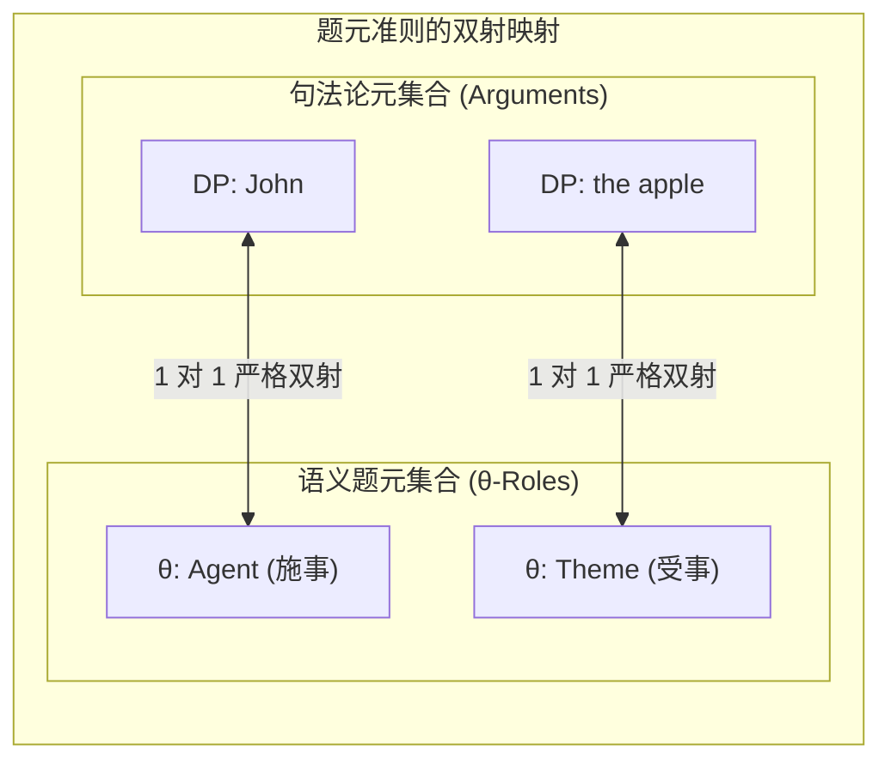
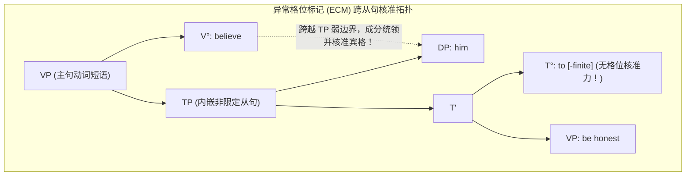

# Lec 3 题元准则、格位理论与结合论基础（$\theta$-Criterion, Case Theory & Binding Basics）

在建立了动词的题元角色（$\theta$-Roles）网格之后，一个核心的形式化约束问题摆在我们面前：**一个句子中能够出现多少个名词短语（DP）？这些名词短语是如何与动词的语义论元一一锁定的？为什么有些完全符合语义逻辑的名词在句法中却坚决无法存活？**

在 MIT 24.902 的第三讲中，Sabine Iatridou 教授深入推导了乔姆斯基（1981）的两大支柱理论——**题元准则（$\theta$-Criterion）**与**格位理论（Case Theory）**，并揭示了异常格位标记（ECM）以及冰岛语拟似格（Quirky Case）背后的深层计算逻辑。

## TL;DR

- 题元准则确立了论元与 $\theta$-角色的严格双射公理，彻底杜绝论元缺失或论元过载。
- 虚词（Expletives: *it, there*）完全没有 $\theta$-角色，其出现纯粹为了满足扩充投射原则（EPP）。
- 抽象格（Abstract Case）独立于表层词形屈折；格位过滤（Case Filter）作为显性名词短语的生存执照。
- 异常格位标记（ECM）展示了跨非限定从句边界指派宾格的能力，奠定后继移位理论基础。

## 1. 题元准则（The $\theta$-Criterion）的双射公理

在形式语义学与句法学的接口处，动词的题元网格与句子表层的名词论元之间必须满足严格的数学映射：

::: theorem 题元准则（The $\theta$-Criterion, Chomsky 1981）
1. **每个论元（Argument）必须承担一个且仅能承担一个题元角色（$\theta$-role）**；
2. **每个题元角色（$\theta$-role）必须分派给一个且仅能分派给一个论元**。
:::

这是一条严格的**一一双射（Bijective Mapping）**法则。任何违背该准则的句子都将在深层推导中暴毙：



### 1.1 违规案例分析

1. **论元过载（$\theta$-角色不足）**：
   - *\*John ate the apple the table.* ❌
   - 动词 *eat* 只有施事和受事两个 $\theta$-角色；第三个名词短语 *the table* 无法获得任何题元角色，直接暴毙于准则第 1 条！
2. **论元缺失（$\theta$-角色悬空）**：
   - *\*John put the book.* ❌
   - 动词 *put* 是三价动词（Agent, Theme, Location）；处所角色未分派，暴毙于准则第 2 条！
3. **单论元争夺多角色（贪婪违规）**：
   - *\*John hit.*（在非反身读音下）❌
   - *John* 不能同时兼任 *hit* 的施事和受事。如果一个人打自己，必须显性使用反身代词 *John hit himself* 来充当独立的受事论元。

### 1.2 虚词（Expletives）的例外之谜：EPP 的霸权

如果每个名词都必须有 $\theta$-角色，那么为什么英语中可以说：
1. *It is raining.*（在下雨。）
2. *There is a fly in my soup.*（我的汤里有一只苍蝇。）

这里的 *it* 和 *there* 是**虚词（Expletives / Dummy Pronouns）**。下雨是一个非论元事件，没有任何实体在“施展下雨动作”。  
为什么虚词不违反题元准则？
- **解答**：虚词**根本不是论元（Non-arguments）**！它在语义上完全是空的，没有所指，因此它**不要求**承担任何 $\theta$-角色；
- **但为什么它必须出现？** 因为人类句法中存在一条更底层的硬约束——**扩充投射原则（Extended Projection Principle, EPP）**：**时态从句（TP）的主语位置（$[Spec, TP]$）在句法上绝对不允许空置！** 虚词纯粹是句法为了填塞主语窟窿而临时空投的“占位符”。

---

## 2. 格位理论（Case Theory）与抽象格

为什么在很多没有表层格位屈折的语言（如现代英语中除代词外的普通名词）中，句法依然需要“格位”？

::: definition 抽象格（Abstract Case）与格位过滤（Case Filter）
- **抽象格**：普遍语法中由特定功能中心语向外核准（Check）或赋予的句法许可特征；
- **格位过滤（Case Filter, Chomsky 1981）**：
  $$\text{*Every phonetically realized DP must be assigned Abstract Case.}$$
  **任何在语音层有物理发音的名词短语（DP），如果未能获得格位授权，句子一律不合法！**
:::

格位就像是显性名词短语在句法中存活的“通行证”。即使语义完全通顺，若缺乏格位，名词也必死无疑。

### 2.1 结构格与固有格的对立

| 格位类型 | 核准机制（Licensing Condition） | 典型实例 | 跨移位稳定性 |
| :--- | :--- | :--- | :--- |
| **结构格（Structural Case）** | 仅取决于名词在树形结构中的**纯几何构形位置**，与题元角色完全脱钩 | **主格（Nominative）**：由限定时态 $T^0$ 核准；<br>**宾格（Accusative）**：由及物动词 $V^0$ 或介词 $P^0$ 核准 | **脆弱**：名词发生被动移位到主语位置时，格位自动从宾格转为主格 |
| **固有格（Inherent Case）** | 由特定词汇中心语在分派特定 $\theta$-角色时**捆绑赋予** | 给予动词分配给目标的**与格（Dative）**，或支配的**属格（Genitive）** | **坚固**：在移位过程中始终黏附在名词上，绝不改变（如冰岛语拟似格） |

```mermaid
graph TD
    subgraph CaseAssignmentMechanism ["结构格的两大中心核准源"]
        TP["TP (限定从句)"]
        T0["T° [+finite] (有屈折时态)"]
        Subj["DP (主语)"]
        VP["VP"]
        V0["V° (及物动词)"]
        Obj["DP (宾语)"]
        
        TP --> Subj
        TP --> T0
        TP --> VP
        VP --> V0
        VP --> Obj
        
        T0 -->|向 [Spec, TP] 指派| SubjNom["主格 (Nominative)"]
        V0 -->|向互为姊妹的补足语指派| ObjAcc["宾格 (Accusative)"]
    end
```

---

## 3. 冰岛语的震撼实证：拟似格（Quirky Case）

许多学者曾怀疑抽象格是否只是理论家的数学捏造。冰岛语（Icelandic）为固有格的存在提供了坚不可摧的跨语言铁证：

::: example 冰岛语非主格主语
在冰岛语中，某些特定心理动词强制要求主语携带与格（Dative）或宾格（Accusative）：
$$\begin{aligned}
&\text{Mér} & &\text{líkar} & &\text{hesturinn.} \\
&\text{Me.DAT} & &\text{likes} & &\text{the horse.NOM} \\
&\text{“我喜欢这匹马。”}
\end{aligned}$$
尽管 *Mér*（我）在表层呈现为与格，但多项严谨的句法测试（移位、反身代词绑定、省略测试）证明：**它百分之百占据着真正的句法主语位置（$[Spec, TP]$）**！
:::

更惊人的是，当这个非宾格/体验者动词被嵌入提升从句时，这个固有格不会被主从句的时态重写为普通主格，它被牢牢冻结在词汇论元中。这证明：**固有格直接植根于词库与 $\theta$-角色的初始分派，而结构格则是由功能范畴按树形几何结算。**

---

## 4. 异常格位标记（Exceptional Case Marking, ECM）

考察以下经典动词短语对比：
- 句子 (1)：*I believe [ that he is honest ].*（我相信他是诚实的。）
- 句子 (2)：*I believe [ him to be honest ].*（我相信他是诚实的。）

在句子 (2) 中，内嵌不定式从句是非限定的（non-finite *to*），**非限定时态 $T^0$ 没有能力核准主格**！因此，如果在从句内部试图使用代词主格，立刻触犯格位过滤：
$$\text{*I believe [ he to be honest ].} \quad \text{❌ (he 缺乏主格授权而暴毙)}$$

### 4.1 ECM 穿透机制

那么为什么代词宾格 *him* 在句子 (2) 中能够完全合法？
这就是著名的**异常格位标记（ECM）**：



- 主句及物动词 *believe* 是一个 ECM 动词；
- 不定式从句由于没有标补语 $C^0$（或者是一个极其透明的非限定小从句），主句动词 *believe* 能够**直接成分统领内嵌从句的主语 DP *him***；
- 主句动词将其富余的结构宾格，跨越从句边界赋予了该主语！

::: insight 格位理论的解释力
ECM 的存在证明了格位分派的独立性：**承担宾格的名词，其题元角色完全由内嵌从句的谓词（be honest）决定，但它的生存许可证（格位）却是由外部主句动词跨界供给的！** 题元与格位的这种解耦，正是管辖与参数理论最优雅的建树之一。
:::
