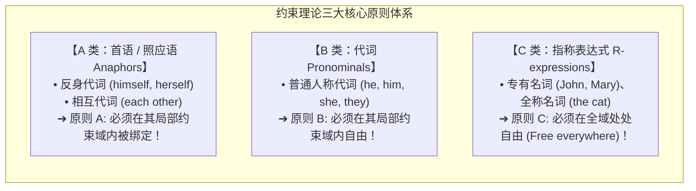
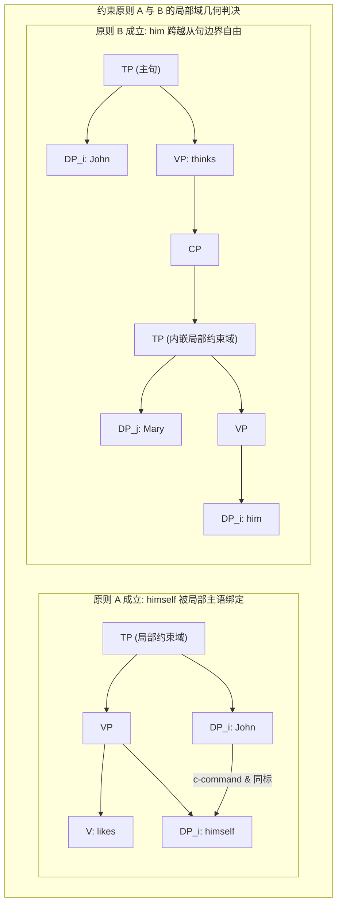
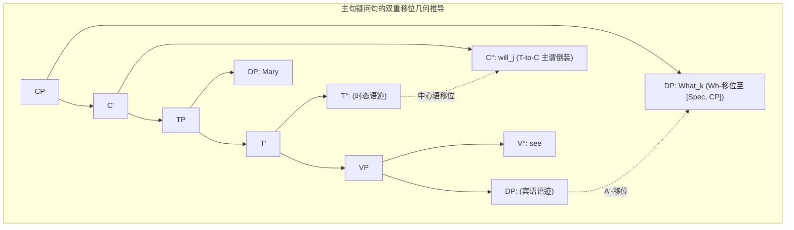

# Lec 4 管辖约束论（原则 A/B/C）与 Wh-移位基础（Binding Theory & Wh-Movement）

在自然语言的指称系统中，反身代词（*himself*）、普通代词（*him*）与专有名词（*John*）展现出了精密的互补分布规律。与此同时，人类语言拥有将句中成分移调至句首形成疑问句的惊人能力。这两类看似相隔千里的现象，在生成语法深层共享着同一套基于树形几何的运算机器。

在 MIT 24.902 的第四讲中，Sabine Iatridou 教授深入建立了**管辖与约束理论（Binding Theory）**的形式化公理，并以此为跳板，正式开启了人类句法最具魅力的核心领域——**句法移位（Syntactic Movement）与 Wh-疑问句系统**。

## TL;DR

- 结合（Binding）严格定义为“成分统领（c-command）+ 同指标记（Coindexation）”。
- 约束原则 A、B、C 形式化划定了反身代词（局域绑定）、普通代词（局域自由）与 R-式（处处自由）的排他性领地。
- 移位运算本质是内部合并（Internal Merge），在源位置留下不可见的语迹（Trace）或待删除的底层拷贝。
- 疑问句推导确立了主句疑问倒装（T-to-C 移位）与内嵌从句原序的结构分流。

## 1. 约束理论（Binding Theory）的形式化大厦

在日常语言交流中，人类说话者能够轻而易举地判断两个代词或名词是否指代客观世界中的同一个人。句法学并不直接关心客观实体本身，而是研究大脑如何在形式语法中为名词短语指派抽象的下标索引（Index），并通过纯粹的树形几何条件来判定这些下标在何种结构环境下可以重合，在何种结构环境下被绝对禁阻。

::: definition 结合（Binding）的形式化定义
对于树形结构中的任意两个名词短语 A 与 B，当且仅当满足以下两个充要条件时，称 **A 绑定 B（A binds B）**：
1. **A 成分统领 B（A c-commands B）**；
2. **A 与 B 携带相同的指称下标（A and B are coindexed, i.e., $A_i \dots B_i$）**。
若一个名词短语未被任何成分绑定，则称其为**自由的（Free）**。
:::

根据名词性短语内在词法特征与照应特性的不同，普遍语法将所有名词性成分穷尽性地划分为三大互斥的自然类，分别受制于三大相互独立的普遍约束公理：照应语要求在最近的局部领域内寻找统治者；普通代词坚决拒绝在近距离内被统领；而承载独立所指的指称表达式则具有最高的自由度，在整棵树的任何角落都不可被成分统领它的成分绑定。三者的结构约束体系如下所示：

### 1.1 局部约束域（Binding Domain）的精确边界

什么是原则 A 和原则 B 适用的“局部约束域”？在乔姆斯基（1981）的标准管辖与约束理论中，局部约束域（Governing Category）被形式化定义为：**包含该目标名词、该名词的管辖者（Governor，通常是向其分派格位或题元角色的动词、介词或限定时态）、以及一个可及主语（Subject）的最小完整功能复合体（Complete Functional Complex, CFC，通常表现为最小的定态时态从句 TP 或带有所有格说明语的名词短语 DP）**。

原则 A 与原则 B 在这一局部从句界限上呈现出近乎完美的镜像互补对立：反身代词必须在这一闭合边界内找到成分统领它的同标先行词，否则便会因“未受绑定”而无法获得解释；相反，普通人称代词如果在此边界内遭遇同标的统领成分，便会直接触发“原则 B 违规”。因此，当且仅当代词跨越内嵌从句边界、将其先行词置于外部主句时，普通代词才重新恢复合法性：

::: example 原则 A 与原则 B 的互补对立
考察最简局部从句 `[TP John likes ... ]`：
1. *John$_i$ likes himself$_i$.* ✅
   - 反身代词 *himself* 在其局部域 TP 内部被主语 *John* 成分统领且同标，**满足原则 A**！
2. *\*John$_i$ likes him$_i$.* ❌
   - 普通代词 *him* 在其局部域 TP 内部被主语 *John* 成分统领且同标，直接违反原则 B（代词在局部域内必须自由），暴毙！
3. *John$_i$ thinks [TP that Mary likes him$_i$ ].* ✅
   - 在内嵌从句中，代词 *him* 的局部约束域是内嵌 TP；在内嵌 TP 内部没有任何成分成分统领它；主句的 *John* 远在局部域外部，**代词完全自由，完美符合原则 B**！
:::

下面的两棵树形图直观对比了反身代词在单层从句内部获得局部绑定，与普通人称代词跨越内嵌从句边界在主从层级间获得合法的非局部指称关联：

---

## 2. 句法移位（Movement）：从外部合并到内部合并

在传统的生成语法中，移位被视为将深层结构（D-Structure）转换为表层结构（S-Structure）的转换规则。而在现代最简方案框架下，移位被还原为最优雅的运算：**内部合并（Internal Merge）**。

::: definition 内部合并（Internal Merge / Move）
设某句法树构建至某一阶段，句法运算从当前已经生成的树形结构内部**复制（Copy）**一个子节点 $\alpha$，并将其重新**合并**到顶级根节点上：
$$\text{Internal Merge}: \ [_{\text{root}} \dots \alpha \dots ] \longrightarrow [_{\text{new root}} \ \alpha \ [_{\text{root}} \dots \langle \alpha \rangle \dots ] ]$$
留在底层的原始位置被称为**语迹（Trace, 记作 $t$）**，在现代语意下即为底层拷贝（Copy）。
:::

---

## 3. Wh-疑问句推导与主从句拓扑不对称

在英语中，疑问句的构建展现了极具规律的移位分流机制。

### 3.1 内嵌疑问句（Embedded Questions）：纯粹的 Wh-移位

考察动词 *wonder* 引导的间接宾语从句：
$$\text{I wonder [CP who Mary saw } t \text{ ].}$$

1. **初始底层合并**：动词 *saw* 与及物宾语疑问词 *who* 合并为 VP，主语 *Mary* 与时态合并为 TP：
   $$[_{\text{TP}} \text{ Mary saw who } ]$$
2. **标补语引入**：带有 $[+Q]$（疑问特征）的功能中心语 $C^0$ 引入推导，激活其说明语位置的需求；
3. **Wh-移位执行**：疑问词 *who* 从宾语底层位置移位至 $[Spec, CP]$：
   $$[_{\text{CP}} \text{ who } [_{\text{C'}} \ C^0 \ [_{\text{TP}} \text{ Mary saw } t_{\text{who}} ] ] ]$$
   **注意**：在内嵌从句中，主谓语序（*Mary saw*）保持原样，无需发生任何助动词倒装！

### 3.2 主句独立疑问句（Matrix Questions）：Wh-移位叠加 T-to-C 倒装

考察直接反问的主句结构：
$$\text{What will Mary see?}$$

在此类主句特指疑问句中，句法推导呈现出更为复杂的双重移位机制。句子首先在底层经历常规的论元合并：及物及宾语疑问词 *what* 在及物动词 *see* 的补足语位置接受受事 $\theta$-角色，助动词 *will* 占据时态中心语 $T^0$，主语 *Mary* 占据 $[Spec, TP]$。当最高层的问句标补语 $C^0$ 引入推导时，它携带着强大的非完形特征（如强烈的疑问算子特征与屈折核准需求）：

1. **A'-短语移位**：疑问词短语 *what* 执行长距离抽取，作为算子移入标补语说明语位置 $[Spec, CP]$；
2. **中心语移位（T-to-C）**：处于时态位置的助动词 *will* 受到 $C^0$ 的吸引，发生主谓倒装（Subject-Auxiliary Inversion, SAI），向上附着到 $C^0$ 位置，从而直接跨越了主语 *Mary*！

主句与从句在这两类移位上的不对称性（内嵌从句严禁 T-to-C 倒装，而主句强制要求倒装）反映了普遍语法对独立命题与从属命题在功能中心语层级上的严密管控。完整的主句疑问句双重移位推导树形几何如下所示：

::: insight 语迹的心理现实性
移位并非将原来的单词“物理抠掉并瞬间消失”。大量的语音收缩实验（如 *wanna*-contraction）与重建效应表明：底层被移动走的语迹在心智中作为一个完整的无声拷贝依然持续发挥着阻断或约束作用。句法机器从未丢失过它曾经存在过的坐标。
:::
