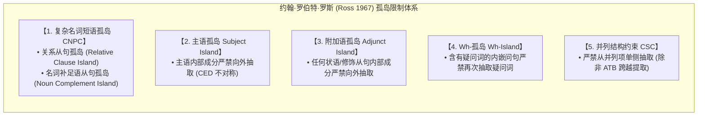
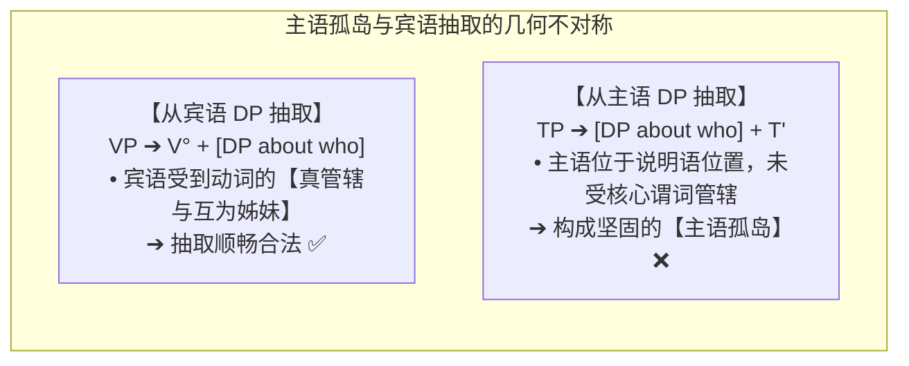

# Lec 5 孤岛效应与移位限制公理（Islands and Movement Restrictions）

在表面上看，句法移位似乎具有无限跨越从句的“无边界性（Unboundedness）”：我们可以毫不费力地造出跨越三个、四个甚至十个内嵌从句的长距离疑问句（*Who do you think [that Mary said [that Peter believes [that Bill saw t ]]]?*）。

然而，句法移位绝非不受约束的狂野飞行。在 MIT 语言学史上最著名的博士论文之一中，约翰·罗伯特·罗斯（John Robert Ross, 1967）发现：**自然语言中存在一系列特定的句法结构盲区，任何成分一旦被封装其中，就如同比置入了一座与世隔绝的“孤岛（Island）”，外界无论施加多么强大的移位力量，都绝对无法将其从中强行抽取出来！**

在 MIT 24.902 的第五讲中，Sabine Iatridou 教授系统解析了五大经典孤岛限制及其作为“句法移位试金石”的科学判定价值。

## TL;DR

- 长距离移位看似无限自由，但受到普遍语法严格的孤岛禁令（Island Constraints）强力管束。
- 复杂名词短语孤岛（CNPC）与附加语孤岛（Adjunct Island）构成不可逾越的绝对屏障。
- 主语孤岛（Subject Island）揭示了主语位置与宾语位置在抽取能力上的深层结构不对称。
- 并列结构约束（CSC）禁止单边抽取，但全面跨越提取（ATB）展现出惊人的对称性豁免。
- 孤岛效应是检验一个句法依存是否发生“真实移位”的终极试金石。

## 1. 移位的无边界表象与破裂

考察标准的顺畅长距离移位：
$$\text{Who}_i \text{ do you think [ that Mary said [ that Bill saw } t_i \text{ ] ]? \quad ✅}$$
疑问词 *who* 跨越了两道主从句边界（CP），句子完全合乎语法。早期的转换语法学家曾由此认为移位是一种无条件的全局操作。

然而，一旦我们在内嵌从句中引入某些特定的句法结构，移位便会瞬间发生灾难性崩溃：

::: example 孤岛违规的灾难现场
- 句子 (1)：*You saw [DP a man [CP who likes Mary ]].*（你看见了一个喜欢玛丽的男人。——合法陈述句）
- 尝试对其宾语 *Mary* 提问进行 Wh-移位：
  $$\text{*Who}_i \text{ did you see [DP a man [CP who likes } t_i \text{ ]] ? \quad ❌ \ \text{(极度严重违规！)}}$$
:::

为什么句子 (1) 中明明与动词相隔不远的名词，却连一道从句都无法跨出？因为该成分被锁闭在了一座**孤岛**内部！

---

## 2. 罗斯五大经典孤岛限制体系

### 2.1 复杂名词短语孤岛（Complex NP Constraint, CNPC）

::: definition 复杂名词短语限制（CNPC）
**任何成分都不能从被限定词/名词短语（DP/NP）所支配的从句（CP）中移位抽取出来。**
:::

CNPC 包含两类经典变体：
1. **关系从句孤岛（Relative Clause Island）**：
   - *John read [DP the book [CP which criticized Chomsky ]].*
   - *\*Who did John read [DP the book [CP which criticized $t$ ]]?* ❌（试图抽取关系从句修饰语内的宾语，绝对暴毙！）
2. **同位语/名词补足语从句孤岛（Noun Complement Island）**：
   - *Mary heard [DP the rumor [CP that Bill stole the diamond ]].*
   - *?\*What did Mary hear [DP the rumor [CP that Bill stole $t$ ]]?* ❌（试图抽取抽象名词 *rumor / claim / fact* 的补足语从句内容，严重违规）。

### 2.2 主语孤岛（Subject Island）与论元不对称

主语孤岛展示了**主语位置**与**宾语位置**在句法几何上的剧烈不公（黄正德 C. -T. James Huang 1982 提出的“抽取域条件 CED”）：

::: example 主宾抽取的不对称性
- **从宾语 DP 内部抽取（完全顺畅 ✅）**：
  - *Who did you hear [DP stories about $t$ ]?* ✅
- **从主语 DP 内部抽取（当场暴毙 ❌）**：
  - *\*Who did [DP stories about $t$ ] terrify you?* ❌
:::

### 2.3 附加语孤岛（Adjunct Island）

附加语（状语从句、分词修饰语）只是句子的外围修饰成分，并未在深层参与核心题元网格的构建。因此，**所有附加语都是坚不可摧的孤岛**：
- *Mary was crying [CP because John lost the car keys ].*
- *\*What was Mary crying [CP because John lost $t$ ]?* ❌
- *Bill fell asleep [CP while reading the syntax book ].*
- *\*Which book did Bill fall asleep [CP while reading $t$ ]?* ❌

### 2.4 Wh-孤岛（Wh-Island）与通道阻塞

当一个内嵌从句本身已经是一个疑问句时，该从句的标补语说明语位置（$[Spec, CP]$）已经被第一个疑问词占据：
- 考察基础句：*John wonders [CP who bought the car ].*
- 尝试将其宾语 *the car* 前置反问：
  $$\text{*What}_k \text{ does John wonder [CP who}_i \text{ [ } t_i \text{ bought } t_k \text{ ]] ? \quad ❌}$$

::: insight 极小移位与通道阻塞
Wh-孤岛的成因在后来的理论中被统一为**极小移位原则（Shortest Move）**：所有跨从句的长距离 Wh-移位，都必须借道内嵌从句的 $[Spec, CP]$ 作为中转跳板（Escape Hatch）。如果该中转站已经被 *who* 占领，后来的 *what* 无法停靠，强行越级跳跃将触发极其漫长的违规跨度！
:::

---

## 3. 并列结构约束（CSC）与跨越提取（ATB）奇迹

罗伯特·罗斯指出的第五大限制是**并列结构约束（Coordinate Structure Constraint, CSC）**：

::: theorem 并列结构约束（CSC）
在由并列连词（*and, or*）构成的并列结构中：
1. **不能单独抽取整个并列项**：*\*What did John eat [ [apples] and $t$ ]?* ❌
2. **不能单独从某一个并列项内部抽取成分**：*\*Who did John see [ [Mary] and [friends of $t$] ]?* ❌
:::

### 3.1 惊人的豁免：全面跨越提取（Across-The-Board, ATB）

然而，自然语言中存在一个令人叹为观止的例外——**全面跨越提取（Across-The-Board, ATB Exception）**：
> **如果一个移位操作同时从所有的并列项中完全对称地抽取相同的成分，CSC 限制被神奇地整体豁免！**

::: example ATB 对称抽取
考察句子：
$$\text{Which book}_i \text{ did John [ [ recommend } t_i \text{ ] and [ Mary criticize } t_i \text{ ] ] ? \quad ✅}$$
- 单独抽取任何一边都会使句子崩溃；
- 但由于 *Which book* 同时且对称地作为 *recommend* 和 *criticize* 的宾语并置移出，大脑判定该结构在逻辑与句法上完全平衡，句子变得无懈可击！
:::

---

## 4. 科学方法论：孤岛效应作为“移位试金石”

在理论语言学研究中，孤岛效应最重要的科学使命在于提供了一枚**诊断试剂**：
> **如果一个未知的句法依存现象对孤岛敏感（即无法穿透复杂名词短语、附加语或主语），那么该现象在深层必定涉及真实的句法移位（Internal Merge）！反之，如果该依存能够无视孤岛，则它必然是通过非移位的共指或关联机制建立的。**

孤岛效应将理论语言学彻底推向了可以像生物学检验蛋白质、化学检验元素一样进行精确证伪的硬核实证科学。
