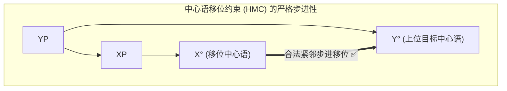
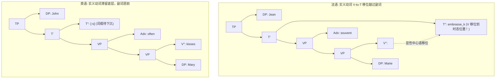

# Lec 6 动词移位：V-to-T、T-to-C 与 Do-支持机制（Verb Movement: V-to-T & T-to-C）

在前面的讨论中，我们接触的移位操作主要是短语级移位（XP-Movement，如名词短语 DP 或疑问词短语 Wh-XP 移位至说明语位置）。然而，生成语法另一个同等关键的分支是**中心语移位（Head Movement, $X^0$-Movement）**。

在 MIT 24.902 的第六讲中，Sabine Iatridou 教授引导我们聚焦让-伊夫·波洛克（Jean-Yves Pollock, 1989）关于法英语动词移位的划时代论文，剖析**V-to-T 移位**、**分裂 Infl 假说**、以及英语中极其独特的**助动词倒装与 *Do*-支持（Do-support）挽救机制**。

## TL;DR

- 中心语移位受制于中心语移位约束（HMC），中心语只能移至紧邻的上位中心语，严禁越级跳跃。
- 英法副词位置对比铁证揭示了参数差异：法语实义动词显性移位至 $T^0$，英语实义动词滞留于 VP 底层。
- 英语否定词 *not* 作为独立投射，阻断了屈折时态向下的词缀跳跃（Affix Hopping）。
- 英语 *Do*-支持是普遍语法中经典的“最后手段（Last Resort）”：在屈折词缀悬空濒死时空投无语义助动词以完成形态拼读。

## 1. 中心语移位（Head Movement）与局部性公理

中心语移位与短语移位在几何上有本质区别：
- 短语（XP）移位永远移动到上位投射的**说明语位置（Specifier）**；
- 中心语（$X^0$）移位只能与紧邻的上位**中心语（$Y^0$）发生词法级附着（Adjunction）**！

::: theorem 中心语移位约束（Head Movement Constraint, HMC, Travis 1984）
**中心语 $X^0$ 只能移动到直接成分统领它的最近中心语 $Y^0$ 中。中心语移位绝对不能跳过任何中间中心语节点！**
:::

---

## 2. 英法副词位置对比与波洛克（Pollock 1989）的重大突破

在表面日常交流中，法语与英语的句子结构看起来极其相近。然而，让-伊夫·波洛克通过一组极其优雅的**副词插入测试（Adverb Placement）**，揭示了两门语言在深层句法参数上的根本分歧。

### 2.1 频率副词的位置之谜

考察频率副词（*often / souvent*）与动词、宾语的相对语序：

::: example 英法动副语序大碰撞
- **法语（French）**：
  $$\begin{aligned}
  &\text{Jean} & &\text{embrasse} & &\text{souvent} & &\text{Marie.} & &\text{✅} \\
  &\text{*Jean} & &\text{souvent} & &\text{embrasse} & &\text{Marie.} & &\text{❌}
  \end{aligned}$$
  **语序必定为：动词 > 副词 > 宾语！**
- **英语（English）**：
  $$\begin{aligned}
  &\text{John} & &\text{often} & &\text{kisses} & &\text{Mary.} & &\text{✅} \\
  &\text{*John} & &\text{kisses} & &\text{often} & &\text{Mary.} & &\text{❌}
  \end{aligned}$$
  **语序必定为：副词 > 动词 > 宾语！**
:::

### 2.2 理论推导：V-to-T 参数

为了统一解释这一语序分流，波洛克提出了跨语言句法学的经典假设：普遍语法为所有自然语言提供了统一的底层层级拓扑骨架。在所有语言的深层结构中，修饰动作方式与发生频率的副词（如 *often / souvent*）均作为高层附加语附着在动词短语的左边缘（即位于时态中心语 $T^0$ 与动词中心语 $V^0$ 之间）：
$$[_{\text{TP}} \text{ Subject } [_{\text{T'}} \ T^0 \ [_{\text{VP}} \text{ Adverb } [_{\text{VP}} \ V^0 \ \text{Object} ] ] ]$$

两门语言之所以在表层呈现出相反的语序，完全是由一个微观句法参数——**V-to-T 移位参数（Verb-to-Tense Parameter）**决定的：

1. **在法语中（强屈折时态形态驱动）**：
   法语拥有高度发达的动词人称和数屈折后缀系统。这些强屈折特征要求实义动词在显性句法推导中，必须**主动向上发生中心语移位，进入 $T^0$ 位置（V-to-T Movement）**以核准时态特征。在此移位过程中，动词自然而然地跨越了附着在 VP 顶部的副词 *souvent*，因而在表层必然呈现为“主语 + 动词 + 副词 + 宾语”的线性语序：`Jean [T embrasse_k] [VP souvent t_k Marie]`；
2. **在英语中（弱屈折形态惰性）**：
   现代英语的动词屈折形态已经极度简化（仅剩微弱的第三人称单数 *-s*）。波洛克指出，英语的时态中心语是“弱（Weak）”的，缺乏足够的引力在显性句法阶段将实义动词向上拉升。因此，英语实义动词在句法推导中**严禁发生 V-to-T 移位**！动词必须老老实实滞留在副词后方的 VP 底层，使得副词保持在动词前方：`John [T -s] [VP often kisses Mary]`。

下面的两棵树形并排对比，清晰地展现了中心语移位是如何直接重塑表层线性和动副间距的：

### 2.3 英语的例外：助动词的特殊特权

然而在英语中，如果动词是**助动词（Auxiliaries: *have, be*）**，它的行为就变得完全和法语一样：
- *John is often happy.* ✅（助动词 *is* 成功移位到副词 *often* 之前！）
- *John has often kissed Mary.* ✅（助动词 *has* 成功移位到 $T^0$！）

这证明：**中心语移位具备精确的词法驱动机制，语义贫乏的助动词比承载完整概念的实义动词拥有更高的句法迁移灵活性。**

---

## 3. 英语否定词与 *Do*-支持（Do-Support）的最后手段机制

既然英语实义动词无法向上移位到 $T^0$，那么时态屈折（如第三人称单数词缀 *-s* 或过去时 *-ed*）是如何与动词拼合的？

### 3.1 词缀跳跃（Affix Hopping / Lowering）

在肯定句中，停留在 $T^0$ 的屈折词缀在音系拼读阶段执行**词缀下沉（Affix Hopping）**，与紧邻的动词合并：
$$[_{\text{TP}} \text{ John } [_{\text{T}} \text{ -s } ] [_{\text{VP}} \text{ kiss Mary } ] ] \implies \text{John kisses Mary.}$$

### 3.2 否定词 *not* 造成的句法短路

当我们在句子中引入否定词 *not* 时，*not* 在句法中投射为一个独立的**否定短语（NegP）**，其中心语横亘在 $T^0$ 与 VP 之间：
$$[_{\text{TP}} \text{ John } [_{\text{T}} \text{ -s } ] [_{\text{NegP}} \text{ not } [_{\text{VP}} \text{ kiss Mary } ] ] ]$$

此时，灾难发生了：
1. **实义动词不能向上移位**：英语实义动词无法移至 $T^0$；即便试图移位，根据 HMC 约束，它也会被中间的否定词 *not* 迎头截击！
2. **词缀无法向下跳跃**：处于 $T^0$ 的抽象词缀 *-s* 无法跨越否定词 *not* 下沉至动词！因为形态融合要求严格的物理与句法临近性！

此时，屈折词缀 *-s* 悬空在 $T^0$ 孤立无援，直接触犯了**悬空词缀过滤器（Stray Affix Filter）**，整棵树面临彻底崩溃的死局！

### 3.3 经济原则下的“最后手段（Last Resort）”

为了挽救濒死的推导，普遍语法启动了最经典的紧急求生机制——**Do-支持（Do-support）**：
- 句法机器从词库中紧急征调一个在语义上完全空白、仅充当发音支架的虚动词 **do**，直接插入到 $T^0$ 的位置；
- 悬空的词缀 *-s* 瞬间找到了宿主，与 *do* 拼合成显性的 **does**；
- 于是，句子顺畅输出为：**John does not kiss Mary**！

::: insight 句法推导的经济性（Economy）
为什么肯定句不说 *\*John does kiss Mary*（在非强调重音下）？  
因为根据最简方案的**经济原则（Economy of Derivation）**：句法中绝对禁止无缘无故引入冗余操作。只有当词缀即将悬空暴毙的绝境下，*Do*-支持作为“最后手段（Last Resort）”才被允许强行介入！
:::
