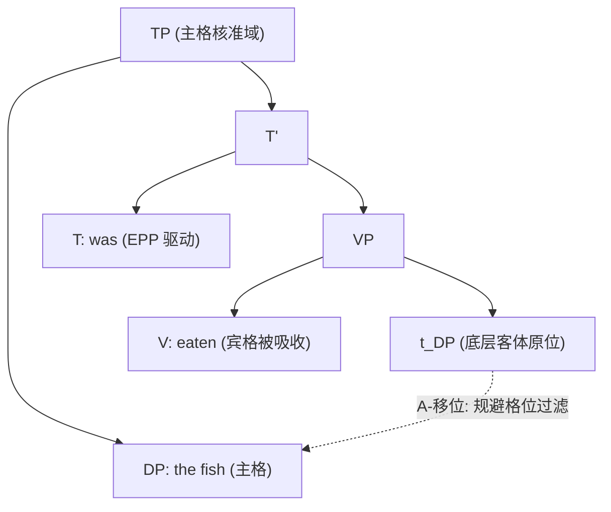
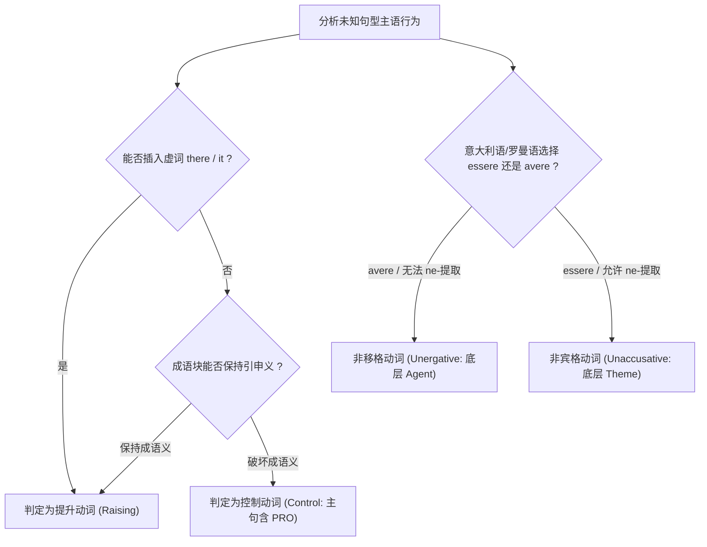

# Lec 07 论元移位与非宾格动词 (A-Movement & Unaccusatives)

在探索了中心语移位（Head Movement）与 Wh-非论元移位（A'-Movement）之后，本讲深入人类语言中另一大核心移位类型——**论元移位（A-Movement）**。通过对被动句、主语提升结构（Raising-to-Subject）以及非宾格动词（Unaccusatives）的精密推导，我们将揭示形态、题元角色分派与抽象格位过滤在句法计算中的协同运作。

## TL;DR

- **论元移位（A-Movement）的核心动力**：论元从潜在格位缺失的论元位置（如内嵌非限定句主语或动词补足语位置）移位至具有结构主格分派能力的论元位置（$[Spec, TP]$），由格位过滤（Case Filter）与 EPP 共同强制驱动。
- **提升动词与控制动词的严密诊断**：提升动词（*seem, appear*）不指派外部题元角色，允许成语块（idiom chunks）提升并保持习语意义，兼容虚词主语（*there/it*）；控制动词（*try, decide*）指派独立的主体题元角色，严禁虚词并破坏成语解读。
- **非宾格动词假说（Unaccusative Hypothesis）**：不及物动词并非同质，划分为非移格动词（Unergative，主体论元直接在外部生成）与非宾格动词（Unaccusative，客体论元在补足语位置底层生成并经由 A-移位提升至表层主语位），由意大利语助动词选择（*essere* vs *avere*）与 *ne*-附着词化实验提供严格实证。

## 论元移位与非论元移位的形式分野

生成语法将移位目标的着陆位（Landing Site）严格区分为**论元位置（A-position）**与**非论元位置（A'-position）**。

::: definition [A-位置与 A'-位置 (A-Position vs A'-Position)]
- **A-位置（Argument Position）**：句法树中潜在能够被指派题元角色（$\theta$-role）的规范结构槽位，最核心的代表即为有限分句的主语位置 $[Spec, TP]$ 以及谓词短语的内部补足语和指示语位置。发生至 A-位置的移位称为 **A-移位（A-Movement）**。
- **A'-位置（Non-argument Position）**：绝不接收题元角色的边缘或附加槽位，典型代表为互补成分短语指示语 $[Spec, CP]$ 以及各种短语的附加语位置（Adjunct）。发生至 A'-位置的移位称为 **A'-移位（A'-Movement）**。
:::

A-移位与 A'-移位在语言计算中展现出截然不同的结构特性：

| 特性维度 | 论元移位 (A-Movement) | 非论元移位 (A'-Movement) |
| :--- | :--- | :--- |
| **典型着陆位置** | $[Spec, TP]$（主语格位） | $[Spec, CP]$（标补词指示语） |
| **移位驱动核心** | 满足格位过滤（Case Filter）与 EPP | 核实算子特征（[+wh], [+focus], [+topic]） |
| **局部性限制** | 极度局部（不能跳过干预的限定从句或主语） | 允许跨从句连续循环移位（逐级跳跃） |
| **重建与约束** | 产生新的结合论结合域（产生新的 A-绑定） | 展现典型的重构效应（Reconstruction Effects） |

## 被动化与布尔齐奥概括

被动语态绝非单纯的语表修辞转换，而是动词形态学操作引发的深层句法论元重组。

### 被动化的句法推导

考察主动句与被动句的对立：

```text
(1) a. Active:  The cat ate the fish.
    b. Passive: The fish was eaten [t].
```

在生成语法分析中，被动分词形态（如英语中的 *-en/-ed*）施加了双重句法效应：
1. **吸收结构宾格（Absorption of Accusative Case）**：被动分词失去了向其直接补足语分派结构宾格的能力。
2. **压制/降级外部题元角色（Suppression of External $\theta$-Role）**：动词原本指派给外部论元的 Agent 角色不再指派给规范的 $[Spec, vP]$ 主语位置，只能以可选的介词短语（*by*-phrase）形式作为附加语出现。

由于补足语 DP *the fish* 无法在底层原位获得宾格，为了避免违反格位过滤（Case Filter），它必须在句法推导中移位至能够获得主格的有限分句 $[Spec, TP]$。这一推导展现了句法如何协调题元要求与形态格位要求：



### 布尔齐奥概括（Burzio's Generalization）

意大利语言学家 Luigi Burzio（1986）发现，被动句与非宾格动词中普遍存在动词指派外部题元角色的能力与其指派宾格的能力之间的强相关性：

::: theorem [布尔齐奥概括 (Burzio's Generalization)]
动词为其直接宾语分派结构宾格，当且仅当该动词为其指示语分派外部题元角色（Agent/Experiencer）。
$$\text{Assign External } \theta\text{-Role} \iff \text{Assign Structural Accusative Case}$$
:::

一旦被动形态压制了外部题元角色，布尔齐奥概括立即预测结构宾格随之消失。因此，底层内部论元必须被动提升。

## 提升结构 vs 控制结构

英语中存在表面序列完全相同的两类嵌入不定式句型：

```text
(2) a. Raising:  John seems [to be intelligent].
    b. Control:  John tried [to be intelligent].
```

尽管表面均为 `NP + V + to-VP`，但二者的句法树几何与论元结构具有本质差异。

### 提升动词（Raising-to-Subject Verbs）

提升动词如 *seem, appear, happen, likely* 是单价谓词（One-place Predicates）。它们只选择一个命题作为补足语（CP/TP），**不指派任何外部题元角色**。

由于内嵌从句为非限定不定式（Non-finite TP），其非限定 $T$ 无法分派主格；内嵌主语 DP *John* 陷入无格状态，必须 A-移位至主句 $[Spec, TP]$ 接收主句有限时态 $T$ 分派的主格：

$$\text{John}_i \text{ seems } [_{TP} \; t_i \text{ to be intelligent}]$$

### 控制动词（Subject Control Verbs）

控制动词如 *try, decide, attempt, refuse* 是二价谓词。它们不仅选择一个内嵌命题，**还必须在主句直接指派一个外部题元角色（Agent）给自己的主语**。

如果 *John* 是从内嵌从句移位到主句主语位置，那么 *John* 将同时在底层接收内嵌从句的 $\theta$-角色，并在主句接收 *try* 的 $\theta$-角色，这将直接崩溃**题元准则（$\theta$-Criterion）**的双射关系。

因此，控制句的主句主语是在主句原位生成的，内嵌从句的主语位置存在一个隐性代词范畴——**大 PRO**：

$$\text{John}_i \text{ tried } [_{CP} \; [_{TP} \; \text{PRO}_i \text{ to be intelligent}]]$$

### 四大经典经验诊断试金石

理论语言学家针对主语提升与控制句法构型的差异，构建了一套精密且具有可操作性的诊断测试体系。通过检验词项在语义与形态格位层面的不对称表现，能够清晰判定未知谓词的结构归属。

#### 1. 虚词主语分布（Expletive *There* and *It*）

虚词（*there, it*）是纯粹的形式符号，不携带语义，绝不能接收任何题元角色。在句法推导中，只有那些本身不向其主语位置分派外部题元角色的谓词，才允许虚词以合法手段填充 $[Spec, TP]$ 以满足扩充投射原则（EPP）。

```text
(3) a. There seems to be a man in the garden.   (提升动词：无外部题元角色，虚词合法)
    b. *There tried to be a man in the garden.   (控制动词：强加题元角色，虚词非法崩溃)
```

由于提升动词 *seem* 不分派外部角色，内嵌从句的虚词 *there* 可以顺利通过 A-移位提升至主句主语槽；相反，控制动词 *try* 必须向其主语强加 Agent 角色，而无语义虚词因无法承担该题元角色而直接导致推导在语义解释界面崩溃。

#### 2. 成语块意义保持测试（Idiom Chunk Preservation）

英语成语（如 *the cat is out of the bag* “真相大白”，或 *the shit hit the fan*）的非字面引申义必须在由谓词与论元构成的底层短语中完整结合才能获得。如果某个名词短语是在高阶主句位置直接生成的，它就无法在底层参与成语的特异性语义结合。

```text
(4) a. The cat seems to be out of the bag.
       --> 解读：真相似乎大白了（成语引申义完整保留）。
    b. #The cat tried to be out of the bag.
       --> 解读：那只猫试图从袋子里出来（仅保留字面野兽行为，成语义彻底丢失）。
```

在提升句 (4a) 中，*the cat* 底层在内嵌 VP 中生成并完成了成语题元绑定，随后才进行音系 A-移位；而在控制句 (4b) 中，*the cat* 必须作为 *try* 的主体生成，直接破坏了成语的底层语义结合。

#### 3. 被动化真值条件等价性（Truth-Conditional Equivalence）

考察内嵌从句被动化前后的真值等价性，能够检验矩阵主语是否具有独立参与命题的题元地位。如果主谓词不增添额外的实体题元角色，那么内嵌从句主动语态与被动语态的转换将不会改变整个复合句的真值条件：

```text
(5) a. A doctor seems to have examined John.
       <=> John seems to have been examined by a doctor. (真值条件完全等价)
    b. A doctor tried to examine John.
       </=> John tried to be examined by a doctor.       (真值条件完全不等价！)
```

在例句 (5b) 中，前句的主旨是在断言“医生在付出努力”，而后句则是在断言“John 在付出努力试图促成检查”。由于控制动词给不同的实体赋予了施事责任，二者的命题语义完全不等同。而在 (5a) 提升结构中，由于提升动词仅对内嵌完整命题进行评注，句子真值条件在被动变换下保持绝对等价。

这种深刻的结构差异在树形拓扑中有着清晰的可视化体现。提升结构展现的是单论元的跨时空移位轨道，其深层生成位置处于从句底层，通过句法移位填补主句空位；而控制结构展现的则是两个独立论元之间的约束指称链接，主句主语与从句隐性主语分别隶属于不同的命题谓词管辖域：

```mermaid
graph LR
    subgraph RaisingDiag ["提升动词 (Raising): seem"]
        R_Subj["主语 John (无外题元)"]
        R_Trace["底层语迹 t"]
        R_Trace -->|A-移位| R_Subj
    end

    subgraph ControlDiag ["控制动词 (Control): try"]
        C_Subj["主语 John (接收 Agent 角色)"]
        C_PRO["隐性 PRO (接收内嵌角色)"]
        C_Subj -.->|共指绑定 (Control)| C_PRO
    end
```

通过这一对比可以发现，提升结构中的移动论元始终保持单一题元身份，而控制结构中的先行词与从句主语则维持双重题元身份。这一测试构成了现代形式语义学与生成句法学界面研究中的经典标杆。

## 非宾格动词假说（The Unaccusative Hypothesis）

传统语法将动词分为及物动词（Transitive）与不及物动词（Intransitive）。然而，David Perlmutter（1978）与 Luigi Burzio（1986）提出了语言学史上极其深远的**非宾格动词假说**：传统的不及物动词在句法生成结构上分裂为两类性质完全相反的亚类。

::: definition [非移格动词与非宾格动词 (Unergatives vs Unaccusatives)]
1. **非移格动词（Unergative Verbs）**：
   - 包含动词如 *dance, run, laugh, shout, work*；
   - 拥有真正的**外部论元（External Argument, Agent）**，在 $[Spec, vP]$ 处基础生成；
   - 基础结构：$[_{vP} \text{DP}_{\text{Agent}} \; [_{VP} \text{V}]]$。
2. **非宾格动词（Unaccusative Verbs）**：
   - 包含动词如 *arrive, fall, melt, die, sink, exist*；
   - **完全没有外部论元**，仅拥有一个深层**内部论元（Internal Argument, Theme/Patient）**，在动词补足语位置底层生成；
   - 基础结构：$[_{VP} \text{V} \; \text{DP}_{\text{Theme}}]$；
   - 动词无法分派宾格（遵循布尔齐奥概括），导致底层内部客体必须经由 A-移位提升至 $[Spec, TP]$。
:::

### 跨语言经验实证

表面上看，英语中 *John danced* 与 *John arrived* 均为 `NP + V` 序列。我们如何证明 *arrived* 的主语原本是一个宾语？

#### 证据一：意大利语助动词选择（Auxiliary Selection）

在现代意大利语完成时态中，及物动词与非移格动词必须选择 *avere*（have）作为助动词，而所有非宾格动词和被动句必须选择 *essere*（be）作为助动词：

```text
(6) a. Gianni ha telefonato.        (非移格: Gianni has phoned)
    b. Gianni è arrivato.           (非宾格: Gianni IS arrived)
    c. Il libro è stato letto.      (被动句: The book IS been read)
```

这一对立直接印证：非宾格动词在推导上与被动句具有同构性，它们均属于“底层宾语的 A-移位提升”！

#### 证据二：意大利语附着词抽取（*ne*-Cliticization）

意大利语附着代词 *ne*（相当于 of-them / of-it）存在严格的句法提取限制：**它只能从动词的直接宾语（内部论元）中提取，绝对禁止从主语中提取**。

```text
(7) a. 及物动词直接宾语提取 (合法):
       Gianni ne ha visti [molti t].
       "Gianni of-them has seen many."

    b. 非移格动词主语提取 (严重非法):
       *Ne hanno telefonato [molti t].
       "Of-them have phoned many."

    c. 非宾格动词表层主语提取 (完美合法!):
       Ne sono arrivati [molti t].
       "Of-them are arrived many."
```

(7c) 的语法性构成非宾格假说的决定性铁证：表层主语在被提取时，在句法底层处于直接补足语位置，满足了 *ne* 抽取的结构限制！

::: pitfall [常见误区：非移格与非宾格的纯语义混淆]
许多初学者试图单纯依靠物理动作意志性来判定动词分类。虽然大部分非移格动词是意志动作（如 *jump*），大部分非宾格动词是非意志状态变化（如 *rot*），但句法分类是由**句法构型与论元拓扑**决定的。例如 *fall* 虽然表面上是不由自主发生的，但其句法本质是无外部致事论元；跨语言中某些非意愿动词在特定语言中可呈现非移格行为。形式证据（助动词、附着词、结果构式）永远高于直觉语义感受。
:::

::: insight [深度洞见：A-移位作为句法“解耦”的理论标杆]
A-移位的确立完成了现代生成句法学历史上一次重大的哲学与逻辑飞跃：它将**句法语义角色（$\theta$-roles）**与**句法表层形态位置（格位与主谓一致）**彻底**解耦（Decoupling）**。

在传统语言学甚至古典逻辑学中，主语（Subject）常被含糊地等同于“施事者（Doer）”。然而，A-移位向我们证明：
1. **一个论元“在何处被赋予意义”（Theme 角色在动词补足语处接收）；**
2. **与这个论元“在何处被赋予社会通行证”（在 $[Spec, TP]$ 接收主格以满足格位过滤和 EPP）；**
完全发生在两个不同的时间与结构位阶上！生成语法的精髓正在于：人类语言心智拥有跨越时空的移位拷贝机制，使单个词项能够穿梭于不同的功能投影之间，同时扮演命题语义参与者与外显形式核准者的多重角色。
:::

## 核心方法论与推导总结

面对自然语言中任何包含不定式从句或不及物动词的未知句法结构，分析者不应依赖粗浅的语感猜测，而应严格运用前述经验测试，依序判断谓词的论元指派潜能与结构生成路径。

整个诊断程序可以概括为包含形态、成语和跨语言投射的多阶段决策流程。首先，检验句子主语位置能否由纯功能性的虚词（如英语 *there* 或 *it*）填充，或者检验成语块在经过句式转换后能否继续保持非字面引申义；如果这两个检验均能顺利通过，则说明该谓词并不向主语位置指派外部题元角色，属于典型的主语提升谓词；若无法通过，则表明主句主语位置必须接收独立的施事或体验者题元角色，句法结构中必然存在隐性的大 PRO 范畴。

其次，针对简单不及物句，我们需要借助跨语言的形态标记与附着词提取法则。例如在意大利语或法语等罗曼语族语言中，考察动词在完成时态中是选择“拥有”类助动词（*avere*）还是“存在”类助动词（*essere*），并验证其弱化代词能否从表层主语短语中直接提取出来。若选择 *essere* 且允许代词提取，则无可争议地证明该不及物动词属于非宾格动词，其表层主语在底层句法树中原本处于动词的内部补足语位置：



这一整套严谨的论元诊断技术，不仅是生成句法学区分深层结构（D-Structure）与表层结构（S-Structure）的核心工具，也是跨语言类型学中分析复杂从句与非宾格现象不可或缺的方法论支柱。
