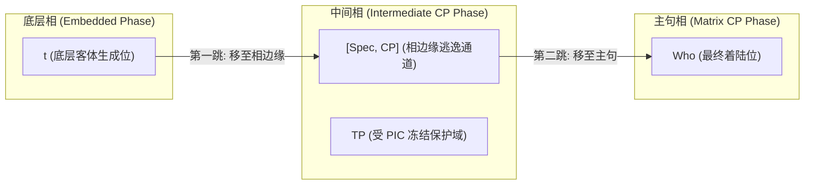
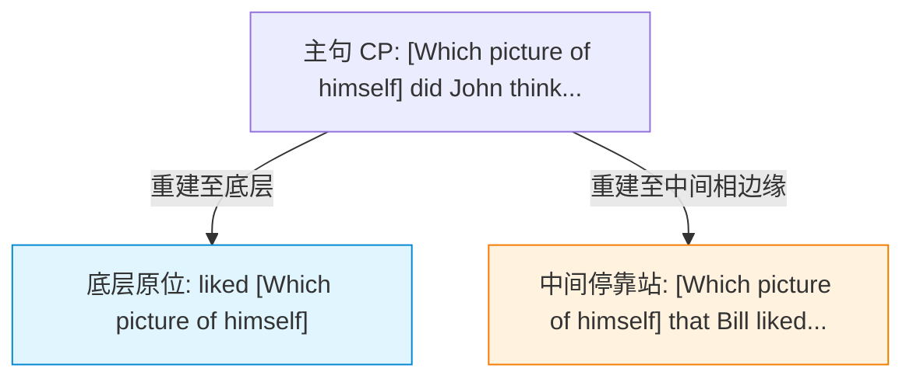

# Lec 08 移位深入：连续循环性与重建 (Successive Cyclicity & Reconstruction)

在前几讲中，我们观察到 Wh-移位可以跨越非常遥远的距离，例如从深层嵌套的内嵌从句直接提取至句首。然而，生成语法学最深刻的发现之一是：**句法运算中不存在任意维度的“超距瞬间移动”**。任何长距离跨从句移位，在物理底层都必须遵循极其严密的**局部性（Locality）**法则，以“小步快跑”的方式逐级穿过每一个从句边界。这种现象被称为**连续循环移位（Successive Cyclicity）**。

本讲将结合现代爱尔兰语、德语方言以及儿童语言习得中的惊人经验证据，证明中间着陆点（$[Spec, CP]$）的客观物理存在；同时通过约束理论在移位环境下的**重建效应（Reconstruction Effects）**，揭示句法拷贝在逻辑形式（LF）界面的真实计算方式。

## TL;DR

- **连续循环移位（Successive Cyclicity）公理**：长距离非论元移位并非一步跨越多个从句，而是必须以每个分句的标补词短语指示语 $[Spec, CP]$ 为中转跳板逐级跃迁，严格遵循近邻条件（Subjacency）与相不可渗透性条件（PIC）。
- **跨语言形态留痕的强力实证**：爱尔兰语标补词在移位通道上呈现交替形态（中立标补词 *go* 全面被移位一致性标补词 *aL* 替代）；德语方言与儿童英语中普遍自发涌现的中间 Wh-拷贝（Wh-copying）直接证实中间停靠站的客观实在性。
- **重建效应（Reconstruction Effects）与结合论**：移位至句首的短语在逻辑形式（LF）界面能够“回落”到其底层语迹或中间中转站位置参与计算。反身代词在表层脱离管辖域却能合法绑定的现象，强力证明语迹拷贝在心智表征中的实际存在。

## 连续循环性：跨越深渊的句法跳板

考察以下英语长距离宾语提问句：

```text
(1) Who did John say [that Mary thought [that Bill saw [t]]]?
```

在这个句子中，疑问词 *who* 表面上直接从最深层的第三层从句跨越到了主句句首。在生成句法学的发展史上，关于这种长距离移位的生成机制曾有两种假说：

1. **单步长距假说（One-step Long Jump）**：Wh-词直接由底层位置一跃升入最高层 $[Spec, CP]$；
2. **连续循环假说（Successive Cyclic Movement）**：Wh-词必须在每个中间从句的标补词短语指示语（$[Spec, CP]$）位置暂时停靠，形成多步链条（Chain）：
   $$\text{Who}_i \dots [_{CP} \; t''_i \dots [_{CP} \; t'_i \dots [_{VP} \; \text{saw } t_i]]]$$

### 理论动因：近邻条件与相理论

为什么句法系统必须强制执行连续循环移位？

::: definition [近邻条件 (Subjacency Condition, Chomsky 1973)]
移位运算在单一推导步骤中，不能跨越超过一个**界限节点（Bounding Node）**。在英语中，界限节点通常为有限从句的 $TP$ 和限定名词短语 $DP$。
:::

如果 Wh-词试图一步完成跨从句移位，它将同时跨越多个 $TP$ 界限节点，直接违反近邻条件。唯有在每一层 $CP$ 的指示语位置建立逃逸通道（Escape Hatch），每次移动仅跨越单一 $TP$，整个长距离链条才能完全合法。

在现代最简方案（Minimalist Program）的**相理论（Phase Theory）**中，这一机制被赋予了计算复杂度的严格解释：

::: theorem [相不可渗透性条件 (Phase Impenetrability Condition, PIC)]
对于由强中心语 $H$（如标补词 $C$ 或轻动词 $v^*$）定义的相 $HP$，其补足语域（Domain）一旦完成组装，便立即送往语音（PF）与语义（LF）界面冻结并不可回溯。主控相外的探针（Probe）只能访问相边缘（Edge，即 $H$ 自身及其指示语 $[Spec, HP]$）：
$$\text{Domain of } H \text{ is inaccessible to operations outside } HP; \text{ only } H \text{ and its edge are accessible.}$$
:::

因此，内嵌从句中的任何成分要想被外层矩阵从句捕获，**必须在内嵌相关闭前移动到相边缘 $[Spec, CP]$**，否则将被不可逆地封锁在相内部！



## 经验铁证：中间着陆点的物理足迹

在标准英语中，中间语迹 $t'$ 是静默无声的，这曾让怀疑论者质疑连续循环移位是否只是理论家的数学虚构。然而，跨语言的实证语料为中间着陆点的客观物理存在提供了无可辩驳的证据。

### 证据一：现代爱尔兰语标补词交替（Irish Complementizer Alternation）

现代爱尔兰语（Modern Irish，研究见 McCloskey 1979, 2002）拥有世界上最著名的连续循环移位形态印记。在爱尔兰语中，陈述句内嵌标补词根据是否有移位发生展现出严格的形态交替：

- **中立陈述标补词 *go*（触发日蚀音变 Eclipsis）**：当该从句内部没有成分从中被提取时使用；
- **移位标补词 *aL*（触发轻化音变 Lenition）**：当且仅当有操作子（Operator）经过该标补词指示语 $[Spec, CP]$ 移位时使用！

考察爱尔兰语中的长距离提问句：

```text
(2) a. 无移位基底句:
       Deir siad [go síleann sé [go bhfeicfidh sé an long]].
       They say [that_go he thinks [that_go he will-see the ship]].

    b. 长距离 Wh-移位句:
       Cén long aL deir siad aL shíleann sé aL fheicfidh sé [t]?
       Which ship [that_aL they say [that_aL he thinks [that_aL he will-see t]]]?
```

在例句 (2b) 中，疑问短语 *Cén long*（哪艘船）从最底层提取。令人惊叹的是：**提取路径上的每一个内嵌从句标补词，全部整齐划一地由 *go* 突变为了 *aL*！** 

这一形态突变直接证明：移位短语绝对没有跳过任何一个中间从句，它在飞往句首的过程中，物理降落在了每一个中间 $[Spec, CP]$ 槽位，并与每一个 $C$ 中心语触发了特征一致核准（Spec-Head Agreement）。

### 证据二：德语方言与儿童语言中的 Wh-拷贝（Wh-Copying）

在许多德语方言、罗姆语（Romani）以及母语为英语的幼儿语言习得过程中，连续循环移位的中间语迹甚至会被**直接发音**出来：

```text
(3) a. 德语中介 Wh-拷贝句 (Wh-Copying in German):
       Wen glaubst du, wen sie gesehen hat?
       "Who do you think who she has seen?"

    b. 英语儿童早期发音 (Thornton 1990):
       Who did you think who Mary saw t?
```

成年人在表层发音时通常应用语音删略规则将中间语迹静默化，而儿童与部分方言说话者直接将停靠在中间 $[Spec, CP]$ 的拷贝读出。这提供了生物语言学视角下的直接证据：人脑句法运算器在生成长距离依存时，确实生成了包含中间节点的完整物理表征。

## 重建效应与结合论诊断

移位不仅留下了形态与语音的足迹，还在语义与结合论（Binding Theory）计算中留下了深层的几何回响。这就是**重建效应（Reconstruction Effects）**。

::: definition [重建效应 (Reconstruction Effects)]
一个移位到表层结构高阶位置的短语，在逻辑形式（LF）或结合论判定中，表现得就好像它仍然位于其深层底层位置（或某个中间着陆位置）一样。
:::

### 诊断一：反身代词对原则 A 的逆境拯救

回顾约束理论原则 A：反身代词必须在其局部域内被成分统领它的先行词所结合。

现在考察以下复杂的跨从句提问句：

```text
(4) [Which picture of himself_i/j] did John_i think [that Bill_j liked t]?
```

表层结构分析：
- 短语 *Which picture of himself* 已经移位到了全句最顶层的 $[Spec, CP]$；
- 在表层树形中，无论主句主语 *John* 还是从句主语 *Bill*，均无法成分统领（c-command）句首的反身代词 *himself*！
- 按照表层几何，该句本应灾难性地违反原则 A 而不可读。

然而，母语者的实际语感是：该句不仅完美合法，而且**反身代词 *himself* 既可以指代从句的 *Bill*，也可以指代主句的 *John*！**

这一现象如何解释？唯有借助**连续循环移位留下的拷贝与重建机制**：



1. **解读一（指代 *Bill*）**：Wh-短语在 LF 界面**完全重建回底层原位 $t$**。在底层原位，从句主语 *Bill* 在其局部结合域内直接 c-command 反身代词，完美满足原则 A！
2. **解读二（指代 *John*）**：Wh-短语**重建至中间标补词指示语位置 $[Spec, CP]$**。在主句结合域内，主句主语 *John* c-command 停靠在中间位置的拷贝，同样满足原则 A！

如果移位是单步直达跳跃而不存在中间停靠站，那么指代主句 *John* 的合法解读在理论上将变得完全不可解释。

### 诊断二：原则 C 违规的重建出血（Reconstruction Bleeding）

原则 C 规定：指称语（R-expression）在任何域内均不得被成分统领。

```text
(5) a. *He_i thinks that Mary liked [the picture of John_i]. (底层违反原则 C)
    b. *[Which picture of John_i] did he_i think that Mary liked t?
```

在例句 (5b) 中，表面上看，名词短语 *John* 已经移到了句首，脱离了代词 *he* 的成分统领管辖。然而，该句依然表现出严重的指称崩溃（*he* 不能与 *John* 共指）。

这是因为：Wh-短语被强制重建回底层补足语原位，使得代词 *he* 重新在几何上 c-command *John*，再次触发原则 C 违规。这证明**原则 C 的判定可以在移位重建后强制执行**。

### 诊断三：量词变项结合重建

考察量词提升与从句提取的相互作用：

```text
(6) [Which of his_i students] did [every professor]_i praise t?
```

代词 *his* 能够被全称量词短语 *every professor* 解释为受绑定的变项（即对每位教授 $x$，$x$ 表扬了 $x$ 的哪个学生）。要使量词能够绑定代词，量词在 LF 必须成分统领该代词。既然 Wh-短语在表层高于量词，这种可结合性再次无可辩驳地证明了 Wh-短语在计算界面重建回了动词补足语位置。

::: pitfall [常见误区：重建是字面上的“倒放物理移位”]
初学者容易将重建直观想象为“先在句法树中往上移，然后再物理往回搬运一次”。在最简方案的**拷贝理论（Copy Theory of Movement）**中，移位本质上是“内部合并（Internal Merge）”：系统并不是搬走原有成分留下一个空洞，而是制作了一个完全相同的副本！句法树中同时存在上层副本与下层副本。语音界面（PF）根据规则删除了下层副本的发音，而语义解释界面（LF）则根据结合论与算子辖域需要，决定激活哪一个副本进行解释。
:::

::: insight [深度洞见：无声语迹的心智实在性]
连续循环性与重建效应共同奠定了形式语言学的核心科学主张：**人类语言系统中的句法客体绝不仅限于可闻的声音振动**。

物理学通过引力透镜现象间接测定暗物质的存在；现代生成句法学同样通过爱尔兰语的标补词变调、儿童发音的中间拷贝以及结合论在 LF 处的精密重建，测定出了无声语迹（Traces / Copies）的几何坐标。人类的大脑并非线性的声学字符串解析器，而是一台在不可见的深层多维树形中高速执行递归合并与拷贝删略的生物计算机。
:::

## 核心推导全景梳理

长距离连续循环移位与重建效应的逻辑链条可以统一概括如下：

| 推导阶段 | 句法运算核心步骤 | 跨语言显性表征 / 界面效应 |
| :--- | :--- | :--- |
| **步骤 1：底层生成** | 词库合并至动词补足语位，建立基础题元依赖 | 确定深层题元网格与初始结合关系 |
| **步骤 2：相边缘跃迁** | 遵循相不可渗透性条件（PIC），移至 $[Spec, CP]$ | 爱尔兰语触发 $C$ 形态由 *go* 变为 *aL*；德语方言发音中介 Wh |
| **步骤 3：终极着陆** | 移动至主句 $[Spec, CP]$ 核实主句 [+wh] 算子特征 | 触发主谓倒装（SAI）与表层线性声学序列 |
| **步骤 4：LF 解释与重建** | 语义解释界面选择性激活底层或中间停靠副本 | 解释反身代词原则 A 多重绑定与变项绑定合法性 |
