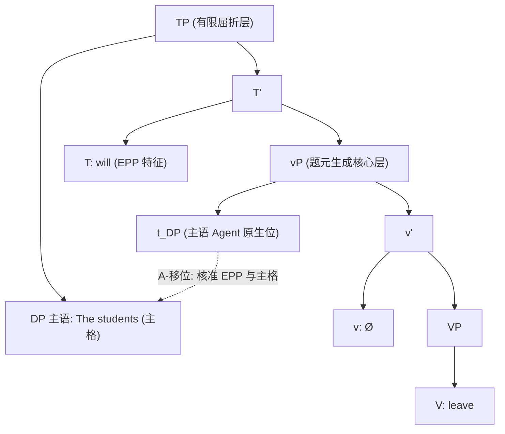
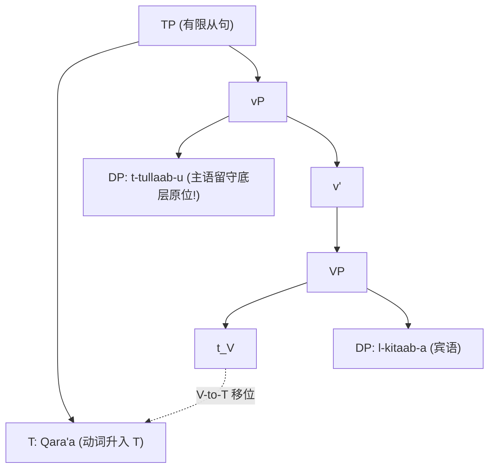

# Lec 09 题元分派均一性与 VP-内部主语 (UTAH & VP-Internal Subjects)

在古典生成语法的 X-杠理论中，句子主语通常被假定直接生成在屈折短语指示语 $[Spec, IP]$（或现代记法中的时态短语 $[Spec, TP]$）。然而，这一传统假设引发了理论上的巨大矛盾：如果施事者（Agent）角色是由动词决定的，为什么动词必须跨越整个短语边界，向外部功能投射的指示语位置分派题元角色？

本讲将探讨现代形式句法学中的两大基石假说——马克·贝克（Mark Baker）的**题元分派均一性假说（UTAH）**与**VP-内部主语假说（VP-Internal Subject Hypothesis, VPISH）**。通过浮动量词（Floating Quantifiers）、成语不对称性以及跨语言语序变异（VSO vs SVO），我们将证明：全句的所有论元（包括主语）最初无一例外都在动词短语内部生成，表层主语只是为了核准形态格位与 EPP 而进行的一场 A-移位！

## TL;DR

- **题元分派均一性假说（UTAH）**：相同的语义题元关系在深层句法树中必须映射为绝对相同的几何构型。施事者必然作为动词短语的指示语生成，受事者必然作为动词中心语的直接补足语生成。
- **VP-内部主语假说（VPISH）**：所有论元均在谓词核心（$vP/VP$）内部基础生成，有限分句主语并非原生于 $[Spec, TP]$，而是经由 A-移位提升至 $[Spec, TP]$ 以核准主格并满足扩充投射原则（EPP）。
- **经验论据多维闭环**：多米尼克·斯波蒂奇（Sportiche 1988）的浮动量词滞留现象（*The students will all [t] leave*）精确测定了主语在底层 $[Spec, vP]$ 留下的物理语迹；凯尔特语族与阿拉伯语的 VSO 语序则天然展示了动词前移而主语留守底层原位的活化石结构。

## 题元分派均一性假说（UTAH）

在探讨主语来源之前，必须确立语义界面与句法结构之间的映射法度。

::: definition [题元分派均一性假说 (UTAH, Baker 1988)]
名词项之间相同的题元关系（Thematic Relationships），在深层句法结构（D-Structure）中必须由绝对相同的结构构型关系（Structural Relationships）来表达。
$$\text{Identical }\theta\text{-relationships} \implies \text{Identical structural positions at base}$$
:::

UTAH 的理论约束力极其严苛：
1. 如果“受事者（Theme）”在主动句中是动词的姐妹节点（$V$ 的补足语），那么在被动句和非宾格动词中，它也**必须**作为 $V$ 的补足语生成；
2. 如果“施事者（Agent）”是由动词及其受事者共同构成的复合事件所指派的，那么在全人类语言中，它必须始终生成在同一个相对层次结构上。

如果有限句主语原生在 $[Spec, TP]$，而附加从句或小句（Small Clause）的主语生成在谓词内部，句法系统就将同一种题元角色（Agent）分派到了两个截然不同的几何位置，这直接颠覆了 UTAH 的统一性公理。

## VP-内部主语假说（VPISH）

为了解决题元局部性与 UTAH 的矛盾，Kuroda（1988）、Kitagawa（1986）以及 Koopman & Sportiche（1991）提出了颠覆性的假说：

::: theorem [VP-内部主语假说 (VP-Internal Subject Hypothesis, VPISH)]
谓词的所有论元（包括外部论元施事者）最初都在该谓词的最大投射（$vP/VP$）内部生成。
表层有限分句的主语并不是在 $[Spec, TP]$ 生成的，而是通过 **A-移位**从底层 $[Spec, vP]$ 提升至 $[Spec, TP]$。
:::

根据现代分层动词假说（Chomsky 1995），动词短语划分为核心动词短语 $VP$ 与轻动词短语 $vP$：
- **内部论元（Theme）**：与核心动词 $V$ 合并，占据 $[Comp, VP]$；
- **外部论元（Agent）**：与复合谓词合并，占据 $[Spec, vP]$；
- **移位驱动**：高阶有限时态中心语 $T$ 带有强 EPP 特征与主格核准需求，驱动处于 $[Spec, vP]$ 的主语向上提升至 $[Spec, TP]$。



## 支撑 VPISH 的四大经验实证

如果主语真的原生在 $vP$ 内部，我们在表层语言事实中能否找到它滞留底层的痕迹？

### 证据一：浮动量词（Floating Quantifiers, Sportiche 1988）

英语中的全称量词 *all, both, each* 既可以紧贴名词短语，也可以“浮动”在助动词之后的动词短语边缘：

```text
(1) a. [All the students] will leave.
    b. The students will [all] leave.
```

在传统语法中，语言学家假设存在某种神秘的“量词右移规则”，将 *all* 抛到了后面。但 Dominique Sportiche 提出了极具革命性的解释——**量词滞留理论（Quantifier Stranding）**：

1. 底层生成时，量词与名词构成一个完整的复合量词短语：$[_{DP} \text{ all } [_{DP} \text{ the students}]]$，该整体位于 $[Spec, vP]$；
2. **选项 A（整体移位）**：整个复合 DP 整体提升到 $[Spec, TP]$，得到 (1a) *[All the students] will leave*；
3. **选项 B（子成分提取）**：名词短语 *the students* 单独 A-移位至 $[Spec, TP]$，而量词 *all* 被**遗弃/滞留（Stranded）**在了底层原生的 $[Spec, vP]$ 槽位上，得到 (1b) *The students will [all t] leave*！

这一理论得到了多重助动词序列分布的惊人验证：

```text
(2) a. The lions [all] must have been sleeping.
    b. The lions must [all] have been sleeping.
    c. The lions must have [all] been sleeping.
    d. The lions must have been [all] sleeping.
```

量词 *all* 可以精确地滞留在每一个可能发生过中继移位的动词投影边缘！浮动量词绝不是随意的线性漂移，而是主语提升轨道上留下的“脱轨车厢”。

### 证据二：成语习语的不对称性（Idiom Asymmetry）

回顾 Marantz（1984）的经典观察：自然语言中存在数以千计由“动词 + 宾语”构成的固定成语，却几乎不存在由“主语 + 动词”构成固定成语而宾语任意填入的情况：

```text
(3) a. V + Object 形成固定成语:
       kick the bucket (死亡)
       spill the beans (泄密)
       bite the dust (阵亡)

    b. Subject + V 构成固定成语而 Object 任意:
       *The dog bit X. (不存在一个固定成语，不管 X 填什么都保持抽象习语义)
```

VPISH 与分层动词理论为此提供了最纯粹的几何解释：
- 动词与直接宾语首先合并构成核心 $VP$。成语语义在这一最小局部结构中被固定；
- 外部主语是在更高阶的 $[Spec, vP]$ 合并的，它直接与已经成型的 $[VP]$ 事件单位结合；
- 因此，动词的深层语义依赖必然先与内部论元锁定，主语在结构层级上永远晚于宾语参与谓词构建。

### 证据三：凯尔特语与阿拉伯语的 VSO 语序推导

世界语言中存在大量动词-主语-宾语（VSO）语序的语言，例如现代爱尔兰语、苏格兰盖尔语以及标准阿拉伯语（Modern Standard Arabic）：

```text
(4) 标准阿拉伯语 (VSO):
    Qara'a  t-tullaab-u       l-kitaab-a.
    read    the-students-NOM  the-book-ACC
    "The students read the book."
```

如果主语原生在 $[Spec, TP]$，推导出 VSO 语序将需要极度别扭的跨越操作。但在 VPISH 框架下，VSO 语序的生成变得无比自然而优雅：

1. 底层论元排列完全遵循通用的 $S - V - O$ 拓扑：主语在 $[Spec, vP]$，客体在动词后；
2. 动词 $V$ 经历中心语移位（V-to-T），越过主语升入时态中心语 $T$；
3. **跨语言参数分歧**：英语等 SVO 语言强制主语提升至 $[Spec, TP]$ 满足 EPP；而阿拉伯语等 VSO 句型中，动词前移本身核准了时态，**主语直接留守在底层的 $[Spec, vP]$ 原位**！



世界语言的语序多样性，本质上只是“动词是否移位”与“主语是否提升”这两个独立二元参数的笛卡尔乘积！

### 证据四：并列短语中的全面移位（ATB）与并列结构

考察以下 VP 并列句：

```text
(5) The chef [cooked the meal] and [cleaned the kitchen].
```

在 VPISH 分析中，并列的并非简单的谓词短语，而是两个完整的命题核心 $vP$。主语 *the chef* 最初同时存在于两个并列项的 $[Spec, vP]$ 槽位中，随后经由**跨越整个结构移位（Across-the-Board Movement, ATB）**统一提升至唯一的全句 $[Spec, TP]$，完美协调了并列结构公理（CSC）与其例外条件。

::: pitfall [常见误区：将 $vP$ 与 $VP$ 混为一谈]
在早期文献中，学者常统称为“VP 内部主语”。但在现代最简句法体系中，必须严格区分大写的轻动词短语 $vP$ 与核心动词短语 $VP$：
- $VP$ 是单纯的词汇动词核心，仅容纳动词自身及其受事补足语；
- $vP$ 是致使（Causative）或施事（Agentive）功能层，施事主语原生于 $[Spec, vP]$；
- 混淆二者会导致无法解释被动句与非宾格句（它们缺少具有强施事性的强 $v^*$ 层，因而没有底层外部主语）。
:::

::: insight [深度洞见：句法疆域的“两极分化”——词汇层与功能层]
VP-内部主语假说的胜利，标志着生成语法确立了全句拓扑的“两极分化”架构：

1. **下半场：词汇题元层（Thematic / Lexical Domain: $vP / VP$）**
   这是人类心智描摹“客观物理世界发生了什么”的纯净画布。在此区域，所有名词论元纯粹按照事件语义网络（谁做了什么、影响了谁、在哪里发生）被组装入树形。
2. **上半场：功能话语层（Functional / Grammatical Domain: $TP / CP$）**
   这是人类心智将“纯粹事件”包装为“社会交际命题”的计算流水线。在此区域，时态、体貌、语态、格位核准、主谓一致、语气强制力（Illocutionary Force）以及疑问焦点特征被逐一烙印在句法对象上。

通过将主语的基础生成下放至词汇层，生成语法实现了结构与语义的完美同构：**所有意义在底层诞生，所有修辞与形态在表层完成**。
:::

## 核心理论演进脉络

全课迄今关于子句结构的理论跃迁可总结如下：

| 理论发展阶段 | 主语生成假定位置 | 无法解释的理论硬伤 | 解决方案与经验突破 |
| :--- | :--- | :--- | :--- |
| **标准古典模型 (Standard Theory)** | 直接生成于 $[Spec, IP]$ | 动词跨短语分派 Agent 角色；违反题元分派均一性（UTAH） | 提出 VPISH，主语基础生成内移至动词短语内部 |
| **早期 VPISH 模型 (Koopman & Sportiche)** | 直接生成于 $[Spec, VP]$ | 无法解释成语动宾不对称；无法区隔被动句与非宾格动词的宾格丧失 | 引入分层轻动词 $vP$，施事者独占 $[Spec, vP]$ |
| **最简双层构型 (Minimalist Split-$vP$)** | Agent 在 $[Spec, vP]$；Theme 在 $[Comp, VP]$ | 完美统一 UTAH、浮动量词滞留轨道与世界语言 VSO/SVO 语序变异 | 确立词汇题元层与功能形态层的绝对两极分野 |
