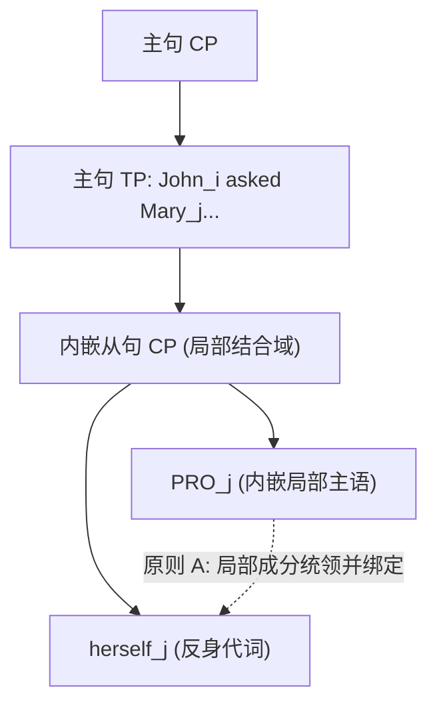

# Lec 10 隐形受控主语 PRO 的经验实证 (Empirical Arguments for PRO)

在自然语言的非限定不定式从句中，主语在物理语音上常常是完全缺失的。例如在英语句子 *John tried to swim* 中，介词不定式标记 *to* 之前没有任何可发音的名词短语。传统描述语法往往简单地认为动词 *try* 直接选择了一个动词短语（VP）作为补足语。

然而，生成语法学在此处提出了一个具有深远理论意义的核心主张：**该从句在句法树结构中并非残缺的 VP，而是一个拥有完整层次结构的从句（TP/CP）；在其主语位置上，存在一个物理不可闻但在心智运算中真实存在的隐性名词短语——受控主语 PRO（Big PRO）**。

本讲将系统梳理证明隐性范畴 PRO 客观实在性的四大经典跨语言经验铁证：反身代词绑定、浮动量词结合、次级谓词一致性以及冰岛语拟似格保持。

## TL;DR

- **PRO 的句法存在性假说**：非限定不定式从句并非单纯的动词短语，而是包含结构完备的主语槽位。在该位置生成的隐性代词类指称范畴称为 PRO，它接收内嵌从句谓词分派的题元角色，并由主句先行词实施控制（Control）。
- **结合论原则 A 的局部性捍卫**：内嵌从句中的反身代词（*herself*）必须在严格的局部结合域内由成分统领它的先行词结合。控制句中反身代词的强制局部指称，直接证明了内嵌主语槽位存在物理隐形的 PRO。
- **跨语言形态与格位的无可辩驳铁证**：俄语次级主语描摹形容词对 PRO 的格位与 $\phi$-特征一致性反映，以及冰岛语中 PRO 能够切实承载内嵌动词分派的特殊非主格“拟似格（Quirky Case）”并向下一致传递，彻底粉碎了“空主语仅是语义联想”的虚无主义假设。

## 理论对立：VP 补足语假说 vs PRO 从句假说

考察经典的主语控制句与宾语控制句：

```text
(1) a. John tried [to win].
    b. John asked Mary [to leave].
```

面对这类现象，理论语言学面临两种针锋相对的模型竞争：

::: definition [两种结构模型的竞争]
1. **无主语 VP 补足语假说（Bare VP Hypothesis）**：
   - 假定控制动词直接选择非限定动词短语 $VP$ 或 $TP$；
   - 括号内部不存在独立的主语节点：$[_{VP} \text{ tried } [_{VP} \text{ to win}]]$；
   - 动作的执行者完全依赖概念语义接口的常识推导。
2. **PRO 完整从句假说（PRO Hypothesis, Chomsky 1981）**：
   - 假定内嵌从句是一个结构完备的子句（$CP$ 或非限定 $TP$）；
   - 在该从句的 $[Spec, TP]$ 位置生成无声的隐性代词范畴 PRO：
     $$\text{John}_i \text{ tried } [_{CP} \; [_{TP} \; \text{PRO}_i \text{ to win}]]$$
   - PRO 独立承载内嵌谓词的题元角色，并通过控制机制（Control）与主句先行词（*John*）建立共指标记。
:::

如果 PRO 仅仅是不可见、不可闻的心智投射，我们如何用严格的科学实验判定其在心智树形中的客观存在？

## 支撑 PRO 的四大决定性经验论据

### 论据一：结合论原则 A 的严格局部域

回顾约束理论原则 A 的核心公理：反身代词（Anaphor）必须在其**局部结合域（Governing Category / Local Domain）**内被成分统领它的先行词所绑定。局部域通常被严格定义为包含该反身代词、其中心语以及一个**主语（Subject）**的最小从句。

考察以下宾语控制句中的反身代词指称限制：

```text
(2) John_i asked Mary_j [to wash herself_j / *himself_i].
```

这一句子的语法性对立展现了惊人的不对称性：
- 反身代词 *herself* 完美合法，且只能指代宾语 *Mary*；
- 反身代词 *himself* 发生灾难性违规，**绝对无法指代主句主语 *John*！**

如果内嵌从句仅仅是一个没有主语的裸 VP，那么全句包含主语的最小从句就是主句自身。既然主句主语 *John* 成分统领 *himself*，根据原则 A，*himself* 理应完美合法。

这一预测与母语者的语感完全背道而驰！PRO 假说对该现象给出了唯一合理的解释：



因为内嵌从句的主语位置真实存在着由 *Mary* 控制的 $\text{PRO}_j$，这个 $\text{PRO}_j$ 使得内嵌从句构成了反身代词的**排他性局部结合域**！反身代词在该域内只能被 $\text{PRO}_j$ 结合，从而合法产生 *herself*，而主句主语 *John* 被坚固的局部域边界完全隔离在外。

### 论据二：浮动量词的局部结合（Floating Quantifiers）

在 Lec 09 中我们证明了浮动量词（*all, both*）必须在底层与一个 DP 形成局部构型并滞留其语迹位置。考察不定式从句中的量词浮动：

```text
(3) a. The students_i wanted [PRO_i to all leave].
    b. The teachers_i told the students_j [PRO_j to all read the book].
```

在例句 (3b) 中，浮动量词 *all* 只能量化从属宾语 *the students*，绝对不能量化主句主语 *the teachers*。这证明量词 *all* 必须在其所属的非限定从句内部就近结合一个物理主语。这个不可见的主语正是 $\text{PRO}_j$。

### 论据三：次级谓词的形态一致性（Secondary Predication）

在许多具有丰富屈折形态的语言（如俄语、古希腊语、西班牙语）中，修饰主语的描摹性次级谓词（Depictive Secondary Predicates）必须在**性、数、格（$\phi$-features & Case）**上与它所修饰的主语保持完全一致。

以俄语（Neidle 1988）中的描摹形容词 *odin*（独自/alone）为例：

```text
(4) 俄语主动控制句:
    Ona_i         xotela       [PRO_i  idti      odna_i         / *odnu].
    She(FEM.NOM)  wanted(FEM)  [PRO    to-go     alone(FEM.NOM) / alone(FEM.ACC)]
    "她想独自一个人去。"
```

俄语数据展现出极其惊人的事实：
- 形容词 *odna* 呈现出清晰无误的**阴性单数主格（Nominative）**形态；
- 如果从句中没有主语，次级谓词根本失去了格位与性数特征的一致性来源；
- 这表明，内嵌从句中的 PRO 不仅在句法上占据主语位置，而且真实携带着抽象特征，驱动了形容词的形态一致性。

### 论据四：冰岛语拟似格保持（Icelandic Quirky Case Preservation）

如果说俄语的主格一致性尚有可能是向主句主语的隐性“渗透”，那么冰岛语（Icelandic，Sigurðsson 1989, 2008）的拟似格现象则为 PRO 的物理存在提供了不可辩驳的终极铁证。

在冰岛语中，部分特殊动词（如 *vanta* “缺乏”、*leiðast* “感到厌烦”）会强行给其主语指派非主格的固有格（Quirky Case，如与格 DAT 或属格 GEN）。当这些动词进入控制不定式从句时，奇迹发生了：

```text
(5) 冰岛语拟似格控制句:
    Hann_i        vonast til  [að  PRO_i(DAT)  leiðast  ekki  einum_i(DAT)      / *einn(NOM)].
    He(MASC.NOM)  hopes for   [to  PRO(DAT)    be-bored not   alone(MASC.DAT)   / alone(MASC.NOM)]
    "他希望自己不要感到孤独厌烦。"
```

深入剖析该句的形态格位计算：
1. 主句动词 *vonast til*（希望）的主语 *Hann* 是规范的**主格（Nominative）**；
2. 内嵌动词 *leiðast* 是一个必须指派**与格（Dative）**的拟似格动词；
3. 从句中的次级谓词形容词“独自”必须严格呈现为**与格（einum）**，如果误用主句主语的主格（einn）将直接导致句子语法性崩溃！

::: theorem [冰岛语拟似格保持定理 (Sigurðsson 1991)]
内嵌形容词的与格形态只能来自于其局部的直接主语。既然主句主语是主格，内嵌从句中必然存在一个真实承载着与格（Dative Quirky Case）的实体句法项——即无声的 PRO：
$$\text{Hann}_{\text{NOM}} \dots [_{CP} \; \text{PRO}_{\text{DAT}} \; \text{leiðast} \dots \text{einum}_{\text{DAT}}]$$
:::

无声的 PRO 能够独立拦截并持有特定动词分派的特殊形态格位，并将其通过一致性运算向下传递给次级谓词。这一发现彻底粉碎了“空主语仅是无结构的语义空位”的怀疑，确立了 PRO 作为完整句法客体的实在性。

::: pitfall [常见误区：PRO 与提升语迹的混淆]
初学者极易将控制句中的 PRO 与提升句中的语迹 $t$（Trace / Copy）相混淆：
- **语迹 $t$**：是同一个名词短语通过移位（Movement）留下的历史副本。提升动词不分派外部题元角色，移动项只有一个题元角色；
- **受控项 PRO**：是在词库与合并中独立生成的基础成分。控制动词向主句先行词分派一个题元角色，内嵌谓词向 PRO 分派另一个完全独立的题元角色。二者是“两个论元被共指关系链接”，而非“一个论元位移”。
:::

::: insight [深度洞见：隐性范畴与心智实在性]
物理学家从未亲眼用肉眼见过“夸克”或“电子”，我们通过云室中的径迹和电磁偏转确证微观粒子的存在；在认知科学与理论句法学中，**PRO 就是心智计算系统中的微观粒子**。

我们无法直接听见 PRO 的声学发音，但通过反身代词结合域的硬性阻断、浮动量词的精准滞留、以及冰岛语中非主格形态特征的坚韧传递，生成语法以极其严密的数学与经验逻辑，测定出了这一静默范畴的全部几何坐标与特征向量。人类语言知识的大部分核心运算，正是发生在这片声音所不可及的无声深渊之中。
:::

## 核心证据维度对照表

| 经验诊断维度 | 若无 PRO 假说的理论预测 | PRO 假说的理论预测 | 实际语言学事实 |
| :--- | :--- | :--- | :--- |
| **反身代词绑定 (英语)** | *John asked Mary to wash himself* 应合法（主句为最小域） | 内嵌从句因 PRO 成为独立域，*himself* 违规崩溃 | 事实完全验证 PRO 假说；*himself* 严重非法 |
| **浮动量词 (英语)** | 量词无法在不定式内部找到结合实体 | 量词在内嵌从句与 PRO 建立局部量化 | 事实验证：量词可合法浮动在不定式内部 |
| **次级谓词一致性 (俄语)** | 形容词缺少性数格来源，或随机赋格 | 形容词与 PRO 建立性数格全同一致 | 事实验证：形容词强制呈现阴性主格一致 |
| **拟似格保持 (冰岛语)** | 从句形容词只能跟随主句主格或默认赋格 | 形容词强制呈现内嵌动词赋予 PRO 的与格 | 事实无可辩驳：形容词必须呈现独特的与格 |
