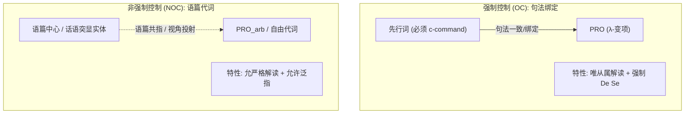

# Lec 11 强制控制与非强制控制 (Obligatory vs Non-obligatory Control)

在 Lec 10 中，我们通过结合论、浮动量词与冰岛语拟似格等经验事实，确立了非限定从句主语位置存在隐性范畴大 PRO（Big PRO）。然而，PRO 并不具有单一均质的语法行为。在某些句型中，PRO 必须被紧邻的上层论元死死锚定，展现出类似反身代词的严苛局域性；而在另一些环境中，PRO 却能指代遥远的上文实体，甚至表达泛指任意人群的普遍解读。

本讲深入控制理论（Control Theory）的核心分类学：**强制控制（Obligatory Control, OC）**与**非强制控制（Non-obligatory Control, NOC）**。我们将建立识别二者的四大经典诊断标准，探讨主语控制与宾语控制的极小距离原则（MDP），并揭示控制现象在形式语义学界面所诱发的特异性自我意识（*De Se*）哲学解读。

## TL;DR

- **强制控制（OC）与非强制控制（NOC）的本质分野**：OC 属于纯句法算子-变项绑定机制，受词汇中心语严格驱动；NOC 属于语篇话语代词机制，受语境突显度与对数观点（Logophoricity）调节。
- **四大经典经验诊断试金石**：OC 必须满足成分统领、必须具备显性先行词、在 VP 省略下仅允许从属解读（Sloppy Reading）、在态度归属环境下强制要求自我意识解读（*De Se*）；NOC 则允许非成分统领先行词、允许任意泛指解读（$\text{PRO}_{arb}$）、允许严格解读（Strict Reading）。
- **极小距离原则（MDP）与 *Promise* 之谜**：宾语控制动词（*persuade*）遵循局域性最近优先匹配，而主语承诺动词（*promise*）对极小距离的违反展示了事件语义与格位分派对句法介入效应的深刻调节。

## 控制现象的双轨构型：OC 与 NOC

语言学家（Williams 1980, Chomsky 1981, Landau 2000, 2013）在考察大量不定式从句后发现，PRO 的指称属性依据结构位置分化为截然不同的两大阵营：

::: definition [强制控制与非强制控制 (OC vs NOC)]
1. **强制控制（Obligatory Control, OC）**：
   - 典型环境：补足语不定式从句（如 *try, persuade, decide, manage, condescend* 的补足语）；
   - 句法特性：必须在同一个句子内部拥有成分统领它的显性先行词，先行词的选择由动词词汇语义硬性指定，严禁泛指。
2. **非强制控制（Non-obligatory Control, NOC）**：
   - 典型环境：主语从句（Subject Clauses）、附加语小句（Adjunct Clauses）或独立不定式；
   - 句法特性：先行词不必成分统领 PRO，先行词可以处于遥远的上文甚至完全缺省，允许泛指任意人（Arbitrary Interpretation, $\text{PRO}_{arb}$）。
:::

考察以下对比：

```text
(1) a. 强制控制 (OC):
       John_i tried [PRO_i to win].
       *It was tried [PRO_arb to win]. (无法泛指，必须有主体)

    b. 非强制控制 (NOC):
       [PRO_arb to swim in this river] is dangerous. (泛指任何人游泳都危险)
       John_i said that [[PRO_i to shave himself] would be difficult]. (长距离跨从句控制)
```

## 四大严格经验诊断体系

为了精确切分未知句型的控制属性，句法学家发展出了四项具有数学严密度的诊断操作。

### 1. 先行词的必须性与任意泛指度（Requirement of Antecedent）

- **在 OC 环境中**：先行词是强制不可或缺的。如果句中没有合法的论元提供绑定，推导必然在界面崩溃：
  ```text
  (2) a. John_i managed [PRO_i to escape].
      b. *It was managed [PRO to escape]. (严重非法)
  ```
- **在 NOC 环境中**：PRO 完全可以脱离句内先行词独立存在，获得通则任意解读（Arbitrary Reading, 记作 $\text{PRO}_{arb}$）：
  ```text
  (3) [PRO_arb to read classic syntax papers] requires patience.
      "（任何人）研读经典句法论文都需要耐力。"
  ```

### 2. 成分统领限制（C-command Requirement）

- **在 OC 环境中**：先行词**必须严格成分统领** PRO。深层嵌套在修饰语内部的名词短语无法充当控制者：
  ```text
  (4) a. [The mother of John_i]_j tried [PRO_j/*i to speak].
  ```
  在 (4a) 中，只有结构上成分统领从句的 *the mother* 能够控制 PRO，被统领的内层名词 *John* 绝对无法越级控制。
- **在 NOC 环境中**：成分统领条件被彻底打破，先行词可以深埋于领属短语中，甚至处于话语前句：
  ```text
  (5) [John_i's campaign manager] thought that [PRO_i to visit Ohio] was crucial.
      "John 的竞选经理认为（John）访问俄亥俄州至关重要。"
  ```

### 3. VP 省略下的严格/从属解读（Strict vs Sloppy Identity）

动词短语省略（VP Ellipsis）是检验句法结合性质的试金石。

```text
(6) 强制控制句中的 VP 省略:
    John_i tried [PRO_i to win], and Bill_j did [try to win], too.
```

- **从属解读（Sloppy Reading，算子变项绑定）**：Bill 努力让自己获胜（$\text{Bill}_j \text{ tried } [\text{PRO}_j \text{ to win}]$）；
- **严格解读（Strict Reading，外延指称复用）**：Bill 努力让 John 获胜（$\text{Bill}_j \text{ tried } [\text{John}_i \text{ to win}]$）。

在强制控制 (6) 中，母语者只能获得从属解读，严格解读是**绝对被句法禁止的**！这证明 OC PRO 在逻辑形式（LF）上本质是一个受绑定的 $\lambda$-变项（Bound Variable）：
$$\text{John}(\lambda x. \; x \text{ tried } [x \text{ to win}])$$

相反，在非强制控制（NOC）句型中，严格解读与从属解读均能合法共存：

```text
(7) 非强制控制句中的 VP 省略:
    John_i thinks that [PRO_i to get a haircut] will help, and Bill_j does, too.
    --> 可解读为: Bill thinks Bill getting a haircut will help (从属解读)
    --> 亦可解读为: Bill thinks John getting a haircut will help (严格解读!)
```

### 4. 意识态度与 De Se 解释（*De Se* vs *De Re*）

形式语义学大师 Gennaro Chierchia（1989）发现，强制控制在哲学心智表征上施加了极度严苛的**自指意识（*De Se*）**约束。

::: theorem [De Se 约束定理 (Chierchia 1989)]
强制控制从句的主体在心理上必须有明确的“关于自我（*De Se*）”的意识；如果行为主体在客观上指的是自己、但在主观上误以为是别人（*De Re*），强制控制句无法成立。
:::

设想以下经典哲学情境：
> 一个神志昏迷的失忆政客在电视上看到一段演讲录像。他看到屏幕上的那个人狼狈不堪，但口才出众。政客完全没有认出录像里的人就是自己，他在心里暗想：“我希望电视里的那个家伙能够当选。”

在此情境下对比以下两个句子的合法性：

```text
(8) a. 有限从句 (De Re 合法):
       The politician_i hoped [that he_i would win].
       --> 完美合法！政客可以指称电视上的那个人（客观上是他自己）。

    b. 强制控制从句 (强制 De Se 违规):
       #The politician_i hoped [PRO_i to win].
       --> 语义不当/真值失败！只有当政客清醒地意识到“我要我自己赢”时，该句才为真。
```

在例句 (8a) 中，内嵌有限从句的代词 *he* 只是一个普通的指称代词。在可能世界语义模型中，代词只需在客观世界上指向该政客即可完成赋值，属于典型的关于外部客观实体的认知（*De Re*）。然而在例句 (8b) 中，只要政客误以为电视上的人是他人，母语者便断然拒绝接受该控制句为真。这表明强制控制句在逻辑形式（LF）上并非普通的代词赋值，而是将从句直接解析为一个属性（Property），并将主语作为该属性的自我归属者。

OC PRO 在句法上直接投射为第一人称视角的自指算子，排除了任何认知偏差的外在指称可能性。这种双轨构型在句法与语篇接口上呈现出截然不同的信息流向，体现了狭义句法计算与语篇语义计算的精密分工：



通过这一对比可以清晰地看出，强制控制的整个运作链条完全锁死在句子内部的局部句法树枝干上，遵循纯粹的结构支配规律；而非强制控制则向话语语境敞开大门，允许语用突显度与言者视角共同参与空主语的指称赋值。

## 主语控制 vs 宾语控制与极小距离原则

当主句同时存在主语和宾语时，句法系统如何裁决由谁来控制内嵌从句的 PRO？

```text
(9) a. 宾语控制: John persuaded Mary_j [PRO_j to leave].
    b. 主语控制: John_i promised Mary [PRO_i to leave].
```

### 极小距离原则（Minimal Distance Principle, MDP）

Rosenbaum（1967）提出了著名的**极小距离原则（MDP）**：

::: definition [极小距离原则 (MDP)]
若句法树中存在多个潜在的控制先行词，PRO 优先由在树形构型中离它**最近的（即具有极小支配/统领距离的）**论元所控制。
:::

在 (9a) 中，直接宾语 *Mary* 在树形层级上比主句主语 *John* 更贴近内嵌从句，因此 *Mary* 成功拦截并控制了 PRO。这符合普遍语法的局部性介入（Intervention）效应。

### 经典例外：*Promise* 类动词之谜

然而，例句 (9b) 中的动词 *promise*（承诺）构成了对 MDP 的公然挑衅：尽管直接宾语 *Mary* 距离 PRO 更近，控制者却奇迹般地跨越了 *Mary*，由更高层的主语 *John* 掌控！

现代句法学提出了两种主流解决方案：
1. **空介词隐藏假说（Null Preposition Hypothesis, Chomsky 1981）**：*promise* 的间接宾语实际上被包裹在一个隐性的介词短语内部（*promise [PP Ø Mary]*），介词投射阻断了 *Mary* 对 PRO 的直接成分统领，使得主语成为唯一合法的统领先行词；
2. **事件语义角色假说（Landau 2000, 2013）**：承诺行为从本质定义上具有不可转让的立约人责任，“承诺去做某事”在词汇概念结构（LCS）上将执行责任内生性地绑定在施约主体（Promiser）身上，语义特征覆盖了纯几何距离。

::: pitfall [常见误区：将 NOC PRO 视为无语法约束的随意乱指]
虽然非强制控制（NOC）摆脱了狭义句法的成分统领限制，但它绝不是随意乱指。NOC PRO 的先行词选择严格受到语用学与认知语言学中**对数观点（Logophoricity）**与**话语同理心（Empathy）**的制约——它必须指向当前语境中的感知主体、思想持有者或交际焦点，不能违反语篇局部性。
:::

::: insight [深度洞见：控制理论作为心智哲学与句法的交叉路标]
控制理论展现了理论句法学与形式哲学、认知科学最精妙的交融。

从表层声音上看，*hope that he wins* 与 *hope to win* 似乎只是冗余度不同的同义表达。但控制语法证明：**人类的大脑在句法计算中为“自知之明（Self-Consciousness / De Se）”保留了专门的硬件通路**。强制控制（OC）不仅仅是省略了代词的发音，它是人类语言系统用纯粹的结构几何，直接编码“第一人称自我意识行动者”的独特认知架构。
:::

## 核心诊断特征全景对照表

| 诊断测试维度 | 强制控制 (Obligatory Control, OC) | 非强制控制 (Non-obligatory Control, NOC) |
| :--- | :--- | :--- |
| **成分统领 (C-command)** | 先行词必须严格 c-command PRO | 先行词无需 c-command（可深埋或缺省） |
| **先行词必须性** | 句内必须存在显性先行词 | 允许无句内先行词，可泛指任意人 ($\text{PRO}_{arb}$) |
| **VP 省略解读** | **仅允许从属解读 (Sloppy Reading)** | **同时允许严格解读与从属解读** |
| **态度归属意识** | **强制要求自指意识 (*De Se*)** | **允许非自指客观认知 (*De Re*)** |
| **跨从句长距离控制** | 严禁跳跃，只能局域控制 | 允许跨越多个有限从句边界建立指称 |
| **主要句法环境** | 谓词补足语从句 (*try, persuade, force*) | 主语从句、主语小句、独立不定式短语 |
