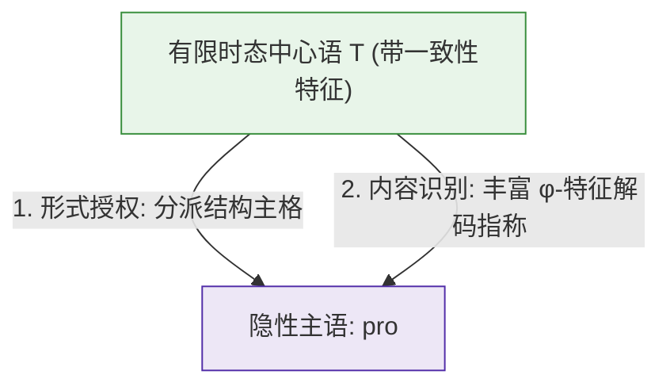

# Lec 12 空主语双轨制：小 pro 与大 PRO (The Null Subject Dichotomy: Pro vs PRO)

在人类语言的跨语言事实中，“主语不发音”是一个极其普遍的现象。然而，仔细审视不同语言环境下的空主语，我们会发现一个根本性的句法断裂：
- 在英语等语言中，空主语**只能**出现在“非限定不定式从句”中（如 *John tried [PRO to leave]*），而绝不能在有限分句中省略主语（**Leaves*）；
- 但在意大利语、西班牙语、现代希腊语以及汉语中，说话者在“有限时态完整陈述句”中同样可以完全不发音主语（如意大利语 *Parla italiano* “（他/她）讲意大利语”）。

古典生成语法学通过精密的形态-句法接口推导，确立了空主语的两大根本类型：**非限定从句中的大 PRO（Big PRO）**与**有限从句中的小 pro（Little pro）**。本讲将解构著名的**主语脱落参数（Pro-Drop Parameter）**、塔拉尔德森概括（Taraldsen's Generalization）以及名字符号系统的四大特征矩阵分类学。

## TL;DR

- **小 pro 与大 PRO 的本质分野**：大 PRO 仅寄居于非限定不定式（Non-finite）中，接受零格（Null Case）或受控，兼具照应语与代词特征；小 pro 专属于有限分句（Finite TP），真实接收结构主格（Nominative Case），在功能上等同于显性代词（*he, she, they*）。
- **丰富屈折授权假说（Rich Agreement Hypothesis）**：小 pro 的存活依赖严格的“授权（Licensing）”与“识别（Identification）”。以意大利语和西班牙语为代表的罗曼语，通过动词丰富的人称/数屈折词缀（$\phi$-features）在句法上完全恢复 pro 的指称内容。
- **主语脱落参数的聚类效应（Clustering Properties）**：允许小 pro 的语言伴随产生一系列联动句法效应：主语自由倒装（Free Subject Inversion）以及**标补词语迹效应（That-Trace Effect）的表层免疫**。

## 普遍语法中的名字符号四分矩阵

为了系统分类自然语言中所有发音与不发音的名词短语，诺姆·乔姆斯基（Chomsky 1981, 1982）提出了基于两个二元句法特征的普适矩阵：
- $[\pm a]$：是否为**照应语（Anaphor）**，即是否必须在局部域内被绑定（服从原则 A）；
- $[\pm p]$：是否为**代词（Pronominal）**，即是否必须在局部域内自由（服从原则 B）。

这一数学组合完美导出了人类语言名字符号系统的四个象限：

| 特征组合 | 显性物理实体 (Overt) | 隐性无声范畴 (Covert / Empty) | 遵循的结合论公理 |
| :---: | :---: | :---: | :---: |
| **$[+a, -p]$** | 反身代词 / 相互代词 (*himself, each other*) | **A-移位语迹 ($t_{\text{NP}}$)** (如被动/提升语迹) | 遵循原则 A（局部被绑定） |
| **$[-a, +p]$** | 显性人称代词 (*he, she, it, they*) | **小 pro** (有限句主语脱落) | 遵循原则 B（局部必须自由） |
| **$[+a, +p]$** | *不存在显性形式（避免结合矛盾）* | **大 PRO** (非限定不定式受控主语) | 遵循 PRO 定理（必须处于无管辖位置） |
| **$[-a, -p]$** | 独立指称语 R-expression (*John, the car*) | **A'-移位语迹 ($t_{\text{wh}}$)** (如疑问算子语迹) | 遵循原则 C（全域绝对自由） |

::: theorem [PRO 定理 (The PRO Theorem)]
如果一个范畴同时携带 $[+a, +p]$ 特征，根据结合论，它必须在其局部结合域内被结合（原则 A），同时又必须在该域内保持自由（原则 B）。
消除这一自相矛盾的唯一数学解是：**PRO 绝不能拥有任何局部结合域！** 这意味着 PRO 必须处于一个“未被管辖（Ungoverned）”的句法位置，即唯有缺乏限定屈折时态的非限定不定式从句主语槽，才允许 PRO 合法寄居。
:::

相反，小 pro 携带 $[-a, +p]$ 特征，它纯粹是一个“只是未发音出来的普通代词”，因此它必须像 *he/she* 一样，出现在可以获得主格的有限从句主语位置。

## 塔拉尔德森概括与小 pro 的核准机制

为什么英语中不能说 **Spoke*（代表“他说了”），而意大利语中 *Parlò* 却完美合法？

挪威语言学家 Taraldsen（1978）提出了决定性的经验观察：主语脱落的能力与动词屈折词尾的丰富程度成正比。Luigi Rizzi（1982, 1986）将其形式化为小 pro 的双重核准条件：

::: definition [小 pro 的双重核准公理 (Rizzi 1986)]
小 pro 在句法推导中要想合法存活，必须同时满足两大刚性条件：
1. **形式授权（Formal Licensing）**：必须由一个具有特定特征的功能中心语（有限分句的时态中心语 $T$）分派**结构主格（Structural Nominative Case）**；
2. **内容识别（Content Identification）**：$T$ 中心语必须携带一套完整的、无歧义的**一致性特征（$\phi$-features: 人称、性、数）**，使得空语类 pro 的语义指称能够从动词词尾形态中 100% 毫无歧义地逆向还原。
:::

### 英语 vs 意大利语形态对比

为了更直观地理解形态系统与句法授权的接口互动，我们可以对比罗曼语族与日耳曼语族在动词屈折范式上的几何分布。意大利语作为典型的主语脱落语言，其动词词干后面附着的形态词缀拥有近乎数学双射的精确度。

考察意大利语现在时动词 *parlare*（说话）的屈折范式：

```text
(1) 意大利语 (包含 6 种截然不同的人称数词尾):
    parl-o    (1SG: 我说)       --> pro 完全可恢复为第一人称单数
    parl-i    (2SG: 你说)       --> pro 完全可恢复为第二人称单数
    parl-a    (3SG: 他/她说)    --> pro 完全可恢复为第三人称单数
    parli-amo (1PL: 我们说)     --> pro 完全可恢复为第一人称复数
    parl-ate  (2PL: 你们说)     --> pro 完全可恢复为第二人称复数
    parl-ano  (3PL: 他们说)     --> pro 完全可恢复为第三人称复数
```

因为每一个词尾形态都唯一映射一个特定的人称和数，听者的大脑在听到 *Parliamo italiano* 时，无需听到物理主语，动词形态的 $\phi$-特征便已将主语小 pro 的身份在心智中解码完毕。这种高度信息密集的词法体系使得显性代词在大多数陈述语境下显得冗余，显性代词（如 *noi* “我们”）只有在需要进行强烈对比或强调焦点时才会被激活。

相反，在现代英语的历史演进中，古英语原本繁复的屈折体系经历了剧烈的音系磨损与形态脱落，绝大多数人称与数的分野已经彻底退化：

```text
(2) 英语 (屈折形态贫乏腐蚀):
    speak   (I / you / we / they) --> 同一个形态对应 4 种不同人称数!
    speaks  (he / she / it)       --> 仅 3SG 拥有独立词尾
```

如果英语省略主语说 *Spoke*，听者根本无法判定究竟是“我说了”、“你说了”还是“他们说了”。由于英语时态中心语 $T$ 缺乏足以识别代词内容的丰富一致性形态，小 pro 无法通过识别条件，因而英语强制要求显性代词（*I spoke, they spoke*）来填充句法树的指示语位置。

这一计算逻辑表明，动词时态中心语并非只是被动地接收动词词根，它同时承担着双重语法职能：向下分派主格以满足形式授权，并借助一致性特征向上投射语义指称：



## 主语脱落参数的核心聚类效应

Rizzi（1982）指出，普遍语法中的参数（Parameter）绝非孤立的规则，一个底层参数的开启往往会在表层语法中引发一系列**连锁聚集效应（Clustering Properties）**。

在将主语脱落参数设定为 $[+\text{pro-drop}]$ 的语言中，普遍伴随出现以下两大著名句法现象：

### 1. 动词后自由主语倒装（Free Subject Inversion）

在意大利语或西班牙语中，显性主语不仅可以出现在句首，还可以毫无标记地自由倒装在动词甚至宾语之后：

```text
(3) a. Gianni ha telefonato.    (主语前置 SVO)
    b. pro ha telefonato Gianni. (主语后置倒装 VSO)
       "Gianni 打电话来了。"
```

其推导机制在于：句首主语槽位 $[Spec, TP]$ 由无声的小 pro 填充以满足 EPP 特征，而真正的重音焦点显性名词短语 *Gianni* 则合法留守在动词短语的底层内部。

### 2. That-Trace 效应的表层免疫

回顾 Lec 05 中著名的标补词语迹禁令（That-Trace Effect）：在英语中，严禁从紧邻的显性标补词 *that* 之后直接提取主语：

```text
(4) a. 英语宾语提取 (合法):
       Who_i do you think [that Mary saw t_i]?

    b. 英语主语提取 (严重非法: That-Trace 违规):
       *Who_i do you think [that t_i left]?
```

然而，在意大利语等主语脱落语言中，这一违规**奇迹般地消失了**：

```text
(5) 意大利语主语长距提取 (完美合法!):
    Chi_i credi [che t'_i abbia telefonato t_i]?
    "Who do you think that has telephoned?"
```

这是否意味着意大利语违反了普遍语法的局部性公理？Rizzi 证明，意大利语并未违反普遍原则！在意大利语中，移位并不是直接从紧邻 *che*（that）的高阶 $[Spec, TP]$ 发起的；而是**先行利用主语倒装机制，将主语置于动词后方的底层位置，随后从动词后方直接跃迁至句首 $[Spec, CP]$**。这使得处于敏感边界的标补词与语迹完全脱钩，优雅地避开了 That-Trace 陷阱！

## 汉语与东亚语言的“激进主语脱落”之谜

面对上述“丰富屈折假说”，理论语言学家遭遇了巨大的跨语言挑战：**现代汉语、日语和韩语没有任何人称和数的动词屈折词尾，为什么同样高度允许空主语？**

```text
(6) 汉语主语脱落:
    甲: 张三看见李四了吗？
    乙: [e] 看见了，[e] 刚走。
```

著名华裔语言学家黄正德（C.-T. James Huang 1984, 1989）对此给出了划时代的理论整合：

::: definition [黄正德概括 (Huang's Generalization)]
世界语言的空主语系统遵循“两极化”原则：
1. **富屈折语（如意大利语）**：拥有极度丰富的形态系统，通过形态一致性识别小 pro；
2. **零屈折语（如汉语、日语）**：完全没有动词屈折形态，其空主语并非依靠动词识别的小 pro，而是由句首隐性**话题（Topic）**绑定的**空变项（Null Variable）**，遵循语篇话题链（Topic Chain）规则；
3. **中庸半吊子语（如英语、法语）**：既失去了丰富的词尾屈折，又具有严格的主谓句法构型而非纯话题构型，两头不靠，因此严禁空主语。
:::

这一洞见证明，跨语言的表面相似性背后可能运行着完全不同的深层计算模块：意大利语的省略是“形态句法的一致性投射”，而汉语的省略则是“语篇话题的算子绑定”。

::: pitfall [常见误区：将小 pro 误认为只是省略了发音]
初学者常以为小 pro 就是口语中“偷懒不说话”。在句法学上，小 pro 是具有完整形式特征（格位、性数格、语义解释）的独立词项。它在深层树形中必须占据规范的主语指示语槽位，能够作为结合论的先行词绑定反身代词，也能像实体词一样参与控制。
:::

::: insight [深度洞见：参数化理论（P&P）的极简美学]
小 pro 与大 PRO 的两极对立，是生成语法“原则与参数（P&P）”纲领最光辉的胜利范式之一。

普遍语法并没有为世界上成千上万种语言分别编写各自的独立法典；它仅仅提供了几组极其精炼的二元特征开关：
- 名词特征矩阵：$[\pm a, \pm p]$；
- 动词屈折参数：$[\pm \text{rich agreement}]$。

开关的轻轻拨动，便在宏观上连锁引发了语序倒装、That-Trace 免疫、不定式受控与代词省略等浩瀚复杂的跨语言多样性。句法学家在纷繁芜杂的世界语料中，照见了如同牛顿力学与元素周期表般整齐划一的心智数学秩序。
:::

## 大 PRO 与小 pro 核心特征终极对比

| 比较维度 | 大 PRO (Big PRO) | 小 pro (Little pro) |
| :--- | :--- | :--- |
| **所属从句类型** | 专属于**非限定不定式从句 (Non-finite)** | 专属于**有限时态完整从句 (Finite)** |
| **名字符号矩阵** | $[+a, +p]$（照应代词杂交体） | $[-a, +p]$（纯粹人称代词） |
| **形态格位需求** | 不接收有限结构格（接收零格 Null Case） | **强制接收有限结构主格 (Nominative Case)** |
| **内容识别机制** | 依靠主句先行词实施“控制（Control）” | 依靠动词词尾“丰富屈折形态（$\phi$-features）” |
| **语境与跨语言** | 几乎存在于全人类所有具有不定式的语言中 | 仅存在于开启了 $[+\text{pro-drop}]$ 参数的语言中 |
| **表层等价替换** | 绝不能直接替换为显性代词（**tried he to win*） | 可自由替换为显性重读代词以表达对比焦点 |
