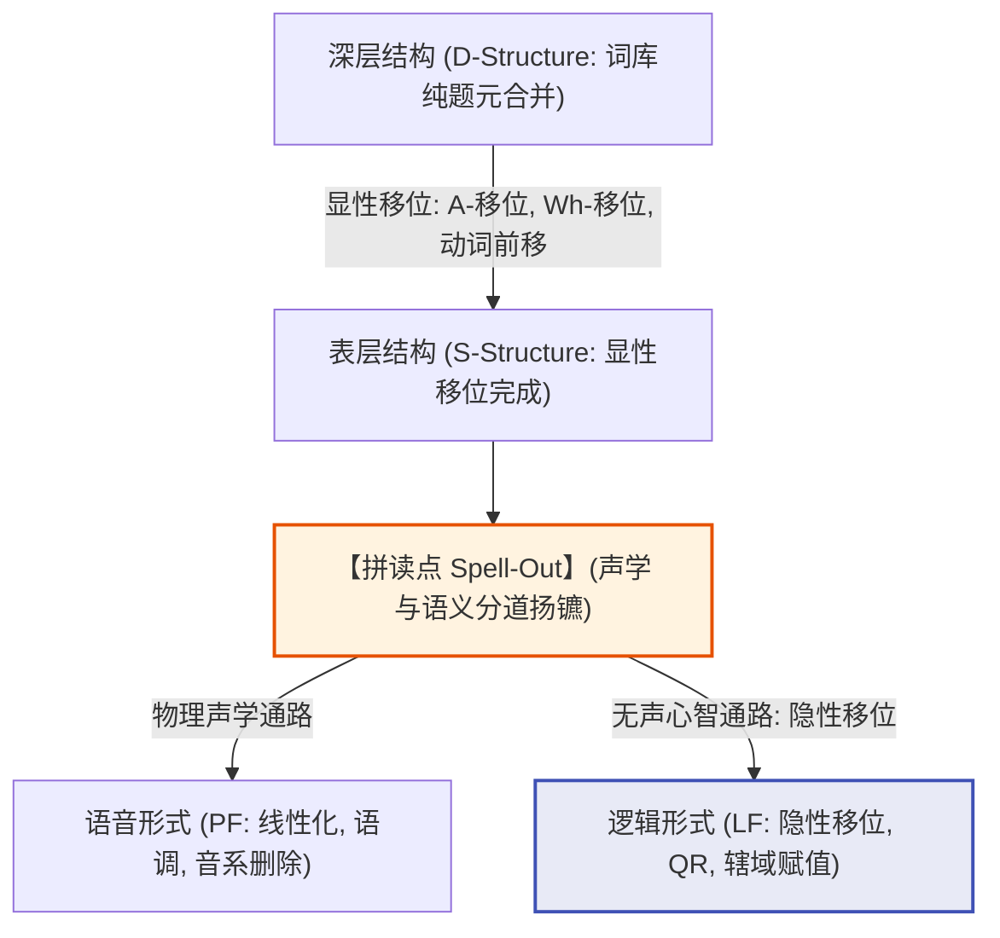
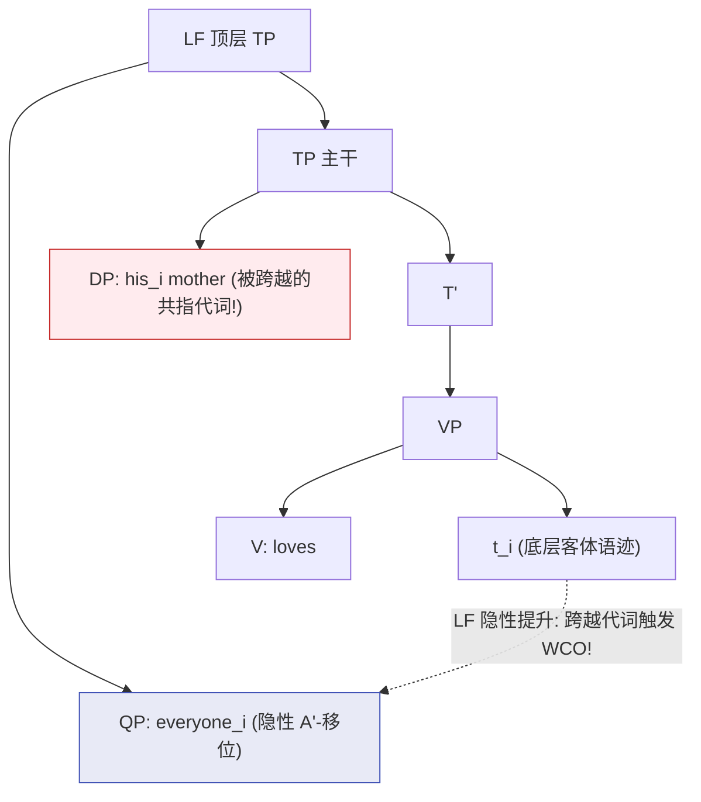

# Lec 13 隐性移位与逻辑形式 (Covert Movement at Logical Form)

在人类语言的感知中，我们直觉上容易认为“看不见的声音便不存在”。然而，经典生成语法的倒 Y-模型（Y-Model）做出了一个惊人的科学预言：**移位运算并不仅限于发声之前的物理世界**。在句法树完成向语音形式（PF）输出并剥离声音信号（Spell-Out）之后，心智计算系统仍然在通往**逻辑形式（Logical Form, LF）**的轨道上继续执行结构重组。

这种在表层不改变物理发音、但在心智深处改变成分统领几何与语义辖域的运算，称为**隐性移位（Covert Movement）**。本讲将系统剖析**量词提升（Quantifier Raising, QR）**、弱交叉效应（Weak Crossover）以及先行词包含删略（ACD），揭示人类心智中无声的句法代数世界。

## TL;DR

- **倒 Y-模型与显性/隐性移位的分野**：显性移位发生在向语音界面拼读（Spell-Out）之前，同时改变声学发音与语义解释；隐性移位发生在拼读之后、送往逻辑形式（LF）界面的通路中，仅改变算子辖域与结合几何，完全保持表层线性语序不变。
- **量词提升（QR）与辖域歧义解构**：双量词句（*Someone loves everyone*）中产生的逆序辖域（$\forall > \exists$）源自量词在 LF 分支发生的隐性 A'-移位，通过附加至高阶 $TP$ 逆向获得成分统领优势。
- **经验实在性的两大终极杀手锏**：弱交叉效应（WCO）在量词句中呈现与显性 Wh-移位完全同构的违规降级，证明 QR 严格遵循 A'-移位句法公理；先行词包含删略（ACD）唯有在 LF 借助 QR 将量词移出矩阵动词短语，才能打破“无限递归死循环”，为隐性移位提供了无可辩驳的几何证明。

## 生成语法的倒 Y-模型架构

在生成语法理论的发展演进中，如何协调“听到的一维声学信号”与“理解的多维逻辑语义”之间的张力，始终是模型构建的核心挑战。Chomsky（1981, 1995）确立了经典生成语法的标准信息流拓扑结构——**倒 Y-模型（Inverted Y-Model，在最简方案早期亦称 T-模型）**。

该模型主张人类心智的句法推导并非单一维度的线性链条，而是在某个特定的分界点发生结构分支。推导最初始于词库中词项的自下而上递归合并（D-Structure），在经历初步的短语构建与显性移位后，生成表层结构（S-Structure）。随后，推导行进至至关重要的**拼读点（Spell-Out）**。在这一分界点上，系统进行信息分流：一份结构副本送往语音形式（PF）进行线性化与发音器官的声学编码；另一份副本则进入无声的认知心智通道，送往逻辑形式（LF）进行形式语义赋值：



在拼读点（Spell-Out）之前发生的一切移位被称为**显性移位（Overt Movement）**，其移位结果既体现在人耳听到的声音顺序上（PF），也体现在逻辑形式的理解上（LF）；而在拼读点之后发生的移位被称为**隐性移位（Covert Movement）**，它发生在大脑内部的逻辑形式通道中，完全不影响 PF 界面听到的线性声学序列。这种二分法为理解自然语言中的无声算子运算奠定了坚实的基础。

## 量词提升（Quantifier Raising, QR）与辖域歧义

考察经典的一阶谓词逻辑多重歧义句：

```text
(1) Someone loves everyone.
```

母语者对该句拥有两种清晰的语义解读：

1. **表层辖域（Surface Scope: $\exists > \forall$）**：
   存在某一个特定的圣人 $x$，这个人爱世界上所有人。
   $$\exists x \, [\text{Person}(x) \land \forall y \, (\text{Person}(y) \to \text{Loves}(x, y))]$$
2. **逆序辖域（Inverse Scope: $\forall > \exists$）**：
   对于世界上的每一个人 $y$，都存在某个爱他的人 $x$（不同的人爱不同的人）。
   $$\forall y \, [\text{Person}(y) \to \exists x \, (\text{Person}(x) \land \text{Loves}(x, y))]$$

在表层句法树中，主语 *someone* 在 $[Spec, TP]$ 处绝对成分统领宾语 *everyone*。表层结构天然推导出了“表层辖域”；但是，**逆序辖域从何而来？**

Robert May（1977, 1985）提出了划时代的**量词提升假说（QR Hypothesis）**：

::: definition [量词提升 (Quantifier Raising, QR)]
在逻辑形式（LF）界面，充当量词短语（Quantifier Phrase, QP）的名词成分必须经历隐性的 **A'-移位**，自下而上附加（Adjoin）到命题投射 $TP$ 或 $vP$ 的顶端，从而建立其形式语义辖域（Scope）。
:::

为了推导逆序辖域，宾语量词短语 *everyone* 在 LF 界面发起隐性 A'-移位，跨越主语附加到了全句 $TP$ 的最高顶端：

```text
(2) LF 逆序拓扑构型:
    [TP [QP everyone_y] [TP [DP someone_x] [vP t_x loves t_y]]]
```

在 (2) 的 LF 树形中，宾语 *everyone* 借助隐性提升，在几何拓扑上成分统领（c-command）了主语 *someone*！这一无声的句法重组，精确推导出了 $\forall > \exists$ 的逆序语义辖域。

## 隐性移位的经验实在性证明

怀疑论者可能会争辩：逆序辖域只是逻辑学家的语义推理游戏，真的存在具有句法实体的“隐性移位”吗？句法学家通过两大严苛测试证明：**QR 绝对是一场真实的句法移位，因为它受到与显性 Wh-移位完全相同的句法公理的制约**。

### 证明一：弱交叉效应（Weak Crossover, WCO）

弱交叉（Weak Crossover, WCO）是理论句法学中用于诊断 A'-移位性质的最具杀伤力的试金石。这一概念最早由 Postal（1971）和 Wasow（1972）提出，用来刻画算子在树形跃迁过程中对未结合代词的非对称跨越。当一个处于底层客体位置的操作子（如疑问词或焦点成分）发生移位，跨越了一个包含共指标记代词的论元（如主语内部的领属代词），且该代词在深层构型中并不成分统领该操作子的底层语迹时，推导将在语义解释界面引发严重的指称崩溃：

```text
(3) 显性 Wh-移位中的弱交叉 (严重非法):
    *Who_i did his_i mother love t_i?
    (无法解读为: "哪个人 x，使得 x 的母亲深爱 x？")
```

在例句 (3) 中，*who* 最终位于最高层的标补词指示语位置，而其底层语迹 $t_i$ 位于动词 *love* 之后。位于主语短语内部的代词 *his* 并不统领 $t_i$，但 *who* 的移位轨迹物理跨越了 *his*，从而构成了经典的弱交叉格局。令人震惊的是，**量词在表层没有显性声学移位的句型中，同样会完全同构地触发一模一样的弱交叉违规**：

```text
(4) 量词环境下的弱交叉对比:
    a. His_i mother loves John_i.            (合法: 代词指代显性实体)
    b. *His_i mother loves everyone_i.       (崩溃! 无法解读为: 对每个人 x，x 的母亲深爱 x)
```

在例句 (4b) 中，表层语序上没有任何移位发生，动词 *loves* 紧跟着宾语 *everyone*。如果不存在隐性移位，(4b) 的违规完全不可理解！

QR 假说为这一现象提供了唯一自洽的句法解释：
- 在 LF 界面，全称量词 *everyone* 必须隐性提升到 $TP$ 顶端；
- 在提升跃迁的过程中，它跨越了与它共指标记的领属性代词 *his*；
- 这一跃迁完全复刻了显性 Wh-移位越过代词的几何拓扑，精准触发了**弱交叉违规（WCO Violation）**！

如下方的树形几何推导所示，移位虽然在发音层面是静默的，但在 LF 界面的拓扑轨道上留下了清晰的交叉几何：



这一经验证据构成了生成语法学中无可辩驳的经典定理：表层看似静态的词串，在深层逻辑形式中完全服从与物理显性移位完全相同的局部性与交叉几何定律。

### 证明二：先行词包含删略（Antecedent-Contained Deletion, ACD）

如果说弱交叉证明了 QR 遵循 A'-移位约束，那么**先行词包含删略（ACD）**则为 QR 提供了数学逻辑上的不可替代性。

考察包含动词短语省略（VP Ellipsis）的复杂句：

```text
(5) John [VP read [every book that Mary did [VP e]]].
```

根据普遍语法关于 VP 省略的等同性拷贝原则，省略的动词短语 $[_{VP} \; e]$ 必须通过向上寻找一个完全同构的**先行词动词短语（Antecedent VP）**来复制填充。

现在审视表层结构中的先行词 VP：
$$\text{Antecedent VP} = [_{VP} \; \text{read } [_{\text{DP}} \; \text{every book that Mary did } [_{VP} \; e]]]$$

**灾难性的死循环爆发了！** 
目标省略的动词短语 $[_{VP} \; e]$ **被物理包含在它的先行词 VP 自身内部**！如果试图拷贝先行词去解析 $[_{VP} \; e]$，被拷贝进来的新结构又会包含一个新的 $[_{VP} \; e]$，导致无限套娃递归崩溃（Infinite Regress）：
$$[_{VP} \; \text{read every book that Mary did } [_{VP} \; \text{read every book that Mary did } [_{VP} \; \text{read } \dots]]]$$

人类的心智为何能在一瞬间无缝理解该句？May（1985）证明，**唯一的数学解药就是量词提升（QR）**：

1. 包含相对从句的整个大量词短语在 LF 界面通过 QR **整体移位脱离矩阵动词短语**，附着到矩阵 $TP$ 之上；
2. 移位之后，矩阵动词短语内部仅留下一个无声的变量语迹 $t_i$：
   $$\text{Matrix VP} = [_{VP} \; \text{read } t_i]$$
3. 此时，先行词动词短语不再包含省略节点！系统可以安全地将 $[_{VP} \; \text{read } t_i]$ 拷贝到从句的 $[_{VP} \; e]$ 中，完美解析为 *Mary read t_i*！

::: theorem [ACD 的 QR 证明 (May 1985)]
先行词包含删略（ACD）在数学上证明了：在语义解释之前，名词量词短语必须在句法几何上物理移出动词短语。如果没有 LF 处的隐性移位，人类语言的解释系统将直接因无限循环而崩溃。
:::

::: pitfall [常见误区：量词提升可以无视孤岛无限远移]
初学者常误以为隐性移位既然是“隐性的”，就可以像超自然现象一样随意跨越从句。实证研究表明：**QR 受到极其严苛的局域性孤岛约束**。在大多数语言中，QR 无法跨越限定从句边界（Finite Clause Boundary）：
- *Someone said [that Mary loves everyone].*
此句中 *everyone* 极难跨越从句边界逆序统领主句的 *someone*。隐性移位与显性移位共享相同的近邻性与相不可渗透性限制。
:::

::: insight [深度洞见：句法学的“哥白尼革命”——声学发音的边缘化]
在古典经验主义视角下，语言就是声音的物理组合。但逻辑形式（LF）与隐性移位的确立，完成了生成句法学对传统语言观念的彻底颠覆：

**发音只是语言的边缘附属物，而句法几何才是心智语义的唯一主宰。**

拼读点（Spell-Out）不过是计算流水线上的一个过路收费站，它把一部分结构信息渲染成声带的物理振动抛给外界，而真正负责深层概念整合与命题逻辑赋值的心智内核，仍在无声的 LF 维度高速执行着树形重构与相运算。无声的句法，才是自然语言最磅礴的实在。
:::

## 显性移位与隐性移位综合对照表

| 对比维度 | 显性移位 (Overt Movement) | 隐性移位 (Covert Movement / QR) |
| :--- | :--- | :--- |
| **发生推导阶段** | 拼读点之前（D-Structure $\to$ S-Structure） | 拼读点之后（S-Structure $\to$ LF） |
| **对发音的影响 (PF)** | **直接改变表层声学线性顺序** | **绝不改变发音，保持原位发声** |
| **对语义的影响 (LF)** | 赋予新的算子位置与语义辖域 | **赋予新的算子位置与语义辖域** |
| **弱交叉效应 (WCO)** | 严格触发（*Who did his mother love?*） | **严格触发（*His mother loves everyone*）** |
| **孤岛与相局域性** | 严格受制于相边界与罗斯孤岛公理 | 严格受制于限定从句边界与相不可渗透性 |
| **经典典型代表** | Wh-移位、局部主题化、主谓倒装 | 量词提升（QR）、Wh-原位词隐性提升（汉语） |
